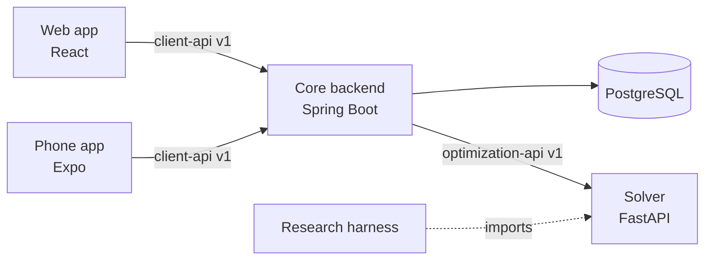

<div align="center">

# DispatchFlow

**Daily delivery-route planning and live re-planning for one delivery company with 2–15 vehicles.**

[](https://github.com/NaimElijah/DispatchFlow/actions/workflows/ci.yml)

[Requirements](docs/requirements/requirements.md) · [Architecture](docs/architecture/architecture.md) · [ADRs](docs/ADRs/README.md) · [Board](https://github.com/users/NaimElijah/projects/9)

</div>

## What and why

DispatchFlow is built for one delivery company. Planning routes by hand, in spreadsheets or in the
dispatcher's head costs extra kilometres and missed delivery windows, with no way to adapt when a
van breaks down at 10:00. DispatchFlow assigns the day's
orders to vehicles and orders each route so that deliveries land in their time windows and no
vehicle exceeds its capacity or its driver's shift. During the day it re-plans the remaining
stops when something goes wrong. Underneath, this is the Vehicle Routing Problem with Time
Windows, solved with Google OR-Tools and with our own Clarke-Wright + ALNS solver as a measured
research track.

It deliberately does not use live traffic data, handle payments, provide turn-by-turn navigation
(both apps hand off to Waze or Google Maps), or serve more than one company or
enterprise-scale fleets.

> [!IMPORTANT]
> **Pre-alpha: the repository holds working skeletons, not features yet.** Every component builds
> and passes its tests with `just check`; CI runs the same recipes but has not run on GitHub yet.
> None of the planning capabilities exists in code. What the system
> must do is in [requirements.md](docs/requirements/requirements.md); what exists today is listed
> under [Status and limitations](#status-and-limitations).

This README is ordered for contributors, so Quick start comes before Architecture.

## Quick start

**Prerequisites**

| Tool | Version | Used for |
|---|---|---|
| Git | any recent | |
| JDK | 21 (`.java-version`) | `src/backend/core` |
| Node.js | 24 LTS (`.nvmrc`) | both frontends, contract lint |
| uv | 0.12+ | both Python projects; installs Python 3.14 (`.python-version`) by itself |
| Docker | running daemon | core's integration tests, `just core-run`, `just audit` |
| just | 1.59 | every command below |

Install `just` through uv, which you already have:

```bash
uv tool install rust-just==1.59.0
```

Then, from a clean clone:

```bash
git clone https://github.com/NaimElijah/DispatchFlow.git && cd DispatchFlow
just setup    # install every component's dependencies
just check    # everything CI checks
```

Start a component:

```bash
just core-run         # core backend on :8080, against a throwaway PostgreSQL container
just solver-run       # solver on :8000, reloading on change
just console-run      # web app (Vite dev server; it prints the URL)
just driver-app-run   # phone app (Expo dev server for phones and the browser)
```

Success looks like this:

```bash
curl http://localhost:8080/actuator/health   # {"groups":["liveness","readiness"],"status":"UP"}
curl http://localhost:8000/health/liveness   # {"status":"UP"}
```

> [!NOTE]
> The first `just core-check` or `just core-run` pulls the PostgreSQL 18.6 image, which can take a
> few minutes. On Windows, `just` runs recipes in Windows PowerShell, so
> `C:\Windows\System32\WindowsPowerShell\v1.0` must be on your `PATH`. It is by default; if `just`
> reports that it cannot find `powershell.exe`, restore Windows' default `PATH` entries.

## Architecture



- **Core backend** (`src/backend/core`) is the system of record and the only API the clients
  call. It owns users, fleets, orders, plans and their lifecycle.
- **Solver** (`src/backend/solver`) turns a routing problem into routes. Every solver sits behind
  one `Solver` port and is chosen by name; every solution passes a shared feasibility validator
  before it leaves the service ([ADR-004](docs/ADRs/ADR-004-pluggable-solver-port.md)).
- **Web app** (`src/frontend/console`) and **phone app** (`src/frontend/driver-app`, iOS and
  Android from one codebase) each serve Admins, Dispatchers and Drivers
  ([ADR-035](docs/ADRs/ADR-035-both-apps-serve-every-role.md)). A driver in the web app works
  online only.
- **Research** (`src/research`) benchmarks the solvers against each other. It is never deployed,
  and it is the only place PyVRP is installed.

Components meet only at the versioned OpenAPI contracts in `contracts/`. Inside each service,
dependencies point one way: the domain imports no framework, I/O or transport types, and
adapters depend on the domain.

The planned main path: a dispatcher requests a solve, the core backend queues a solve job, sends
the day's orders, fleet and travel times to the solver, validates and stores the returned routes,
and notifies the web app. None of these calls exists in code yet. Today the solver answers its
liveness probe, the core its health probe, and the two apps render a heading.

The repository layout and the dependency rules: [code-structure.md](docs/architecture/code-structure.md).
[architecture.md](docs/architecture/architecture.md) is still a stub. Decisions and their reasons:
[docs/ADRs/](docs/ADRs/README.md).

## Tech stack

| Layer | Technology | Version | Why |
|---|---|---|---|
| Core backend | Java, Spring Boot, Spring Data JPA | 21, 4.1.2 | The team's strongest stack; mature ecosystem for the adapters |
| Database | PostgreSQL 18.6; Flyway (version from the Spring Boot parent) | 18.6 | Relational data with real constraints; versioned SQL migrations |
| Solver | Python, FastAPI | 3.14, 0.162 | OR-Tools' richest bindings; algorithm work iterates apart from the backend |
| Web app | React, TypeScript, Vite | 19.3, 6.0, 8.3 | Web app for every role; its driver screens also work in a phone's browser |
| Phone app | React Native, Expo | 0.88, SDK 58 | One codebase for iOS and Android, for every role |
| Contracts | OpenAPI, Redocly CLI | 3.1, 2.72 | Each side is built against the contract, not against the other side |
| Tests | JUnit + Testcontainers, pytest, Vitest, Jest | | Real PostgreSQL in tests, never an in-memory stand-in |
| Tooling | just, uv, npm, OSV-Scanner | 1.59, 0.12, 11, 2.7 | One command set locally and in CI; one audit across every ecosystem |

TypeScript is held at 6.0 because typescript-eslint does not support 7 yet
([ADR-012](docs/ADRs/ADR-012-javascript-tooling-npm-eslint-prettier.md)).

## Configuration

`just core-run` needs no configuration: it starts its own database. To run the core jar against a
real database, set these environment variables. `src/backend/core/.env.example` lists them; Spring
Boot does not read a `.env` file itself, so export them, or pass the file to Docker with
`docker run --env-file .env`.

| Variable | Purpose | Default | Required |
|---|---|---|---|
| `SPRING_DATASOURCE_URL` | JDBC URL of the PostgreSQL database | none | Yes |
| `SPRING_DATASOURCE_USERNAME` | Database user | none | Yes |
| `SPRING_DATASOURCE_PASSWORD` | Database password | none | Yes |

`.env` files are ignored by git. Never commit real values.

## Development

**Branches and pull requests.** `main` is production and `dev` is development. Branch off `dev`
as `type/short-kebab-description` (for example `feat/order-csv-import`) and open the pull request
back into `dev`. Pull requests are squash-merged, so the title is the commit: write it as a
[Conventional Commit](https://www.conventionalcommits.org/), `type(scope): imperative subject`.
Fill in the template and link the issue with `Closes #N`. `dev` reaches `main` through a merge
commit, never a squash.

**Every component has the same verbs:**

| Command | What it does |
|---|---|
| `just <component>-setup` | Install that component's dependencies |
| `just <component>-check` | Everything CI checks for it |
| `just <component>-format` | Reformat its code |
| `just <component>-run` | Start it (core, solver, console, driver-app) |

The components are `core`, `solver`, `research`, `console` and `driver-app`. `just` lists every
recipe; `just check` and `just format` run them all.

**Adding a feature end to end:** start from the requirement it delivers in
[requirements.md](docs/requirements/requirements.md); change the contract in `contracts/` first;
implement the domain, then the use case, then the adapter in `src/backend/core` (and in the solver
if it needs new solving behaviour); then the client screens; tests at each layer; and update the
requirements, architecture and ADRs in the same pull request.

Rules for code, tests and commits are in [.claude/CLAUDE.md](.claude/CLAUDE.md), with backend and
frontend specifics in `src/backend/CLAUDE.md` and `src/frontend/CLAUDE.md`, and each component's
own rules and commands in a `CLAUDE.md` inside it. `.claude/agents/` holds four team agents, for
code review, security review, debugging and tests. `.claude/skills/` holds three team skills for the
branch workflow: finishing work into a pull request, syncing with `dev`, and acting on review
comments. The rules apply to people and to coding assistants alike.

## Testing

| Layer | Covers | Command |
|---|---|---|
| Core unit (`*Test`) | Domain and use cases, no I/O (none yet: no bounded context exists) | `just core-check` |
| Core integration (`*IT`) | Against a real PostgreSQL in a container | `just core-check` |
| Solver | HTTP adapter, dependency boundary | `just solver-check` |
| Research | Its environment: the solver and PyVRP are installed | `just research-check` |
| Web app | Components in jsdom (Vitest + Testing Library) | `just console-check` |
| Phone app | Components (Jest + React Native Testing Library) | `just driver-app-check` |
| Contracts | Both OpenAPI documents lint clean | `just contracts-check` |
| Dependencies | Known vulnerabilities in every lockfile and the pom | `just audit` |

Test names follow Given/When/Then. CI runs every row above, on every push and on every pull
request into `dev` and `main`; any red job fails the run. Browser end-to-end tests (`tests/e2e`)
and load tests (`tests/load`) have folders but no tests yet. There is no coverage threshold.

## Project structure

```text
src/
  backend/core/        REST API and system of record (Spring Boot)
  backend/solver/      solver service (FastAPI)
  frontend/console/    web app (React + Vite)
  frontend/driver-app/ phone app (Expo)
  research/            benchmarks, simulation, order generator; never deployed
contracts/             versioned OpenAPI contracts between the components
tests/                 cross-component tests only: e2e/, load/
infra/                 road-network data (osrm/) and deployment (deploy/)
logs/                  local log output; git ignores its contents
docs/                  requirements, architecture, ADRs, presentations
justfile               every command, the same locally and in CI
```

## Design decisions

**Domain-driven design, built as ports and adapters**
([ADR-001](docs/ADRs/ADR-001-domain-driven-design-with-hexagonal-architecture.md)): business
rules import no framework, database or network type, so they are tested without any of them.
Cost: mapping between domain objects, database entities and API types.

**A Java core and a separate Python optimization service**
([ADR-002](docs/ADRs/ADR-002-core-backend-and-separate-optimization-service.md)): the solvers run
in Python, beside OR-Tools' richest API and the research tooling, while the core keeps the data.
Cost: two languages, and one more service to run.

**Every solver behind one port** ([ADR-004](docs/ADRs/ADR-004-pluggable-solver-port.md)): solvers
are chosen by name and judged by one validator and one objective, so OR-Tools and our solver are
compared on equal terms. Cost: the shared problem model must fit both solvers.

**OR-Tools first, our own solver as research**
([ADR-005](docs/ADRs/ADR-005-or-tools-first-research-solver-for-re-optimization.md)): the product
never waits on research. Cost: the research solver must earn its place in measured benchmarks.

**One command runner, one workflow** ([ADR-009](docs/ADRs/ADR-009-just-as-the-single-entry-point.md),
[ADR-015](docs/ADRs/ADR-015-ci-one-workflow-one-job-per-component.md)): CI calls the same `just`
recipes developers run, and jobs are never skipped by path filters, so a required check never
hangs. Cost: every contributor installs `just`, and CI builds every component on every push.

The other decisions, including the repository layout, the two clients and the tooling, are in
the [ADR index](docs/ADRs/README.md).

## Status and limitations

**Pre-alpha.** Shipped: a skeleton for each of the five components, with its build, formatter,
linter, tests and CI job; the two contracts; and the solver's and the core backend's health
probes.

Planned, in the order of the [requirements](docs/requirements/requirements.md):
users and roles; fleet, customers and orders; the daily solve on OR-Tools; the route map;
publishing to drivers and the phone app's stop flow; SMS messages to recipients; live tracking and
re-optimization; and our own solver with its benchmark study.

Known limitations:

- Nothing is deployed; there is no staging or production environment yet.
- `docker compose` is not set up; each component runs on its own until a service needs another.
- Four vulnerabilities in the frontends' build, lint and test tooling are ignored by the audit
  until 2027-01-31. The zod and deepmerge entries still await the owner's review. The reasons are
  in `src/frontend/console/osv-scanner.toml` and `src/frontend/driver-app/osv-scanner.toml`
  ([ADR-016](docs/ADRs/ADR-016-dependency-audit-with-osv-scanner.md),
  [ADR-023](docs/ADRs/ADR-023-accept-minimatch-and-glob-advisories.md)).

## Contributing

Work starts from an issue on the [board](https://github.com/users/NaimElijah/projects/9). Use the
issue templates (feature, bug, spike) and the pull request template. Run `just check` before you
push.

## Licence

Proprietary, all rights reserved. See [LICENSE](LICENSE)
([ADR-017](docs/ADRs/ADR-017-proprietary-licence.md)).
