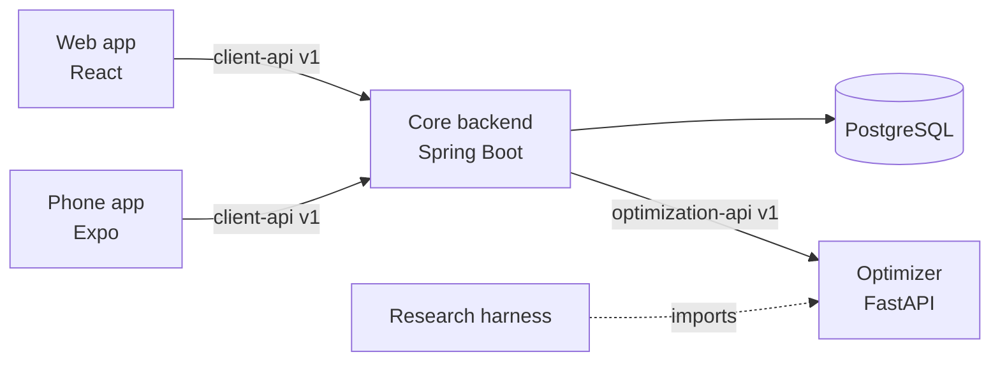

<div align="center">

# DispatchFlow

**Daily delivery-route planning and live re-planning for one delivery company with 2–15 vehicles.**

[](https://github.com/NaimElijah/DispatchFlow/actions/workflows/ci.yml)

[Requirements](docs/requirements/requirements.md) · [Architecture](docs/architecture/architecture.md) · [Domain design](docs/architecture/domain_layer/domain_layer_design.md) · [Tech stack](docs/architecture/tech_stack.md) · [Roadmap](docs/roadmap.md) · [ADRs](docs/ADRs/README.md) · [Board](https://github.com/users/NaimElijah/projects/9)

</div>

## What and why

DispatchFlow is built for one delivery company. Planning routes by hand, in spreadsheets or in the
dispatcher's head costs extra kilometres and missed delivery windows, with no way to adapt when a
vehicle breaks down at 10:00. DispatchFlow assigns the day's
orders to vehicles and orders each route so that deliveries land in their time windows and no
vehicle exceeds its capacity or its driver's shift. During the day it re-plans the remaining
stops when something goes wrong. Underneath, this is the Vehicle Routing Problem with Time
Windows, solved with Google OR-Tools and with our own Clarke-Wright + ALNS solver as a measured
research track.

It deliberately does not use live traffic data, handle payments, provide turn-by-turn navigation
(both apps hand off to Waze or Google Maps), or serve more than one company or
enterprise-scale fleets.

> [!IMPORTANT]
> **Pre-alpha: the repository holds working skeletons, the domain layer, the core's persistence and a
> declared application layer, not features yet.**
> Every component builds and passes its tests with `just check`, and CI runs the same recipes on
> every push and on every pull request into `dev` or `main`. The application layer is declared but
> not built, beyond the audit log, so the other persistence adapters have no caller yet and none of
> the planning capabilities can be used.
> What the system must do is in [requirements.md](docs/requirements/requirements.md); what exists
> today and what comes next are under [Status and limitations](#status-and-limitations).

This README is ordered for contributors, so Quick start comes before Architecture.

## Quick start

**Prerequisites**

| Tool | Version | Used for |
|---|---|---|
| Git | any recent | |
| JDK | 25 (`.java-version`) | `src/backend/core` |
| Node.js | 24 LTS (`.nvmrc`) | both frontends, contract lint |
| pnpm | 12.23.0 (`packageManager` in `src/frontend/package.json`) | the web app and the shared packages |
| uv | 0.12+ | both Python projects; installs Python 3.14 (`.python-version`) by itself |
| Docker | Docker Desktop on Windows and macOS; on Linux, Engine 28.3.3 or later, whose fix keeps a port published on `127.0.0.1` off the network after a firewalld reload (CVE-2025-54388) | core's integration tests, `just core-run`, `just audit`, `just infra-check`, the whole stack |
| just | 1.59 | every command below |
| unzip | any, on Linux and macOS | the Maven wrapper, which checks Maven's zip against its pinned SHA-256 and, without unzip, fetches a .tar.gz that fails the check |

Point `JAVA_HOME`, and your IDE's Java SDK, at that JDK 25: the core does not build on an older one.

Install `just` through uv, which you already have:

```bash
uv tool install rust-just==1.59.0
```

Install pnpm with npm, which comes with Node:

```bash
npm install --global pnpm@12.23.0
```

Then, from a clean clone:

```bash
git clone https://github.com/NaimElijah/DispatchFlow.git && cd DispatchFlow
just setup    # install every component's dependencies
just check    # everything CI checks
```

Start a component:

```bash
just core-run         # core backend on 127.0.0.1:8080, against a throwaway PostgreSQL container
just optimizer-run    # optimizer on :8000, reloading on change
just web-run          # web app (Vite dev server; it prints the URL)
just mobile-run       # phone app (Expo dev server for phones and the browser)
```

Success looks like this:

```bash
curl http://localhost:8080/actuator/health   # {"groups":["liveness","readiness"],"status":"UP"}
curl http://localhost:8000/health/liveness   # {"status":"UP"}
```

Or start the whole stack, each service in its container, every port on `127.0.0.1`
([ADR-151](docs/ADRs/ADR-151-the-dev-stack-runs-the-core-as-a-compose-service-and-the-core-checks-its-database-session.md)):

```bash
cp infra/deploy/.env.example infra/deploy/.env    # then fill in its three passwords
just data                                         # once: the map's files for Be'er Sheva, into data/tiles/ (about 22 MB)
just dev                                          # build, start, wait until healthy, then watch
```

The three passwords must each be filled in, and the two roles' passwords must differ; make all
three differ, as `.env.example` says. A first start that stopped on them leaves the database
without its roles, so run `just db-reset` before `just dev` again.

| Command | What it does |
|---|---|
| `just dev` | Builds and starts every service, waits until each one is healthy and the migrate step has finished, prints where each listens, then watches for edits |
| `just dev-down` | Stops the stack and removes its containers; the database stays for the next `just dev`. Stop the watch first |
| `just db-reset` | Stops the stack and deletes its database, after asking, so the next `just dev` migrates an empty one. A password changed in `.env` needs it |

`just dev` and `just dev-down` stop with a message while `infra/deploy/.env` is missing, and
`just db-reset` does once you've answered its question. Every checkout and worktree of the
repository runs the same stack and database, so `just db-reset` in any of them deletes it.

The web app is on http://localhost:5173, and proxies `/api/` to the stack's core, which the
laptop also reaches on 127.0.0.1:8080, and `/map/` to the tiles service, which the laptop reaches
on 127.0.0.1:8090. The tiles service serves what `just data` built: run it once before the first
`just dev`, or every `/map/` file answers 404. `just data` needs Docker Desktop, on Windows or
macOS; a native Linux Docker is untested. `just dev` starts the tiles service under the
`data` profile, and `just infra-check` doesn't, because its files are git-ignored (ADR-152). The
optimizer is on 127.0.0.1:8081, and PostgreSQL on 127.0.0.1:5432. A laptop that runs a PostgreSQL
of its own on 5432 sets
`DISPATCHFLOW_POSTGRES_HOST_PORT` in that `.env`. While `just dev` watches, an edit to the web app
or the optimizer is copied into its container, which reloads it. Ctrl+C stops the watch, which just
reports as a failed recipe, and leaves the stack running; a change to the core needs Ctrl+C, then
`just dev` again. Stop the watch before `just dev-down`: one left running rebuilds and starts a
service again when its lockfile or manifest changes. Compose watches a project once, so a
second `just dev` beside a running one rebuilds, runs the migrate step and restarts the core,
then stops with an error at its watch.
`docker compose -f infra/deploy/compose.dev.yaml logs -f core` follows one service's log. The stack
starts with no fleet and no orders, and its core's stand-in session signs the laptop's own calls in
as the seeded Dispatcher (see [Configuration](#configuration)). Checked on Windows with Docker
29.9.3 and Compose v5.7.1.

```bash
curl http://localhost:8080/actuator/health   # the stack's core: {"groups":["liveness","readiness"],"status":"UP"}
curl http://localhost:8081/health/liveness   # the stack's optimizer: {"status":"UP"}
```

The stack and `just core-run` or `just web-run` share ports 8080 and 5173, so run one or the other.
To debug the core in the IDE, stop the stack's two with
`docker compose -f infra/deploy/compose.dev.yaml stop core web`, then run `TestDispatchFlowApplication`
(what `just core-run` starts) and `just web-run` on the laptop.

> [!NOTE]
> The first `just core-check` or `just core-run` pulls the PostgreSQL 18.7 image, which can take a
> few minutes. On Windows, `just` runs recipes in Windows PowerShell, so
> `C:\Windows\System32\WindowsPowerShell\v1.0` must be on your `PATH`. It is by default; if `just`
> reports that it cannot find `powershell.exe`, restore Windows' default `PATH` entries.

## Architecture



- **Core backend** (`src/backend/core`) is the system of record and the only API the clients
  call. It holds one module per bounded context: Access, Fleet, Customers & Orders, Planning,
  Live Operations, Recipient Messaging, Reporting and Audit
  ([domain design](docs/architecture/domain_layer/domain_layer_design.md#1-subdomains-and-bounded-contexts)).
  Each module's domain is built. Its application layer is declared, with bodies that throw, but
  for Audit's audit log and its refusal helper
  ([ADR-119](docs/ADRs/ADR-119-the-application-layer-is-declared-ahead-as-signatures-whose-bodies-throw.md); the conventions are in
  [ADR-120](docs/ADRs/ADR-120-the-application-layer-takes-an-actor-and-a-call-context-and-reads-through-query-ports.md)), and its built adapters store each module's aggregates in its own PostgreSQL schema
  ([data model](docs/architecture/data-model.md)), and the kernel's give the clock, new IDs and
  the error bodies; its other adapter packages are declared, empty
  ([ADR-130](docs/ADRs/ADR-130-every-folder-is-declared-ahead-empty-and-documented.md)). A folder that passes
  20 files splits wherever four of its files can move, a domain by aggregate
  ([ADR-118](docs/ADRs/ADR-118-a-domain-package-above-30-files-splits-by-aggregate.md),
  [ADR-125](docs/ADRs/ADR-125-a-folder-above-20-files-splits-wherever-a-group-of-four-can-move.md)).
- **Optimizer** (`src/backend/optimizer`) turns a routing problem into routes. Every solver sits behind
  one `Solver` port and is chosen by name; every solution passes a shared feasibility validator
  before it leaves the service ([ADR-004](docs/ADRs/ADR-004-pluggable-solver-port.md)).
- **Web app** (`src/frontend/web`) and **phone app** (`src/frontend/mobile`, iOS and
  Android from one codebase) each serve Admins, Dispatchers and Drivers
  ([ADR-035](docs/ADRs/ADR-035-both-apps-serve-every-role.md)). A driver in the web app works
  online only.
- **Research** (`src/research`) benchmarks the solvers against each other. It is never deployed,
  and it is the only place PyVRP is installed.

Components meet only at the versioned OpenAPI contracts in `contracts/`. Inside each service,
dependencies point one way: the domain imports no framework, I/O or transport types, and
adapters depend on the domain.

None of the calls between components exists in code yet. Today the optimizer answers its liveness
probe, the core its health probe, the web app its shell (navigation, routes, and English, or Hebrew
right to left once its Settings page says so), and the phone app a heading; the domain layers, in
the core and in the optimizer, are built and tested, and their application layers are declared but
not built.
The core's persistence adapters store every module's aggregates in PostgreSQL. Only the audit log,
which every changing call will write through, calls one.
[architecture.md](docs/architecture/architecture.md) describes that system as it is, and
[code-structure.md](docs/architecture/code-structure.md) the repository layout.

The decided design is the domain document, the tech stack and the ADRs, which the team builds
from, with the [roadmap](docs/roadmap.md) for dates:

- [domain_layer_design.md](docs/architecture/domain_layer/domain_layer_design.md): the bounded
  contexts, aggregates, events and the rules between them. Where the tech stack disagrees with
  it, it wins.
- [tech_stack.md](docs/architecture/tech_stack.md): every tool and version, why it won, and the
  milestone it is adopted at.
- [docs/ADRs/](docs/ADRs/README.md): each decision and its reasons.

The main path: a dispatcher requests a solve, the core queues a solve job, sends the whole
problem with its travel-time matrix to the optimizer, keeps only a validated result, and pushes
progress to the web app over server-sent events
([ADR-052](docs/ADRs/ADR-052-each-plan-stores-the-matrix-and-values-it-was-solved-with.md),
[ADR-044](docs/ADRs/ADR-044-solver-port-takes-start-budget-and-seed-and-problem-judges.md),
[ADR-026](docs/ADRs/ADR-026-server-sent-events-and-push-for-live-updates.md)).

## Tech stack

| Layer | Technology | Version | Why |
|---|---|---|---|
| Core backend | Java, Spring Boot, Spring Data JPA; libphonenumber, JTS, JSpecify; uuid-creator | 25, 4.1.2; 9.0.43, 1.20.0, version from the Spring Boot parent; 6.1.1 | The team's strongest stack; mature ecosystem for the adapters. libphonenumber parses phone numbers and JTS checks the service area, both in the pure domain; JSpecify marks null-safe packages; uuid-creator makes the UUIDv7 IDs, which the JDK can't |
| Database | PostgreSQL 18.7; Flyway (version from the Spring Boot parent) | 18.7 | Relational data with real constraints; versioned SQL migrations |
| Optimizer | Python, FastAPI, NumPy | 3.14, 0.162, 2.5.4 | OR-Tools' richest bindings; algorithm work iterates apart from the backend; NumPy holds the validator's arrays |
| Web app | React, TypeScript, Vite; TanStack Router, Query and Table, Mantine, i18next; React Hook Form, Zod, libphonenumber-js | 19.3, 6.0, 8.3; 1.170, 5.108, 9.3, 9.8, 27.2; 7.92, 4.6, 1.13 | Web app for every role; its driver screens also work in a phone's browser. Typed routes, an in-memory server cache, right to left through one provider, one strings package for both apps, and forms whose schemas both apps share |
| Phone app | React Native, Expo | 0.88, SDK 58 | One codebase for iOS and Android, for every role |
| Contracts | OpenAPI, Redocly CLI | 3.1, 2.72 | Each side is built against the contract, not against the other side |
| Tests | JUnit + Testcontainers, ArchUnit, pytest + Hypothesis, vrplib, import-linter, Vitest, MSW, user-event, Jest | ArchUnit 1.5.1, Hypothesis 6.170, vrplib 2.2.0, import-linter 2.16, MSW 3.0, user-event 14.6 | Real PostgreSQL in tests, never an in-memory stand-in; ArchUnit, import-linter and ruff keep each domain pure; vrplib reads the Solomon instances the validator is checked against |
| Tooling | just, uv, pnpm (web app), npm (phone app), OSV-Scanner | 1.59, 0.12, 12.23, 11, 2.7 | One command set locally and in CI; one audit across every ecosystem |

TypeScript is held at 6.0 because typescript-eslint does not support 7 yet
([ADR-039](docs/ADRs/ADR-039-one-pnpm-workspace-for-both-apps-and-shared-packages.md)).

This table is what the code uses today. [tech_stack.md](docs/architecture/tech_stack.md) decides
the stack for the Alpha and after, and ADR-038 to ADR-047 (Accepted, in the
[ADR index](docs/ADRs/README.md)) record where it departs from today's: Spring Modulith, mise,
and the phone app's move to pnpm. Spring Modulith and mise are not in the tree yet; each lands
with the milestone that needs it. ADR-039's pnpm workspace in `src/frontend` already holds the
web app and the shared packages, and the phone app joins it at M10. ADR-038's Java 25 is already in the tree, and
[ADR-123](docs/ADRs/ADR-123-the-code-keeps-its-grouped-layout-and-three-components-take-new-names.md)
keeps the layout and renames three components, which the tree already uses.

## Configuration

`just core-run` needs no configuration: it starts its own database, and runs the `dev` profile,
whose stand-in session signs in as the seeded Dispatcher every call to `localhost` or `127.0.0.1`
from the web app's own origin or from a client that is no browser, until sign-in exists
([ADR-147](docs/ADRs/ADR-147-the-stand-in-condition-sits-in-the-root-package-and-a-refused-access-token-answers-one-code.md),
[ADR-148](docs/ADRs/ADR-148-the-stand-in-serves-only-its-own-origin-every-unsigned-api-call-answers-401-and-the-guard-outlives-the-session.md)).
It listens on `127.0.0.1` alone, so the phone app reaches it as `localhost`: the iOS simulator does
so itself, and an Android emulator or device through `adb reverse tcp:8080 tcp:8080`.
To try another role for one run, set the stand-in's entry on that command alone, as
`DISPATCHFLOW_STANDIN_ACCOUNT=driver just core-run`, or `admin`: don't export it, because the core
refuses to boot with it set under any other profile. To run the core jar against a real database, the database needs the two roles that `infra/deploy/postgres/initdb/create-roles.sql`
creates from `DISPATCHFLOW_OWNER_PASSWORD` and `DISPATCHFLOW_APP_PASSWORD`
(`infra/deploy/.env.example`). First run the `migrate` command with the variables below set to
`dispatchflow_owner`: it applies the migrations and exits, non-zero when one fails. Then start the
core with them set to `app`
([ADR-145](docs/ADRs/ADR-145-the-migrate-command-runs-flyway-as-the-owner-and-the-core-connects-as-app.md)).
Keep the two in separate files, so the core never gets the owner's password: with the image that
`src/backend/core/Dockerfile` builds, `docker run --env-file migrate.env <image> migrate`, then
`docker run --env-file core.env <image>`. With a jar that `./mvnw package` builds, load each file in
a subshell, for example `(set -a; . ./migrate.env; java -jar target/core-<version>.jar migrate)`,
rather than typing a password into an `export`.
`src/backend/core/.env.example` lists the core's; Spring Boot does not read a `.env` file itself, so
export them, or pass the file to Docker with `docker run --env-file .env`.

| Variable | Purpose | Default | Required |
|---|---|---|---|
| `SPRING_DATASOURCE_URL` | JDBC URL of the PostgreSQL database | none | Yes |
| `SPRING_DATASOURCE_USERNAME` | Database user: `app` for the core, `dispatchflow_owner` for `migrate` | none | Yes |
| `SPRING_DATASOURCE_PASSWORD` | That user's password | none | Yes |

`.env` files are ignored by git. Never commit real values.

## Development

**Branches and pull requests.** `main` is production and `dev` is development. Branch off `dev`
as `type/short-kebab-description` (for example `feat/order-csv-import`) and open the pull request
back into `dev`. Pull requests are squash-merged, so the title is the commit: write it as a
[Conventional Commit](https://www.conventionalcommits.org/), `type(scope): imperative subject`.
Fill in the template and link the issue with `Closes #N`. `dev` reaches `main` through a merge
commit, never a squash.

**Every component has the same verbs:**

| Command | What it does |
|---|---|
| `just <component>-setup` | Install that component's dependencies |
| `just <component>-check` | Everything CI checks for it |
| `just <component>-format` | Reformat its code |
| `just <component>-run` | Start it (core, optimizer, web, mobile) |

The components are `core`, `optimizer`, `research`, `web` and `mobile`. `just` lists every
recipe; `just check` and `just format` run them all. The `web` recipes run from the pnpm
workspace in `src/frontend`, so they also set up and check the shared packages. `just infra-check`
and `just infra-format` cover the development stack in `infra/deploy`, which `just dev`,
`just dev-down` and `just db-reset` run.

**Adding a feature end to end:** start from the requirement it delivers in
[requirements.md](docs/requirements/requirements.md), the aggregate that owns its rule in the
[domain design](docs/architecture/domain_layer/domain_layer_design.md#4-aggregates-context-by-context),
and the milestone it belongs to in the
[roadmap](docs/roadmap.md#2-milestones);
change the contract in `contracts/` first;
implement the domain, then the use case, then the adapter in `src/backend/core` (and in the optimizer
if it needs new solving behaviour); then the client screens; tests at each layer; and update the
requirements, architecture and ADRs in the same pull request.

Rules for code, tests and commits are in [.claude/CLAUDE.md](.claude/CLAUDE.md), with backend and
frontend specifics in `src/backend/CLAUDE.md` and `src/frontend/CLAUDE.md`, and each component's
own rules and commands in a `CLAUDE.md` inside it. `.claude/agents/` holds four team agents, for
code review, security review, debugging and tests. `.claude/skills/` holds three team skills for the
branch workflow: finishing work into a pull request, syncing with `dev`, and acting on review
comments. The rules apply to people and to coding assistants alike.

## Testing

| Layer | Covers | Command |
|---|---|---|
| Core unit (`*Test`) | Domain and use cases, no I/O. Today: the shared kernel's values, the eight modules' domains, the ArchUnit rules (purity, shape, package structure, the application layer's shape and the JPA mapping), the clock and ID adapters, the problem factory, and `web`'s trace filter, error handlers and call wrapper, and Audit's audit log and refusal helper; every other use case is declared and not built, so none has a behaviour test yet | `just core-check` |
| Core integration (`*IT`) | Against a real PostgreSQL in a container. Today: the application starts, each module's aggregates are saved and loaded, with a damaged stored value refused, the shared version helper's saves, conflicts and storing of the kernel's values are checked, the audit trail is append-only for `app` and its purge deletes nothing a year old or younger, the audit log's records commit or roll back with their transaction, and `web`'s pieces are wired in the whole application | `just core-check` |
| Optimizer | The domain (the validator's crafted-violation catalogue, Hypothesis properties, Solomon best-known solutions accepted), the HTTP adapter, the dependency boundary and import-linter | `just optimizer-check` |
| Research | Its environment: the optimizer and PyVRP are installed | `just research-check` |
| Web app | Components in jsdom (Vitest + Testing Library), with MSW failing any request no handler answers; the shared packages' lint, format and tests | `just web-check` |
| Phone app | Components (Jest + React Native Testing Library) | `just mobile-check` |
| Contracts | Both OpenAPI documents lint clean | `just contracts-check` |
| Dependencies | Known vulnerabilities in every lockfile and the pom | `just audit` |
| Development stack | The checker's own rules; then the Compose file publishes only on `127.0.0.1`, gives each service only its own secrets, hardens every service, puts any profiled one under `data`, as a numeric non-root user with no capabilities, and creates no volume but the database's; the whole stack starts healthy with no main process as root; `migrate`, the roles, #250's server settings, the JVM zone and the web app's proxy check out | `just infra-check` |

Test names follow Given/When/Then. CI runs every row above, on every push and on every pull
request into `dev` and `main`; any red job fails the run. Browser end-to-end tests (`tests/e2e`)
and load tests (`tests/load`) have folders but no tests yet. There is no coverage threshold.

## Project structure

```text
src/
  backend/core/        REST API and system of record (Spring Boot)
  backend/optimizer/   optimization service (FastAPI)
  frontend/web/        web app (React + Vite)
  frontend/mobile/     phone app (Expo)
  frontend/packages/   shared TypeScript packages: eslint-config, tsconfig, i18n, formatters and schemas, and two placeholders
  research/            benchmarks, simulation, order generator; never deployed
contracts/             versioned OpenAPI contracts between the components
tests/                 cross-component tests only: e2e/, load/
infra/                 road-network data (osrm/), deployment (deploy/) and, from M13, terraform/
data/                  built map, routing and benchmark data; git ignores its contents
logs/                  local log output; git ignores its contents
docs/                  requirements, architecture and design, ADRs, the roadmap, presentations
justfile               every command, the same locally and in CI
```

[ADR-123](docs/ADRs/ADR-123-the-code-keeps-its-grouped-layout-and-three-components-take-new-names.md) (Accepted) decides this tree and its component names.

## Design decisions

**Domain-driven design, built as ports and adapters**
([ADR-001](docs/ADRs/ADR-001-domain-driven-design-with-hexagonal-architecture.md)): business
rules import no framework, database or network call, so they are tested without any of them; the one
exception is the persistence annotations that [ADR-126](docs/ADRs/ADR-126-jpa-replaces-jooq-and-the-domain-carries-its-mapping.md)
allows on the domain classes, in place of a second set of entity classes. Cost: mapping between domain
objects and API types, and a domain that carries annotations.

**A Java core and a separate Python optimization service**
([ADR-002](docs/ADRs/ADR-002-core-backend-and-separate-optimization-service.md)): the solvers run
in Python, beside OR-Tools' richest API and the research tooling, while the core keeps the data.
Cost: two languages, and one more service to run.

**Every solver behind one port** ([ADR-004](docs/ADRs/ADR-004-pluggable-solver-port.md)): solvers
are chosen by name and judged by one validator and one objective, so OR-Tools and our solver are
compared on equal terms. Cost: the shared problem model must fit both solvers.

**OR-Tools first, our own solver as research**
([ADR-005](docs/ADRs/ADR-005-or-tools-first-research-solver-for-re-optimization.md)): the product
never waits on research. Cost: the research solver must earn its place in measured benchmarks.

**One command runner, one workflow** ([ADR-009](docs/ADRs/ADR-009-just-as-the-single-entry-point.md),
[ADR-015](docs/ADRs/ADR-015-ci-one-workflow-one-job-per-component.md)): CI calls the same `just`
recipes developers run, and jobs are never skipped by path filters, so a required check never
hangs. All eight jobs are required checks on `dev` and `main`
([ADR-135](docs/ADRs/ADR-135-the-seven-ci-jobs-are-required-checks-and-a-pull-request-needs-one-approval.md),
[ADR-151](docs/ADRs/ADR-151-the-dev-stack-runs-the-core-as-a-compose-service-and-the-core-checks-its-database-session.md)).
Cost: every contributor installs `just`, and CI builds every component on every push.

The other decisions, including the repository layout, the two clients and the tooling, are in
the [ADR index](docs/ADRs/README.md). It also lists ADR-037 to ADR-047, accepted in this round, on
2026-11-13 and 2026-11-14 (ADR-123 has since superseded ADR-037), and ADR-048 to ADR-093, which record the rest of the decisions. Each
supersedes, amends or extends the ADRs its status names, to match the design documents. The code
does not follow them yet. ADR-094 to ADR-096 settle three points found open afterwards: the
contract check's base branch, the zod and deepmerge advisories, and the root `CLAUDE.md`. ADR-097
to ADR-118 record decisions taken while the domain layer was built, reviewed and split into packages,
ADR-119 and ADR-120 the declaration of the application layer, ADR-121 its review, ADR-122 the
finish skill without an agent review, ADR-123 the grouped layout with three renamed components,
ADR-124 what a `CLAUDE.md` holds, and ADR-125 when a folder splits into subfolders.

## Status and limitations

**Pre-alpha.** Shipped: a skeleton for each of the five components, with its build, formatter,
linter, tests and CI job; the two contracts; the optimizer's and the core backend's health probes; and
the Compose development stack, which `just infra-check` checks.
The domain layer is being built ahead of its milestones: the core's shared kernel with its purity
rules, the domains of `access`, `audit`, `fleet`, `liveops`, `messaging`, `orders`, `planning` and
`reporting`, the core's persistence (Flyway migrations, mapped aggregates and a PostgreSQL adapter
for each of those eight modules, with the two database roles and the `migrate` command that applies
the migrations), and the optimizer's domain for daily solves and re-optimizations
(the validator, the objective and the drop reasons). The application layer is declared ahead too, in the core and in
the optimizer: every use case, query, port and module API has its signature, and every body that would
do work throws "To Be Implemented." ([ADR-119](docs/ADRs/ADR-119-the-application-layer-is-declared-ahead-as-signatures-whose-bodies-throw.md), [ADR-132](docs/ADRs/ADR-132-unbuilt-bodies-say-to-be-implemented.md)), but for the audit log, wired to record a changing call's refused 401, a lost race and a request that breaks the contract, and every changing use case's outcome as each is built, and its `Refusals` helper, beside the database function that will delete the records older than a year once the nightly retention run calls it ([ADR-149](docs/ADRs/ADR-149-the-use-case-records-its-refusal-after-the-rollback-and-the-audit-purge-counts-its-year-back-from-now.md)). No other use case calls a persistence adapter yet.

Planned: the [roadmap](docs/roadmap.md) has the course calendar, the milestones M0 to M13, and the
definition and demo script of the Alpha (M0 to M5).

Known limitations:

- Nothing is deployed; there is no staging or production environment yet.
- Four vulnerabilities in the phone app's build, lint and test tooling are ignored by the audit
  until 2027-01-31. All four were accepted: minimatch and glob in ADR-023, zod and deepmerge
  in ADR-095. The reasons are in `src/frontend/mobile/osv-scanner.toml`
  ([ADR-016](docs/ADRs/ADR-016-dependency-audit-with-osv-scanner.md),
  [ADR-023](docs/ADRs/ADR-023-accept-minimatch-and-glob-advisories.md),
  [ADR-095](docs/ADRs/ADR-095-accept-the-zod-and-deepmerge-advisories-until-2027-01-31.md)).

## Contributing

Work starts from an issue on the [board](https://github.com/users/NaimElijah/projects/9). Use the
issue templates (feature, bug, spike) and the pull request template. Run `just check` before you
push. A pull request into `dev` or `main` merges once all eight CI checks pass and one other person
approves it; a push after the approval, a merge of `dev` included, needs a new one. An Admin can
merge past both
([ADR-135](docs/ADRs/ADR-135-the-seven-ci-jobs-are-required-checks-and-a-pull-request-needs-one-approval.md)).

## Licence

Proprietary, all rights reserved. See [LICENSE](LICENSE)
([ADR-017](docs/ADRs/ADR-017-proprietary-licence.md)).
