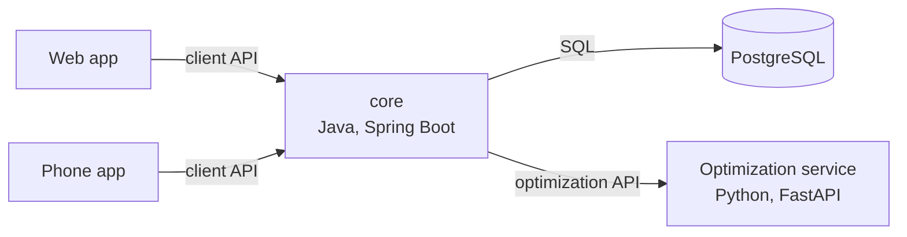

# ADR-002: A Java core backend and a separate Python optimization service

- **Status:** Accepted; amended by ADR-038
- **Date:** 2026-10-30

## Context

The backend has two jobs that differ in kind.

- **The system of record and the API.** It stores organizations, fleets, orders and plans,
  enforces the business rules, and serves the REST API to the web app and the phone
  app. The team knows Java and Spring, and the ecosystem around them is mature (the
  implementation plan's stated reason).
- **Solving.** It turns a routing problem into routes. A solve runs for 5 to 60 seconds
  ([NFR-06]), so it cannot sit inside a request.

The solving code has its own pulls:

- **Google OR-Tools** has its richest ecosystem and documentation in Python, and OR-Tools is
  the solver the product runs on ([ADR-005]).
- **The DispatchFlow solver** is a research component. Its algorithm work iterates on its own
  schedule, apart from the backend's.
- **PyVRP**, the benchmark reference, is a Python library ([ADR-004]).

The cost is plain: two languages, two toolchains and a network call between them. Whether a
Python ALNS reaches enough iterations in the time limit is an open risk ([Q-17]).

## Decision

We run two services, and they meet only at a versioned OpenAPI contract ([NFR-21]).

- **`core`** is Java 21 with Spring Boot 4.1.2 (`pom.xml`). It is the system of record, on
  PostgreSQL ([ADR-007]), and the only server the two clients talk to ([ADR-003]). It serves
  `contracts/client-api/v1`. Spring Security arrives with the identity context.
- **The optimization service** is Python 3.14 (`.python-version`) with FastAPI and Uvicorn,
  and Pydantic models through FastAPI. It hosts the solvers behind the `Solver` port
  ([ADR-004]) and serves `contracts/optimization-api/v1` ([ADR-006]).
- **Only `core` calls the optimization service.** The service receives the whole problem in
  the request and returns a solution. It does not read the system of record, and the Plan and
  its lifecycle stay in `core`.
- **A solve is an asynchronous job**, because it outlasts a request. A queued solve survives a
  backend restart ([NFR-12]).

### Not decided here

How a solve is queued, picked up and returned is open. The implementation plan says a job
table in PostgreSQL is enough for a queue at this scale, and names RabbitMQ as an option.
[NFR-12] cites a decision on a job table that is still to be written. This ADR fixes the
boundary between the services, not the mechanism that crosses it.

## Consequences

- **Easy:** the solvers use OR-Tools' Python API and documentation directly, and the research
  solver changes without a backend release.
- **Easy:** PyVRP stays out of the product by construction ([ADR-008]).
- **Easy:** the contract is the only coupling. Each side is tested against it, and either side
  can be replaced if the contract holds.
- **Hard:** two languages, two build tools and two dependency sets. Each has its own CI job
  ([ADR-015]).
- **Hard:** the routing problem has two models, one in Java and one in Python. Only the
  contract keeps them in step, and a change to the problem touches both sides in one pull
  request.
- **Hard:** the call can fail in ways an in-process call cannot: the service is down, slow or
  returns a malformed answer. `core` must turn each into a failed solve ([ADR-004]).
- **Cost:** one more deployable to build, start and monitor.
- **Risk:** Python may not reach enough ALNS iterations in the time limit ([Q-17]).
  [ADR-005] already names what to revisit if it does: the language of the solver core, not the
  port or the service boundary.

## Alternatives considered

- **One Java backend calling OR-Tools through its Java bindings.** Rejected: it drops the
  second language, but the plan judges OR-Tools' Python ecosystem and documentation the
  richest. It also ties the research solver's algorithm work to the backend's code and release
  cycle, and PyVRP would still have to be run from Python.
- **An all-Python backend.** Rejected: it removes the second language, but the team chose Java
  and Spring for familiarity and for the ecosystem. The system of record is the larger part of
  the code.
- **Running the Python optimizer inside the Java process.** Rejected: it needs an embedded Python
  runtime or a subprocess per solve. Either way the interface is not the OpenAPI contract
  ([NFR-21]), and the optimizer's runtime and release are tied to the JVM's.
- **One service per bounded context.** Rejected for the reasons in [ADR-001]: three people, one
  VM ([NFR-14]) and an undecided context map. Only the optimizer has a reason to run apart, which
  is its language and its research pace.
- **One service per solver.** Already rejected in [ADR-004].

## Revisit when

- **Q-17 shows that Python cannot reach enough iterations.** Follow [ADR-005]: revisit the
  language of the solver core. The service boundary stays unless the new language is Java.
- **The research solver is dropped.** If only OR-Tools remains, the Java bindings may remove a
  service and a language for less than the second language costs. Weigh them in a new ADR.
- **A solver needs a different runtime, or must scale alone.** See [ADR-004].
- **The queue mechanism is chosen.** Record it in its own ADR and link it from here.

[ADR-001]: ADR-001-domain-driven-design-with-hexagonal-architecture.md
[ADR-003]: ADR-003-dispatcher-console-and-driver-app.md
[ADR-004]: ADR-004-pluggable-solver-port.md
[ADR-005]: ADR-005-or-tools-first-research-solver-for-re-optimization.md
[ADR-006]: ADR-006-versioned-openapi-contracts.md
[ADR-007]: ADR-007-postgresql-with-flyway-migrations.md
[ADR-008]: ADR-008-monorepo-layout-under-src.md
[ADR-015]: ADR-015-ci-one-workflow-one-job-per-component.md
[NFR-06]: ../requirements/requirements.md#nfr-06
[NFR-12]: ../requirements/requirements.md#nfr-12
[NFR-14]: ../requirements/requirements.md#nfr-14
[NFR-21]: ../requirements/requirements.md#nfr-21
[Q-17]: ../requirements/requirements.md#open-questions
