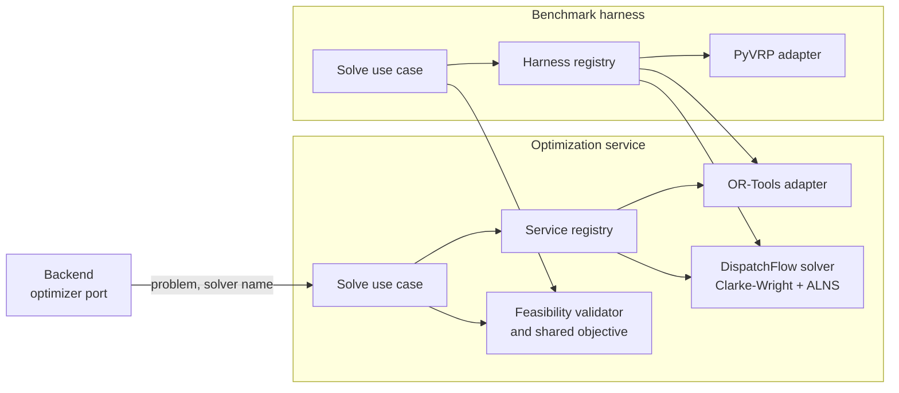

# ADR-004: Every solver behind one solver port

- **Status:** Accepted; extended by ADR-029; amended by ADR-044
- **Date:** 2026-10-27

## Context

DispatchFlow needs more than one VRPTW solver, each for a different reason:

- **Google OR-Tools** is the solver the product runs on ([ADR-005]). Its routing solver is
  mature, and its results are predictable enough to put in front of a customer.
- **The DispatchFlow solver** (Clarke-Wright savings improved by Adaptive Large Neighbourhood
  Search) is the project's research component ([FR-42]). Without it the product reduces to an
  OR-Tools integration with a map.
- **PyVRP**, an open-source state-of-the-art solver, is a benchmark reference only ([FR-51]).

Two constraints pull against each other. The product must never depend on the research solver
succeeding. The research solver must also be comparable with OR-Tools on equal terms: the same
input, the same time limit, the same feasibility rules and the same objective. Comparing the
objective each solver reports about itself would not be fair, because the solvers model some
terms differently. Route stability is the main example ([Q-06]).

The solvers run in the optimization service, written in Python and separate from the Java
backend ([NFR-21], [Q-17]).

## Decision

We put every solver behind one port, `Solver`, inside the optimization service, and choose one
by name for each solve. This is the strategy pattern.

- **One contract.** A solver takes a routing problem and returns a solution.
  - The problem holds the orders, the fleet and its shifts, the travel-time matrix, the
    objective's settings, the time limit and the seed.
  - It may also hold a search budget (a number of iterations, or a solution limit). When set,
    the budget ends the search instead of the clock, which makes a run repeatable ([NFR-13]).
  - For a re-optimization the problem also holds the current routes. A solver may start from
    them, and the stability term is measured against them ([FR-37]).
  - The solution holds the routes and the dropped orders with their reasons.
  - The solution also says whether the current routes seeded the search, and how many
    iterations or solutions the search reached. A comparison can then tell a warm start from a
    cold one ([FR-46]), and a time-limited result can be replayed under that budget ([NFR-13]).
  - A solver returns a *solution*, not a *plan*. The Plan and its lifecycle belong to the
    backend.
- **Failure is loud.** A solver that finds no solution within its limit, or fails, raises one
  solver error.
  - The solve use case turns it into a failed solve that names the solver, as it does a
    validator rejection ([BR-15]).
  - The solve use case measures the elapsed time itself and records any overrun of the limit.
  - No other solver is tried in its place, so the solver a job records is always the one that
    ran.
- **Chosen by name.** Solvers are registered by name in a registry that is injected into the
  solve use case.
  - The service's registry holds OR-Tools and the DispatchFlow solver. It has no default: a
    solve that names no solver, or a solver the registry does not hold, is rejected.
  - The benchmark harness builds its own registry, which also holds PyVRP. PyVRP and its
    adapter live in the harness's package, and PyVRP is a harness-only dependency. The service
    never installs it, so it never serves a solve in the product.
- **One judge.** Every solution passes the shared feasibility validator ([BR-15]) and is scored
  by the shared objective ([BR-09]) before it leaves the service, whichever solver produced it.
  Solvers are never compared on the objective value they report themselves.
- **Nothing else knows the solvers.** The backend, the web app and the phone app
  know a solver only by its name.
  - The backend's optimizer port always sends a solver name, and the solve job records it
    ([FR-20], [NFR-11]).
  - The default for each kind of solve, OR-Tools, is set in the backend's planning settings,
    beside the default time limit ([FR-19]).
  - Adding a solver takes one adapter and one registry entry inside the optimization service.

## Consequences

- **Easy:** solvers are compared on identical input under identical rules.
- **Easy:** the product ships on OR-Tools while the research solver is unfinished.
- **Easy:** making another solver the default for one kind of solve is a change to the
  backend's planning settings, not a code change, if [ADR-005]'s revisit trigger fires.
- **Hard:** the shared problem is a lowest common denominator.
  - Whatever a solver needs must be expressible in it, and each solver translates it into its
    own model.
  - OR-Tools has no native term for route stability, so how its adapter approximates one is
    still open ([Q-06]).
- **Hard:** the validator and the shared objective are the single source of truth for every
  solver.
  - The DispatchFlow solver's incremental objective must equal the shared one ([BR-09]).
  - A change to a business rule changes the validator first.
- **Cost:** one level of indirection, and one adapter per solver.

## Alternatives considered

- **OR-Tools only, with no solver of our own.** Rejected: it removes the research component,
  the main thing that sets the project apart ([ADR-005]).
- **Only our own solver, with OR-Tools as a benchmark baseline** (the initial presentation's
  plan). Rejected: the product, the demo and the pilot would depend on the least predictable
  component.
- **A `Solver` interface in the Java backend.** Rejected: the solvers are written in Python.
  The backend would need a client for each solver and would have to know how they differ, when
  all it needs is a solver's name.
- **One service per solver.** Rejected: it duplicates problem translation, validation and the
  API contract, and adds deployables. Nothing about load or isolation calls for that at 15
  vehicles and 200 stops.

## Revisit when

- A solver needs a different runtime (a native build, a GPU) or must scale on its own. One
  service per solver becomes worth its cost then.
- A solver cannot be expressed through the shared problem and solution without losing what
  makes it worth having.

[ADR-005]: ADR-005-or-tools-first-research-solver-for-re-optimization.md
[FR-19]: ../requirements/requirements.md#daily-planning
[FR-20]: ../requirements/requirements.md#daily-planning
[FR-37]: ../requirements/requirements.md#live-operations-and-re-optimization
[FR-42]: ../requirements/requirements.md#research-and-evaluation
[FR-46]: ../requirements/requirements.md#research-and-evaluation
[FR-51]: ../requirements/requirements.md#research-and-evaluation
[BR-09]: ../requirements/requirements.md#business-rules-and-invariants
[BR-15]: ../requirements/requirements.md#business-rules-and-invariants
[NFR-11]: ../requirements/requirements.md#nfr-11
[NFR-13]: ../requirements/requirements.md#nfr-13
[NFR-21]: ../requirements/requirements.md#nfr-21
[Q-06]: ../requirements/requirements.md#open-questions
[Q-17]: ../requirements/requirements.md#open-questions
