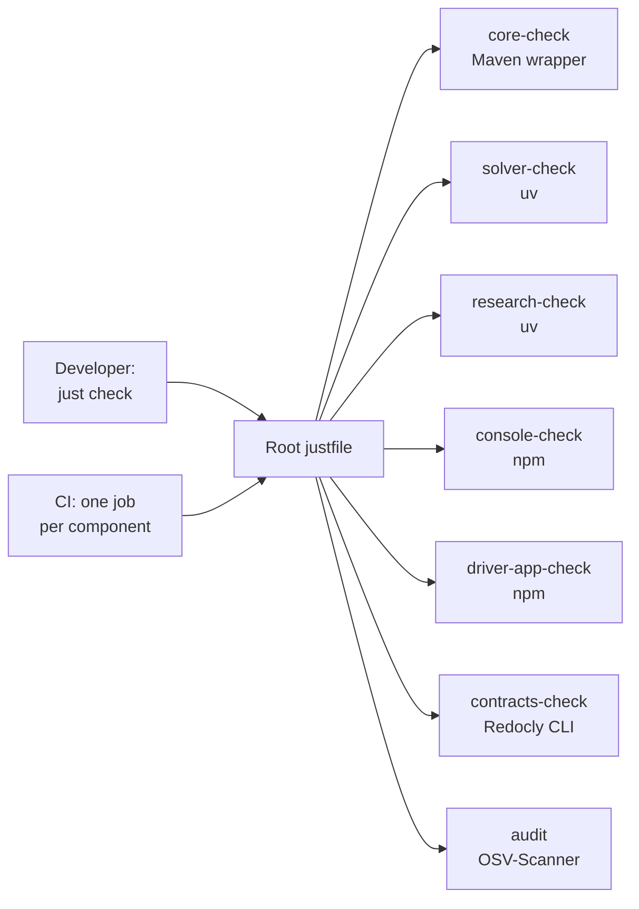

# ADR-009: The root `justfile` is the single entry point, and CI runs the same recipes

- **Status:** Accepted; amended by ADR-037 and ADR-038
- **Date:** 2026-10-30

## Context

The repository holds five components in three ecosystems: Java and Maven, Python and uv, and
Node and npm ([ADR-008]). It also holds two OpenAPI contracts ([ADR-006]). The team is three
people, some of them on Windows, while CI runs on Linux.

The forces:

- **"CI builds and tests every change"** ([NFR-16]). A check that passes on a laptop must pass in
  CI, and the other way round. A second, CI-only definition of a check drifts from the first.
- **A contributor needs one answer to "what do I run?"** Without it, each component's commands
  have to be learned separately, and nothing defines "everything CI checks" in one place.
- **The toolchain must work on Windows.** `make` is not installed there by default.

## Decision

We make the root `justfile` the single entry point. Every command a contributor or CI runs is a
recipe in it, and CI calls the recipes instead of repeating their commands.

- **`just` 1.59.0 runs every command.** It is installed from PyPI as `rust-just`, so anyone who
  has uv can install it. CI runs `uvx --from rust-just==1.59.0 just <recipe>` ([ADR-015]).
- **Recipe names follow one pattern.**
  - `setup`, `check` and `format` run across the components.
  - Each component has `<component>-setup`, `<component>-check` and `<component>-format`, and
    where it runs, `<component>-run`. The components are `core`, `solver`, `research`,
    `console` and `driver-app`.
  - `contracts-check` ([ADR-006]) and `audit` ([ADR-016]) stand alone. `just` with no argument
    lists the recipes.
- **`just check` runs everything CI runs**, and CI jobs call the same recipes. A green local
  `just check` predicts a green pipeline.
- **On Windows, recipes run in Windows PowerShell**, set by `set windows-shell` in the
  `justfile`. The `justfile` also picks `.\mvnw.cmd` on Windows and `./mvnw` elsewhere.
- **A recipe line has to run in both PowerShell and a POSIX shell.**
- **A component's native tools still work.** The recipes call Maven, uv and npm. They add no
  build of their own ([ADR-011], [ADR-012], [ADR-013]).

## Consequences

- **Easy:** `just check` before a push is the same check CI runs.
- **Easy:** changing a check means changing one recipe. The workflow does not repeat it.
- **Easy:** a new contributor installs uv and `just`, then runs `just setup`. The version files
  tell them which Java, Python and Node to use ([ADR-010]).
- **Hard:** recipes must run in both PowerShell and a POSIX shell. A shell feature that works in
  only one of them breaks the other platform.
- **Hard:** `just check` needs Docker, for the core's integration tests ([ADR-014]) and the
  vulnerability audit ([ADR-016]). So does `just core-run`.
- **Hard:** `contracts-check` runs Redocly CLI through `npx`, so a machine that runs it needs
  Node.
- **Cost:** `just` is a tool contributors have to install, although uv installs it.

## Alternatives considered

- **`make`.** Rejected: it is not installed on Windows.
- **Per-language scripts only** (Maven, npm scripts and uv commands, with no common wrapper).
  Rejected: nothing would define "everything CI checks" in one place, and the workflow would
  have to repeat each command.

## Revisit when

- No contributor works on Windows any more. Recipes could then use POSIX shell features
  freely, and the `windows-shell` setting could go.
- A check cannot be written as a recipe that runs in both shells without a per-system branch,
  as `mvnw` already needs one.

[ADR-006]: ADR-006-versioned-openapi-contracts.md
[ADR-008]: ADR-008-monorepo-layout-under-src.md
[ADR-010]: ADR-010-toolchain-pins-in-version-files.md
[ADR-011]: ADR-011-python-tooling-uv-ruff-mypy-pytest.md
[ADR-012]: ADR-012-javascript-tooling-npm-eslint-prettier.md
[ADR-013]: ADR-013-java-tooling-maven-wrapper-and-spotless.md
[ADR-014]: ADR-014-real-dependencies-in-containers-for-tests-and-local-runs.md
[ADR-015]: ADR-015-ci-one-workflow-one-job-per-component.md
[ADR-016]: ADR-016-dependency-audit-with-osv-scanner.md
[NFR-16]: ../requirements/requirements.md#nfr-16
