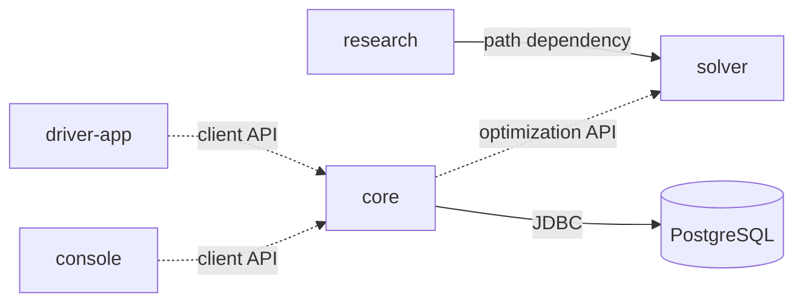

# DispatchFlow — Architecture

How DispatchFlow is built, as it is today. What it must do is in
[requirements.md](../requirements/requirements.md); why each decision was taken is in the
[ADRs](../ADRs/README.md). Where each file lives is in [code-structure.md](code-structure.md).

> [!NOTE]
> Only the skeleton exists. Each component builds, passes its checks and runs a first test, and
> nothing more. The design the team is heading for is in [Target design](#target-design); this
> file describes none of it as built.

## Architecture overview

DispatchFlow is five components in one repository: a Java core backend, a Python solver service,
two TypeScript frontends and a Python research harness. Two OpenAPI contracts define how they
will meet. The core is meant to be the system of record, with PostgreSQL as its database, and the
only client of the solver ([ADR-002](../ADRs/ADR-002-core-backend-and-separate-optimization-service.md)).
Today the core and the solver each start and answer a health probe. No component calls another.

A dotted arrow is a contract that is defined but that no code calls yet. A solid arrow exists
today.

## Components

| Component | Is | Does today |
|---|---|---|
| `core` (`src/backend/core`) | Spring Boot 4.1.2, Java 21 | Starts, connects to PostgreSQL, answers `GET /actuator/health`, and turns an unhandled exception into a 500 problem body |
| `solver` (`src/backend/solver`) | FastAPI, Python 3.14 | Answers `GET /health/liveness` with `{"status":"UP"}` |
| `console` (`src/frontend/console`) | React, Vite | Renders a heading |
| `driver-app` (`src/frontend/driver-app`) | React Native, Expo SDK 58 | Renders a heading |
| `research` (`src/research`) | Python, uv; never deployed | Installs `solver` and PyVRP in one environment, and imports neither yet: `tests/test_environment.py` only checks that both can be found. `benchmark/`, `simulation/`, `generator/`, `instances/` and `results/` hold only `.gitkeep` |

`core` has no controller, entity or Flyway migration: `src/main/resources/db/migration/` holds
only a `.gitkeep`. `solver`'s `domain`, `application` and `solvers` folders hold only `.gitkeep`.
There is no bounded context yet.

## Communication

Components meet only at the two contracts under `contracts/`
([ADR-006](../ADRs/ADR-006-versioned-openapi-contracts.md)):

- `contracts/client-api/v1/openapi.yaml` has `/api/v1` as its `servers` entry. Its `paths` is
  empty, so `core` serves no operation from it yet. It defines the `Problem` schema (RFC 9457) and
  the `UnexpectedProblem` response.
- `contracts/optimization-api/v1/openapi.yaml` is served by `solver`. It defines one operation,
  `getLiveness`, which is `GET /health/liveness`.

No source file in `src/` holds an HTTP client, and the frontends make no request. The `core`
health probe at `/actuator/health` is in neither contract. The one link between components that
exists is in the build: `research` installs `solver` as an editable path dependency
([code-structure.md](code-structure.md#how-the-components-depend-on-each-other)).

## Data flow

No request crosses a component today. Two probes are tested, each inside its own component:

- The `core` health probe: a request to `/actuator/health` reaches Spring Boot, and
  `src/backend/core/src/test/java/com/dispatchflow/DispatchFlowApplicationIT.java` asserts that
  the answer is `UP` while a PostgreSQL container runs.
- The `solver` liveness probe: `src/backend/solver/tests/adapters/inbound/http/test_app.py` asserts
  through `TestClient(create_app())` that `GET /health/liveness` answers 200 with
  `{"status":"UP"}`.

A request traced from a frontend through `core` and `solver` and back can be written once those
calls exist.

## External dependencies and integration points

| Dependency | Used by | For |
|---|---|---|
| PostgreSQL 18.6 | `core` | The database. In a Testcontainers container for `*IT` tests and `just core-run`, which need Docker ([ADR-014](../ADRs/ADR-014-real-dependencies-in-containers-for-tests-and-local-runs.md)). Elsewhere `core` reads `SPRING_DATASOURCE_URL`, `SPRING_DATASOURCE_USERNAME` and `SPRING_DATASOURCE_PASSWORD` from the environment |
| PyVRP | `research` | A reference solver for benchmarks. Never installed in `solver` |

No other outside service is called. The repository has no Compose file; `core` and `solver` each
have a `Dockerfile`, and neither runs as root
([ADR-019](../ADRs/ADR-019-container-images-run-as-non-root.md)).

## Structural decisions not visible from the file layout

- **Dependencies point one way.** Domain code imports no framework, I/O or transport type, and
  adapters depend on the domain ([ADR-001](../ADRs/ADR-001-domain-driven-design-with-hexagonal-architecture.md)).
  There is no domain code yet, so nothing but review enforces this.
- **Every solver sits behind one `Solver` port** and is chosen by name
  ([ADR-004](../ADRs/ADR-004-pluggable-solver-port.md)). The port does not exist yet.
- **PyVRP stays out of `solver`.** `src/backend/solver/tests/test_dependency_boundary.py` fails if
  it can be imported there. It is the only architecture rule a test checks today.
- **Flyway owns the schema.** `core` sets `spring.jpa.hibernate.ddl-auto=validate`, so Hibernate
  never changes it ([ADR-007](../ADRs/ADR-007-postgresql-with-flyway-migrations.md)).
- **Every error body is an RFC 9457 problem.** `UnexpectedErrorHandler` runs last, after Spring
  MVC's own problem handling, so a response never names the cause.

## Target design

The code does not follow this yet. The decided design:

- [Technical implementation plan §2](../init_impl_ref/technical_implementation_plan.md#2-architecture-at-a-glance):
  the one-VM diagram, and [§3](../init_impl_ref/technical_implementation_plan.md#3-build-sequence)
  for the milestones.
- [Domain layer design §1](domain_layer/domain_layer_design.md#1-subdomains-and-bounded-contexts)
  and [§2](domain_layer/domain_layer_design.md#2-context-map): the bounded contexts and the
  module graph.
- [Tech stack](tech_stack.md): the tools, and what each beat.
- [ADR index](../ADRs/README.md): ADR-037 to ADR-047 record the layout, tooling and module
  decisions, and ADR-048 to ADR-092 the rest.

This file is rewritten as each milestone of the plan lands.
