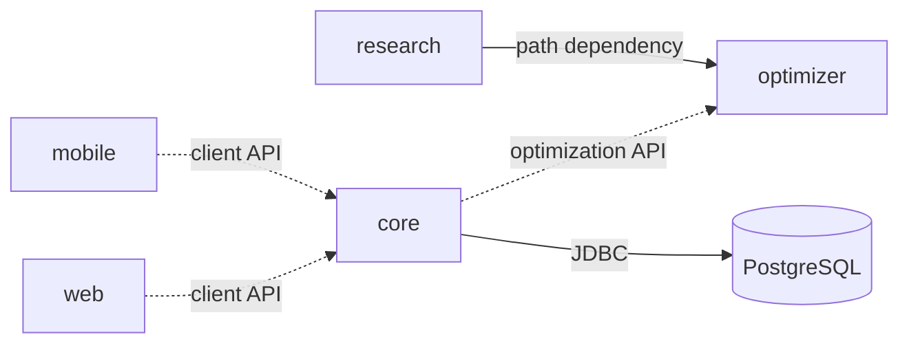

# DispatchFlow — Architecture

How DispatchFlow is built, as it is today. What it must do is in
[requirements.md](../requirements/requirements.md); why each decision was taken is in the
[ADRs](../ADRs/README.md). Where each file lives is in [code-structure.md](code-structure.md).

> [!NOTE]
> Only the skeleton, the domain layer, the declared application layer and the persistence of every
> `core` module exist. Each component builds, passes its checks and runs a first test. The domain
> layers of `core` and `optimizer` are built and tested. The persistence of `access`, `audit`,
> `fleet`, `liveops`, `messaging`, `orders`, `planning` and `reporting` is built: a migration, mapped
> aggregates and a persistence adapter each. The application layers are
> declared, not built: every body that would do work throws, and no use case calls a persistence
> adapter. The design the team is heading for is in [Target design](#target-design); this file
> describes none of it as built beyond that.

## Architecture overview

DispatchFlow is five components in one repository: a Java core backend, a Python optimization service,
two TypeScript frontends and a Python research harness. Two OpenAPI contracts define how they
will meet. The core is meant to be the system of record, with PostgreSQL as its database, and the
only client of the optimizer ([ADR-002](../ADRs/ADR-002-core-backend-and-separate-optimization-service.md)).
Today the core and the optimizer each start and answer a health probe, and the core's persistence
adapters store every module's aggregates in PostgreSQL. No component calls another.

A dotted arrow is a contract that is defined but that no code calls yet. A solid arrow exists
today.

## Components

| Component | Is | Does today |
|---|---|---|
| `core` (`src/backend/core`) | Spring Boot 4.1.2, Java 25 | Starts, connects to PostgreSQL and migrates it, answers `GET /actuator/health`, turns an unhandled exception into a 500 problem body, and stores every module's aggregates through its persistence adapters |
| `optimizer` (`src/backend/optimizer`) | FastAPI, Python 3.14, NumPy | Answers `GET /health/liveness` with `{"status":"UP"}`, and holds the domain for daily solves and re-optimizations (the validator, the objective and the drop reasons), and a declared application layer; nothing calls either yet |
| `web` (`src/frontend/web`) | React, Vite | Renders a heading |
| `mobile` (`src/frontend/mobile`) | React Native, Expo SDK 58 | Renders a heading |
| `research` (`src/research`) | Python, uv; never deployed | Installs `optimizer` and PyVRP in one environment, and imports neither yet: `tests/test_environment.py` only checks that both can be found. `benchmark/`, `simulation/`, `generator/`, `instances/` and `results/` hold only `.gitkeep` |

`core` has no controller. Its `src/main/resources/db/migration/` holds ten Flyway migrations: `V1`
creates the eight module schemas, `V2` to `V9` add one module's tables each, and `V10` refuses a
negative position in every stored list ([data-model.md](data-model.md)). The 20 aggregate roots are
JPA entities: their domain classes carry the mapping, and only Hibernate rebuilds an aggregate, its
`@PostLoad` check refusing a damaged row
([ADR-126](../ADRs/ADR-126-jpa-replaces-jooq-and-the-domain-carries-its-mapping.md),
[ADR-127](../ADRs/ADR-127-how-the-aggregates-are-mapped-and-where-their-stored-state-is-tested.md)).
Each module has an `adapter/out/persistence` package. It holds the module's package-private Spring
Data interfaces, the converters and instantiators of its values, and the adapters that implement its
repository ports. 20 of them, one for each root, save it through `VersionedSave`, except that two of
a session's saves write without a version check by design: one that changes only its contact times
([ADR-128](../ADRs/ADR-128-the-persistence-rules-the-mapping-settled-after-adr-127.md), decision 1),
and its revocation
([ADR-121](../ADRs/ADR-121-the-application-skeletons-review-settles-its-seams-conflicts-retention-and-scoring-inputs.md),
P20). Four store a record by insert (`audit`'s audit records, `liveops`' kept positions, and
`messaging`'s opt-outs and its SMS replies, whose insert skips a reply already kept), and
`reporting` keeps a baseline's outcome as a record row of its own, so five `@Immutable` `Stored…`
entities keep records. No adapter carries `@Transactional`: each runs in the caller's transaction
([ADR-129](../ADRs/ADR-129-transactions-start-only-in-the-service-layer.md)). The eight methods that take a lock lasting only as long as that transaction
(the reads `activeAdminsUnderLock`, both `capacityUnderLock`, `claimNext` and `capOn`, and the
writes `countAnswer`, `addUnlessKeyTaken` and the plan's `add`) call `OpenTransaction.require`
first, as does `deleteEndedBefore`, whose `DELETE … RETURNING` would otherwise commit on its own.
Each refuses a call outside a read-write transaction.
`Plan`'s adapter sits in a `plan/` subpackage of Planning's, with the `@Immutable` entity its
revisions are appended as. Every root's load check refuses a gap in its stored lists first, and
Hibernate batch-fetches the collections a load reads, 200 roots at a time
([ADR-128](../ADRs/ADR-128-the-persistence-rules-the-mapping-settled-after-adr-127.md)). Each
module's `*PersistenceIT` tests its adapters against PostgreSQL. No aggregate keeps a `restore`
factory or a snapshot record. Three adapter methods still throw: `SolveJobRepository`'s two blanking
methods (`UnsupportedOperationException("Built in M13")`, because nothing stores a job's input yet)
and `AuditRecords.purgeExpired`, which waits for the database roles. `src/test` also holds two
entities that have tables, `Ledger` and its child `LedgerEntry`, and the test-only migration
`src/test/resources/db/fixture/V0_1__persistence_fixture.sql`. Flyway applies it in every
integration-test context and under `just core-run`, and only the version helper's tests use its
tables. The `@Entity` classes under `archfixture/` are deliberately wrong fixtures for the mapping
rules, and no schema maps them. `optimizer`'s `solvers` folders hold only `.gitkeep`; its `domain`
holds the domain for daily solves and re-optimizations
([ADR-098](../ADRs/ADR-098-the-validator-works-in-double-precision-with-a-tolerance.md) fixes its
numbers), and its `application` package declares the `Solver` port, the registry, the requests and
outcomes and five use cases, each body raising `NotImplementedError` ("Built in M<n>"). `core` holds
the shared kernel (`com.dispatchflow.shared`): typed IDs, the shared values and the domain's
building blocks ([ADR-097](../ADRs/ADR-097-the-shared-kernel-holds-the-domains-building-blocks.md),
[ADR-106](../ADRs/ADR-106-free-text-is-normalized-and-capped-by-one-kernel-rule.md)). Beside it,
`shared/adapter/out/persistence` is the persistence adapter every module shares
([ADR-126](../ADRs/ADR-126-jpa-replaces-jooq-and-the-domain-carries-its-mapping.md)):
`VersionedSave`, which saves an aggregate so that its version moves by exactly 1, the converters
that store the kernel's single-value types (the 14 typed IDs are in its `id` package), and the
instantiators of the embeddable `TimeWindow`, `GeoPoint` and `DaySeconds`. That package is an
adapter, not part of the kernel. `AggregateRoot` is a `@MappedSuperclass` that holds the `@Version`
and publishes the events its methods raised when a repository's `save` runs. The `domain` packages
of `access`, `audit`, `fleet`, `liveops`, `messaging`, `orders`, `planning` and `reporting` are
built ahead of their milestones, with the `events` packages of the six modules that raise events
(not `audit` or `reporting`), and no use case calls them yet.

Each core module also has an `application` package, and the kernel has `shared/application`. They
are declared ahead of their milestones: every use case, query, port and module API has its signature,
and every body that would do work throws `UnsupportedOperationException("Built in M<n>")`. They are
not built. No bean wires them, and nothing calls a port: the persistence adapters implement the
repository ports, and no use case calls them, so the application context starts as before. Each
service carries a class-level `@Transactional`, read-only where it changes nothing. A use case with
outside calls, or one transaction per item, carries none and holds a transactional
`<UseCase>Change` ([ADR-129](../ADRs/ADR-129-transactions-start-only-in-the-service-layer.md)). Why they are declared now is in [ADR-119](../ADRs/ADR-119-the-application-layer-is-declared-ahead-as-signatures-whose-bodies-throw.md). The caller
is an `Actor` and a `CallContext`, the shared ports are in `shared/application`, and screens read
through query ports ([ADR-120](../ADRs/ADR-120-the-application-layer-takes-an-actor-and-a-call-context-and-reads-through-query-ports.md)).

A package of more than 20 files splits wherever a group of 4 can move: a module's domain into one
package per aggregate, then into concept packages, and an application package the same way
([ADR-118](../ADRs/ADR-118-a-domain-package-above-30-files-splits-by-aggregate.md),
[ADR-125](../ADRs/ADR-125-a-folder-above-20-files-splits-wherever-a-group-of-four-can-move.md)).
Which modules are split, and into what, is in [bounded-contexts.md](bounded-contexts.md).

## Communication

Components meet only at the two contracts under `contracts/`
([ADR-006](../ADRs/ADR-006-versioned-openapi-contracts.md)):

- `contracts/client-api/v1/openapi.yaml` has `/api/v1` as its `servers` entry. Its `paths` is
  empty, so `core` serves no operation from it yet. It defines the `Problem` schema (RFC 9457) and
  the `UnexpectedProblem` response.
- `contracts/optimization-api/v1/openapi.yaml` is served by `optimizer`. It defines one operation,
  `getLiveness`, which is `GET /health/liveness`.

No source file in `src/` holds an HTTP client, and the frontends make no request. The `core`
health probe at `/actuator/health` is in neither contract. The one link between components that
exists is in the build: `research` installs `optimizer` as an editable path dependency
([code-structure.md](code-structure.md#how-the-components-depend-on-each-other)).

## Data flow

No request crosses a component today. Two probes and the persistence adapters are tested, each
inside its own component:

- The `core` health probe: a request to `/actuator/health` reaches Spring Boot, and
  `src/backend/core/src/test/java/com/dispatchflow/DispatchFlowApplicationIT.java` asserts that
  the answer is `UP` while a PostgreSQL container runs.
- The `optimizer` liveness probe: `src/backend/optimizer/tests/adapters/inbound/http/test_app.py` asserts
  through `TestClient(create_app())` that `GET /health/liveness` answers 200 with
  `{"status":"UP"}`.
- A save and a load through a persistence adapter: each module's `*PersistenceIT` saves an
  aggregate into a PostgreSQL container and loads it in another transaction, and where a stored
  value can be damaged it damages one with SQL to check that the load refuses it
  ([data-model.md](data-model.md#where-the-stored-state-is-tested)).

A request traced from a frontend through `core` and `optimizer` and back can be written once those
calls exist.

## External dependencies and integration points

| Dependency | Used by | For |
|---|---|---|
| PostgreSQL 18.6 | `core` | The database, one schema per module, each with tables. Spring Boot runs the Flyway migrations at startup, until the `migrate` step of [ADR-041](../ADRs/ADR-041-one-postgresql-schema-per-module-read-and-written-through-jooq.md) exists. In a Testcontainers container for `*IT` tests and `just core-run`, which need Docker ([ADR-014](../ADRs/ADR-014-real-dependencies-in-containers-for-tests-and-local-runs.md), superseded by [ADR-042](../ADRs/ADR-042-compose-dev-for-local-runs-testcontainers-for-tests.md): local runs start their services from `compose.dev.yaml`, the tests keep Testcontainers, and M0 decides whether `just core-run` stays. Not in the code yet). Elsewhere `core` reads `SPRING_DATASOURCE_URL`, `SPRING_DATASOURCE_USERNAME` and `SPRING_DATASOURCE_PASSWORD` from the environment |
| PyVRP | `research` | A reference solver for benchmarks. Never installed in `optimizer` |

No other outside service is called. The repository has no Compose file; `core` and `optimizer` each
have a `Dockerfile`, and neither runs as root
([ADR-019](../ADRs/ADR-019-container-images-run-as-non-root.md)).

## Structural decisions not visible from the file layout

- **Dependencies point one way.** Domain code imports no framework, I/O or transport type, and
  adapters depend on the domain ([ADR-001](../ADRs/ADR-001-domain-driven-design-with-hexagonal-architecture.md)).
  In `core`, ArchUnit tests check the domain's purity rules over the shared kernel and every
  module's `domain` and `events` packages, the shape rules for restricted types, errors and events,
  and the package rules: no cycle between a module's domain packages, a domain root that imports
  none of its own subpackages, `@NullMarked` on the kernel and on every domain and events package,
  and no package below a module's `api`, `spi` or `events` or below the kernel, except `shared.adapter.out.persistence`
  (`src/test/java/com/dispatchflow/architecture/`, [ADR-118](../ADRs/ADR-118-a-domain-package-above-30-files-splits-by-aggregate.md),
  [ADR-125](../ADRs/ADR-125-a-folder-above-20-files-splits-wherever-a-group-of-four-can-move.md)).
  The application rules there are listed in [`ApplicationRules`](../../src/backend/core/src/test/java/com/dispatchflow/architecture/ApplicationRules.java);
  rules 1 to 7 are [ADR-120](../ADRs/ADR-120-the-application-layer-takes-an-actor-and-a-call-context-and-reads-through-query-ports.md)'s
  decision 10, with rule 4 extended and rule 8 added by [ADR-121](../ADRs/ADR-121-the-application-skeletons-review-settles-its-seams-conflicts-retention-and-scoring-inputs.md),
  and rule 7 widened to every application package by [ADR-125](../ADRs/ADR-125-a-folder-above-20-files-splits-wherever-a-group-of-four-can-move.md).
  The purity rules also allow the persistence annotations that [ADR-126](../ADRs/ADR-126-jpa-replaces-jooq-and-the-domain-carries-its-mapping.md) lists in the domain and the
  kernel, and `PersistenceRules` has nine rules on how the domain is mapped: every aggregate root an
  `@Entity`, relationships only inside
  one aggregate, `@Version` only on `AggregateRoot`, every enum stored by name, a `@PostLoad` check on
  every entity root, no `@GeneratedValue`, no Spring Data interface wider than its port needs, every mapped
  table in its module's schema, and no adapter that uses another module's entity. They check every
  production class, so a module mapped later is covered without editing a rule, and they fire on
  deliberately wrong fixtures. `TransactionRules` has six on where a transaction starts
  ([ADR-129](../ADRs/ADR-129-transactions-start-only-in-the-service-layer.md)):
  - `@Transactional` only in the services, directly or through an annotation;
  - every service transactional at class level, or holding the `<UseCase>Change` that is;
  - no transactional class or method that Spring can't subclass;
  - no outside-call port in a transactional class;
  - no read-only service that writes an audit record;
  - `OpenTransaction.require` before every transaction-scoped lock.
  The other dependency rules are enforced by review.
- **Every solver sits behind one `Solver` port** and is chosen by name
  ([ADR-004](../ADRs/ADR-004-pluggable-solver-port.md), amended by
  [ADR-044](../ADRs/ADR-044-solver-port-takes-start-budget-and-seed-and-problem-judges.md), which
  fixes its call as `solve(problem, start, budget, seed)`). The port and the registry are declared in
  `application/ports.py` ([ADR-119](../ADRs/ADR-119-the-application-layer-is-declared-ahead-as-signatures-whose-bodies-throw.md)); no solver implements the port yet.
- **PyVRP stays out of `optimizer`.** `src/backend/optimizer/tests/test_dependency_boundary.py` holds two
  tests. One fails if PyVRP is installed there, and the other if PyVRP is locked in its `uv.lock`.
  With `core`'s purity, shape, package, application, mapping and transaction rules, and `optimizer`'s import-linter contracts and the ruff
  bans in its domain (lint steps in `just optimizer-check`), they are the only architecture rules
  checked automatically today.
- **Flyway owns the schema.** `core` sets `spring.jpa.hibernate.ddl-auto=validate`, so Hibernate
  never changes it ([ADR-007](../ADRs/ADR-007-postgresql-with-flyway-migrations.md), superseded by
  [ADR-041](../ADRs/ADR-041-one-postgresql-schema-per-module-read-and-written-through-jooq.md),
  amended by [ADR-126](../ADRs/ADR-126-jpa-replaces-jooq-and-the-domain-carries-its-mapping.md), which replaces jOOQ with JPA). `just core-schema-draft` writes the DDL Hibernate
  would generate to `src/backend/core/target/schema-draft.sql`, as a draft for a migration, without a
  database connection. At startup `validate` checks each mapped table and column against the
  migrations, which [data-model.md](data-model.md#migrations) lists; no migration grants anything
  yet ([ADR-127](../ADRs/ADR-127-how-the-aggregates-are-mapped-and-where-their-stored-state-is-tested.md), decision 8).
- **Every error body is an RFC 9457 problem.** `UnexpectedErrorHandler` runs last, after Spring
  MVC's own problem handling, so a response never names the cause.

## Target design

The code does not follow this yet. The decided design is the domain document, the tech stack and
the ADRs:

- [Domain layer design §1](domain_layer/domain_layer_design.md#1-subdomains-and-bounded-contexts)
  and [§2](domain_layer/domain_layer_design.md#2-context-map): the bounded contexts and the
  module graph.
- [Tech stack](tech_stack.md): the tools, and what each beat.
- [ADR index](../ADRs/README.md): the layout is
  [ADR-123](../ADRs/ADR-123-the-code-keeps-its-grouped-layout-and-three-components-take-new-names.md)'s (the grouped tree and three renames), in the tree;
  [ADR-038](../ADRs/ADR-038-mise-pins-every-toolchain-and-core-moves-to-java-25.md) (`mise`; the core
  already runs its Java 25),
  [ADR-040](../ADRs/ADR-040-core-is-a-spring-modulith-monolith-with-one-module-per-context.md) (a
  Spring Modulith monolith, one module per context) and
  [ADR-041](../ADRs/ADR-041-one-postgresql-schema-per-module-read-and-written-through-jooq.md) (a
  schema per module, with its persistence amended to JPA by [ADR-126](../ADRs/ADR-126-jpa-replaces-jooq-and-the-domain-carries-its-mapping.md)) give the target shape. Apart from Java 25, and every module's schema, tables and
  persistence adapters, none of them is in the tree yet: the two database roles and the `migrate`
  step do not exist, and Spring Modulith is not a dependency. ADR-039 and ADR-042 to ADR-047 record the other tooling, contract, solver-port, token
  and image decisions, and ADR-048 onward the rest.
- [Roadmap](../roadmap.md#2-milestones): the milestones and dates.

The hosting is in [ADR-078](../ADRs/ADR-078-hosting-on-one-aws-vm-in-tel-aviv-built-with-terraform.md)
and [tech stack §15](tech_stack.md#15-infrastructure-and-operations). Beyond what the design and
the ADRs decide, the schema is written down by the migrations that build it, and
[data-model.md](data-model.md) describes it as built.

This file is rewritten as each milestone of the [roadmap](../roadmap.md#2-milestones) lands.
