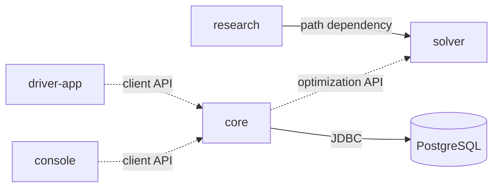

# DispatchFlow — Architecture

How DispatchFlow is built, as it is today. What it must do is in
[requirements.md](../requirements/requirements.md); why each decision was taken is in the
[ADRs](../ADRs/README.md). Where each file lives is in [code-structure.md](code-structure.md).

> [!NOTE]
> Only the skeleton and the domain layer exist. Each component builds, passes its checks and runs a
> first test, and the domain layers of `core` and `solver` are built and tested, with no application
> layer or adapter, so nothing calls them. The design the team is heading for is in
> [Target design](#target-design); this file describes none of it as built beyond that.

## Architecture overview

DispatchFlow is five components in one repository: a Java core backend, a Python solver service,
two TypeScript frontends and a Python research harness. Two OpenAPI contracts define how they
will meet. The core is meant to be the system of record, with PostgreSQL as its database, and the
only client of the solver ([ADR-002](../ADRs/ADR-002-core-backend-and-separate-optimization-service.md)).
Today the core and the solver each start and answer a health probe. No component calls another.

A dotted arrow is a contract that is defined but that no code calls yet. A solid arrow exists
today.

## Components

| Component | Is | Does today |
|---|---|---|
| `core` (`src/backend/core`) | Spring Boot 4.1.2, Java 21 | Starts, connects to PostgreSQL, answers `GET /actuator/health`, and turns an unhandled exception into a 500 problem body |
| `solver` (`src/backend/solver`) | FastAPI, Python 3.14, NumPy | Answers `GET /health/liveness` with `{"status":"UP"}`, and holds the domain for daily solves and re-optimizations (the validator, the objective and the drop reasons), which nothing calls yet |
| `console` (`src/frontend/console`) | React, Vite | Renders a heading |
| `driver-app` (`src/frontend/driver-app`) | React Native, Expo SDK 58 | Renders a heading |
| `research` (`src/research`) | Python, uv; never deployed | Installs `solver` and PyVRP in one environment, and imports neither yet: `tests/test_environment.py` only checks that both can be found. `benchmark/`, `simulation/`, `generator/`, `instances/` and `results/` hold only `.gitkeep` |

`core` has no controller, entity or Flyway migration: `src/main/resources/db/migration/` holds
only a `.gitkeep`. `solver`'s `application` package holds only an empty `__init__.py` and its
`solvers` folders only `.gitkeep`; its `domain` holds the domain for daily solves and re-optimizations
([ADR-098](../ADRs/ADR-098-the-validator-works-in-double-precision-with-a-tolerance.md) fixes its
numbers).
`core` holds the shared kernel (`com.dispatchflow.shared`): typed IDs, the shared values and the
domain's building blocks
([ADR-097](../ADRs/ADR-097-the-shared-kernel-holds-the-domains-building-blocks.md),
[ADR-106](../ADRs/ADR-106-free-text-is-normalized-and-capped-by-one-kernel-rule.md)). Nothing calls
it yet. The `domain` packages of `access`, `audit`, `fleet`, `liveops`, `messaging`, `orders`,
`planning` and `reporting` are built ahead of their milestones, with the `events` packages of the six
modules that raise events (not `audit` or `reporting`), and nothing calls them yet either.

A module's domain splits into one package per aggregate over a root that holds its error and what several packages use, once it passes 30 files ([ADR-118](../ADRs/ADR-118-a-domain-package-above-30-files-splits-by-aggregate.md)). Planning has the root and `plan`, `solution`, `basis`, `revision`, `reconciliation` and `settings`; Live Operations `delivery`, `alert` and `routerun`; Recipient Messaging `message`, `rating` and `settings`; Access `account`, `session` and `companyprofile`; Fleet `register`, `roster` and `driver`. Customers & Orders, Reporting and Audit, the shared kernel and every `events` package stay flat.

## Communication

Components meet only at the two contracts under `contracts/`
([ADR-006](../ADRs/ADR-006-versioned-openapi-contracts.md)):

- `contracts/client-api/v1/openapi.yaml` has `/api/v1` as its `servers` entry. Its `paths` is
  empty, so `core` serves no operation from it yet. It defines the `Problem` schema (RFC 9457) and
  the `UnexpectedProblem` response.
- `contracts/optimization-api/v1/openapi.yaml` is served by `solver`. It defines one operation,
  `getLiveness`, which is `GET /health/liveness`.

No source file in `src/` holds an HTTP client, and the frontends make no request. The `core`
health probe at `/actuator/health` is in neither contract. The one link between components that
exists is in the build: `research` installs `solver` as an editable path dependency
([code-structure.md](code-structure.md#how-the-components-depend-on-each-other)).

## Data flow

No request crosses a component today. Two probes are tested, each inside its own component:

- The `core` health probe: a request to `/actuator/health` reaches Spring Boot, and
  `src/backend/core/src/test/java/com/dispatchflow/DispatchFlowApplicationIT.java` asserts that
  the answer is `UP` while a PostgreSQL container runs.
- The `solver` liveness probe: `src/backend/solver/tests/adapters/inbound/http/test_app.py` asserts
  through `TestClient(create_app())` that `GET /health/liveness` answers 200 with
  `{"status":"UP"}`.

A request traced from a frontend through `core` and `solver` and back can be written once those
calls exist.

## External dependencies and integration points

| Dependency | Used by | For |
|---|---|---|
| PostgreSQL 18.6 | `core` | The database. In a Testcontainers container for `*IT` tests and `just core-run`, which need Docker ([ADR-014](../ADRs/ADR-014-real-dependencies-in-containers-for-tests-and-local-runs.md), superseded by [ADR-042](../ADRs/ADR-042-compose-dev-for-local-runs-testcontainers-for-tests.md): local runs start their services from `compose.dev.yaml`, the tests keep Testcontainers, and the M0 restructure decides whether `just core-run` stays. Not in the code yet). Elsewhere `core` reads `SPRING_DATASOURCE_URL`, `SPRING_DATASOURCE_USERNAME` and `SPRING_DATASOURCE_PASSWORD` from the environment |
| PyVRP | `research` | A reference solver for benchmarks. Never installed in `solver` |

No other outside service is called. The repository has no Compose file; `core` and `solver` each
have a `Dockerfile`, and neither runs as root
([ADR-019](../ADRs/ADR-019-container-images-run-as-non-root.md)).

## Structural decisions not visible from the file layout

- **Dependencies point one way.** Domain code imports no framework, I/O or transport type, and
  adapters depend on the domain ([ADR-001](../ADRs/ADR-001-domain-driven-design-with-hexagonal-architecture.md)).
  In `core`, ArchUnit tests check the domain's purity rules over the shared kernel and every
  module's `domain` and `events` packages, the shape rules for restricted types, errors and events,
  and the package rules: no cycle between a module's domain packages, and `@NullMarked` on the kernel
  and on every domain and events package
  (`src/test/java/com/dispatchflow/architecture/`, [ADR-118](../ADRs/ADR-118-a-domain-package-above-30-files-splits-by-aggregate.md)).
  The other dependency rules are enforced by review.
- **Every solver sits behind one `Solver` port** and is chosen by name
  ([ADR-004](../ADRs/ADR-004-pluggable-solver-port.md), amended by
  [ADR-044](../ADRs/ADR-044-solver-port-takes-start-budget-and-seed-and-problem-judges.md), which
  fixes its call as `solve(problem, start, budget, seed)`). The port does not exist yet.
- **PyVRP stays out of `solver`.** `src/backend/solver/tests/test_dependency_boundary.py` holds two
  tests. One fails if PyVRP is installed there, and the other if PyVRP is locked in its `uv.lock`.
  With `core`'s purity, shape and package rules and `solver`'s import-linter contracts (a lint step
  in `just solver-check`), they are the only architecture rules checked automatically today.
- **Flyway owns the schema.** `core` sets `spring.jpa.hibernate.ddl-auto=validate`, so Hibernate
  never changes it ([ADR-007](../ADRs/ADR-007-postgresql-with-flyway-migrations.md), superseded by
  [ADR-041](../ADRs/ADR-041-one-postgresql-schema-per-module-read-and-written-through-jooq.md),
  which keeps Flyway and replaces JPA with jOOQ; not in the code yet).
- **Every error body is an RFC 9457 problem.** `UnexpectedErrorHandler` runs last, after Spring
  MVC's own problem handling, so a response never names the cause.

## Target design

The code does not follow this yet. The decided design is the domain document, the tech stack and
the ADRs:

- [Domain layer design §1](domain_layer/domain_layer_design.md#1-subdomains-and-bounded-contexts)
  and [§2](domain_layer/domain_layer_design.md#2-context-map): the bounded contexts and the
  module graph.
- [Tech stack](tech_stack.md): the tools, and what each beat.
- [ADR index](../ADRs/README.md):
  [ADR-037](../ADRs/ADR-037-flat-layout-under-src-with-deploy-and-infra.md) (the layout),
  [ADR-038](../ADRs/ADR-038-mise-pins-every-toolchain-and-core-moves-to-java-25.md) (`mise`, and
  Java 25),
  [ADR-040](../ADRs/ADR-040-core-is-a-spring-modulith-monolith-with-one-module-per-context.md) (a
  Spring Modulith monolith, one module per context) and
  [ADR-041](../ADRs/ADR-041-one-postgresql-schema-per-module-read-and-written-through-jooq.md) (a
  schema per module, read and written through jOOQ) give the target shape. None of them is in the
  tree yet. ADR-039 and ADR-042 to ADR-047 record the other tooling, contract, solver-port, token
  and image decisions, and ADR-048 onward the rest.
- [Roadmap](../roadmap.md#2-milestones): the milestones and dates.

The hosting is in [ADR-078](../ADRs/ADR-078-hosting-on-one-aws-vm-in-tel-aviv-built-with-terraform.md)
and [tech stack §15](tech_stack.md#15-infrastructure-and-operations). Beyond what the design and
the ADRs decide, the schema and the flows are written down by the migrations and code that build them.

This file is rewritten as each milestone of the [roadmap](../roadmap.md#2-milestones) lands.
