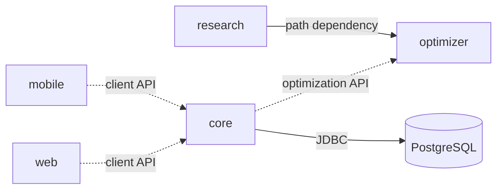

# DispatchFlow — Architecture

How DispatchFlow is built, as it is today. What it must do is in
[requirements.md](../requirements/requirements.md); why each decision was taken is in the
[ADRs](../ADRs/README.md). Where each file lives is in [code-structure.md](code-structure.md).

> [!NOTE]
> Only the skeleton, the domain layer, the declared application layer, the persistence of every
> `core` module, `core`'s web plumbing, the web app's shell and its shared pieces exist. Each
> component builds, passes its checks and runs a first test. The domain layers of `core` and
> `optimizer` are built and tested. The persistence of `access`, `audit`, `fleet`, `liveops`,
> `messaging`, `orders`, `planning` and `reporting` is built: a migration, mapped aggregates and a
> persistence adapter each. The web plumbing is built: the `Clock` and `IdGenerator` adapters,
> `web`'s trace-ID filter, error handlers, call wrapper and error endpoint, the JSON logs and
> `SchedulingConfiguration`. The web app's shell is built: its routes, layout, languages and
> Settings page; no screen of it calls the API. Its shared form, refusal and table pieces are built
> too, but no screen uses them yet. The application layers are declared, not built, but for Audit's
> `AuditLogService`, wired to record a changing call's refused 401, a lost race and a request that
> breaks the contract, and every changing use case's outcome as each is built, and Audit's static
> `Refusals` helper: every other body that would do work throws, no other use case calls a
> persistence adapter, and no operation is served, so no record is written yet. The design the team
> is heading for is in [Target design](#target-design); this file describes none of it as built
> beyond that.

## Architecture overview

DispatchFlow is five components in one repository: a Java core backend, a Python optimization service,
two TypeScript frontends and a Python research harness. Two OpenAPI contracts define how they
will meet. The core is meant to be the system of record, with PostgreSQL as its database, and the
only client of the optimizer ([ADR-002](../ADRs/ADR-002-core-backend-and-separate-optimization-service.md)).
Today the core and the optimizer each start and answer a health probe, and the core's persistence
adapters store every module's aggregates in PostgreSQL. No component calls another.

A dotted arrow is a contract that is defined but that no code calls yet. A solid arrow exists
today.

## Components

| Component | Is | Does today |
|---|---|---|
| `core` (`src/backend/core`) | Spring Boot 4.1.2, Java 25 | Run as `migrate`, applies the Flyway migrations as `dispatchflow_owner` and exits. Otherwise starts, connects to PostgreSQL as `app`, which owns no table, answers `GET /actuator/health`, answers every error that reaches Spring MVC's exception handlers or Tomcat's error dispatch as the client API's `Problem` with a `code` and the request's trace ID, re-runs a call that lost a race, refuses to start on a database session that could pass its grants or on a server whose messages could be translated, `lc_messages` other than `C` or `POSIX` (`DatabaseSessionGuard`), and stores every module's aggregates through its persistence adapters |
| `optimizer` (`src/backend/optimizer`) | FastAPI, Python 3.14, NumPy | Answers `GET /health/liveness` with `{"status":"UP"}`, and holds the domain for daily solves and re-optimizations (the validator, the objective and the drop reasons), and a declared application layer; nothing calls either yet |
| `web` (`src/frontend/web`) | React 19, Vite 8, TanStack Router and Query, Mantine 9, i18next | Renders its shell: a header, the navigation, and pages for planning (`/plans/$date`, where `/` leads to tomorrow's), orders, import, fleet and settings, with not-found and error pages. It is in English, or in Hebrew right to left once its Settings page says so. The planning page shows its date over an empty area for the map (#174), every page but planning and settings says it is not built yet, and no page calls the API ([ADR-143](../ADRs/ADR-143-the-web-app-shell-declares-routes-per-area-opens-in-english-and-renders-no-style-element.md)). Its shared pieces, which no screen uses yet, are form fields over React Hook Form and the shared Zod schemas, one fetch and answer reader for every call, a versioned save that sends the read `ETag`, a message that words the core's refusals for a read or a write, a table over TanStack Table, and save notifications, which stay until closed when they offer an action ([ADR-153](../ADRs/ADR-153-the-web-apps-shared-form-refusal-and-table-pieces.md), [ADR-154](../ADRs/ADR-154-the-audit-of-the-shared-web-pieces-amends-how-a-call-fails-a-notice-closes-and-a-range-reads.md)) |
| `mobile` (`src/frontend/mobile`) | React Native, Expo SDK 58 | Renders a heading |
| `research` (`src/research`) | Python, uv; never deployed | Installs `optimizer` and PyVRP in one environment, and imports neither yet: `tests/test_environment.py` only checks that both can be found. `benchmark/`, `simulation/` and `generator/` are declared, empty packages, and `results/` holds only `.gitkeep`. Its benchmark instances will live in the git-ignored `data/` |

`core` has no controller. Its `src/main/resources/db/migration/` holds twelve Flyway migrations:
`V1` creates the eight module schemas, `V2` to `V9` add one module's tables each, `V10` refuses a
negative position in every stored list, `V11` grants `app` what each adapter runs, and `V12` adds
the audit trail's purge function and its cutoff, owned by `dispatchflow_owner`, of which `app` may
run the purge alone ([data-model.md](data-model.md)). The 20 aggregate roots are
JPA entities: their domain classes carry the mapping, and only Hibernate rebuilds an aggregate, its
`@PostLoad` check refusing a damaged row
([ADR-126](../ADRs/ADR-126-jpa-replaces-jooq-and-the-domain-carries-its-mapping.md),
[ADR-127](../ADRs/ADR-127-how-the-aggregates-are-mapped-and-where-their-stored-state-is-tested.md)).
Each module has an `adapter/out/persistence` package, and beside it declared, empty adapter packages
(see below). The persistence package holds the module's package-private Spring
Data interfaces, the converters and instantiators of its values, and the adapters that implement its
repository ports. 20 of them, one for each root, save it through `VersionedSave`, except that two of
a session's saves write without a version check by design: one that changes only its contact times
([ADR-128](../ADRs/ADR-128-the-persistence-rules-the-mapping-settled-after-adr-127.md), decision 1),
and its revocation
([ADR-121](../ADRs/ADR-121-the-application-skeletons-review-settles-its-seams-conflicts-retention-and-scoring-inputs.md),
P20). Four store a record by insert (`audit`'s audit records, `liveops`' kept positions, and
`messaging`'s opt-outs and its SMS replies, whose insert skips a reply already kept), and
`reporting` keeps a baseline's outcome as a record row of its own, so five `@Immutable` `Stored…`
entities keep records. No adapter carries `@Transactional`: each runs in the caller's transaction
([ADR-129](../ADRs/ADR-129-transactions-start-only-in-the-service-layer.md)). The eight methods that take a lock lasting only as long as that transaction
(the reads `activeAdminsUnderLock`, both `capacityUnderLock`, `claimNext` and `capOn`, and the
writes `countAnswer`, `addUnlessKeyTaken` and the plan's `add`) call `OpenTransaction.require`
first, as does `deleteEndedBefore`, whose `DELETE … RETURNING` would otherwise commit on its own.
Each refuses a call outside a read-write transaction. Every connection waits at most 2 seconds for
each lock, through its `lock_timeout`
([ADR-136](../ADRs/ADR-136-the-core-waits-two-seconds-for-a-lock-and-a-lock-it-cannot-get-is-retried.md)).
`Plan`'s adapter sits in a `plan/` subpackage of Planning's, with the `@Immutable` entity its
revisions are appended as. Every root's load check refuses a gap in its stored lists first, and
Hibernate batch-fetches the collections a load reads, 200 roots at a time
([ADR-128](../ADRs/ADR-128-the-persistence-rules-the-mapping-settled-after-adr-127.md)). Each
module's `*PersistenceIT` tests its adapters against PostgreSQL. No aggregate keeps a `restore`
factory or a snapshot record. Three adapter methods still throw: `SolveJobRepository`'s two blanking
methods (`UnsupportedOperationException("To Be Implemented.")`, because nothing stores a job's input yet)
and `AuditRecords.purgeExpired`, which waits for the nightly retention run that calls the purge
function. `src/test` also holds two
entities that have tables, `Ledger` and its child `LedgerEntry`, and two test-only migrations in
`src/test/resources/db/fixture/`: `V0_1`, which creates their tables, and `V0_2`, which grants `app`
what the version helper's tests run. Flyway applies them in every integration-test context and
under `just core-run`, and only those tests use their tables. The `@Entity` classes under
`archfixture/` are deliberately wrong fixtures for the mapping rules, and no schema maps them.
`optimizer`'s solvers, `adapters/outbound/solvers/{ortools,alns,nearest_neighbour}`, its
`adapters/outbound/clock` and its `adapters/inbound/worker` are declared, empty packages; its `domain`
holds the domain for daily solves and re-optimizations
([ADR-098](../ADRs/ADR-098-the-validator-works-in-double-precision-with-a-tolerance.md) fixes its
numbers), and its `application` package declares the `Solver` port, the registry, the requests and
outcomes and five use cases, each body raising `NotImplementedError("To Be Implemented.")`. `core` holds
the shared kernel (`com.dispatchflow.shared`): typed IDs, the shared values and the domain's
building blocks ([ADR-097](../ADRs/ADR-097-the-shared-kernel-holds-the-domains-building-blocks.md),
[ADR-106](../ADRs/ADR-106-free-text-is-normalized-and-capped-by-one-kernel-rule.md)). Beside it,
`shared/adapter/out/persistence` is the persistence adapter every module shares
([ADR-126](../ADRs/ADR-126-jpa-replaces-jooq-and-the-domain-carries-its-mapping.md)):
`VersionedSave`, which saves an aggregate so that its version moves by exactly 1, the converters
that store the kernel's single-value types (the 14 typed IDs are in its `id` package), and the
instantiators of the embeddable `TimeWindow`, `GeoPoint` and `DaySeconds`. That package is an
adapter, not part of the kernel. Beside it, `shared/adapter/out/clock` holds `SystemClock`, the
`Clock` of production, which reads the system's UTC clock cut to the microsecond and today's date in
Israel, and `shared/adapter/out/uuid` holds `UuidV7Generator`, the `IdGenerator`, which makes UUID
version 7 through `uuid-creator`. `shared/adapter/out/optimizer` is declared, empty: it will hold the
client generated from `optimization-api`, which Planning's and Reporting's `optimizer` adapters
wrap. `shared/adapter/in/web` holds `Problems`, the one factory of every error body, its
`ProblemItem`, and `HandlerOrder`, the order of every exception handler; it will also hold the code
generated from `client-api`, built at every build and never committed, and `@RequiresCapability`.
`shared/adapter/out/sse` is declared, empty: it will hold the registry of open event streams. These
two sit below `web`, so a module's controllers, handlers and `sse` adapters reach them without
depending on it ([ADR-140](../ADRs/ADR-140-the-app-wide-web-package-sits-above-the-modules.md)). `AggregateRoot` is a `@MappedSuperclass` that holds the `@Version`
and publishes the events its methods raised when a repository's `save` runs. The `domain` packages
of `access`, `audit`, `fleet`, `liveops`, `messaging`, `orders`, `planning` and `reporting` are
built ahead of their milestones, with the `events` packages of the six modules that raise events
(not `audit` or `reporting`), and no use case calls them yet.

Each core module also has an `application` package, and the kernel has `shared/application`. They
are declared ahead of their milestones: every use case, query, port and module API has its signature,
and every body that would do work throws `UnsupportedOperationException("To Be Implemented.")`. They are
not built, but for Audit's `AuditLogService`, the `AuditLog` every changing use case will write
through, and its `Refusals` helper.
Each module's root package holds only its `package-info` and a package-private
`<Module>Configuration`, whose `@Import` list is empty but for `AuditConfiguration`'s, which names
`AuditLogService`: a use case and its `Change` join it in the
pull request that builds its body, so no bean wires a throwing one ([ADR-140](../ADRs/ADR-140-the-app-wide-web-package-sits-above-the-modules.md),
decision 10). Only `AuditLogService` calls a port, `AuditRecords.append`: the other persistence
adapters implement the repository ports, and no use case calls them. A success's record joins its
change's transaction; a refusal's is written once the refused change has rolled back, so a use case
whose transaction can refuse is two classes, and each one-class skeleton that can refuse splits as
its body is built ([ADR-149](../ADRs/ADR-149-the-use-case-records-its-refusal-after-the-rollback-and-the-audit-purge-counts-its-year-back-from-now.md)). Who writes it:
- the use case that called its `Change`, through Audit's `Refusals.recordedBy`, which runs the
  use case's own checks and its own `Change` and records the refusal that leaves them, a
  `RuleViolation` or any `ApplicationRefusal` of the kernel's, `NotFound` among them, before it
  rethrows it; and directly, for a conflict the use case answers itself
  ([ADR-150](../ADRs/ADR-150-one-audit-helper-records-the-refusals-a-use-case-sees-and-the-contracts-handler-records-a-changing-call-it-refuses.md));
- the two `Change`s `TransactionRules` rule 10 lists, inside their own transaction, which commits:
  they let no refusal leave, and each alone knows the account or session its record names;
- the adapter that refused a call no use case saw: the access interceptor's 401, the call wrapper's
  lost race, and the contract's handler for a changing call it refuses after the access interceptor
  kept its caller and before the handler starts, which the call wrapper marks as it starts it. A
  refusal raised before a handler is chosen names no operation and leaves no record.

A refusal that is only another exception's cause, such as Audit's refusal of a malformed part,
answers 500 at ERROR, never the refusal's own status.

`com.dispatchflow.SchedulingConfiguration` turns on the asynchronous listeners
always, on Spring Boot's executor capped at 4 threads, with `MdcTaskDecorator` copying the caller's
MDC to each, and the scheduled jobs unless `dispatchflow.scheduling.enabled` is off, as the
integration tests set it. Each
service carries a class-level `@Transactional`, read-only where it changes nothing. A use case with
outside calls, one transaction per item, or a transaction that can refuse, carries none and holds a
transactional `<UseCase>Change` ([ADR-129](../ADRs/ADR-129-transactions-start-only-in-the-service-layer.md)). Why they are declared now is in [ADR-119](../ADRs/ADR-119-the-application-layer-is-declared-ahead-as-signatures-whose-bodies-throw.md). The caller
is an `Actor` and a `CallContext`, the shared ports are in `shared/application`, and screens read
through query ports ([ADR-120](../ADRs/ADR-120-the-application-layer-takes-an-actor-and-a-call-context-and-reads-through-query-ports.md)).

A package of more than 20 files splits wherever a group of 4 can move: a module's domain into one
package per aggregate, then into concept packages, and an application package the same way
([ADR-118](../ADRs/ADR-118-a-domain-package-above-30-files-splits-by-aggregate.md),
[ADR-125](../ADRs/ADR-125-a-folder-above-20-files-splits-wherever-a-group-of-four-can-move.md)).
Which modules are split, and into what, is in [bounded-contexts.md](bounded-contexts.md).

Every module's `adapter/` also holds packages declared ahead, empty, as [ADR-119](../ADRs/ADR-119-the-application-layer-is-declared-ahead-as-signatures-whose-bodies-throw.md)
declared the application layer: 53 in all (51 in the modules, 2 beside the kernel), each with a `package-info.java` that says what goes in it and
carries `@NullMarked`, and no class. An inbound adapter is `adapter/in/<kind>`, of six kinds:
`web`, `listen`, `schedule`, `job`, `callback` and `cli`. An outbound one is `adapter/out/<name>`,
named for the outside system or channel it talks to, `persistence` for the module's own database,
or the technology it wraps when it calls nothing outside the process. Each module's packages and the
ports they implement are in [ADR-130](../ADRs/ADR-130-every-folder-is-declared-ahead-empty-and-documented.md) (decision 4). The phone app's
`src/features/<context>` folders, the web app's `audit`, `liveops`, `messaging` and `reporting`
ones and its `src/components/map/`, the two unfilled folders of `src/frontend/packages/` and the
infra, docs and data folders the tech stack draws are declared the same way, as `.gitkeep`
placeholders.

The application-wide `web` package, `com.dispatchflow.web`, is no module. It holds:

- `TraceIdFilter` and `Traceparent`: every request's trace ID, from a valid `traceparent` or made
  fresh, put in the MDC; the filter also hands an exception that escaped every handler to Tomcat's
  error dispatch while the ID is still in the MDC, and refuses with 400 a path Spring can't parse;
- the call wrapper: `CallWrapper`, the `WebMvcRegistrations` whose handler adapter wraps every
  handler's invocation, `CallRetry`, which re-runs a call that lost a race and writes its one refused
  audit record, `CommitWatch`, the transaction listener that stops a retry once a try committed, and
  `Race`, which classifies the exception thrown;
- the handlers: `ContractErrorHandler`, with `ContractBreaks`, of requests that break the contract,
  of Spring MVC's own errors and of Tomcat's refusals of a request's parameters, which also writes
  the refused audit record of a changing call it refuses before its handler starts,
  `KernelErrorHandler`, of the kernel's errors, and `UnexpectedErrorHandler`, of the rest, with
  `WebCodes`, the codes they answer of their own;
- `ErrorEndpoint`, the last resort: the `@RestController` behind Spring Boot's error path, which
  answers as a `Problem` an error that no handler answered or that a servlet filter raised;
- `ServedJson`, which makes the served JSON converter refuse unknown properties and duplicate keys,
  and `BodySizeLimit`, which caps at 1 MiB a request body that a converter reads. No handler takes
  a streaming parameter (`ApplicationRules` rule 16), and Spring's form-content filter is off; a
  form POST's parameters, which Spring reads before any converter, and a multipart body have caps
  of their own (see below).

Below it, `web.security` knows who the caller is
([ADR-140](../ADRs/ADR-140-the-app-wide-web-package-sits-above-the-modules.md), decisions 3, 4 and
7; [ADR-147](../ADRs/ADR-147-the-stand-in-condition-sits-in-the-root-package-and-a-refused-access-token-answers-one-code.md),
[ADR-148](../ADRs/ADR-148-the-stand-in-serves-only-its-own-origin-every-unsigned-api-call-answers-401-and-the-guard-outlives-the-session.md)):

- `StandInSession`, a servlet filter after `TraceIdFilter`, signs in every request that presents no
  credential, neither an `Authorization` header nor the `__Host-refresh` cookie, names a loopback
  host in its own `Host` header, and comes from no other origin's page (its `Sec-Fetch-Site` is
  absent, `same-origin` or `none`, never `same-site`, `cross-site` or another value), as an entry of
  `seeded-accounts.properties`: the one shared list of seeded accounts, which the `dev` and `test`
  profiles import, each entry a fixed account ID, its roles, an address and a language. It is the
  entry `dispatchflow.stand-in.account` names, which the `test` profile, `just core-run` and the
  Compose `core` service, by default, set to the Dispatcher; the main classpath's `dev` file names none, so the image can't serve it by
  mistake. It has a fixed session. It
  exists only when the active profiles are exactly `dev` or exactly `test` (`@StandInOnly`, whose
  condition, `StandInProfiles`, sits in the root package so every module's stand-in adapters can use
  it too). Sign-in replaces it with a token filter (#199), and keeps `StandInGuard` while any
  other stand-in exists.
- `StandInGuard` refuses to boot with the stand-in's configuration under any other set of profiles,
  `dev` beside `e2e` included, or, where a stand-in may run, when `DISPATCHFLOW_DEPLOYED` or a
  provider's credential key is set. Its messages name the keys, never their values.
- `AccessInterceptor`, in front of every handler under `/api/v1`, builds the call's `Caller` from the
  principal and the chosen handler: the `CallContext`, with the account and session, the client the
  `X-App` and `X-App-Version` headers declare, the handler's operation and the trace ID, and the
  `Actor` when the caller is signed in. A call with no principal answers 401
  `ACCESS_TOKEN_REFUSED`, with exactly `WWW-Authenticate: Bearer`, through `NotSignedInHandler`,
  whatever handler it reaches, one that isn't an annotated method included, such as a router
  function or the 404 of a path no operation has. It keeps the client only when `X-App-Version` is
  three numbers, and puts a signed-in caller's `accountId` and `sessionId` in the MDC, which the
  trace filter puts back on the request's error and async dispatches; a changing call to an
  operation first writes its refused audit record, as a race's is (see below). No operation is open yet, and #171 adds the role check's 403 here.

`web.stream` and `web.e2e` are declared ahead, empty: the event stream's endpoint and the
end-to-end tests' control endpoints. Nothing depends on `web`, and it uses only the modules'
`application.api` and `events`.

## Communication

Components meet only at the two contracts under `contracts/`
([ADR-006](../ADRs/ADR-006-versioned-openapi-contracts.md)):

- `contracts/client-api/v1/openapi.yaml` has `/api/v1` as its `servers` entry. Its `paths` holds
  Planning's six operations, `listPlansOnDate`, `openPlan`, `getPlan`, `requestSolve`,
  `getSolveProgress` and `getRouteShape`, and `core` serves none of them yet. Their times are
  RFC 3339 instants
  ([ADR-155](../ADRs/ADR-155-the-client-api-sends-times-as-rfc-3339-instants-and-a-list-that-may-grow-as-a-string.md)).
  It defines the `Problem` schema (RFC 9457), with
  its `code`, `params`, `traceId` and `errors` and the codes any operation can answer, 401
  `ACCESS_TOKEN_REFUSED` among them, its `ProblemItem` and `ProblemParameter`, and the
  `UnexpectedProblem` response.
- `contracts/optimization-api/v1/openapi.yaml` is served by `optimizer`. It defines one operation,
  `getLiveness`, which is `GET /health/liveness`.

No source file in `src/` holds an HTTP client, and the frontends make no request. The `core`
health probe at `/actuator/health` is in neither contract. The one link between components that
exists is in the build: `research` installs `optimizer` as an editable path dependency
([code-structure.md](code-structure.md#how-the-components-depend-on-each-other)). In the
development stack, the web app's dev server proxies `/api/` to the core on the app's own
origin, forwarding the browser's `Host` and `Sec-Fetch-Site` as they were sent and answering no
other origin's CORS request: no page calls it yet, and `just infra-check` sends its probes
through it ([ADR-148](../ADRs/ADR-148-the-stand-in-serves-only-its-own-origin-every-unsigned-api-call-answers-401-and-the-guard-outlives-the-session.md),
[ADR-151](../ADRs/ADR-151-the-dev-stack-runs-the-core-as-a-compose-service-and-the-core-checks-its-database-session.md)).
It also proxies `/map/` to the `tiles` service with the prefix removed, as `vite preview` does,
since it inherits the dev server's proxy: the map's files then come from the app's own origin, and
no page loads them yet.

## Data flow

No request crosses a component today but `just infra-check`'s probes, which go through the web
app's dev server to the core, and, under `just dev`, a `/map/` request, which the dev server passes
to the `tiles` service. Two probes and the persistence adapters are tested, each inside its
own component:

- The `core` health probe: a request to `/actuator/health` reaches Spring Boot, and
  `src/backend/core/src/test/java/com/dispatchflow/DispatchFlowApplicationIT.java` asserts that
  the answer is `UP` while a PostgreSQL container runs.
- The `optimizer` liveness probe: `src/backend/optimizer/tests/adapters/inbound/http/test_app.py` asserts
  through `TestClient(create_app())` that `GET /health/liveness` answers 200 with
  `{"status":"UP"}`.
- The caller of a call under `/api/v1`: under `dev` or `test` alone, `StandInSession` signs the
  request in as the seeded Dispatcher; `AccessInterceptor` builds its `Caller`, or answers 401 when
  there is no principal; the call wrapper binds `CurrentCall` and `CurrentActor` from it around the
  handler, its retries included, and the binding ends with the call. `web.security`'s `*Test`
  classes drive each step through MockMvc over a test-only controller, and `StandInGuardTest`
  starts a context under each set of profiles the guard must refuse.
- An error inside `core`: `TraceIdFilter` gives the request its trace ID, from its `traceparent`
  or made fresh, in the MDC. The call wrapper runs the handler, again while it loses a race and no
  read-write transaction of the try has committed. An exception goes to the first handler, in `HandlerOrder`,
  that maps it, which answers the `Problem` that `Problems` builds, with the trace ID, and logs one
  JSON line (Elastic Common Schema) carrying the same ID. An error that no handler answers, or that
  a servlet filter raises, reaches `ErrorEndpoint`, which answers the same `Problem`: for one that
  escaped every handler, `TraceIdFilter` asks Tomcat for that error dispatch, so `ErrorEndpoint`
  logs it once, with the ID. `web`'s `*Test` classes drive each step through MockMvc, `WebIT`
  checks the wiring in the whole application, and `WebOverTomcatIT` sends requests to a real Tomcat
  for its refusals of a request's parameters and its error dispatch.
- A save and a load through a persistence adapter: each module's `*PersistenceIT` saves an
  aggregate into a PostgreSQL container and loads it in another transaction, and where a stored
  value can be damaged it damages one with SQL to check that the load refuses it
  ([data-model.md](data-model.md#where-the-stored-state-is-tested)).

A request traced from a frontend through `core` and `optimizer` and back can be written once those
calls exist.

## External dependencies and integration points

| Dependency | Used by | For |
|---|---|---|
| PostgreSQL 18.7 | `core` | The database, one schema per module, each with tables. The `migrate` command runs the Flyway migrations as `dispatchflow_owner` before the core starts, and the core connects as `app`. The tests' Testcontainers server starts with the dev stack's four server settings ([ADR-152](../ADRs/ADR-152-the-session-guard-reads-the-real-login-and-accepts-only-untranslated-messages-and-the-stack-check-checks-what-it-claims.md)) ([ADR-041](../ADRs/ADR-041-one-postgresql-schema-per-module-read-and-written-through-jooq.md), [ADR-145](../ADRs/ADR-145-the-migrate-command-runs-flyway-as-the-owner-and-the-core-connects-as-app.md)); `infra/deploy/postgres/initdb/create-roles.sql` creates both roles in a new database. In a Testcontainers container for `*IT` tests and `just core-run`, which need Docker ([ADR-014](../ADRs/ADR-014-real-dependencies-in-containers-for-tests-and-local-runs.md), superseded by [ADR-042](../ADRs/ADR-042-compose-dev-for-local-runs-testcontainers-for-tests.md): the tests keep Testcontainers, and `just core-run` stays ([ADR-151](../ADRs/ADR-151-the-dev-stack-runs-the-core-as-a-compose-service-and-the-core-checks-its-database-session.md))). The Testcontainers container runs that init script, and Flyway runs in the core's JVM there, as the owner. In the development stack, `infra/deploy/compose.dev.yaml`'s `postgres` service runs it, with #250's log and message settings, and its `migrate` service runs the migrations as the owner before `core` starts. Elsewhere `core` and `migrate` read `SPRING_DATASOURCE_URL`, `SPRING_DATASOURCE_USERNAME` and `SPRING_DATASOURCE_PASSWORD` from the environment |
| PyVRP | `research` | A reference solver for benchmarks. Never installed in `optimizer` |
| Caddy 2.11.9 (`caddy:2.11.9-alpine`, on its tag until January: [ADR-047](../ADRs/ADR-047-images-pinned-by-digest-and-core-on-temurin-25-jre.md)) | the development stack's `tiles` service; `just data` | Serves `data/tiles/` and answers the PMTiles reader's range requests ([ADR-084](../ADRs/ADR-084-maplibre-in-both-apps-with-self-hosted-protomaps-tiles.md)). Its shell, `wget` and `tar` run the `just data` steps the pmtiles image can't. Apache License 2.0 |
| go-pmtiles 1.31.2 (`protomaps/go-pmtiles`, pinned by digest) | `just data` | Cuts Be'er Sheva's tiles from the pinned Protomaps build. A BSD 3-clause licence |
| Protomaps basemap build 20260811 (basemap 4.15.1, pinned with its hash: [ADR-158](../ADRs/ADR-158-the-alphas-tiles-come-from-a-pinned-protomaps-build-checked-by-hash.md)) and `protomaps/basemaps-assets` at a pinned commit | `just data`, for the web app's map | The tiles are an ODbL Produced Work of OpenStreetMap, which must be credited (NFR-18). The fonts are Noto, under the SIL Open Font License 1.1; the sprite is derived from the MIT-licensed `tangrams/icons` |

No other outside service is called at run time. `just data` downloads, on each run, from two sources
outside Israel, and sends them no company or personal data: the tiles it cuts from the pinned Protomaps build
(`build.protomaps.com`) and the archive of the pinned commit of `protomaps/basemaps-assets`
(GitHub), each checked against its SHA-256. `core` and `optimizer` each have a `Dockerfile`, and neither
runs as root ([ADR-019](../ADRs/ADR-019-container-images-run-as-non-root.md)).
`infra/deploy/compose.dev.yaml` runs PostgreSQL, the `migrate` step, the core under the `dev`
profile, the optimizer, the `tiles` service (Caddy 2.11.9, serving the map's files from
`data/tiles/`, under the `data` Compose profile, which `just infra-check` doesn't start: [ADR-152](../ADRs/ADR-152-the-session-guard-reads-the-real-login-and-accepts-only-untranslated-messages-and-the-stack-check-checks-what-it-claims.md))
and the web app's dev server (`src/frontend/web/Dockerfile.dev`) on a laptop,
each service with only its own credentials and every port bound to `127.0.0.1`. The web app's
`vite.config.ts` proxies `/api/` to the core, keeping the browser's `Host` and `Sec-Fetch-Site`,
and `/map/` to the `tiles` service with the prefix removed. `just data` builds the map's files:
Be'er Sheva's tiles, cut with the `pmtiles` CLI from a pinned Protomaps build to
`infra/osrm/beer-sheva.geojson`, and the style's fonts and sprite from a pinned commit of
`protomaps/basemaps-assets`.
`just dev` starts the stack, the `data` profile included, and waits until every service is healthy
and the migrate step has finished, then Compose Watch copies edits into the web app and the
optimizer; `just dev-down` stops it, and `just db-reset` also deletes its database, the stack's
only named volume, which every checkout of the repository shares
([ADR-156](../ADRs/ADR-156-just-dev-waits-for-a-healthy-stack-then-watches-and-the-stack-outlives-the-watch.md)).
`just infra-check` validates the file and starts every service outside the `data` profile in a
throwaway project, in `just check` and CI. At startup the core's `DatabaseSessionGuard` refuses a
session that logged in as another role and switched, a database role with an attribute that
passes the grants, one that belongs to any other role or owns an object, and a server whose
`lc_messages` isn't `C` or `POSIX`, the only settings that keep its messages in English
([ADR-151](../ADRs/ADR-151-the-dev-stack-runs-the-core-as-a-compose-service-and-the-core-checks-its-database-session.md), [ADR-152](../ADRs/ADR-152-the-session-guard-reads-the-real-login-and-accepts-only-untranslated-messages-and-the-stack-check-checks-what-it-claims.md)).

## Structural decisions not visible from the file layout

- **Dependencies point one way.** Domain code imports no framework, I/O or transport type, and
  adapters depend on the domain ([ADR-001](../ADRs/ADR-001-domain-driven-design-with-hexagonal-architecture.md)).
  In `core`, ArchUnit tests check the domain's purity rules over the shared kernel and every
  module's `domain` and `events` packages, the shape rules for restricted types, errors and events,
  and the package rules: no cycle between a module's domain packages, a domain root that imports
  none of its own subpackages, `@NullMarked` on the kernel and on every domain and events package,
  and no package below a module's `api`, `spi` or `events` or below the kernel, except
  `shared.adapter.in.<x>` and `shared.adapter.out.<x>`
  (`src/test/java/com/dispatchflow/architecture/`, [ADR-118](../ADRs/ADR-118-a-domain-package-above-30-files-splits-by-aggregate.md),
  [ADR-125](../ADRs/ADR-125-a-folder-above-20-files-splits-wherever-a-group-of-four-can-move.md)).
  The application rules there are listed in [`ApplicationRules`](../../src/backend/core/src/test/java/com/dispatchflow/architecture/ApplicationRules.java);
  rules 1 to 7 are [ADR-120](../ADRs/ADR-120-the-application-layer-takes-an-actor-and-a-call-context-and-reads-through-query-ports.md)'s
  decision 10, with rule 4 extended and rule 8 added by [ADR-121](../ADRs/ADR-121-the-application-skeletons-review-settles-its-seams-conflicts-retention-and-scoring-inputs.md),
  and rule 7 widened to every application package by [ADR-125](../ADRs/ADR-125-a-folder-above-20-files-splits-wherever-a-group-of-four-can-move.md).
  Rules 9 to 11 are [ADR-130](../ADRs/ADR-130-every-folder-is-declared-ahead-empty-and-documented.md)'s, and rule 12 is
  [ADR-131](../ADRs/ADR-131-the-declared-structures-review-tightens-its-rules-and-fills-its-gaps.md)'s: the adapters of a module stay apart (no adapter uses another
  adapter of its module, `in` and `out` included), no adapter uses another module's adapter, no
  shared adapter uses anything outside the kernel, and only the optimizer adapters use the generated
  optimizer client. Rule 5's `@NullMarked` check covers the adapter packages too, and a test holds
  the tree to the adapters ADR-130, ADR-131 and ADR-140 declare. Rule 13 is [ADR-140](../ADRs/ADR-140-the-app-wide-web-package-sits-above-the-modules.md)'s: `web`
  uses, of the modules, only their `application.api` and `events`, and rule 2 refuses every module a
  dependency on `web`, so `web` sits above the modules. Rule 14, also ADR-140's, lets only
  `web` and the modules' `adapter.in.web` use `CurrentActor` and `CurrentCall`, the holders of a web
  call's caller, rule 18 lets only `web`'s call wrapper bind them, and rule 17 lets only
  `web.security` build an `Actor` or a `CallContext`, beside the context's own `serverStep`; a test
  checks that each
  holder rule 14 names exists. Rule 15,
  also ADR-140's, keeps each module's root package to its
  `package-info` and its package-private `<Module>Configuration`, which declares no `@Bean` and no
  scan and imports only its own module's `application.service` classes. Rules 19 and 20 are
  [ADR-147](../ADRs/ADR-147-the-stand-in-condition-sits-in-the-root-package-and-a-refused-access-token-answers-one-code.md)'s:
  the root package uses nothing below it, so the adapters may use its `StandInProfiles` and
  `@StandInOnly` without a
  cycle, and `web.security` uses no class directly in `web`, which depends on it. Rule 21, also
  ADR-147's, lets no handler take an `Actor` or a `CallContext`, alone, as a type argument or in an
  array, which Spring would build from the request's parameters.
  The purity rules also allow the persistence annotations that [ADR-126](../ADRs/ADR-126-jpa-replaces-jooq-and-the-domain-carries-its-mapping.md) lists in the domain and the
  kernel, and `PersistenceRules` has nine rules on how the domain is mapped: every aggregate root an
  `@Entity`, relationships only inside
  one aggregate, `@Version` only on `AggregateRoot`, every enum stored by name, a `@PostLoad` check on
  every entity root, no `@GeneratedValue`, no Spring Data interface wider than its port needs, every mapped
  table in its module's schema, and no adapter that uses another module's entity. They check every
  production class, so a module mapped later is covered without editing a rule, and they fire on
  deliberately wrong fixtures. `TransactionRules` has ten on where a transaction starts and where
  an audit record is written ([ADR-129](../ADRs/ADR-129-transactions-start-only-in-the-service-layer.md),
  [ADR-149](../ADRs/ADR-149-the-use-case-records-its-refusal-after-the-rollback-and-the-audit-purge-counts-its-year-back-from-now.md),
  [ADR-150](../ADRs/ADR-150-one-audit-helper-records-the-refusals-a-use-case-sees-and-the-contracts-handler-records-a-changing-call-it-refuses.md)):
  - `@Transactional` only in the services, directly or through an annotation;
  - every service transactional at class level, or holding the `<UseCase>Change` that is;
  - no transactional class or method that Spring can't subclass;
  - no outside-call port in a transactional class;
  - no read-only service that writes an audit record;
  - `OpenTransaction.require` before every transaction-scoped lock;
  - no data reached by a service with no transaction, which may hold only its `Change`, outside-call
    and storeless ports, other services, and `api` or `spi` interfaces, `AuditLog` included;
  - every transactional event listener `@Async`;
  - a success recorded only in a transactional service, at the default propagation and outside a
    read-only method;
  - a refusal recorded in no transactional class but the two named `Change`s that commit one on
    purpose, and Audit's `Refusals` helper called in none, those two included.
  The other dependency rules are enforced by review.
- **Every solver sits behind one `Solver` port** and is chosen by name
  ([ADR-004](../ADRs/ADR-004-pluggable-solver-port.md), amended by
  [ADR-044](../ADRs/ADR-044-solver-port-takes-start-budget-and-seed-and-problem-judges.md), which
  fixes its call as `solve(problem, start, budget, seed)`). The port and the registry are declared in
  `application/ports.py` ([ADR-119](../ADRs/ADR-119-the-application-layer-is-declared-ahead-as-signatures-whose-bodies-throw.md)); no solver implements the port yet.
- **PyVRP stays out of `optimizer`.** `src/backend/optimizer/tests/test_dependency_boundary.py` holds two
  tests. One fails if PyVRP is installed there, and the other if PyVRP is locked in its `uv.lock`.
  With `core`'s purity, shape, package, application, mapping and transaction rules,
  `optimizer`'s import-linter contracts and the ruff bans in its domain (lint steps in
  `just optimizer-check`), and the web app's folder rules below, they are the only architecture
  rules checked automatically today.
- **The web app's folders depend one way, and its features stay apart.** `src/` itself imports
  `features/`, which import `routes/`, then `components/`, then `lib/`, never back: an area parents
  its routes on the shell's `shellRoute`, and `src/routeTree.ts`, above both, gathers them. No
  feature imports another, nothing below `src/` imports the modules that assemble the app
  (`main`, `App`, `router`, `routeTree` and the rest), and only tests import `src/test/`.
  ESLint's `no-restricted-imports` in `src/frontend/web/eslint.config.js` checks every static
  import and re-export, type-only ones included, but not `import()` expressions, and
  `src/test/importDirection.test.ts` pins each rule
  ([ADR-143](../ADRs/ADR-143-the-web-app-shell-declares-routes-per-area-opens-in-english-and-renders-no-style-element.md),
  [ADR-144](../ADRs/ADR-144-the-web-apps-features-stay-apart-and-its-lower-folders-never-import-upward.md)).
- **Flyway owns the schema.** `core` sets `spring.jpa.hibernate.ddl-auto=validate`, so Hibernate
  never changes it ([ADR-007](../ADRs/ADR-007-postgresql-with-flyway-migrations.md), superseded by
  [ADR-041](../ADRs/ADR-041-one-postgresql-schema-per-module-read-and-written-through-jooq.md),
  amended by [ADR-126](../ADRs/ADR-126-jpa-replaces-jooq-and-the-domain-carries-its-mapping.md), which replaces jOOQ with JPA). `just core-schema-draft` writes the DDL Hibernate
  would generate to `src/backend/core/target/schema-draft.sql`, as a draft for a migration, without a
  database connection. At startup `validate` checks each mapped table and column against the
  migrations, which [data-model.md](data-model.md#migrations) lists. `V11` grants `app` what each
  adapter runs, and every later migration grants on the tables it creates
  ([ADR-127](../ADRs/ADR-127-how-the-aggregates-are-mapped-and-where-their-stored-state-is-tested.md),
  decision 8). `DatabaseRolesIT` fails on a table that grants `app` nothing or more than its rows,
  on a function open to every role, on a function `app` may execute other than the audit purge,
  and on a schema `app` may create in
  ([ADR-145](../ADRs/ADR-145-the-migrate-command-runs-flyway-as-the-owner-and-the-core-connects-as-app.md),
  [ADR-146](../ADRs/ADR-146-the-jar-takes-only-options-but-for-its-command-and-the-roles-guards-cover-every-object-and-log.md)).
- **The core never migrates.** `application.properties` turns Flyway off, so the core, connected as
  `app`, owns no table and can change no schema. The image's `java -jar app.jar migrate` hands the
  run to `MigrateCommand`, whose context holds only the data source and Flyway, connected as
  `dispatchflow_owner` through the same `SPRING_DATASOURCE_*` keys and the core's pool settings, and
  exits non-zero when a migration fails. The jar refuses any other argument that isn't an option, so
  a misplaced or misspelt command can't start the whole core with the owner's credential. The tests
  and `just core-run` run Flyway in the core's JVM instead, on an owner pool of their own: the test
  classpath's `application-test.properties` turns it on for the tests, and
  `TestDispatchFlowApplication` for `just core-run`, never `application-dev.properties`, which the
  Compose core reads too
  ([ADR-145](../ADRs/ADR-145-the-migrate-command-runs-flyway-as-the-owner-and-the-core-connects-as-app.md),
  [ADR-146](../ADRs/ADR-146-the-jar-takes-only-options-but-for-its-command-and-the-roles-guards-cover-every-object-and-log.md)).
- **Every error body is the contract's `Problem`.** `shared.adapter.in.web.Problems` builds each
  one, with `type` `about:blank`, a `code`, its `params` and the trace ID from the MDC, and never a
  `detail` ([ADR-140](../ADRs/ADR-140-the-app-wide-web-package-sits-above-the-modules.md), decision 5).
  Its `instance`, the request's path, is set by Spring, and by `Problems.at` for `ErrorEndpoint`
  (ADR-142, decision 5). The handlers run in `HandlerOrder`'s order: each module's
  own, `web`'s handler of the contract's breaks, which replaces Spring Boot's handler of Spring
  MVC's errors, the kernel's, and `UnexpectedErrorHandler` last, so a response never names the
  cause. Spring asks each handler for the thrown type and then for its causes, before it asks the
  next. So a module's exception that wraps a Spring MVC one reaches its module, and a `RuleViolation`
  that a converter wraps in a type mismatch answers 400, not the kernel's 422
  ([ADR-142](../ADRs/ADR-142-the-call-wrappers-retry-its-400s-and-its-error-endpoint-as-162-built-them.md), decision 4).
- **An error that no handler answers is still a `Problem`.** One that escapes every handler, or that
  a servlet filter raises, reaches `ErrorEndpoint`, which implements Spring Boot's `ErrorController`
  so that `BasicErrorController` backs off. It answers the status Tomcat dispatched, with a code
  from `WebCodes`; it logs a listed 5xx at ERROR, a listed 4xx at INFO with its status alone, and a
  status the contract doesn't list at ERROR, answered 500 (ADR-142, decision 5). Its `instance` is
  the failed request's raw path, quoted by `Problems.at` where `java.net.URI` would refuse it.
  `TraceIdFilter` catches an exception that escapes every handler, on a request or async dispatch,
  and asks Tomcat for the error dispatch with `sendError(500)`, the exception in
  `jakarta.servlet.error.exception`, so Tomcat logs no line of its own without the trace ID.
  Tomcat's own refusals keep the quiet answer Tomcat gives them: an `InvalidParameterException` asks
  for its error code and a `BadRequestException` for 400, with no exception attached, so
  `ErrorEndpoint` logs the 4xx at INFO with its status alone and no parameter's value. Once the
  response is committed, the exception escapes as before, and Tomcat cuts the connection; once
  Tomcat allows no more I/O on the connection, it runs no error dispatch, and the exception goes
  unlogged. On a request dispatch, the filter first parses the path as Spring will, and asks Tomcat
  for a 400 for a path Spring can't parse, which only a malformed escape in a path parameter is,
  since Tomcat passes that undecoded: Spring parses the path outside its exception handling.
  `ErrorEndpoint` answers that 400 for the whole request and logs it at INFO. Every answer of
  `ErrorEndpoint` carries `Content-Disposition: inline;filename=f.txt`, the value Spring's
  reflected-file-download check sets itself, so that check never decodes the failed request's path
  parameters, which it would throw on. A path Tomcat itself can't parse, with a `[`, a `]`, a `{` or
  a malformed escape outside a path parameter, gets Tomcat's own 400 page before any filter runs: a
  connector-level refusal, which ADR-142 accepts, so no `Problem` answers it.
- **A 400 lists at most 100 of its failing items,** in the body and in its log line, which also
  carries the total. A 422 lists every refusal, which the domain bounds (ADR-142, decision 3).
- **Every read of a body has a cap.** `BodySizeLimit` caps what a converter reads at 1 MiB, Tomcat's
  form cap a form POST's parameters, and a multipart body has its own, 8 MB per file and 10 MB per
  request (`application.properties`). No handler takes a streaming parameter, which
  `ApplicationRules` rule 16 checks, and `application.properties` turns Spring's form-content filter
  off, which would read a PUT, PATCH or DELETE form body whole before the request is routed
  (ADR-142, decision 6). A form POST's parameters, which Spring reads for a handler before any
  converter, and which a filter could read too, have Tomcat's own cap,
  `server.tomcat.max-http-form-post-size`, of 1 MiB. Tomcat refuses one over it, or a parameter it
  can't decode, with an `InvalidParameterException`. Thrown while Spring MVC resolves a handler's
  arguments, `ContractErrorHandler` answers it, 413 or 400; thrown in a filter, `TraceIdFilter` asks
  Tomcat for its status, and `ErrorEndpoint` answers it.
- **A call that lost a race runs again.** `CallWrapper`'s handler adapter invokes each handler
  through `CallRetry`, with the arguments Spring already read and validated. A save's
  `StaleVersion` on a call that sent no version, and a failed lock wait on any call, matched on the
  type thrown, run up to 3 more times, each in new transactions, while no read-write transaction of
  the try has committed, which `CommitWatch` hears from the transaction manager; a read-only commit
  doesn't count. Then 503. A `StaleVersion` on a call that sent `If-Match` or `If-None-Match`
  answers 412, and one that compared a body's version 409, at once (ADR-140, decision 6). A race
  after a read-write commit answers 500 `UNEXPECTED_ERROR` and is neither retried nor audited,
  because the change is stored and a 503 would invite a duplicate ([ADR-142](../ADRs/ADR-142-the-call-wrappers-retry-its-400s-and-its-error-endpoint-as-162-built-them.md), decisions 1
  and 2). `CallRetry` writes the refused audit record of a 412, 409 or 503, `AccessInterceptor`
  that of a changing call's 401, and `ContractErrorHandler` that of a signed-in changing call it
  refuses before the handler starts, each through the injected `AuditLog` once every transaction of
  the call has ended ([ADR-149](../ADRs/ADR-149-the-use-case-records-its-refusal-after-the-rollback-and-the-audit-purge-counts-its-year-back-from-now.md)).
- **Every log line is JSON.** The console writes Elastic Common Schema, with the MDC, so every line
  of a request carries its `traceId`, and every line of a signed-in call after the access
  interceptor its `accountId` and `sessionId` too (ADR-140, decision 8).

## Target design

The code does not follow this yet. The decided design is the domain document, the tech stack and
the ADRs:

- [Domain layer design §1](domain_layer/domain_layer_design.md#1-subdomains-and-bounded-contexts)
  and [§2](domain_layer/domain_layer_design.md#2-context-map): the bounded contexts and the
  module graph.
- [Tech stack](tech_stack.md): the tools, and what each beat.
- [ADR index](../ADRs/README.md): the layout is
  [ADR-123](../ADRs/ADR-123-the-code-keeps-its-grouped-layout-and-three-components-take-new-names.md)'s (the grouped tree and three renames), in the tree;
  [ADR-038](../ADRs/ADR-038-mise-pins-every-toolchain-and-core-moves-to-java-25.md) (`mise`; the core
  already runs its Java 25),
  [ADR-040](../ADRs/ADR-040-core-is-a-spring-modulith-monolith-with-one-module-per-context.md) (a
  Spring Modulith monolith, one module per context) and
  [ADR-041](../ADRs/ADR-041-one-postgresql-schema-per-module-read-and-written-through-jooq.md) (a
  schema per module, with its persistence amended to JPA by [ADR-126](../ADRs/ADR-126-jpa-replaces-jooq-and-the-domain-carries-its-mapping.md)) give the target shape. Apart from Java 25, every module's schema, tables and
  persistence adapters, and the two database roles and the `migrate` step
  ([ADR-145](../ADRs/ADR-145-the-migrate-command-runs-flyway-as-the-owner-and-the-core-connects-as-app.md)),
  none of them is in the tree yet: Spring Modulith is not a dependency. ADR-039 and ADR-042 to ADR-047 record the other tooling, contract, solver-port, token
  and image decisions, and ADR-048 onward the rest.
- [Roadmap](../roadmap.md#2-milestones): the milestones and dates.

The hosting is in [ADR-078](../ADRs/ADR-078-hosting-on-one-aws-vm-in-tel-aviv-built-with-terraform.md)
and [tech stack §15](tech_stack.md#15-infrastructure-and-operations). Beyond what the design and
the ADRs decide, the schema is written down by the migrations that build it, and
[data-model.md](data-model.md) describes it as built.

This file is rewritten as each milestone of the [roadmap](../roadmap.md#2-milestones) lands.
