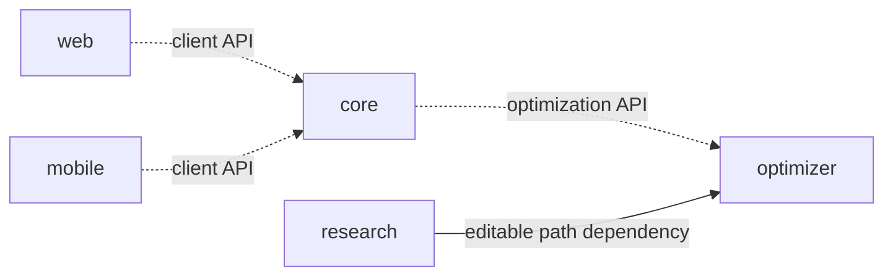
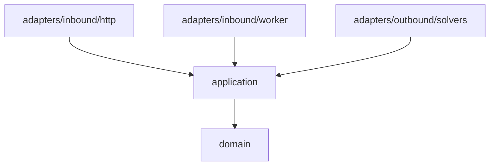

# DispatchFlow — Code structure

Where each kind of code and test lives, and which way dependencies point. It describes the
repository as it is today. What the system must do is in
[requirements.md](../requirements/requirements.md); why the repository is laid out this way is in
[ADR-008](../ADRs/ADR-008-monorepo-layout-under-src.md) and
[ADR-123](../ADRs/ADR-123-the-code-keeps-its-grouped-layout-and-three-components-take-new-names.md), why
every folder the design draws is declared ahead is in
[ADR-130](../ADRs/ADR-130-every-folder-is-declared-ahead-empty-and-documented.md), and why it is built and checked the way
it is in [ADR-009](../ADRs/ADR-009-just-as-the-single-entry-point.md) to
[ADR-016](../ADRs/ADR-016-dependency-audit-with-osv-scanner.md).

ADR-123 (Accepted) keeps this tree and gives three components the names they have today:
`src/backend/optimizer`, `src/frontend/web` and `src/frontend/mobile`.

Also Accepted and not in the tree yet:
[ADR-038](../ADRs/ADR-038-mise-pins-every-toolchain-and-core-moves-to-java-25.md) (`mise` pins every
toolchain; the core already runs its Java 25),
[ADR-039](../ADRs/ADR-039-one-pnpm-workspace-for-both-apps-and-shared-packages.md) (one pnpm
workspace for both apps),
[ADR-042](../ADRs/ADR-042-compose-dev-for-local-runs-testcontainers-for-tests.md) (`compose.dev.yaml`
for local runs) and
[ADR-046](../ADRs/ADR-046-renovate-replaces-dependabot-and-targets-dev.md) (Renovate replaces
Dependabot). They supersede or amend some of ADR-009 to ADR-016 above: ADR-010, ADR-012 and ADR-014
are superseded; ADR-009, ADR-013 and ADR-015 are amended.

> [!NOTE]
> Most folders below are still empty. A folder listed as a placeholder holds only a `.gitkeep`
> file. A package that is declared, empty holds only a `package-info.java` (Java) or an `__init__.py`
> with a docstring (Python) ([ADR-130][ADR-130]). What is real today is the skeleton, the domain
> layer of `core` and `optimizer`, and the persistence of every `core` module: each component builds,
> passes its own checks and runs a first test.

## Top level

| Path | Holds |
|---|---|
| `src/backend/core/` | The REST API and system of record: Java 25, Spring Boot 4.1.2, Maven |
| `src/backend/optimizer/` | The optimization service: Python 3.14, FastAPI, NumPy, uv |
| `src/frontend/web/` | The web app, for every role: React, TypeScript, Vite |
| `src/frontend/mobile/` | The phone app, for every role: React Native, Expo SDK 58, TypeScript |
| `src/frontend/packages/` | Seven placeholder folders for the shared TypeScript packages ([ADR-039](../ADRs/ADR-039-one-pnpm-workspace-for-both-apps-and-shared-packages.md)); none has a `package.json` yet |
| `src/research/` | Benchmarks, simulation and the order generator: Python, uv. Never deployed |
| `contracts/` | `client-api/v1` and `optimization-api/v1` (OpenAPI), and the Redocly lint setup |
| `tests/` | Tests that span components: `e2e/` and `load/`. Both are placeholders |
| `infra/` | `osrm/`, `deploy/` (with `backup/` and `observability/`) and `terraform/`. All are placeholders |
| `data/` | The OSM extract, OSRM files, PMTiles and benchmark instances, once built. Git keeps the folder and ignores everything in it |
| `logs/` | Local log output. Git keeps the folder and ignores everything in it |
| `docs/` | `CLAUDE.md`, `requirements/` (with `ARD/`), `architecture/` (with `domain_layer/` and `tech_stack.md`), `ADRs/`, `roadmap.md` and `presentations/`; the placeholders are `operations/`, `guides/he/`, `guides/en/`, `research/usability/` and `architecture/generated/` |
| `.claude/` | Claude Code's context: the root `CLAUDE.md`, the team agents (`agents/`), the team skills (`skills/`), `settings.json`, and an empty `rules/` folder ([ADR-018](../ADRs/ADR-018-ai-assistant-context-in-the-repository.md), [ADR-020](../ADRs/ADR-020-team-subagents-in-the-repository.md), [ADR-025](../ADRs/ADR-025-team-skills-in-the-repository.md)) |
| `.github/` | The CI workflow, Dependabot configuration, and issue and pull request templates |
| `justfile` | Every command. CI runs the same recipes |
| `README.md`, `.editorconfig`, `.gitattributes`, `.gitignore` | The readme, and the editor, line-ending and ignore settings |
| `.java-version`, `.python-version`, `.nvmrc` | Toolchain pins: Java 25, Python 3.14, Node 24 |
| `LICENSE` | Proprietary, all rights reserved ([ADR-017](../ADRs/ADR-017-proprietary-licence.md)) |

Each component has its own manifest, and each except `core` (Maven) has a lockfile. The one link
at build time is `research`'s path dependency on `optimizer`, below.

`src/backend`, `src/frontend`, each component, `contracts/` and `docs/` also hold a `CLAUDE.md` with
the rules for that folder.

## How the components depend on each other



A dotted arrow is a contract that is defined but that no code calls yet. The solid arrow is a
build dependency that exists today.

- The two frontends talk only to `core`, through `contracts/client-api/v1`. `core` serves that
  contract.
- `core` is the only client of `optimizer`, through `contracts/optimization-api/v1`. `optimizer` serves
  that contract.
- Neither side owns a contract, so the contracts sit at the root, outside every component.
- Today `contracts/client-api/v1`, served under `/api/v1`, declares no operation yet, and
  `contracts/optimization-api/v1` declares one: `GET /health/liveness`. `core` has no client for
  the optimization API yet.
- `research` installs `optimizer` from `../backend/optimizer` as an editable path dependency, and adds
  PyVRP. The optimizer's environment never contains PyVRP:
  `src/backend/optimizer/tests/test_dependency_boundary.py` fails if PyVRP is installed there or locked
  in its `uv.lock` ([ADR-004](../ADRs/ADR-004-pluggable-solver-port.md)).
- A change to `src/backend/optimizer/pyproject.toml` also needs `uv lock` in `src/research`.

## Inside each component

### `src/backend/core`

```text
src/backend/core/
  pom.xml, mvnw, mvnw.cmd, .mvn/   Maven and its wrapper
  CLAUDE.md                        the rules for this folder
  Dockerfile, .dockerignore
  .env.example                     the database connection keys, with no values
  src/main/java/com/dispatchflow/
    DispatchFlowApplication.java   the Spring Boot entry point
    shared/                        the shared kernel: the typed IDs, the shared values, their
                                   errors, and the building blocks every module's domain uses
      application/                 the ports every module uses: Clock, IdGenerator,
                                   ProcessedEvents, NotFound, StaleVersion (declared)
      adapter/out/persistence/     the persistence adapter every module shares: VersionedSave, the
                                   converters and instantiators that store the kernel's values,
                                   and id/ with the 14 typed-ID converters; an adapter, not the
                                   kernel
      adapter/out/clock/           declared, empty: the adapter of Clock
      adapter/out/uuid/            declared, empty: the adapter of IdGenerator
      adapter/out/optimizer/       declared, empty: the client generated from optimization-api,
                                   which Planning's and Reporting's optimizer adapters wrap
    access/                        a bounded context's module: domain/ (account, session,
                                   companyprofile), events/, application/ (declared) and
                                   adapter/ (below)
    fleet/                         domain/ (register, roster, driver), events/, application/ and
                                   adapter/
    orders/                        domain/ (flat), events/, application/ and adapter/
    planning/                      domain/ (plan, solution, drop, basis, revision,
                                   reconciliation, settings), events/, application/ and
                                   adapter/, with plan/ under out/persistence/ for Plan
    audit/                         domain/ (flat), application/ and adapter/; it raises no event
    reporting/                     domain/ (baseline), application/ and adapter/; it raises no
                                   event
    messaging/                     domain/ (message, rating, settings), events/, application/ and
                                   adapter/
    liveops/                       domain/ (delivery, outcome, proof, alert,
                                   routerun), events/, application/ and adapter/
    web/                           application-wide web concerns: the fallback for unexpected errors
      UnexpectedErrorHandler.java  answers an unhandled exception with a 500 problem body
      package-info.java
  src/main/resources/
    application.properties
    application-schema-draft.properties  the profile `just core-schema-draft` runs
    db/migration/                  Flyway migrations: V1 creates the eight schemas, then one per
                                   module, V2 access, V3 audit, V4 fleet, V5 liveops, V6
                                   messaging, V7 orders, V8 planning and V9 reporting; V10 refuses
                                   a negative list position on every list table (data-model.md)
  src/test/java/com/dispatchflow/
    shared/                        the kernel's tests, and DomainAssertions, the refusal helper
                                   every module's domain tests use; AsSaved, which does to an
                                   aggregate in memory what a save does (it publishes and clears
                                   the events and moves the version), so that a domain test
                                   reaches a saved state through commands; SaveEvents, the
                                   helper that in-memory fakes use to publish events as a save
                                   does;
                                   adapter/out/persistence/ holds the shared adapter's tests and
                                   the test-only entities Ledger and its child LedgerEntry
    architecture/                  the domain purity, shape and package rules, the application
                                   rules, the JPA mapping rules and the transaction rules
                                   (ArchUnit), and the error-code,
                                   event-name and refusal-test checks
    archfixture/                   deliberately wrong classes that each rule must flag, one
                                   subpackage per rule under alpha/domain/ (split by kind above
                                   20 files), epsilon/ for the package rules, zeta/ for the
                                   application rules, entity/ and mapping/ under alpha/domain/
                                   and adapter/out/persistence/ for the mapping rules, and theta/
                                   for the transaction rules
    access/                        that module's domain tests, in the package of the type each
                                   tests, and its adapter/out/persistence/ tests: a *PersistenceIT
                                   for each aggregate or record, and the converters' tests
    fleet/                         the same as access/
    orders/                        the same as access/
    planning/                      the same as access/; the Plan's is in
                                   adapter/out/persistence/plan/
    audit/                         the same as access/
    reporting/                     the same as access/
    messaging/                     the same as access/
    liveops/                       the same as access/
    web/UnexpectedErrorHandlerTest.java  the 500 problem body keeps the cause out
    IntegrationTest.java                 the one annotation every *IT uses: the whole app and PostgreSQL
    DispatchFlowApplicationIT.java       the health probe answers UP against PostgreSQL
    TestDispatchFlowApplication.java     what `just core-run` starts
    TestcontainersConfiguration.java     the PostgreSQL container
    Transactions.java                    the ITs' shared transaction helper: it runs work in a
                                         transaction of its own, as a use case would, so a test
                                         can hold two copies of an aggregate and prove a conflict
    TestPersistenceConfiguration.java    what the persistence tests add: the test-only Flyway
                                         location, no archfixture in Hibernate's scan, the
                                         Transactions bean, and a recorder of published events
  src/test/resources/
    db/fixture/                    V0_1__persistence_fixture.sql, the test-only schema
                                   persistence_fixture and its two tables behind Ledger and
                                   LedgerEntry (migration versions V0_* are reserved for tests)
```

The shared kernel exists
([ADR-097](../ADRs/ADR-097-the-shared-kernel-holds-the-domains-building-blocks.md)), and so do the
`domain` packages of `access`, `audit`, `fleet`, `liveops`, `messaging`, `orders`, `planning` and
`reporting`, and the `events` packages of the six that raise events. A domain package of more than 20
files splits into one package per aggregate, over a root that holds the module's error, then into
concept packages, wherever a group of 4 files can move
([ADR-118](../ADRs/ADR-118-a-domain-package-above-30-files-splits-by-aggregate.md),
[ADR-125](../ADRs/ADR-125-a-folder-above-20-files-splits-wherever-a-group-of-four-can-move.md)): `access`,
`fleet`, `liveops`, `messaging`, `planning` and `reporting` are split, `orders` and `audit` are flat,
and so are the kernel's domain types and every `api`, `spi` and `events` package.
`shared/application/` is a package of its own, beside them
([ADR-120](../ADRs/ADR-120-the-application-layer-takes-an-actor-and-a-call-context-and-reads-through-query-ports.md)).
The 20-file threshold applies to every source folder, so an application package above it splits by
aggregate too, and an aggregate's package by a concept beneath it: Planning's `service` and
`port/out`, Access's `service` and `port/out`, Live Operations' `service` and `port/out`, Customers
& Orders' `service` and `port/out`, and Fleet's `service` are split. A test sits in the package of the type it tests, and a refusal
test may sit anywhere under its error's package.

Each module also has an `application` package, declared ahead of its milestone and not built
([ADR-119](../ADRs/ADR-119-the-application-layer-is-declared-ahead-as-signatures-whose-bodies-throw.md)).
It holds whichever of `api`, `spi`, `port/out` and `service` the module has something for: `access`,
`audit` and `liveops` have no `spi`, and `messaging` and `reporting` have neither `api` nor `spi`.
Every body that would do work throws `UnsupportedOperationException("Built in M<n>")`. Nothing is
wired: the application layer registers no bean, and no use case calls a port. Its one Spring
annotation is `@Transactional`: on every service's class, and on the read-only reads of a
`<UseCase>Change`. A use case with outside calls, or one transaction per item, holds its
transactional `Change`, and it carries no transaction itself; nor does a service that calls such a
use case
([ADR-129](../ADRs/ADR-129-transactions-start-only-in-the-service-layer.md)). The ports every module uses sit in `shared/application`, and the caller is an `Actor`
and a `CallContext`
([ADR-120](../ADRs/ADR-120-the-application-layer-takes-an-actor-and-a-call-context-and-reads-through-query-ports.md)).

Each module's `adapter/` holds its persistence adapter, which is built, and packages declared
ahead, empty ([ADR-130][ADR-130]). Every declared package holds a `package-info.java` and nothing
else: its Javadoc says what goes in the package and which ports it implements, and it carries
`@NullMarked`. There are 53 of them, 50 in the eight modules and 3 beside the kernel, and no adapter
class exists beyond the persistence adapters.
The names follow two rules:

- An inbound adapter is `adapter/in/<kind>`, of six kinds: `web` (a screen calls the client API),
  `listen` (an event arrives, its module's own or another's), `schedule` (the clock says so), `job`
  (a worker takes queued work), `callback` (an outside service calls in) and `cli` (a person runs a
  server step).
  There is no `in/sse`: the stream's endpoint is app-wide, and the `web` ADR (#143) places it.
- An outbound adapter is `adapter/out/<name>`: named for the outside system or channel it talks to
  (`osrm`, `govmap`, `sms`, `disk`), `persistence` for the module's own database, or for the
  technology it wraps when it calls nothing outside the process (`crypto`, `config`, `random`,
  `resources`, `roaddata`).

ADR-130 decision 4 and [ADR-131][ADR-131] decision 4 list each module's packages and the ports
they implement. Every module also has an `in/cli` for its part of the server steps that span the
modules (ADR-131 decision 5). Adapters meet only through ports: no adapter uses another adapter of
its module or an adapter of another module, no shared adapter uses anything outside the kernel,
and only Planning's and Reporting's optimizer adapters use the generated optimizer client
(`ApplicationRules`, rules 9 to 12).

Each of the eight modules has an
`adapter/out/persistence/` package ([ADR-126](../ADRs/ADR-126-jpa-replaces-jooq-and-the-domain-carries-its-mapping.md), [ADR-127](../ADRs/ADR-127-how-the-aggregates-are-mapped-and-where-their-stored-state-is-tested.md)). A module's package holds:

- the `Jpa…` classes, which implement the module's repository and record ports;
- a package-private Spring Data interface for each root, named for its collection (`Customers`,
  `ImportBatches`, `AllStopMessages`), which declares only `save` and the lookups its port needs;
- the module's converters (`…Converter`, auto-applied) and its embeddable instantiators
  (`…Instantiator`, registered in `package-info.java`), which store the module's single-column and
  multi-column values;
- a `Stored…` entity for each record it keeps: `StoredAuditRecord`, `StoredPosition`, `StoredReply`,
  `StoredOptOut` and `StoredBaselineOutcome`;
- for Planning only, a `plan/` subpackage that holds `Plan`'s adapter (`JpaPlanRepository`,
  `Plans`) and the `@Immutable` entity a plan's revisions are appended as, `StoredPlanRevision`,
  with its embeddables `StoredRevisionRoute` and `StoredRevisionStop`. Planning's converters, in the parent package, serve it
  too ([ADR-125](../ADRs/ADR-125-a-folder-above-20-files-splits-wherever-a-group-of-four-can-move.md)).

The migration for each of these modules is in `src/main/resources/db/migration/`, and
[data-model.md](data-model.md) describes its tables. An adapter reads and writes only its own
module's schema and entities (`PersistenceRules`).

The decided design is the domain document, the tech stack and the ADRs:
see the [domain layer
design](domain_layer/domain_layer_design.md#1-subdomains-and-bounded-contexts). How a context is
laid out inside is in [tech stack §4](tech_stack.md#4-repository-layout) and [domain layer design
§13](domain_layer/domain_layer_design.md#13-inside-each-module-hexagon) (the hexagon). New contexts
are written to tech stack §4.
[ADR-040](../ADRs/ADR-040-core-is-a-spring-modulith-monolith-with-one-module-per-context.md)
(Accepted) makes each context a Spring Modulith module, and
[ADR-041](../ADRs/ADR-041-one-postgresql-schema-per-module-read-and-written-through-jooq.md)
(Accepted, amended by [ADR-126](../ADRs/ADR-126-jpa-replaces-jooq-and-the-domain-carries-its-mapping.md) and [ADR-127](../ADRs/ADR-127-how-the-aggregates-are-mapped-and-where-their-stored-state-is-tested.md)) gives each module its own schema, accessed through JPA with the
mapping on the domain classes. ADR-040's module packages and adapter layout are in the tree
(ADR-130 declared them); Spring Modulith, which it also adopts, is not. ADR-041 and ADR-126 are, for every
module: their schemas, tables, mapped aggregates and persistence adapters exist, but the two
database roles and the `migrate` step do not.
[ADR-001](../ADRs/ADR-001-domain-driven-design-with-hexagonal-architecture.md)'s layout (one package
per context, split into `api`, `domain`, `application` and `adapter`) is amended by ADR-040, which
is accepted.

### `src/backend/optimizer`

```text
src/backend/optimizer/
  pyproject.toml, uv.lock, Dockerfile, .dockerignore
  CLAUDE.md                        the rules for this folder
  src/dispatchflow_optimizer/
    __init__.py                    the package marker; every package below has one
    py.typed                       marks the package as typed
    domain/                        Problem (validate, cost, explain_drop), ProblemFactory, Solution,
                                   TravelTimeModel, PenaltyScale, RuleId; problem_parts (the parts a
                                   problem holds) and problem_view (the protocol the validator, the
                                   objective and the drop reasons read a problem through)
    application/                   declared, bodies not built (ADR-119): the Solver port, the
                                   registry, the requests and outcomes, and five use cases
    adapters/inbound/http/app.py   create_app(): the FastAPI app, with GET /health/liveness
    adapters/inbound/worker/       declared, empty: the solver worker per lane (ADR-051)
    adapters/outbound/solvers/     one package per solver, each declared, empty
      ortools/                     the OR-Tools adapter
      alns/                        the DispatchFlow solver
      nearest_neighbour/           the baseline's solver, which the registry does not hold
    adapters/outbound/clock/       declared, empty: the Stopwatch adapter
  tests/                           mirrors the package path
    domain/                        the catalogue, properties, Solomon acceptance (data/solomon/)
    adapters/inbound/http/test_app.py
    test_dependency_boundary.py
```

The roles follow [ADR-004](../ADRs/ADR-004-pluggable-solver-port.md): every solver sits behind
one `Solver` port and is chosen by name. The port's call is `solve(problem, start, budget, seed)`
([ADR-044](../ADRs/ADR-044-solver-port-takes-start-budget-and-seed-and-problem-judges.md),
Accepted).
[ADR-040](../ADRs/ADR-040-core-is-a-spring-modulith-monolith-with-one-module-per-context.md)
puts the solvers under `adapters/outbound/solvers/`, and [ADR-130](../ADRs/ADR-130-every-folder-is-declared-ahead-empty-and-documented.md) declares them there.
`nearest_neighbour` is the baseline's solver, which the registry does not hold
([ADR-121](../ADRs/ADR-121-the-application-skeletons-review-settles-its-seams-conflicts-retention-and-scoring-inputs.md),
P16). No solver implements the port yet.



Everything may use `domain`. `domain` uses nothing else in the package.
The solver registry is a type in `application`; `create_app()` in `adapters/inbound/http`, the
process's entry point, fills it with the solvers. `application` therefore never imports
the solver adapters, and the two cannot form a cycle. The research harness builds its own registry.
No outbound adapter imports an inbound one, and no solver imports another: two import-linter
contracts check it ([ADR-131][ADR-131]). The workers sit apart from `http` because `spawn` mode
re-imports the worker's module in each process, so FastAPI never loads in a solver process.

### `src/research`

```text
src/research/
  pyproject.toml, uv.lock
  CLAUDE.md       the rules for this folder
  src/dispatchflow_research/
    __init__.py   the package marker
    benchmark/    the benchmark harness (declared, empty)
    simulation/   the disruption simulation (declared, empty)
    generator/    the order generator (declared, empty)
    solvers/      the harness's own solvers: pyvrp/, the PyVRP adapter (declared, empty)
  results/        benchmark results (placeholder)
  studies/        the YAML study files, validated by Pydantic (placeholder)
  tests/test_environment.py
```

`test_environment.py` checks that the research environment holds both `dispatchflow_optimizer` and
`pyvrp`. Benchmark instances live in the git-ignored `data/` at the repository root, not here
([ADR-123](../ADRs/ADR-123-the-code-keeps-its-grouped-layout-and-three-components-take-new-names.md),
[ADR-130][ADR-130]).

### `src/frontend/web`

A Vite project. `src/main.tsx` mounts `src/App.tsx`, which renders a heading. `src/test/setup.ts`
configures Vitest. The configuration files (`vite.config.ts`, `tsconfig*.json`,
`eslint.config.js`, `.prettierrc.json`) sit at the project root. `src/features/` holds one
placeholder folder for each bounded context ([TS §10](tech_stack.md#10-web-app)): `access`, `audit`, `fleet`,
`liveops`, `messaging`, `orders`, `planning` and `reporting` ([ADR-130][ADR-130]).

### `src/frontend/mobile`

An Expo project. `src/index.ts` registers `src/App.tsx`, which renders a heading. `app.json`
and `assets/` hold the Expo configuration and icons. `osv-scanner.toml` lists the vulnerabilities
the audit ignores, each with a reason and an expiry date. The minimatch and glob entries were
accepted in [ADR-023](../ADRs/ADR-023-accept-minimatch-and-glob-advisories.md), and the zod and
deepmerge entries in
[ADR-095](../ADRs/ADR-095-accept-the-zod-and-deepmerge-advisories-until-2027-01-31.md). Its
`src/features/` holds the same eight placeholder folders as the web app's. It has no route folder:
that comes with `expo-router` at M10 ([ADR-130][ADR-130]).

The two apps share no code. `src/frontend/packages/` holds seven placeholder folders: `api-client`,
`schemas`, `i18n`, `map-style`, `formatters`, `eslint-config` and `tsconfig`. A folder is not a package:
none has a `package.json` yet, and the ticket that first puts code in one adds it
([ADR-039](../ADRs/ADR-039-one-pnpm-workspace-for-both-apps-and-shared-packages.md),
[ADR-130][ADR-130]). `contracts/client-api/v1` declares no operation yet, so neither app has an
API client.
[ADR-043](../ADRs/ADR-043-generated-code-from-both-contracts-and-problem-details-errors.md)
(Accepted, not in the tree yet) generates code from the contracts on both sides.

## Where the tests live

| Kind of test | Location | Run by |
|---|---|---|
| `core`, unit (`*Test`) | `src/backend/core/src/test/java` | Maven Surefire |
| `core`, integration (`*IT`) | `src/backend/core/src/test/java` | Failsafe, with a PostgreSQL container |
| `optimizer` | `src/backend/optimizer/tests`, mirroring the package path | pytest |
| `research` | `src/research/tests` | pytest |
| `web` | next to the code, in `src/` (`App.test.tsx`) | Vitest, in jsdom |
| `mobile` | next to the code, in `src/` (`App.test.tsx`) | Jest, through `jest-expo` |
| End-to-end and load | `tests/e2e`, `tests/load` | No tool is configured yet |

Unit and integration tests stay inside their component, where each tool looks for them. Root
`tests/` holds only tests that span components. No end-to-end tool is configured, and [NFR-10]
calls for k6 for load tests. [Tech stack §17](tech_stack.md#17-testing) decides on Playwright for end-to-end tests and k6
for load tests.

The rule is that each side of a contract is tested against it ([NFR-162]). No test does that
yet.

`just <component>-check` runs a component's tests with its format and lint checks, and
`just check` runs every component's, plus the contract lint and the dependency audit.
See the [`justfile`](../../justfile).

## Dependency rules

These follow from
[ADR-001](../ADRs/ADR-001-domain-driven-design-with-hexagonal-architecture.md).

- **Domain code imports no framework, I/O or transport type.** Adapters depend on the domain,
  never the reverse. There are no cycles between modules or packages.
- **In `core`, a context reaches another only through that context's `api`, `spi` and `events`
  packages** ([domain layer design §2.3](domain_layer/domain_layer_design.md#23-rules-between-contexts)).
  ADR-001 names `api` only.
- **In `optimizer`, every solver implements the one `Solver` port** and is chosen by name. The
  registry has no default, and a name it does not hold is rejected.
- **PyVRP is never a dependency of `optimizer`.** Only `src/research` installs it.
- **The frontends talk only to `core`.** The API client is generated and never edited.

Three sets of rules are checked automatically today:
- the PyVRP rule;
- in `core`, the domain's purity rules, the shape rules, the package rules, the application
  rules, the JPA mapping rules and the transaction rules;
- in `optimizer`, the import-linter contracts in `pyproject.toml`: the domain imports no framework,
  solver or standard-library module that reads a clock, draws randomness or does I/O; the validator,
  the objective and the drop reasons never import `problem`; `application` imports no FastAPI,
  Starlette, Uvicorn, Pydantic, OR-Tools, Numba, `alns`, `concurrent`, `multiprocessing` or
  `subprocess`; the layers
  point one way; and the product never imports PyVRP. In the
  domain, ruff's `TID251` also bans `numpy.random`, `datetime64`, `timedelta64`, `numpy.load`,
  `fromfile`, `loadtxt` and `importlib.import_module`, and `PTH123`, `T20`, `S102` and `S307` ban
  `open()`, `print()`, `exec()` and `eval()`
  ([ADR-113](../ADRs/ADR-113-route-stability-is-its-own-cost-the-rules-read-a-problem-through-a-protocol-and-untimed-outputs-are-documented.md)).

The purity rules are ArchUnit tests in `src/test/java/com/dispatchflow/architecture/`, over
`shared` and every module's `domain` and `events` packages
([domain layer design §3.9](domain_layer/domain_layer_design.md#39-purity)). The shape rules cover
who may construct a restricted type, including that only a root's own class calls a root's
constructors and that no class extends a root, and what an error or an event may carry. The package rules are
four: no cycle between a module's domain packages, a domain root that imports none of its own
subpackages, `@NullMarked` on the kernel and on every domain and events package
([ADR-118](../ADRs/ADR-118-a-domain-package-above-30-files-splits-by-aggregate.md)), and no package
below a module's `api`, `spi` or `events` or below the kernel, except `shared.adapter.in.<x>` and `shared.adapter.out.<x>`
([ADR-125](../ADRs/ADR-125-a-folder-above-20-files-splits-wherever-a-group-of-four-can-move.md),
widened by [ADR-130][ADR-130]). The purity rules also forbid any pure class a dependency on `shared.adapter`. The nine JPA mapping rules
(`PersistenceRules`, [ADR-126](../ADRs/ADR-126-jpa-replaces-jooq-and-the-domain-carries-its-mapping.md)) are
separate. The rest are conventions that review enforces.

The application rules are ArchUnit tests too, in `ApplicationRules`, numbered in
[the Javadoc of its rule methods](../../src/backend/core/src/test/java/com/dispatchflow/architecture/ApplicationRules.java); rules 1 to 7 are
[ADR-120](../ADRs/ADR-120-the-application-layer-takes-an-actor-and-a-call-context-and-reads-through-query-ports.md)'s
decision 10, with rule 4 extended and rule 8 added by [ADR-121](../ADRs/ADR-121-the-application-skeletons-review-settles-its-seams-conflicts-retention-and-scoring-inputs.md),
and rule 7 widened to every application package by [ADR-125](../ADRs/ADR-125-a-folder-above-20-files-splits-wherever-a-group-of-four-can-move.md).
Rules 9 to 11 are [ADR-130][ADR-130]'s, and rule 12 is [ADR-131][ADR-131]'s: the adapters of a
module stay apart, no adapter uses another module's adapter, no shared adapter uses anything
outside the kernel, and only the optimizer adapters use the generated optimizer client. Rule 5's
`@NullMarked` check covers the adapter packages too, and a test holds the tree to the adapters
ADR-130 and ADR-131 declare.

[Tech stack §2.2](tech_stack.md#22-enforcement) also plans Spring Modulith's `verify()` for the
Alpha
([ADR-040](../ADRs/ADR-040-core-is-a-spring-modulith-monolith-with-one-module-per-context.md),
Accepted).

[ADR-130]: ../ADRs/ADR-130-every-folder-is-declared-ahead-empty-and-documented.md
[ADR-131]: ../ADRs/ADR-131-the-declared-structures-review-tightens-its-rules-and-fills-its-gaps.md
[NFR-10]: ../requirements/requirements.md#nfr-10
[NFR-162]: ../requirements/requirements.md#nfr-162
