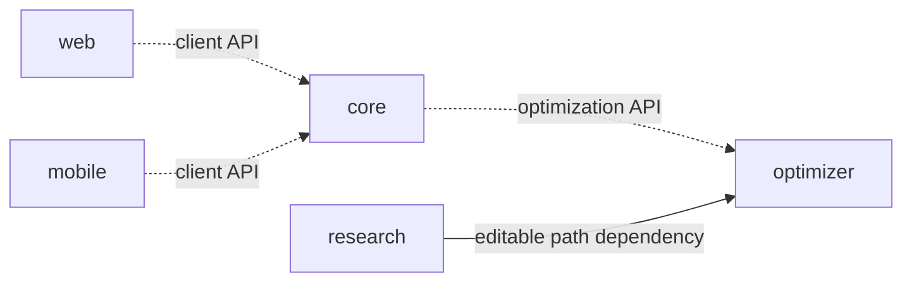
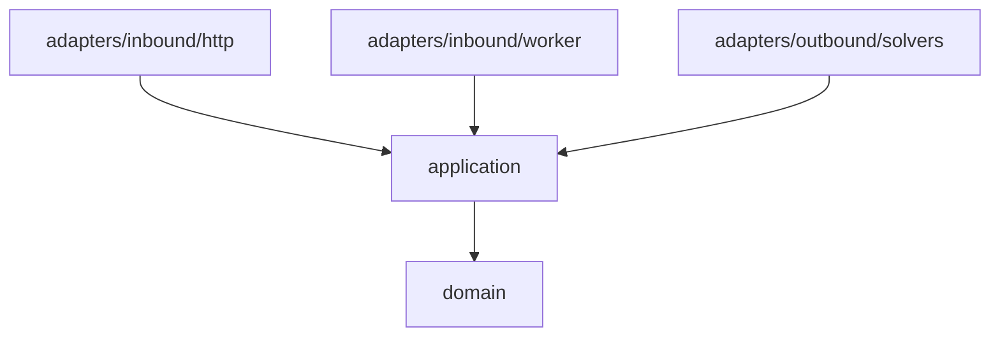

# DispatchFlow — Code structure

Where each kind of code and test lives, and which way dependencies point. It describes the
repository as it is today. What the system must do is in
[requirements.md](../requirements/requirements.md); why the repository is laid out this way is in
[ADR-008](../ADRs/ADR-008-monorepo-layout-under-src.md) and
[ADR-123](../ADRs/ADR-123-the-code-keeps-its-grouped-layout-and-three-components-take-new-names.md), why
every folder the design draws is declared ahead is in
[ADR-130](../ADRs/ADR-130-every-folder-is-declared-ahead-empty-and-documented.md), and why it is built and checked the way
it is in [ADR-009](../ADRs/ADR-009-just-as-the-single-entry-point.md) to
[ADR-016](../ADRs/ADR-016-dependency-audit-with-osv-scanner.md).

ADR-123 (Accepted) keeps this tree and gives three components the names they have today:
`src/backend/optimizer`, `src/frontend/web` and `src/frontend/mobile`.

Also Accepted and not in the tree yet:
[ADR-038](../ADRs/ADR-038-mise-pins-every-toolchain-and-core-moves-to-java-25.md) (`mise` pins every
toolchain; the core already runs its Java 25) and
[ADR-046](../ADRs/ADR-046-renovate-replaces-dependabot-and-targets-dev.md) (Renovate replaces
Dependabot).
[ADR-039](../ADRs/ADR-039-one-pnpm-workspace-for-both-apps-and-shared-packages.md) (one pnpm
workspace for both apps) is in the tree for the web app and the shared packages; the phone app
joins it at M10. These three, with ADR-042, supersede or amend some of ADR-009 to ADR-016 above: ADR-010, ADR-012
and ADR-014 are superseded; ADR-009, ADR-013 and ADR-015 are amended.

> [!NOTE]
> Most folders below are still empty. A folder listed as a placeholder holds only a `.gitkeep`
> file. A package that is declared, empty holds only a `package-info.java` (Java) or an `__init__.py`
> with a docstring (Python) ([ADR-130][ADR-130]). What is real today is the skeleton, the domain
> layer of `core` and `optimizer`, and the persistence of every `core` module: each component builds,
> passes its own checks and runs a first test.

## Top level

| Path | Holds |
|---|---|
| `src/backend/core/` | The REST API and system of record: Java 25, Spring Boot 4.1.2, Maven |
| `src/backend/optimizer/` | The optimization service: Python 3.14, FastAPI, NumPy, uv |
| `src/frontend/` | The pnpm workspace's root, over `web/` and `packages/*` ([ADR-039](../ADRs/ADR-039-one-pnpm-workspace-for-both-apps-and-shared-packages.md)): `package.json`, `pnpm-workspace.yaml` and its one lockfile, `pnpm-lock.yaml`; `.prettierrc.json`, Prettier's one file for the web app and the packages ([ADR-141](../ADRs/ADR-141-prettiers-settings-live-in-one-file-in-src-frontend.md)); and `.dockerignore`, for the web app's dev image |
| `src/frontend/web/` | The web app, for every role: React, TypeScript, Vite, pnpm |
| `src/frontend/mobile/` | The phone app, for every role: React Native, Expo SDK 58, TypeScript |
| `src/frontend/packages/` | The shared TypeScript packages ([ADR-039](../ADRs/ADR-039-one-pnpm-workspace-for-both-apps-and-shared-packages.md)): `eslint-config`, `tsconfig`, `i18n`, `formatters` and `schemas` are workspace packages, and two placeholder folders have no `package.json` yet |
| `src/research/` | Benchmarks, simulation and the order generator: Python, uv. Never deployed |
| `contracts/` | `client-api/v1` and `optimization-api/v1` (OpenAPI), and the Redocly lint setup |
| `tests/` | Tests that span components: `e2e/` and `load/`. Both are placeholders |
| `infra/` | `osrm/`, `deploy/` and `terraform/`. `deploy/compose.dev.yaml` runs the development stack, and `deploy/check_dev_stack.py`, with its `ruff.toml` and its tests in `deploy/test_check_dev_stack.py`, is `just infra-check` ([ADR-151](../ADRs/ADR-151-the-dev-stack-runs-the-core-as-a-compose-service-and-the-core-checks-its-database-session.md), [ADR-152](../ADRs/ADR-152-the-session-guard-reads-the-real-login-and-accepts-only-untranslated-messages-and-the-stack-check-checks-what-it-claims.md)). `deploy/postgres/initdb/create-roles.sql` creates the two database roles in a new PostgreSQL, and `deploy/.env.example` lists the keys Compose reads ([ADR-145](../ADRs/ADR-145-the-migrate-command-runs-flyway-as-the-owner-and-the-core-connects-as-app.md)); `deploy/tiles/Caddyfile` configures the stack's `tiles` service; `osrm/beer-sheva.geojson` is a rectangle around Be'er Sheva, Omer and Lehavim (it also covers Tel Sheva, Laqiya and the edge of Rahat), shared by the tile cut (`just data`), #168's clip and #209's service area: changing it means re-running `just data` and committing the new `israel_tiles_sha256`; `deploy/backup/` and `deploy/observability/` are placeholders |
| `data/` | The OSM extract, OSRM files, PMTiles and benchmark instances, once built. Git keeps the folder and ignores everything in it |
| `logs/` | Local log output. Git keeps the folder and ignores everything in it |
| `docs/` | `CLAUDE.md`, `requirements/` (with `ARD/`), `architecture/` (with `domain_layer/` and `tech_stack.md`), `ADRs/`, `roadmap.md`, `operations/` (with `data-inventory.md`) and `presentations/`; the placeholders are `guides/he/`, `guides/en/`, `research/usability/` and `architecture/generated/` |
| `.claude/` | Claude Code's context: the root `CLAUDE.md`, the team agents (`agents/`), the team skills (`skills/`), `settings.json`, and an empty `rules/` folder ([ADR-018](../ADRs/ADR-018-ai-assistant-context-in-the-repository.md), [ADR-020](../ADRs/ADR-020-team-subagents-in-the-repository.md), [ADR-025](../ADRs/ADR-025-team-skills-in-the-repository.md)) |
| `.github/` | The CI workflow, Dependabot configuration, and issue and pull request templates |
| `justfile` | Every command. CI runs the same recipes. `dev`, `dev-down` and `db-reset` start, stop and reset the development stack on a laptop, and `gen` regenerates the code built from the contracts |
| `README.md`, `.editorconfig`, `.gitattributes`, `.gitignore` | The readme, and the editor, line-ending and ignore settings |
| `.java-version`, `.python-version`, `.nvmrc` | Toolchain pins: Java 25, Python 3.14, Node 24 |
| `LICENSE` | Proprietary, all rights reserved ([ADR-017](../ADRs/ADR-017-proprietary-licence.md)) |

Each component has its own manifest, and each except `core` (Maven) has a lockfile. The web app's
lockfile is the workspace's, `src/frontend/pnpm-lock.yaml`, which it shares with the packages. The
one link at build time is `research`'s path dependency on `optimizer`, below.

`src/backend`, `src/frontend`, each component, `contracts/`, `contracts/client-api/` and `docs/` also
hold a `CLAUDE.md` with the rules for that folder, and a few narrower folders hold one of their
own.

## How the components depend on each other



A dotted arrow is a contract that is defined but that no code calls yet. The solid arrow is a
build dependency that exists today.

- The two frontends talk only to `core`, through `contracts/client-api/v1`. `core` serves that
  contract.
- `core` is the only client of `optimizer`, through `contracts/optimization-api/v1`. `optimizer` serves
  that contract.
- Neither side owns a contract, so the contracts sit at the root, outside every component.
- Today `contracts/client-api/v1`, served under `/api/v1`, declares Planning's two operations,
  `openPlan` and `requestSolve`, which `core` serves, and `contracts/optimization-api/v1` declares
  one: `GET /health/liveness`. `core` has no client for the optimization API yet.
- `research` installs `optimizer` from `../backend/optimizer` as an editable path dependency, and adds
  PyVRP. The optimizer's environment never contains PyVRP:
  `src/backend/optimizer/tests/test_dependency_boundary.py` fails if PyVRP is installed there or locked
  in its `uv.lock` ([ADR-004](../ADRs/ADR-004-pluggable-solver-port.md)).
- A change to `src/backend/optimizer/pyproject.toml` also needs `uv lock` in `src/research`.

## Inside each component

### `src/backend/core`

```text
src/backend/core/
  pom.xml, mvnw, mvnw.cmd, .mvn/   Maven and its wrapper
  CLAUDE.md                        the rules for this folder
  Dockerfile, Dockerfile.dockerignore   the image, built from the repository's root so the build
                                   sees contracts/client-api/v1 (ADR-160); the ignore file binds
                                   this image only
  .env.example                     the database connection keys, app's, with no values
  src/main/java/com/dispatchflow/
    DispatchFlowApplication.java   the Spring Boot entry point: it hands a first `migrate` to the
                                   next and refuses any other argument that isn't an option (ADR-146)
    MigrateCommand.java            the migrate step: the data source and Flyway alone, run as
                                   dispatchflow_owner before the core starts (ADR-145)
    DatabaseSessionGuard.java      refuses to start as a superuser, an owner, a member of any
                                   role, a login that switched role, or on a server whose
                                   lc_messages isn't C or POSIX (ADR-151, ADR-152)
    SchedulingConfiguration.java   @EnableAsync always, @EnableScheduling behind
                                   dispatchflow.scheduling.enabled, and the executor's cap
    MdcTaskDecorator.java          copies the caller's MDC to an asynchronous listener's thread
    StandInProfiles.java           the stand-ins' condition, exactly dev or exactly test, and what
                                   marks a deployed environment; @StandInOnly (StandInOnly.java)
                                   carries it (ADR-147)
    shared/                        the shared kernel: the typed IDs, the shared values, their
                                   errors, and the building blocks every module's domain uses
      application/                 the ports every module uses: Clock, IdGenerator,
                                   ProcessedEvents (declared), NotFound, StaleVersion, and
                                   ApplicationRefusal, which Audit's Refusals records
      adapter/out/persistence/     the persistence adapter every module shares: VersionedSave, the
                                   converters and instantiators that store the kernel's values,
                                   and id/ with the 14 typed-ID converters; an adapter, not the
                                   kernel
      adapter/out/clock/           SystemClock, the adapter of Clock
      adapter/out/uuid/            UuidV7Generator, the adapter of IdGenerator (uuid-creator)
      adapter/out/optimizer/       declared, empty: the client generated from optimization-api,
                                   which Planning's and Reporting's optimizer adapters wrap
      adapter/in/web/              Problems, the factory of every error body, ProblemItem,
                                   TraceIds, which makes a fresh trace ID, HandlerOrder,
                                   FilterOrder, the core's own filters' order, and ClientApi, the
                                   base path /api/v1 and the generated package; api/ and model/
                                   hold the code generated from client-api, which every build
                                   writes into target/generated-sources/openapi and never commits
                                   (ADR-160), and @RequiresCapability will join them; every
                                   module's controllers and handlers use it (ADR-140)
      adapter/out/sse/             declared, empty: the registry of open event streams, which
                                   Planning's and Live Operations' sse adapters send through
                                   (ADR-140)
    access/                        a bounded context's module: domain/ (account, session,
                                   companyprofile), events/, application/ (declared) and
                                   adapter/ (below); at its root only package-info.java and
                                   AccessConfiguration, the @Import list of its built use cases;
                                   every module's root holds the same, as <Module>Configuration
    fleet/                         domain/ (register, roster, driver), events/, application/ and
                                   adapter/
    orders/                        domain/ (flat), events/, application/ and adapter/
    planning/                      domain/ (plan, solution, drop, basis, revision,
                                   reconciliation, settings), events/, application/ and
                                   adapter/, with plan/ under out/persistence/ for Plan, and
                                   PlanController in in/web/, the core's one controller of the
                                   client API
    audit/                         domain/ (flat), application/ and adapter/; it raises no event
    reporting/                     domain/ (baseline), application/ and adapter/; it raises no
                                   event
    messaging/                     domain/ (message, rating, settings), events/, application/ and
                                   adapter/
    liveops/                       domain/ (delivery, outcome, proof, alert,
                                   routerun), events/, application/ and adapter/
    web/                           application-wide web concerns, above the modules: nothing depends
                                   on it, and it uses only their api and events (ADR-140)
      TraceIdFilter.java           each request's trace ID, from traceparent (Traceparent.java)
                                   or made fresh, in the MDC; hands an escaped exception to
                                   Tomcat's error dispatch; refuses with 400 a path Spring
                                   can't parse
      CallWrapper.java             the handler adapter that runs every handler through CallRetry,
                                   and binds CurrentCall and CurrentActor around a call under
                                   /api
      CallRetry.java               re-runs a call that lost a race, and audits the race it answers,
                                   naming its caller; after a commit it audits nothing and answers
                                   500
      CommitWatch.java             marks a try committed, so it isn't re-run
      Race.java                    what a lost race answers: 412, 409 or a retry, then 503
      ContractErrorHandler.java    400, 404, 405, 406, 413 and 415, Spring MVC's other errors and
                                   Tomcat's parameter refusals, and the refused audit record of a
                                   changing call refused before its handler starts;
                                   ContractBreaks.java builds the failing items
      KernelErrorHandler.java      the kernel's errors: 401, 403, 404, 409, 412, 422 and 503, and
                                   500 for a damaged stored value, a race after a commit and a
                                   refusal that is only another exception's cause
      UnexpectedErrorHandler.java  answers an unhandled exception with a 500 problem body
      ErrorEndpoint.java           the last resort: answers as a problem an error no handler
                                   answered, or that a servlet filter raised
      WebCodes.java                the codes web answers of its own, 401 ACCESS_TOKEN_REFUSED
                                   among them
      ClientApiPaths.java          serves a class that implements a generated interface under
                                   the literal prefix /api/v1, with no Spring API versioning
                                   (ADR-160)
      NoStoreFilter.java           Cache-Control: no-store, no-transform on every /api/ answer
                                   (ADR-157, ADR-160)
      ServedJson.java              the served JSON converter refuses unknown and duplicate keys,
                                   and leaves absent values out
      BodySizeLimit.java           caps at 1 MiB what a converter reads of a request body
      security/                    who the caller is (ADR-140, ADR-147): StandInSession, the
                                   filter that signs a request in as a seeded account under dev or
                                   test alone; StandInGuard, which refuses to boot with it
                                   anywhere else; AccessInterceptor, which builds the Caller
                                   of each call under /api/ or answers 401, by throwing
                                   NotSignedIn, which
                                   NotSignedInHandler answers; AccessInterceptorRegistration puts
                                   it in front of /api/**; Caller, who makes a call: its
                                   CallContext and, when signed in, its Actor; SignedInCaller, the
                                   request's principal; SeededAccounts, the shared list as the
                                   stand-in reads it
      stream/                      declared, empty: the event stream's endpoint, its heartbeat and
                                   the SessionsRevoked listener
      e2e/                         declared, empty: the end-to-end tests' control endpoints, under
                                   the e2e profile
      package-info.java
  src/main/resources/
    application.properties         Flyway off: the core never migrates
    application-schema-draft.properties  the profile `just core-schema-draft` runs
    application-dev.properties     the dev profile: the seeded list's import and the loopback
                                   address; never Flyway, and no stand-in account (ADR-147)
    seeded-accounts.properties     the one shared list of seeded accounts, which dev and test
                                   import (ADR-133, ADR-147)
    db/migration/                  Flyway migrations: V1 creates the eight schemas, then one per
                                   module, V2 access, V3 audit, V4 fleet, V5 liveops, V6
                                   messaging, V7 orders, V8 planning and V9 reporting; V10 refuses
                                   a negative list position on every list table; V11 grants app
                                   what each adapter runs; V12 adds the audit purge and its
                                   cutoff (data-model.md)
  src/test/java/com/dispatchflow/
    shared/                        the kernel's tests, and DomainAssertions, the refusal helper
                                   every module's domain tests use; AsSaved, which does to an
                                   aggregate in memory what a save does (it publishes and clears
                                   the events and moves the version), so that a domain test
                                   reaches a saved state through commands; SaveEvents, the
                                   helper that in-memory fakes use to publish events as a save
                                   does; application/ holds FixedClock and SequentialIds, which the
                                   use case tests share;
                                   adapter/out/persistence/ holds the shared adapter's tests and
                                   the test-only entities Ledger and its child LedgerEntry
    architecture/                  the domain purity, shape and package rules, the application
                                   rules, the JPA mapping rules and the transaction rules
                                   (ArchUnit), and the error-code,
                                   event-name, refusal-test and application-refusal checks
    archfixture/                   deliberately wrong classes that each rule must flag, one
                                   subpackage per rule under alpha/domain/ (split by kind above
                                   20 files), epsilon/ for the package rules, zeta/ for the
                                   application rules, entity/ and mapping/ under alpha/domain/
                                   and adapter/out/persistence/ for the mapping rules, and theta/
                                   for the transaction rules
    access/                        that module's domain tests, in the package of the type each
                                   tests, and its adapter/out/persistence/ tests: a *PersistenceIT
                                   for each aggregate or record, and the converters' tests
    fleet/                         the same as access/
    orders/                        the same as access/
    planning/                      the same as access/; the Plan's is in
                                   adapter/out/persistence/plan/; adapter/in/web/ holds
                                   PlanControllerIT, and application/port/out/ the in-memory fakes
                                   that OpenPlanTest and RequestSolveTest use
    audit/                         the same as access/
    reporting/                     the same as access/
    messaging/                     the same as access/
    liveops/                       the same as access/
    shared/adapter/in/web/         the problem factory's tests, ErrorParamsTest among them:
                                   every production error's params have a mapping; and
                                   TraceIdsTest, a fresh trace ID is never all zeros
    shared/adapter/out/            the clock's and the ID generator's tests, in clock/ and uuid/
    web/                           a test per class: the handlers, the error endpoint, the trace
                                   filter and the call wrapper through MockMvc; WebIT checks them
                                   wired in the whole application, and WebOverTomcatIT behind a
                                   real Tomcat; security/, the stand-in, its guard under each set
                                   of profiles, and the access interceptor over a test-only
                                   controller
    SchedulingConfigurationTest.java     the executor, its MDC copy and the scheduling property
    TransactionalBeanTest.java           a final transactional bean fails the context
    IntegrationTest.java                 the annotation every *IT uses but one that needs a real
                                         Tomcat: the whole app as app and PostgreSQL, under the
                                         test profile
    TomcatIntegrationTest.java           the same on a random port, in a context of its own
    CapturedLogs.java                    a unit test's view of a logger's events, read from logback
    DispatchFlowApplicationIT.java       the health probe answers UP against PostgreSQL
    DispatchFlowApplicationTest.java     the jar refuses a bare word, and `migrate` misplaced or
                                         misspelt
    DatabaseRolesIT.java                 the two roles, the migrate command and the grants' guard
    DatabaseSessionGuardIT.java          each session the core refuses to start on, against PostgreSQL;
                                         DatabaseSessionGuardTest, the messages settings
    TestDispatchFlowApplication.java     what `just core-run` starts: the dev profile, Flyway on,
                                         Israel's zone set by its own main
    TestActors.java                      the Actor of any seeded entry, read from the shared list
    TestcontainersConfiguration.java     the PostgreSQL container with both roles and the dev
                                         stack's server settings, the core's
                                         connection as app and the owner's pool, which Flyway runs
                                         on
    DatabaseRoles.java                   the roles' names and a run's passwords, from the init script
    DatabaseOwner.java                   the qualifier of the owner's pool and JdbcClient, which a
                                         test's own damage SQL runs on
    Transactions.java                    the ITs' shared transaction helper: it runs work in a
                                         transaction of its own, as a use case would, so a test
                                         can hold two copies of an aggregate and prove a conflict
    TestPersistenceConfiguration.java    what the persistence tests add: the test-only Flyway
                                         location, no archfixture in Hibernate's scan, the
                                         Transactions bean, and a recorder of published events
  src/test/resources/
    application-test.properties    the test profile: the seeded list's import, the stand-in's
                                   account, the loopback address, Flyway in the JVM and the
                                   scheduled jobs off
    core-run.properties            `just core-run`'s stand-in account, below the environment
    db/fixture/                    V0_1__persistence_fixture.sql, the test-only schema
                                   persistence_fixture and its two tables behind Ledger and
                                   LedgerEntry, and V0_2, app's grants on them (migration
                                   versions V0_* are reserved for tests)
```

The shared kernel exists
([ADR-097](../ADRs/ADR-097-the-shared-kernel-holds-the-domains-building-blocks.md)), and so do the
`domain` packages of `access`, `audit`, `fleet`, `liveops`, `messaging`, `orders`, `planning` and
`reporting`, and the `events` packages of the six that raise events. A domain package of more than 20
files splits into one package per aggregate, over a root that holds the module's error, then into
concept packages, wherever a group of 4 files can move
([ADR-118](../ADRs/ADR-118-a-domain-package-above-30-files-splits-by-aggregate.md),
[ADR-125](../ADRs/ADR-125-a-folder-above-20-files-splits-wherever-a-group-of-four-can-move.md)): `access`,
`fleet`, `liveops`, `messaging`, `planning` and `reporting` are split, `orders` and `audit` are flat,
and so are the kernel's domain types and every `api`, `spi` and `events` package.
`shared/application/` is a package of its own, beside them
([ADR-120](../ADRs/ADR-120-the-application-layer-takes-an-actor-and-a-call-context-and-reads-through-query-ports.md)).
The 20-file threshold applies to every source folder, so an application package above it splits by
aggregate too, and an aggregate's package by a concept beneath it: Planning's `service` and
`port/out`, Access's `service` and `port/out`, Live Operations' `service` and `port/out`, Customers
& Orders' `service` and `port/out`, and Fleet's `service` are split. A test sits in the package of the type it tests, and a refusal
test may sit anywhere under its error's package.

Each module also has an `application` package, declared ahead of its milestone and, but for Audit's
`AuditLogService` and `Refusals` and Planning's `OpenPlan` and `RequestSolve`, not built ([ADR-119](../ADRs/ADR-119-the-application-layer-is-declared-ahead-as-signatures-whose-bodies-throw.md)).
It holds whichever of `api`, `spi`, `port/out` and `service` the module has something for: `access`,
`audit` and `liveops` have no `spi`, and `messaging` and `reporting` have neither `api` nor `spi`.
Every body that would do work throws `UnsupportedOperationException("To Be Implemented.")`, but for
Audit's `AuditLogService`, which appends through `AuditRecords`, and Planning's `OpenPlan` and
`RequestSolve`, each with its `Change`, which are the wired use cases, and the `Refusals` helper in Audit's `api`, which runs a use case's own checks and `Change` and records the
domain or application refusal that leaves them ([ADR-150](../ADRs/ADR-150-one-audit-helper-records-the-refusals-a-use-case-sees-and-the-contracts-handler-records-a-changing-call-it-refuses.md)). A use case
is wired in its module's package-private `<Module>Configuration`, at the module's root, by joining
its `@Import` list in the pull request that builds its body ([ADR-140][ADR-140]); every list but
`AuditConfiguration`'s and `PlanningConfiguration`'s is still empty, and `ApplicationRules` rule 15 keeps the root to that class and its `package-info`. The layer's one Spring
annotation is `@Transactional`: on every service's class, and on the read-only reads of a
`<UseCase>Change`. A use case with outside calls, one transaction per item, or a transaction that
can refuse, holds its transactional `Change`, and it carries no transaction itself; nor does a
service that calls such a use case
([ADR-129](../ADRs/ADR-129-transactions-start-only-in-the-service-layer.md),
[ADR-149](../ADRs/ADR-149-the-use-case-records-its-refusal-after-the-rollback-and-the-audit-purge-counts-its-year-back-from-now.md)). The ports every module uses sit in `shared/application`, and the caller is an `Actor`
and a `CallContext`
([ADR-120](../ADRs/ADR-120-the-application-layer-takes-an-actor-and-a-call-context-and-reads-through-query-ports.md)).

Each module's `adapter/` holds its persistence adapter, which is built, and packages declared
ahead, empty ([ADR-130][ADR-130]). Every declared package holds a `package-info.java`, and nothing
else until its first class (a stand-in, which arrives with its issue): its Javadoc says what goes
in the package and which ports it implements, and it carries `@NullMarked`. 50 of them are still
empty, 48 in the eight modules and 2 beside the kernel. The adapter classes beyond the persistence
adapters are the kernel's: `in/web`'s problem factory, `out/clock`'s `SystemClock` and `out/uuid`'s
`UuidV7Generator`, and Planning's: `in/web`'s `PlanController`, `out/random`'s `RandomSeeds` and
`out/sse`'s `LiveUpdatesStandIn`, the stand-in for the event stream.
The names follow two rules:

- An inbound adapter is `adapter/in/<kind>`, of six kinds: `web` (a screen calls the client API),
  `listen` (an event arrives, its module's own or another's), `schedule` (the clock says so), `job`
  (a worker takes queued work, or a step runs once at startup), `callback` (an outside service
  calls in) and `cli` (a person runs a server step).
  There is no `in/sse`: the stream's endpoint is app-wide, in `web.stream`, and the registry of open
  streams is the kernel's `shared/adapter/out/sse` ([ADR-140][ADR-140]).
- An outbound adapter is `adapter/out/<name>`: named for the outside system or channel it talks to
  (`osrm`, `govmap`, `sms`, `disk`), `persistence` for the module's own database, or for the
  technology it wraps when it calls nothing outside the process (`crypto`, `config`, `random`,
  `resources`, `roaddata`).

ADR-130 decision 4 and [ADR-131][ADR-131] decision 4 list each module's packages and the ports they
implement, [ADR-133][ADR-133] adds Access's `in/job`, and ADR-140 adds the kernel's `in/web`, the code
generated from `client-api`, and `out/sse`. Every module also has an `in/cli` for its
part of the server steps that span the modules (ADR-131 decision 5). Adapters meet only through
ports: no adapter uses another adapter of its module or an adapter of another module, no shared
adapter uses anything outside the kernel, and only Planning's and Reporting's optimizer adapters use
the generated optimizer client (`ApplicationRules`, rules 9 to 12). The kernel's `in/web` and `out/sse`
sit below `web`, so every module's controllers and `sse` adapter reach them without depending on it.

Each of the eight modules has an
`adapter/out/persistence/` package ([ADR-126](../ADRs/ADR-126-jpa-replaces-jooq-and-the-domain-carries-its-mapping.md), [ADR-127](../ADRs/ADR-127-how-the-aggregates-are-mapped-and-where-their-stored-state-is-tested.md)). A module's package holds:

- the `Jpa…` classes, which implement the module's repository and record ports;
- a package-private Spring Data interface for each root, named for its collection (`Customers`,
  `ImportBatches`, `AllStopMessages`), which declares only `save` and the lookups its port needs;
- the module's converters (`…Converter`, auto-applied) and its embeddable instantiators
  (`…Instantiator`, registered in `package-info.java`), which store the module's single-column and
  multi-column values;
- a `Stored…` entity for each record it keeps: `StoredAuditRecord`, `StoredPosition`, `StoredReply`,
  `StoredOptOut` and `StoredBaselineOutcome`;
- for Planning only, a `plan/` subpackage that holds `Plan`'s adapter (`JpaPlanRepository`,
  `Plans`) and the `@Immutable` entity a plan's revisions are appended as, `StoredPlanRevision`,
  with its embeddables `StoredRevisionRoute` and `StoredRevisionStop`. Planning's converters, in the parent package, serve it
  too ([ADR-125](../ADRs/ADR-125-a-folder-above-20-files-splits-wherever-a-group-of-four-can-move.md)).

The migration for each of these modules is in `src/main/resources/db/migration/`, and
[data-model.md](data-model.md) describes its tables. An adapter reads and writes only its own
module's schema and entities (`PersistenceRules`).

The decided design is the domain document, the tech stack and the ADRs:
see the [domain layer
design](domain_layer/domain_layer_design.md#1-subdomains-and-bounded-contexts). How a context is
laid out inside is in [tech stack §4](tech_stack.md#4-repository-layout) and [domain layer design
§13](domain_layer/domain_layer_design.md#13-inside-each-module-hexagon) (the hexagon). New contexts
are written to tech stack §4.
[ADR-040](../ADRs/ADR-040-core-is-a-spring-modulith-monolith-with-one-module-per-context.md)
(Accepted) makes each context a Spring Modulith module, and
[ADR-041](../ADRs/ADR-041-one-postgresql-schema-per-module-read-and-written-through-jooq.md)
(Accepted, amended by [ADR-126](../ADRs/ADR-126-jpa-replaces-jooq-and-the-domain-carries-its-mapping.md), [ADR-127](../ADRs/ADR-127-how-the-aggregates-are-mapped-and-where-their-stored-state-is-tested.md) and [ADR-145](../ADRs/ADR-145-the-migrate-command-runs-flyway-as-the-owner-and-the-core-connects-as-app.md)) gives each module its own schema, accessed through JPA with the
mapping on the domain classes. ADR-040's module packages and adapter layout are in the tree
(ADR-130 declared them); Spring Modulith, which it also adopts, is not. ADR-041 and ADR-126 are, for every
module: their schemas, tables, mapped aggregates and persistence adapters exist, and so do the two
database roles and the `migrate` step.
[ADR-001](../ADRs/ADR-001-domain-driven-design-with-hexagonal-architecture.md)'s layout (one package
per context, split into `api`, `domain`, `application` and `adapter`) is amended by ADR-040, which
is accepted.

### `src/backend/optimizer`

```text
src/backend/optimizer/
  pyproject.toml, uv.lock, Dockerfile, .dockerignore
  CLAUDE.md                        the rules for this folder
  src/dispatchflow_optimizer/
    __init__.py                    the package marker; every package below has one
    py.typed                       marks the package as typed
    domain/                        Problem (validate, cost, explain_drop), ProblemFactory, Solution,
                                   TravelTimeModel, PenaltyScale, RuleId; problem_parts (the parts a
                                   problem holds) and problem_view (the protocol the validator, the
                                   objective and the drop reasons read a problem through)
    application/                   declared, bodies not built (ADR-119): the Solver port, the
                                   registry, the requests and outcomes, and five use cases
    adapters/inbound/http/app.py   create_app(): the FastAPI app, with GET /health/liveness
    adapters/inbound/worker/       declared, empty: the solver worker per lane (ADR-051)
    adapters/outbound/solvers/     one package per solver, each declared, empty
      ortools/                     the OR-Tools adapter
      alns/                        the DispatchFlow solver
      nearest_neighbour/           the baseline's solver, which the registry does not hold
    adapters/outbound/clock/       declared, empty: the Stopwatch adapter
  tests/                           mirrors the package path
    domain/                        the catalogue, properties, Solomon acceptance (data/solomon/)
    adapters/inbound/http/test_app.py
    test_dependency_boundary.py
```

The roles follow [ADR-004](../ADRs/ADR-004-pluggable-solver-port.md): every solver sits behind
one `Solver` port and is chosen by name. The port's call is `solve(problem, start, budget, seed)`
([ADR-044](../ADRs/ADR-044-solver-port-takes-start-budget-and-seed-and-problem-judges.md),
Accepted).
[ADR-040](../ADRs/ADR-040-core-is-a-spring-modulith-monolith-with-one-module-per-context.md)
puts the solvers under `adapters/outbound/solvers/`, and [ADR-130](../ADRs/ADR-130-every-folder-is-declared-ahead-empty-and-documented.md) declares them there.
`nearest_neighbour` is the baseline's solver, which the registry does not hold
([ADR-121](../ADRs/ADR-121-the-application-skeletons-review-settles-its-seams-conflicts-retention-and-scoring-inputs.md),
P16). No solver implements the port yet.



Everything may use `domain`. `domain` uses nothing else in the package.
The solver registry is a type in `application`; `create_app()` in `adapters/inbound/http`, the
process's entry point, fills it with the solvers. `application` therefore never imports
the solver adapters, and the two cannot form a cycle. The research harness builds its own registry.
No outbound adapter imports an inbound one, and no solver imports another: two import-linter
contracts check it ([ADR-131][ADR-131]). The workers sit apart from `http` because `spawn` mode
re-imports the worker's module in each process, so FastAPI never loads in a solver process.

### `src/research`

```text
src/research/
  pyproject.toml, uv.lock
  CLAUDE.md       the rules for this folder
  src/dispatchflow_research/
    __init__.py   the package marker
    benchmark/    the benchmark harness (declared, empty)
    simulation/   the disruption simulation (declared, empty)
    generator/    the order generator (declared, empty)
    solvers/      the harness's own solvers: pyvrp/, the PyVRP adapter (declared, empty)
  results/        benchmark results (placeholder)
  studies/        the YAML study files, validated by Pydantic (placeholder)
  tests/test_environment.py
```

`test_environment.py` checks that the research environment holds both `dispatchflow_optimizer` and
`pyvrp`. Benchmark instances live in the git-ignored `data/` at the repository root, not here
([ADR-123](../ADRs/ADR-123-the-code-keeps-its-grouped-layout-and-three-components-take-new-names.md),
[ADR-130][ADR-130]).

### `src/frontend/web`

A Vite project in the pnpm workspace ([ADR-143](../ADRs/ADR-143-the-web-app-shell-declares-routes-per-area-opens-in-english-and-renders-no-style-element.md)):

```text
src/frontend/web/
  index.html             <html lang="en" dir="ltr">, until DocumentLanguage sets the chosen language
  vite.config.ts         Vite and Vitest; ADR-069's policy on `vite preview`; the /api/ proxy
  Dockerfile.dev         the dev server's image for compose.dev.yaml, built from src/frontend
  src/
    main.tsx             reads the language setting, then builds i18next, the query cache and the router
    App.tsx              the last error boundary over AppProviders, then the router
    AppProviders.tsx     the providers the app and the component tests share: i18next, TanStack
                         Query, Mantine's direction and theme, its notifications, DatesLanguage
    DatesLanguage.tsx    the date pickers' language and Israel's week; the one file that imports Day.js
    AppErrorBoundary.tsx the last error boundary, around the whole app
    router.ts            createAppRouter, over routeTree.ts
    routeTree.ts         gathers every area's routes under the shell's layout route
    i18n.ts              createI18n, over @dispatchflow/i18n
    i18next.d.ts         types t() keys against the strings
    DocumentLanguage.tsx keeps <html lang> and the direction in step with the language
    styles/theme.css     what Mantine would inject as <style>: the font and the hiddenFrom rules
    routes/              the shell: the root route, shellRoute and its layout, /, the not-found
                         route and page, the error page
    features/<context>/  each area's pages and its routes.ts; access/ holds the Settings page,
                         planning/ the /plans and /plans/$date routes and their dates
    components/          the UI no area owns: NotBuiltPage, TextLink, usePageTitle, ProblemMessage,
                         DataTable, useNotifySaved, useLanguage; form/, the form, its save button and
                         the summary's placing of a refusal, with the fields in form/fields/;
                         map/, the map's (#174, empty until then)
    lib/                 the code no layer owns: the language setting, the refusal reader
                         (problems.ts), the refusal texts (problemText.ts), the one fetch and
                         answer reader of every call (coreCalls.ts), the one query cache
                         (queryClient.ts) and the versioned save (versionedSave.ts)
    test/                Vitest's setup, renderApp, renderComponent, the one MSW server, the <style>
                         check, the tests of the lint rules, and the example form
```

Imports point one way, from `src/` itself to `features/`, `routes/`, `components/` and `lib/`:
a feature parents its routes on the shell's `shellRoute`, the shell imports no feature, no feature
imports another, nothing below `src/` imports the modules that assemble the app, and only tests
import `src/test/`. `eslint.config.js` refuses each static import that breaks these, and
`src/test/importDirection.test.ts` pins them
([ADR-144](../ADRs/ADR-144-the-web-apps-features-stay-apart-and-its-lower-folders-never-import-upward.md)).
`src/features/` holds one folder for each
bounded context ([TS §10](tech_stack.md#10-web-app)): `access`, `fleet`, `orders` and `planning`
hold their routes and pages, and `audit`, `liveops`, `messaging` and `reporting` are placeholders
([ADR-130][ADR-130]). `src/test/setup.ts` starts the
tests' one MSW server, `src/test/server.ts`, over the handlers in `src/test/handlers.ts`; a
request no handler answers fails its test, and so does a `<style>` element left in the document.
The configuration files (`vite.config.ts`, `tsconfig*.json`, `eslint.config.js`) sit at the project
root: the two `tsconfig` files extend `@dispatchflow/tsconfig`, and `eslint.config.js` uses
`@dispatchflow/eslint-config`. Prettier reads `src/frontend/.prettierrc.json` ([ADR-141](../ADRs/ADR-141-prettiers-settings-live-in-one-file-in-src-frontend.md)).

### `src/frontend/mobile`

An Expo project. `src/index.ts` registers `src/App.tsx`, which renders a heading. `app.json`
and `assets/` hold the Expo configuration and icons. `osv-scanner.toml` lists the vulnerabilities
the audit ignores, each with a reason and an expiry date. The minimatch and glob entries were
accepted in [ADR-023](../ADRs/ADR-023-accept-minimatch-and-glob-advisories.md), and the zod and
deepmerge entries in
[ADR-095](../ADRs/ADR-095-accept-the-zod-and-deepmerge-advisories-until-2027-01-31.md). Its
`src/features/` holds eight placeholder folders, one per bounded context, named as the web app's
are. It has no route folder:
that comes with `expo-router` at M10 ([ADR-130][ADR-130]).

The two apps share no code. `src/frontend/packages/` holds seven folders. Five are workspace
packages that only the web app uses so far: `eslint-config` (`@dispatchflow/eslint-config`, the
ESLint 10 flat configs), `tsconfig` (`@dispatchflow/tsconfig`, the `base`, `app` and `node`
presets), `i18n` (`@dispatchflow/i18n`, the English and Hebrew strings as TypeScript, one
namespace per area in `src/en/` and `src/he/`, with `common` for the shared components and
`problems` for every refusal's text and next step), `formatters` (`@dispatchflow/formatters`,
dates, times and quantities as Israel reads them) and `schemas` (`@dispatchflow/schemas`, the
building blocks of every form's Zod schema) ([ADR-153](../ADRs/ADR-153-the-web-apps-shared-form-refusal-and-table-pieces.md)). Each ships its source, which the app
compiles, and its `build` script is its type check. The other two, `api-client` and `map-style`, are
placeholders: a folder is not a package until the ticket that first puts code in it adds its
`package.json` ([ADR-039](../ADRs/ADR-039-one-pnpm-workspace-for-both-apps-and-shared-packages.md),
[ADR-130][ADR-130]). `contracts/client-api/v1` declares two operations, and `core` generates its interfaces from them,
but the web app's generator is not set up yet (#148), so neither app has an API client.
[ADR-043](../ADRs/ADR-043-generated-code-from-both-contracts-and-problem-details-errors.md)
(Accepted) generates code from the contracts on both sides: `core`'s is in the tree, the
consumers' and the optimizer's are not yet.

## Where the tests live

| Kind of test | Location | Run by |
|---|---|---|
| `core`, unit (`*Test`) | `src/backend/core/src/test/java` | Maven Surefire |
| `core`, integration (`*IT`) | `src/backend/core/src/test/java` | Failsafe, with a PostgreSQL container |
| `optimizer` | `src/backend/optimizer/tests`, mirroring the package path | pytest |
| `research` | `src/research/tests` | pytest |
| `web` | next to the code, in `src/` (`App.test.tsx`, `test/setup.test.ts`, and `test/workspace.test.ts`, which checks the workspace's lockfile) | Vitest, in jsdom, with MSW and user-event |
| Shared TypeScript packages | next to the code, in each package's `src/` | Vitest |
| `mobile` | next to the code, in `src/` (`App.test.tsx`) | Jest, through `jest-expo` |
| End-to-end and load | `tests/e2e`, `tests/load` | No tool is configured yet |

Unit and integration tests stay inside their component, where each tool looks for them. Root
`tests/` holds only tests that span components. No end-to-end tool is configured, and [NFR-10]
calls for k6 for load tests. [Tech stack §17](tech_stack.md#17-testing) decides on Playwright for end-to-end tests and k6
for load tests.

The rule is that each side of a contract is tested against it ([NFR-162]). No test does that
yet.

`just <component>-check` runs a component's tests with its format and lint checks, and
`just check` runs every component's, plus the contract lint and the dependency audit.
`just gen` generates the code built from the contracts, which is never committed: today the core's
interfaces and models, which every core build writes too. See the [`justfile`](../../justfile).

## Dependency rules

These follow from
[ADR-001](../ADRs/ADR-001-domain-driven-design-with-hexagonal-architecture.md).

- **Domain code imports no framework, I/O or transport type.** Adapters depend on the domain,
  never the reverse. There are no cycles between modules or packages.
- **In `core`, a context reaches another only through that context's `api`, `spi` and `events`
  packages** ([domain layer design §2.3](domain_layer/domain_layer_design.md#23-rules-between-contexts)).
  ADR-001 names `api` only.
- **In `optimizer`, every solver implements the one `Solver` port** and is chosen by name. The
  registry has no default, and a name it does not hold is rejected.
- **PyVRP is never a dependency of `optimizer`.** Only `src/research` installs it.
- **The frontends talk only to `core`.** The API client is generated and never edited.

Three sets of rules are checked automatically today:
- the PyVRP rule;
- in `core`, the domain's purity rules, the shape rules, the package rules, the application
  rules, the JPA mapping rules and the transaction rules;
- in `optimizer`, the import-linter contracts in `pyproject.toml`: the domain imports no framework,
  solver or standard-library module that reads a clock, draws randomness or does I/O; the validator,
  the objective and the drop reasons never import `problem`; `application` imports no FastAPI,
  Starlette, Uvicorn, Pydantic, OR-Tools, Numba, `alns`, `concurrent`, `multiprocessing` or
  `subprocess`; the layers
  point one way; and the product never imports PyVRP. In the
  domain, ruff's `TID251` also bans `numpy.random`, `datetime64`, `timedelta64`, `numpy.load`,
  `fromfile`, `loadtxt` and `importlib.import_module`, and `PTH123`, `T20`, `S102` and `S307` ban
  `open()`, `print()`, `exec()` and `eval()`
  ([ADR-113](../ADRs/ADR-113-route-stability-is-its-own-cost-the-rules-read-a-problem-through-a-protocol-and-untimed-outputs-are-documented.md)).

The purity rules are ArchUnit tests in `src/test/java/com/dispatchflow/architecture/`, over
`shared` and every module's `domain` and `events` packages
([domain layer design §3.9](domain_layer/domain_layer_design.md#39-purity)). The shape rules cover
who may construct a restricted type, including that only a root's own class calls a root's
constructors and that no class extends a root, and what an error or an event may carry. The package rules are
four: no cycle between a module's domain packages, a domain root that imports none of its own
subpackages, `@NullMarked` on the kernel and on every domain and events package
([ADR-118](../ADRs/ADR-118-a-domain-package-above-30-files-splits-by-aggregate.md)), and no package
below a module's `api`, `spi` or `events` or below the kernel, except `shared.adapter.in.<x>` and `shared.adapter.out.<x>`
([ADR-125](../ADRs/ADR-125-a-folder-above-20-files-splits-wherever-a-group-of-four-can-move.md),
widened by [ADR-130][ADR-130]). The purity rules also forbid any pure class a dependency on `shared.adapter`. The nine JPA mapping rules
(`PersistenceRules`, [ADR-126](../ADRs/ADR-126-jpa-replaces-jooq-and-the-domain-carries-its-mapping.md)) are
separate. The rest are conventions that review enforces.

The application rules are ArchUnit tests too, in `ApplicationRules`, numbered in
[the Javadoc of its rule methods](../../src/backend/core/src/test/java/com/dispatchflow/architecture/ApplicationRules.java); rules 1 to 7 are
[ADR-120](../ADRs/ADR-120-the-application-layer-takes-an-actor-and-a-call-context-and-reads-through-query-ports.md)'s
decision 10, with rule 4 extended and rule 8 added by [ADR-121](../ADRs/ADR-121-the-application-skeletons-review-settles-its-seams-conflicts-retention-and-scoring-inputs.md),
and rule 7 widened to every application package by [ADR-125](../ADRs/ADR-125-a-folder-above-20-files-splits-wherever-a-group-of-four-can-move.md).
Rules 9 to 11 are [ADR-130][ADR-130]'s, and rule 12 is [ADR-131][ADR-131]'s: the adapters of a
module stay apart, no adapter uses another module's adapter, no shared adapter uses anything
outside the kernel, and only the optimizer adapters use the generated optimizer client. Rule 5's
`@NullMarked` check covers the adapter packages too, and a test holds the tree to the adapters
ADR-130, ADR-131 and ADR-140 declare.

Rule 13 is [ADR-140][ADR-140]'s. `web` is no module: rule 2 refuses every module a dependency on it, so
it sits above them, and rule 13 limits it to the modules' `application.api` and `events`, besides the
kernel and the frameworks. Rule 14, also ADR-140's, keeps the two holders of a web call's caller, `CurrentActor` (in
Access's `application.api`) and `CurrentCall` (in Audit's), to `web` and the modules' `adapter.in.web`:
a use case takes its `Actor` and `CallContext` as parameters. Rule 15,
also ADR-140's, keeps each module's root to its `package-info` and a package-private
`<Module>Configuration` that declares no `@Bean` and no scan, and imports only its own module's
`application.service` classes. Rule 17, also ADR-140's, lets only `web.security` build an `Actor`,
or a `CallContext`, beside the context's own `serverStep` ([ADR-148][ADR-148]),
and rule 18 lets only `web`'s call wrapper bind the holders, through any method of a holder but
`get()`. A test checks that each holder rules 14 and 18 name exists. Rules 19 and 20 are
[ADR-147][ADR-147]'s: no class directly in the root package uses a class below it, so the modules'
stand-in adapters may use its `StandInProfiles` and `@StandInOnly` without a cycle, and
`web.security` uses no class
directly in `web`. Rule 21, also ADR-147's, lets no handler take an `Actor` or a `CallContext`,
alone, as a type argument or in an array, which Spring would build from the request's parameters.
Rule 22, [ADR-140][ADR-140]'s decision 2, is the twin of rule 12 for the code generated from
`client-api`: only `web` and the modules' `adapter.in.web` use its types, a class that implements a
generated `<Tag>Api` lies in the `adapter.in.web` of the module its tag starts with, and every
generated interface has exactly one implementation there, so an operation with no controller fails
the build.

Rule 16 is [ADR-142][ADR-142]'s: no request handler, a method of a `@Controller` or one annotated
`@RequestMapping` or a variant, declares a streaming parameter (`InputStream`, `Reader`,
`OutputStream`, `Writer`, or a servlet request or response), because the call wrapper re-invokes a
handler with the arguments it already read.

[Tech stack §2.2](tech_stack.md#22-enforcement) also plans Spring Modulith's `verify()` for the
Alpha
([ADR-040](../ADRs/ADR-040-core-is-a-spring-modulith-monolith-with-one-module-per-context.md),
Accepted).

[ADR-130]: ../ADRs/ADR-130-every-folder-is-declared-ahead-empty-and-documented.md
[ADR-131]: ../ADRs/ADR-131-the-declared-structures-review-tightens-its-rules-and-fills-its-gaps.md
[ADR-133]: ../ADRs/ADR-133-a-startup-step-is-a-job-and-access-declares-one.md
[ADR-140]: ../ADRs/ADR-140-the-app-wide-web-package-sits-above-the-modules.md
[ADR-142]: ../ADRs/ADR-142-the-call-wrappers-retry-its-400s-and-its-error-endpoint-as-162-built-them.md
[ADR-147]: ../ADRs/ADR-147-the-stand-in-condition-sits-in-the-root-package-and-a-refused-access-token-answers-one-code.md
[ADR-148]: ../ADRs/ADR-148-the-stand-in-serves-only-its-own-origin-every-unsigned-api-call-answers-401-and-the-guard-outlives-the-session.md
[NFR-10]: ../requirements/requirements.md#nfr-10
[NFR-162]: ../requirements/requirements.md#nfr-162
