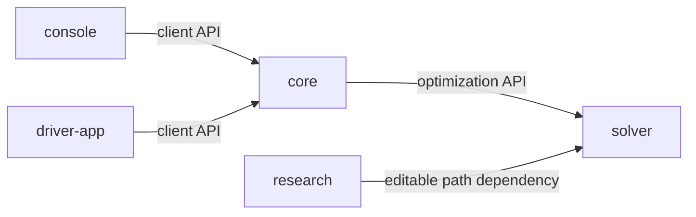
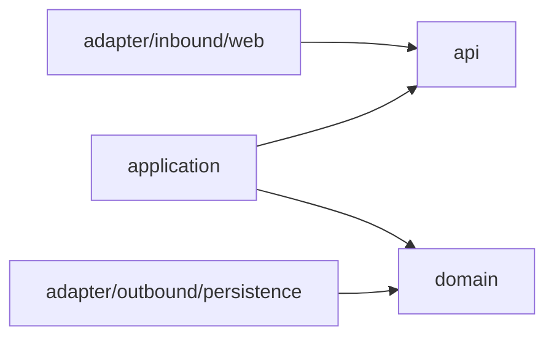
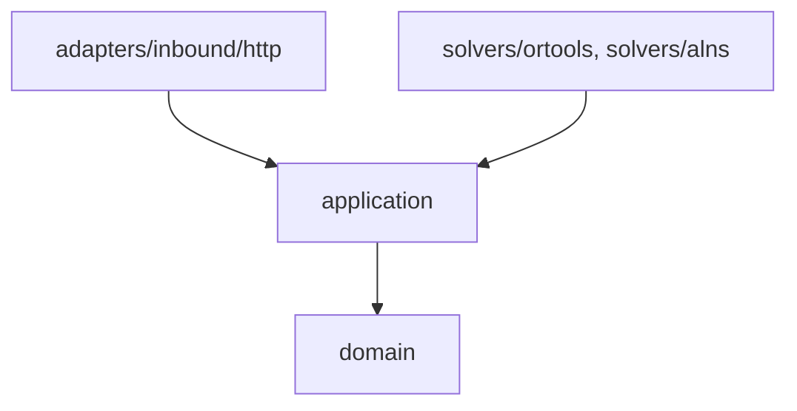

# DispatchFlow — Code structure

Where each kind of code and test lives, and which way dependencies point. It describes the
repository as it is today. What the system must do is in
[requirements.md](../requirements/requirements.md); why the repository is laid out this way is in
[ADR-008](../ADRs/ADR-008-monorepo-layout-under-src.md), and why it is built and checked the way
it is in [ADR-009](../ADRs/ADR-009-just-as-the-single-entry-point.md) to
[ADR-016](../ADRs/ADR-016-dependency-audit-with-osv-scanner.md).

> [!NOTE]
> Most folders below are still empty. A folder listed as a placeholder holds only a `.gitkeep`
> file. What is real today is the skeleton: each component builds, passes its own checks and
> runs a first test.

## Top level

| Path | Holds |
|---|---|
| `src/backend/core/` | The REST API and system of record: Java 21, Spring Boot 4.1.2, Maven |
| `src/backend/solver/` | The optimization service: Python 3.14, FastAPI, uv |
| `src/frontend/console/` | The console for admins and dispatchers: React, TypeScript, Vite |
| `src/frontend/driver-app/` | The driver app: React Native, Expo SDK 58, TypeScript |
| `src/research/` | Benchmarks, simulation and the order generator: Python, uv. Never deployed |
| `contracts/` | `client-api/v1` and `optimization-api/v1` (OpenAPI), and the Redocly lint setup |
| `tests/` | Tests that span components: `e2e/` and `load/`. Both are placeholders |
| `infra/` | `osrm/` and `deploy/`. Both are placeholders |
| `logs/` | Local log output. Git keeps the folder and ignores everything in it |
| `docs/` | `requirements/`, `architecture/`, `ADRs/`, and the project's planning material |
| `.github/` | The CI workflow, Dependabot configuration, and issue and pull request templates |
| `justfile` | Every command. CI runs the same recipes |
| `.java-version`, `.python-version`, `.nvmrc` | Toolchain pins: Java 21, Python 3.14, Node 24 |
| `LICENSE` | Proprietary, all rights reserved ([ADR-017](../ADRs/ADR-017-proprietary-licence.md)) |

Each component has its own manifest and lockfile, and nothing is shared at build time.

## How the components depend on each other



- The two frontends talk only to `core`, through `contracts/client-api/v1`. `core` serves that
  contract.
- `core` is the only client of `solver`, through `contracts/optimization-api/v1`. `solver` serves
  that contract.
- Neither side owns a contract, so the contracts sit at the root, outside every component.
- Today `contracts/client-api/v1`, served under `/api/v1`, declares only the two placeholder
  `Example` operations, and `contracts/optimization-api/v1` declares one:
  `GET /health/liveness`. `core` has no client for the optimization API yet.
- `research` installs `solver` from `../backend/solver` as an editable path dependency, and adds
  PyVRP. The solver's environment never contains PyVRP:
  `src/backend/solver/tests/test_dependency_boundary.py` fails if it can be imported there
  ([ADR-004](../ADRs/ADR-004-pluggable-solver-port.md)).
- A change to `src/backend/solver/pyproject.toml` also needs `uv lock` in `src/research`.

## Inside each component

### `src/backend/core`

```text
src/backend/core/
  pom.xml, mvnw, mvnw.cmd, .mvn/   Maven and its wrapper
  Dockerfile, .dockerignore
  .env.example                     the database connection keys, with no values
  src/main/java/com/dispatchflow/
    DispatchFlowApplication.java   the Spring Boot entry point
    example/                       a placeholder context that shows the structure (see below)
    web/                           application-wide web concerns: the fallback for unexpected errors
  src/main/resources/
    application.properties
    db/migration/                  Flyway migrations: only the example's V0_1, for now
  src/test/java/com/dispatchflow/
    IntegrationTest.java                 the one annotation every *IT uses: the whole app and PostgreSQL
    DispatchFlowApplicationIT.java       the health probe answers UP against PostgreSQL
    TestDispatchFlowApplication.java     what `just core-run` starts
    TestcontainersConfiguration.java     the PostgreSQL container
```

Each bounded context is one package under `com.dispatchflow`, split into four packages:

| Package | Holds |
|---|---|
| `api` | The context's public surface: the only package another context may use |
| `domain` | The context's business rules. It imports no framework, I/O or transport type |
| `application` | The context's use cases |
| `adapter` | The context's connections to the outside world |

No real context exists yet: the team designs them in #5. `example` is a placeholder that shows the
structure each one follows. `Widget` and the names around it are dummies, not DispatchFlow
concepts. Once the first real context exists, delete the package, its tests and its `Example`
operations in the client API. For its migration, `V0_1__create_example_widget.sql`:

- if no persistent database has applied it yet, delete the file too;
- if one has, keep it and add a migration that drops `example_widget`. Flyway refuses to start
  against a database that applied a migration it can no longer find.

```text
com/dispatchflow/example/
  api/                       ExampleApi, CreateWidgetCommand, WidgetView
  domain/                    Widget (the aggregate), WidgetId, Size, InvalidWidgetException,
                             WidgetRepository (a port)
  application/               ExampleService, which implements ExampleApi: the service layer
  adapter/inbound/web/       WidgetController and its request, response and problem types
  adapter/outbound/persistence/
                             WidgetEntity, WidgetJpaRepository, and WidgetPersistenceAdapter,
                             which implements WidgetRepository
```



`domain` depends on nothing, and the inbound adapter imports only `api`. A rejection crosses `api`
as an `api` type: the service catches the domain's `InvalidWidgetException` and throws
`WidgetRejectedException`, so no caller needs the context's domain.

`ExampleApi` is both what other contexts may call and what the web adapter calls. That is right
while the two needs match. When a context's `api` gains an operation that no other context
calls, give the web adapter its own use-case interface in `application` instead.

The tests follow the layers: `SizeTest` and `WidgetTest` test the domain alone,
`ExampleServiceTest` tests the service layer with an in-memory fake of `WidgetRepository`, and
`WidgetApiIT` drives the HTTP API down to a PostgreSQL container.

### `src/backend/solver`

```text
src/backend/solver/
  pyproject.toml, uv.lock, Dockerfile, .dockerignore
  src/dispatchflow_solver/
    domain/                        problem, solution, objective, validator (placeholder)
    application/                   use cases, the Solver port, the registry (placeholder)
    solvers/
      ortools/                     the OR-Tools adapter (placeholder)
      alns/                        the DispatchFlow solver (placeholder)
    adapters/inbound/http/app.py   create_app(): the FastAPI app, with GET /health/liveness
  tests/                           mirrors the package path
    adapters/inbound/http/test_app.py
    test_dependency_boundary.py
```

The roles follow [ADR-004](../ADRs/ADR-004-pluggable-solver-port.md): every solver sits behind
one `Solver` port and is chosen by name.



Everything may use `domain`. `domain` uses nothing else in the package.
The solver registry is a type in `application`; `create_app()` in `adapters/inbound/http`, the
process's entry point, fills it with the solvers. `application` therefore never imports
`solvers`, and the two cannot form a cycle. The research harness builds its own registry.

### `src/research`

```text
src/research/
  pyproject.toml, uv.lock
  src/dispatchflow_research/
    benchmark/    the benchmark harness (placeholder)
    simulation/   the disruption simulation (placeholder)
    generator/    the order generator (placeholder)
  instances/      benchmark instances (placeholder)
  results/        benchmark results (placeholder)
  tests/test_environment.py
```

`test_environment.py` checks that the research environment holds both `dispatchflow_solver` and
`pyvrp`.

### `src/frontend/console`

A Vite project. `src/main.tsx` mounts `src/App.tsx`, which renders a heading. `src/test/setup.ts`
configures Vitest. The configuration files (`vite.config.ts`, `tsconfig*.json`,
`eslint.config.js`, `.prettierrc.json`) sit at the project root.

### `src/frontend/driver-app`

An Expo project. `index.ts` registers `App.tsx`, which renders a heading. `app.json`
and `assets/` hold the Expo configuration and icons. `osv-scanner.toml` lists the vulnerabilities
the audit ignores, each with a reason and an expiry date, pending the owner's review.

The two apps share no code. The API client in each will be generated from
`contracts/client-api/v1`.

## Where the tests live

| Kind of test | Location | Run by |
|---|---|---|
| `core`, unit (`*Test`) | `src/backend/core/src/test/java` | Maven Surefire |
| `core`, integration (`*IT`) | `src/backend/core/src/test/java` | Failsafe, with a PostgreSQL container |
| `solver` | `src/backend/solver/tests`, mirroring the package path | pytest |
| `research` | `src/research/tests` | pytest |
| `console` | next to the code, in `src/` (`App.test.tsx`) | Vitest, in jsdom |
| `driver-app` | next to the code (`App.test.tsx`) | Jest, through `jest-expo` |
| End-to-end and load | `tests/e2e`, `tests/load` | Not chosen yet |

Unit and integration tests stay inside their component, where each tool looks for them. Root
`tests/` holds only tests that span components. The tool for end-to-end tests is not chosen
([`src/frontend/CLAUDE.md`](../../src/frontend/CLAUDE.md)), and [NFR-10] calls for k6 for load
tests.

The rule is that each side of a contract is tested against it ([NFR-21]). No test does that
yet.

`just <component>-check` runs a component's tests with its format and lint checks, and
`just check` runs every component's. See the [`justfile`](../../justfile).

## Dependency rules

These follow from
[ADR-001](../ADRs/ADR-001-domain-driven-design-with-hexagonal-architecture.md).

- **Domain code imports no framework, I/O or transport type.** Adapters depend on the domain,
  never the reverse. There are no cycles between modules or packages.
- **In `core`, a context reaches another only through that context's `api` package.**
- **In `solver`, every solver implements the one `Solver` port** and is chosen by name. The
  registry has no default, and a name it does not hold is rejected.
- **PyVRP is never a dependency of `solver`.** Only `src/research` installs it.
- **The frontends talk only to `core`.** The API client is generated and never edited.

Only the PyVRP rule is checked by a test today. The others are conventions that review
enforces; no tool such as ArchUnit or import-linter is configured.

[NFR-10]: ../requirements/requirements.md#nfr-10
[NFR-21]: ../requirements/requirements.md#nfr-21
