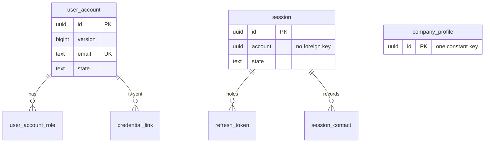
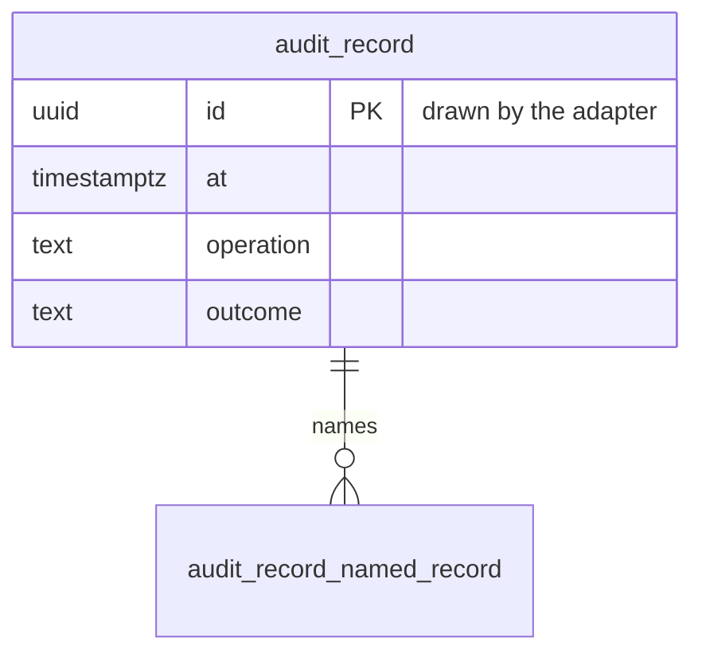
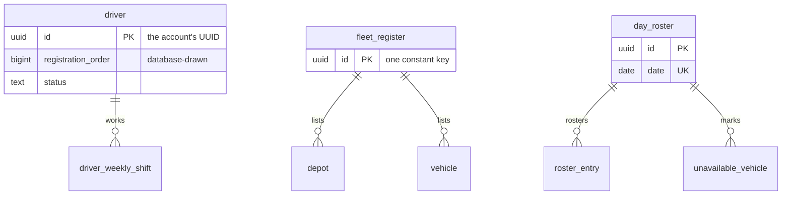
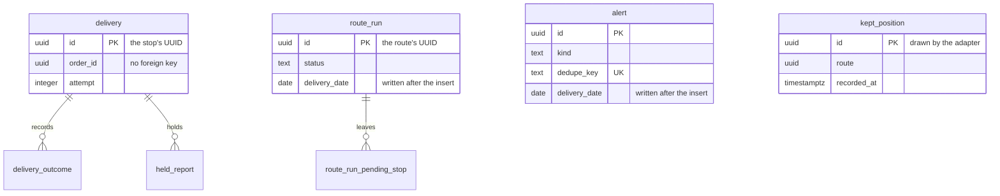
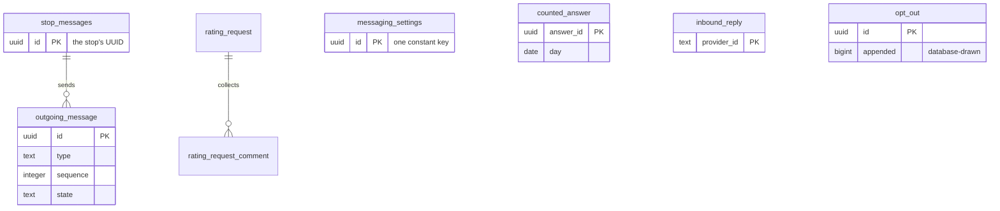
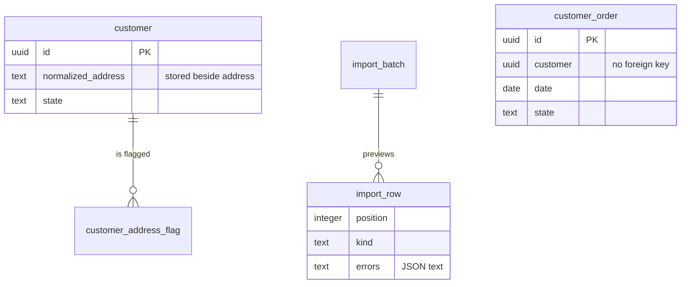
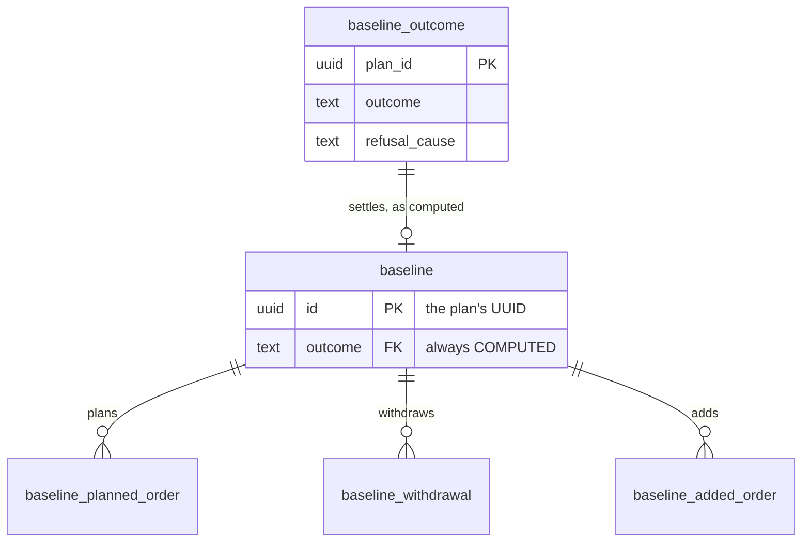

# DispatchFlow — Data model

The tables `core` stores its aggregates in, as the migrations in
`src/backend/core/src/main/resources/db/migration/` build them. What the system must do is in
[requirements.md](../requirements/requirements.md). How each class carries its mapping, how it is
versioned, loaded and saved, and how the stored state is tested is in [ADR-126][ADR-126] and
[ADR-127][ADR-127]. The aggregates, their rules and their states are in
[domain layer design §4](domain_layer/domain_layer_design.md#4-aggregates-context-by-context); this
file does not restate them. Where this file and a migration differ, the migration wins.

Every module has tables: `access`, `audit`, `fleet`, `liveops`, `messaging`, `orders`, `planning`
and `reporting`, 72 in all.

## Conventions

### Migrations

`V1__create_module_schemas.sql` creates the eight schemas of [ADR-041][ADR-041], one per module and
named after its package. Each module then adds its tables in one migration of its own
([ADR-127][ADR-127], decision 9):

| Version | File | Module |
|---|---|---|
| `V2` | `V2__access.sql` | `access` |
| `V3` | `V3__audit.sql` | `audit` |
| `V4` | `V4__fleet.sql` | `fleet` |
| `V5` | `V5__liveops.sql` | `liveops` |
| `V6` | `V6__messaging.sql` | `messaging` |
| `V7` | `V7__orders.sql` | `orders` |
| `V8` | `V8__planning.sql` | `planning` |
| `V9` | `V9__reporting.sql` | `reporting` |
| `V10` | `V10__list_positions_start_at_0.sql` | every module's list tables |
| `V11` | `V11__app_role_grants.sql` | what `app` may do on every module's tables |

Every number from `V1` to `V11` is taken, and a later migration takes the next free number. `V0_*`
is reserved for the test-only fixture in `src/test/resources/db/fixture/`, which only the tests run.

- **Grants.** Flyway runs as `dispatchflow_owner`, which owns every schema and table, and the core
  connects as `app`, which owns none ([ADR-041][ADR-041], [ADR-145][ADR-145]). `V11` grants `app`
  `USAGE` on the eight schemas and, on each table, only what its adapter runs: all four of `SELECT`,
  `INSERT`, `UPDATE` and `DELETE` where rows change and go, no `DELETE` where none is ever deleted,
  no `UPDATE` where rows are only added and removed, `SELECT` and `INSERT` where they are appended
  once, `SELECT` and `INSERT` on the audit trail's two tables, and `INSERT` alone on a published
  plan's revisions. Each later migration grants on the tables it creates ([ADR-127][ADR-127],
  decision 8), and `DatabaseRolesIT` fails on a table that grants `app` nothing or more than its
  rows.
- **`ddl-auto=validate`.** At startup Hibernate checks every mapping against the migrated schema and
  never changes it (`application.properties`). It checks that each mapped table and column exists
  with a compatible type, not constraints or nullability, so the integration tests are what check
  the `CHECK` constraints below.

### How a table is mapped

Every table is one of four kinds, and its kind decides its key.

| Kind | Mapped as | Key |
|---|---|---|
| Root | An `@Entity` extending `AggregateRoot`, with a `version bigint NOT NULL` column | `id uuid` |
| Child entity | An `@Entity` the root owns through `@OneToMany` and `@OrderColumn`, listed by `position` | Its own `id uuid` |
| Value rows | An `@ElementCollection` of a value with no ID of its own ([ADR-127][ADR-127], decision 3) | None of its own: a unique over the owner and `position`, or over what the value is |
| Record | An `@Immutable` entity in the module's persistence adapter, inserted and never updated, with no version ([ADR-127][ADR-127], decision 6) | The record's natural key, or a UUID the adapter draws |

### Keys and versions

- A root's key is its typed ID's UUID. A root keyed by another aggregate's ID uses that UUID:
  `fleet.driver` takes its account's, `liveops.delivery` and `messaging.stop_messages` their
  stop's, `liveops.route_run` its route's and `reporting.baseline` its plan's.
- A singleton keys on a constant UUID that its class documents, and a `CHECK` pins the column to it
  (`company_profile_one_row`, `fleet_register_one_row`, `messaging_settings_one_row`,
  `planning_settings_one_row`).
- `fleet.day_roster` is found by its date, so it takes a UUID beside a `date` column that is unique.
- A first save stores version 0, and every save moves the version by exactly 1
  ([ADR-126][ADR-126], [ADR-057][ADR-057]).
- A foreign key runs from a child table to its root's table. `planning` adds composite ones, from a
  stop to a route of its own plan and from a revision's rows to the revision, and `reporting` one
  more, below.
  A column that names another aggregate's row (an order's `customer`, a vehicle's `start_depot`, a
  roster entry's `driver`) is a plain `uuid` with no foreign key. `ON DELETE CASCADE` appears only
  where retention deletes the parent with its children: `access.refresh_token`,
  `access.session_contact`, `messaging.outgoing_message` and `audit.audit_record_named_record`.
  A delivery is never deleted, because retention erases its personal data and keeps its records,
  and a solve job, a proposal, a plan and a plan's revisions are never deleted either
  ([domain layer design §9.7](domain_layer/domain_layer_design.md#97-how-things-end)). A plan's route
  and stop rows are deleted only by that plan's own changes.

### Types and constraints

- **Enums** are `text` with a `CHECK … IN (…)` constraint named `<table>_<column>_known`, stored by
  name ([ADR-126][ADR-126]).
- **A state with data** is a `state` or `kind` column beside nullable columns, and a `CHECK` per
  state says which columns each state fills (for example `user_account_state_times`). The migration
  is the second line of defence: the `@PostLoad` check on the root is the first.
- **Ordered lists** have a `position integer NOT NULL` column and a `UNIQUE (owner, position)` that
  is `DEFERRABLE INITIALLY DEFERRED`, because Hibernate rewrites the indexes row by row. Nothing in
  the schema keeps the positions contiguous, and Hibernate loads a missing one as a `null` element,
  so every root's load check refuses a gap first, through the kernel's `StoredLists`. `V10` checks
  `position >= 0` on each list table, because Hibernate fails on a negative position while it loads
  the list, before any check runs ([ADR-128][ADR-128], decision 4).
- **Instants** are `timestamptz`, kept to the microsecond, so an instant the domain compares after a
  load is cut to the microsecond before it is stored: `CorrectedTime` cuts a device's instants, and
  the `Clock` port requires its `now()` to be cut ([ADR-128][ADR-128], decision 5). An Israel-local
  date and time (`IsraelDateTime`) is `timestamp(6)` with no zone, a date is `date`, and a time of
  day is `time`, and the session runs in UTC ([ADR-088][ADR-088]).
- **Weights and volumes** are `numeric(8, 2)` kilograms and `numeric(9, 2)` litres
  ([ADR-061][ADR-061]).
- **Durations.** A bare `java.time.Duration` is `bigint` nanoseconds, through the shared adapter's
  `DurationConverter`, so every module stores one the same way and exactly ([ADR-128][ADR-128],
  decision 3). `planning` does: a leg's travel time (`leg_in_travel`, `leg_to_end_travel`), a late
  stop's `late`, a violation's `exceeded_by` and the fixed cost per vehicle. A solve limit is
  nanoseconds too, through its own converter. A service time is whole seconds in a `bigint`
  (`default_service_time`, `service_time_seconds`), and `reporting.baseline.driver_hours` is
  `bigint` nanoseconds through its own converter, so that a fraction of a second is kept
  ([ADR-109][ADR-109]). A time of day inside a plan is `bigint` seconds (`*_seconds`) beside a
  `date`.
- **Personal data** is nullable where retention anonymizes a row in place (`user_account`, `driver`,
  `customer`, `customer_order`). In each, a `CHECK` keeps every column that anonymizing clears null
  in an anonymized row, and the load check enforces it too.
- **Advisory locks** are taken with `pg_advisory_xact_lock(hashtext('<module>:<lock>:' || value))`,
  so each module's locks have their own names and are released at commit
  ([ADR-127][ADR-127], decision 9). The modules take `access:active-admins`,
  `liveops:alert-dedupe-key:<key>`, `messaging:daily-cap:<day>`, `orders:date-capacity:<date>`,
  `planning:plan-date:<date>` and `planning:solve-lane:<lane>`. A solve job is claimed with
  `FOR UPDATE SKIP LOCKED`.

### Choices worth knowing

- **An import row's errors are JSON text.** `orders.import_row.errors` holds a list of `DomainError`
  records through `RowErrorsConverter`, which admits only records under `com.dispatchflow`
  ([ADR-127][ADR-127], decision 7). It is the only JSON in the schemas, and an unreadable row's
  `field_errors` column uses the same converter. Every other value is relational.
- **A session's contact times are a set.** `access.session_contact` is keyed by the session and the
  instant, with no position, so a contact is one inserted row and a drop deletes only the old ones
  ([ADR-127][ADR-127], decision 10).
- **`orders.customer.normalized_address` is stored, not derived.** `Customer` sets it with the
  address, so that `candidatesAt` finds a match by index. It holds the result of the normalization
  rules of the day it was set. If those rules change, every stored value goes stale and an import
  would miss matches until a migration recomputes the column.
- **Records through adapter entities.** The records of
  [domain layer design §3.2](domain_layer/domain_layer_design.md#32-records) stay free of
  annotations, and an `@Immutable` entity in the adapter stores each: `audit.audit_record`,
  `liveops.kept_position`, `messaging.inbound_reply` and `messaging.opt_out`. Reporting's
  `baseline_outcome` and planning's `plan_revision` are stored the same way.
- **A child that moves between parents is owned by the root.** A plan's stops move between its routes
  and keep their IDs, so `Plan` holds every stop in one collection of its own that alone creates and
  deletes them, and a route's list only says which stops it serves
  ([ADR-127][ADR-127], decision 11). See [`planning`](#planning-v8).
- **A date the adapter writes after the insert.** `liveops.route_run.delivery_date` and
  `liveops.alert.delivery_date` are columns the aggregates do not map ([ADR-127][ADR-127],
  decision 12). See [`liveops`](#liveops-v5).
- **Columns the database fills.** `fleet.driver.registration_order` and `messaging.opt_out.appended`
  are `GENERATED ALWAYS AS IDENTITY`. The entities do not write them, and a query orders by them.
- **State no entity maps.** `reporting.baseline.outcome` is a column its default writes and the key
  `baseline_settles_its_plan` reads, and `messaging.counted_answer` is a table only native SQL
  writes and reads ([ADR-128][ADR-128], decision 2). Neither holds personal data.
  `ddl-auto=validate` and `just core-schema-draft` don't see them or the two dates above, so a
  migration drafted from the mapping must keep them.

## Schemas

### `access` (V2)

The aggregates `UserAccount`, `Session` and `CompanyProfile`
([§4.1](domain_layer/domain_layer_design.md#41-access)).

| Table | Holds | Key |
|---|---|---|
| `user_account` | An account: email and who set it, password hash, state, language, generation, terms acceptance | `id` |
| `user_account_role` | One row per role, `ADMIN`, `DISPATCHER` or `DRIVER` | `(user_account_id, role)` |
| `credential_link` | A set-password, recovery or email-change link: token hash, issue and expiry times, status. A child entity | `id`, and a deferred unique on `(user_account_id, position)` |
| `session` | A sign-in: the account, both generations, state, opening and last-password times | `id` |
| `refresh_token` | A session's tokens, each `CURRENT`, `EXCHANGED`, `REPLACED` or `SUPERSEDED`. A child entity | `id`, and a deferred unique on `(session_id, position)` |
| `session_contact` | The instants a session was contacted. Value rows | `(session_id, contacted_at)` |
| `company_profile` | The company's name, language, default delivery window and default service time. A singleton | A constant UUID |

What the constraints enforce:

- **An account's state.** `user_account_state_times`: an `ACTIVE` account has neither a deactivation
  nor an anonymization time, a `DEACTIVATED` one has the first, an `ANONYMIZED` one has both.
- **One account per address** (BR-45). `user_account_email_unique` is a unique over `email`. A
  `NULL` is distinct, so anonymized accounts hold no address between them, and the adapter answers a
  violation of that one constraint, by name, with `EmailInUse`. `user_account_email_set_whole` has
  `email_set_by` and `email_set_at` both null or both set. `user_account_anonymized_holds_nothing`:
  an `ANONYMIZED` account holds no email, no record of who set it, and no password hash.
- **A link's kind.** `credential_link_email_change_whole`: only an email-change link carries
  `new_email` and `requested_by`.
- **A token's state.** `refresh_token_state_has_time`: every state but `CURRENT` has a `state_at`.
  `refresh_token_exchanged_has_successor`: only an `EXCHANGED` token names its successor.
- **A session's end.** `session_revoked_has_time`: a `REVOKED` session has `revoked_at`.
- **Partial indexes** for the lookups the ports make: the active Admins
  (`user_account_role_admin`, where `role = 'ADMIN'`), the accounts whose deactivation is due
  (`user_account_deactivated_at`), a user's open links (`credential_link_open`) and a session's
  current token (`refresh_token_current`). Links and tokens are found by their token's hash, never
  by the token, and each hash is unique across every link or every token
  (`credential_link_token_hash`, `refresh_token_token_hash`), because each lookup expects one row.
- **Deletion.** An account is anonymized in place, never deleted, so its children have no cascade.
  A session is deleted 30 days after it ends, and its tokens and contacts go with it.

### `audit` (V3)

The append-only audit trail ([§4.8](domain_layer/domain_layer_design.md#48-audit),
[ADR-110][ADR-110]). It holds only IDs, codes, enums, numbers and instants.

| Table | Holds | Key |
|---|---|---|
| `audit_record` | One record: when, account, session, app and its version, operation, outcome, error code, trace ID. A record, never updated | A random `id` the adapter draws, so two records with the same content are two rows |
| `audit_record_named_record` | The records an audit record names, in the order given: a kind and an ID. Value rows | A deferred unique on `(audit_record_id, position)` |

- `audit_record_app_whole`: `app` and `app_version` are both null or both set, and `app` is `WEB` or
  `PHONE`.
- `audit_record_refused_has_code`: a `REFUSED` record has an `error_code`, and no other does.
- `audit_record_named_record_kind_known` lists the 14 kinds a record may name.
- `audit_record_at` serves the purge of records older than a year. No purge function exists yet,
  so `JpaAuditRecords.purgeExpired` throws `UnsupportedOperationException`;
  [tech stack §6.3](tech_stack.md#63-persistence) decides one, owned by `dispatchflow_owner`.
- `app` may only insert and read both tables (`V11`, [ADR-041][ADR-041]), so the core can neither
  change nor delete a record.

### `fleet` (V4)

The aggregates `Driver`, `FleetRegister` and `DayRoster`
([§4.2](domain_layer/domain_layer_design.md#42-fleet)). Nothing deletes a driver, the register or a
roster, so no foreign key cascades.

| Table | Holds | Key |
|---|---|---|
| `driver` | A driver: status, retirement and anonymization times, name and phone, default shift and vehicle | `id`, the driver's account UUID |
| `driver_weekly_shift` | The weekly shift template, at most one shift per weekday. Value rows | `(driver_id, day)` |
| `fleet_register` | The register itself, which has no column but its key and version. A singleton | A constant UUID |
| `depot` | A depot: name, location, opening hours, retirement time. A child entity | `id`, and a deferred unique on `(fleet_register_id, position)` |
| `vehicle` | A vehicle: name, plate, capacity, start and end depot, retirement time. A child entity | `id`, and a deferred unique on `(fleet_register_id, position)` |
| `day_roster` | A date's roster | `id`, and a unique `date` |
| `roster_entry` | A driver's entry: shift, vehicle choice, availability. Value rows, in the order rostered | Deferred uniques on `(day_roster_id, position)` and on `(day_roster_id, driver)` |
| `unavailable_vehicle` | The vehicles marked unavailable on the roster's date. Value rows | A deferred unique on `(day_roster_id, position)` |

- **A driver's status.** `driver_active_has_no_times`, `driver_retired_has_retired_at` and
  `driver_anonymized_has_anonymized_at` tie each status to its times. `driver_contact_whole` has
  `name` and `phone` both null or both set, and `driver_anonymized_has_no_contact` has both null
  for an `ANONYMIZED` driver.
- **One roster per date.** `day_roster_one_per_date` is a unique over `date`. A second roster for a
  date is a race that `DayRosterRepository.add` answers with `StaleVersion`.
- **One entry per driver.** `roster_entry_driver_once` is deferred, as the position unique is,
  because Hibernate rewrites a list's rows one by one.
- **A vehicle choice.** `roster_entry_assigned_has_vehicle`: an entry's `vehicle` is set exactly
  when its `vehicle_choice` is `ASSIGNED`. The other choices are `NOT_SET` and `NO_VEHICLE`.
- **Wholeness.** `depot_location_whole` has latitude and longitude both null or both set, and
  `depot_hours_whole` has `opens` and `closes` both null or both set.
- **`driver_retired_at`** is a partial index, where `status = 'RETIRED'`, for the retention job.
- **Registration order.** `registration_order` orders `DriverRepository.registered()`.

### `liveops` (V5)

The aggregates `Delivery`, `RouteRun` and `Alert`, and the position record
([§4.5](domain_layer/domain_layer_design.md#45-live-operations)).

| Table | Holds | Key |
|---|---|---|
| `delivery` | A stop's delivery for one attempt: its order, the attempt and the driver's arrival | `id`, the stop's UUID |
| `delivery_outcome` | The outcome records, the original first and then each correction: a delivered or failed outcome with its proof or reason, who recorded it, and its origin. Value rows | A deferred unique on `(delivery_id, position)` |
| `held_report` | A report held for a dispatcher: an outcome, the driver, route, revision and times, what it overrides, and its state. A child entity | `id`, the `HeldReportId`, and a deferred unique on `(delivery_id, position)` |
| `route_run` | A route's run: who started it and why, its status, who finished it and when, the confirmed revision | `id`, the route's UUID |
| `route_run_pending_stop` | The stops a finished run left without an outcome, in the route's order. Value rows | A deferred unique on `(route_run_id, position)` |
| `alert` | An alert: its kind and the subject columns that kind names, its dedupe key, raise time, state and acknowledgement | `id`, and a unique `dedupe_key` |
| `kept_position` | A position a route kept: route, driver, point, recorded and received times. A record | A random UUID the adapter draws |

- **An outcome is a kind plus its columns.** `delivery_outcome_delivered_whole` and
  `delivery_outcome_failed_whole`: `left_at_door` is set exactly for `DELIVERED`, and
  `failure_reason` exactly for `FAILED`. A proof belongs to a delivered outcome only, a proof's note
  needs its file and its file needs its kind, and `failure_text` goes only with `OTHER`
  (`delivery_outcome_proof_only_delivered`, `_proof_file_has_kind`, `_proof_note_has_file`,
  `_failure_text_only_other`). `held_report` carries the same outcome columns with the same
  constraints, under the prefix `held_report_`.
- **An outcome's origin.** The origin is `REPORTED`, `CONFIRMED_HELD`, `ON_BEHALF` or `CORRECTION`,
  and each sets its own columns: a route for `REPORTED` and `ON_BEHALF`
  (`delivery_outcome_route_named`), a revision and three report times for `REPORTED` only
  (`delivery_outcome_report_whole`, BR-44, BR-110), a confirmed report for `CONFIRMED_HELD`
  (`delivery_outcome_confirmation_named`), and a time for `CORRECTION`, the only origin with a
  reason (`delivery_outcome_correction_dated`, `delivery_outcome_reason_only_correction`).
- **The arrival.** `delivery_arrival_whole`: the five `arrival_*` columns are all null or all set.
- **A held report's state.** `held_report_decision_dated`: every state but `OPEN` has `state_at`.
  `held_report_dispatcher_named`: only `CONFIRMED` and `REFUSED_BY_DISPATCHER` name a dispatcher
  in `state_by`. `held_report_open` is a partial index, where `state = 'OPEN'`, for the dispatcher's
  list.
- **A run's end.** `route_run_finished_whole`: a `FINISHED` run has `finished_at` and `finished_by`.
- **An alert's subject.** `alert_kind_known` lists the 10 kinds, and each subject column is set
  exactly for the kinds that name it: `route` for all but `LOW_RATING`, `stop` for six kinds,
  `revision` for `STOP_AT_RISK` and `ROUTE_CHANGE_UNCONFIRMED`, `driver` for `DRIVER_PROBLEM` and
  `REPORT_REFUSED`, and `problem`, `held_report`, `refused_fact` and `rating_request` each for one
  kind (the `alert_*_named` constraints). `alert_acknowledged_whole`: an `ACKNOWLEDGED` alert has
  `acknowledged_by` and `acknowledged_at`.
- **One alert per key.** `alert_dedupe_key_unique` allows one alert for a dedupe key, open or
  acknowledged ([ADR-107][ADR-107]). It is the backstop: `JpaAlertRepository.addUnlessKeyTaken` takes
  the key's advisory lock, `liveops:alert-dedupe-key:<key>`, and looks for the key with a query. It
  stores the alert only when none holds it. A taken key is therefore found by a query and not by a
  failed insert, so the caller's transaction stays usable and the alert's events are not published.
- **Retention.** The partial indexes `delivery_outcome_personal_data` and `held_report_personal_data`
  find the rows whose proof file, failure text or correction reason retention may erase (NFR-31,
  NFR-184). `kept_position_received_at` serves the deletion of positions 7 days after receipt, and
  `kept_position_latest` finds a route's last two positions, newest first.
- **`delivery_order_attempt`** serves the lookup of one attempt's delivery for an order.

**The `delivery_date` columns.** A route's run and an alert hold no date, since the date belongs to
the route's plan, and the classes do not map one. The `liveops` adapter still keeps it beside the
row: `startedOn` reads a date's runs by it (`route_run_delivery_date`), and `alert_open_on` indexes a
date's open alerts. `add` first inserts the row, through Hibernate, and then writes the date with one
native `UPDATE … WHERE delivery_date IS NULL` in the same transaction. It throws `AssertionError` when
that does not update exactly one row, which means the caller added an aggregate it had loaded.

- **Why it is nullable:** Hibernate inserts the row first, without the date.
- **What it costs:** the schema cannot refuse a row stored without its date, and a run or alert
  without one is invisible to the lookups by date. Only the adapter writes these tables, so the
  rule rests on that.
- **What it buys:** the date stays out of the domain classes, and the lookups by date use an index.

**Where the records live.** Of the public values that `Delivery` keeps in columns of its own,
`ArrivalRecord` sits beside it in `domain.delivery`, and `OutcomeRecord`, `HeldReport`, `HeldState`,
`Origin` and `CorrectionReason` sit in `com.dispatchflow.liveops.domain.outcome`, because each is
about an outcome. No class there depends on `domain.delivery`, so the two packages form no cycle
([ADR-125][ADR-125]). The package-private `StoredOutcomeRecord`,
`StoredOutcome` and `StoredHeldReport` in `domain.delivery` store them: an outcome record, which has
no ID, as an embeddable with its origin as a kind plus nullable columns, and a held report as a child
entity ([ADR-127][ADR-127], decision 3).

### `messaging` (V6)

The aggregates `StopMessages`, `RatingRequest` and `MessagingSettings`, the day's counted answers
and two records ([§4.6](domain_layer/domain_layer_design.md#46-recipient-messaging),
[ADR-108][ADR-108]).

| Table | Holds | Key |
|---|---|---|
| `stop_messages` | A stop's messages, which has no column but its key and version | `id`, the stop's UUID |
| `outgoing_message` | One message: type, sequence, phone, text, state, provider reference, drop cause. A child entity | `id`, a unique on `(stop_messages_id, type, sequence)`, and a deferred unique on `(stop_messages_id, position)` |
| `counted_answer` | The reply answers counted toward a day's cap. No entity: native SQL writes and reads it | `answer_id` |
| `rating_request` | A rating request: its stop, phone, rating, and the state of its reminder and its thank-you | `id` |
| `rating_request_comment` | The comments received, in order. Value rows | A deferred unique on `(rating_request_id, position)` |
| `messaging_settings` | The company's two switches and its dispatch phone. A singleton | A constant UUID |
| `inbound_reply` | An SMS reply kept, with its phone, text and time. A record | `provider_id`, the provider's own identifier |
| `opt_out` | The opt-out history: a phone's hash, `OPTED_OUT` or `OPTED_IN`, the time, the dispatcher. A record | A UUID the adapter assigns |

- **Sent at most once.** `outgoing_message_once` is a unique over a message's stop, type and
  sequence (NFR-191). It is not deferred, and the position unique is.
- **A message's state.** `outgoing_message_accepted_has_reference`: only an `ACCEPTED` message has a
  `provider_reference`. `outgoing_message_dropped_has_cause`: only a `DROPPED` one has a
  `drop_cause`.
- **A request's rating.** `rating_request_rated_whole` has `rating` and `rated_at` both null or both
  set. `reminder` and `thank_you` are `NOT_YET`, `SENT` or `SKIPPED`.
- **An opt-in.** `opt_out_opt_in_has_dispatcher`: only a dispatcher removes an opt-out (FR-380).
  `opt_out` keeps a hash, never the phone, and a phone's latest entry is the one with the highest
  `appended`, whatever its time ([ADR-108][ADR-108]).
- **A reply is kept once** by `provider_id` (NFR-199), and deleted after 90 days (NFR-184).
- **Partial indexes** for the lookups the ports make: the messages the sender may claim
  (`outgoing_message_claimable`, where `state` is `PENDING` or `UNKNOWN`, oldest trigger first), when
  a phone was last messaged (`outgoing_message_accepted_to`, where `state = 'ACCEPTED'`) and the
  latest request sent to a phone (`rating_request_open_for`, where `phone IS NOT NULL`).

### `orders` (V7)

The aggregates `Customer`, `Order` and `ImportBatch`
([§4.3](domain_layer/domain_layer_design.md#43-customers--orders)). Nothing deletes a customer, an
order or an import, so no foreign key cascades, and no foreign key joins two aggregates: an order
names its customer by ID only.

| Table | Holds | Key |
|---|---|---|
| `customer` | A customer: name, phone, address and its normalized form, note, location kind and point, match quality, default window and service time, state | `id` |
| `customer_address_flag` | The doubts about a customer's location, each flag once. Value rows | `(customer_id, flag)` |
| `customer_order` | An order: customer, date, window, weight, volume, service time, priority, recipient and access details, attempt, state. `order` is reserved in PostgreSQL | `id` |
| `import_batch` | An uploaded file: its hash, encoding (`UTF_8` or `WINDOWS_1255`), preview time, state | `id` |
| `import_row` | A preview's rows, in row order. Value rows, and a batch that leaves the preview keeps none | A deferred unique on `(import_batch_id, position)` |

- **A customer's location.** `customer_location_has_point`: a `MISSING` location has no point and
  the others have one. `customer_location_point_whole` has latitude and longitude both null or both
  set. `customer_geocoded_has_quality`: only a `GEOCODED` location has a `match_quality`.
- **A customer's state.** `customer_state_since`: an `ACTIVE` customer has no `state_since`, and a
  retired or anonymized one has. `customer_normalized_with_address`: `address` and
  `normalized_address` are both null or both set. `customer_anonymized_holds_nothing`: an
  `ANONYMIZED` customer has a `MISSING` location and none of its personal columns.
- **An order's state.** `customer_order_cancelled_at`: a `CANCELLED` order has `cancelled_at`. The
  window is `starts_at` and `ends_at`, because PostgreSQL reserves `end`.
- **One reference per date** (FR-211). `customer_order_reference_unique_on_date` is a partial
  unique index on `(date, reference)` over the uncancelled orders that have a reference. Placing,
  moving and putting back an order read the date's orders under its lock first, so the index is
  the backstop for a write that skipped the lock.
- **A batch's state.** `import_batch_state_since`: a `PREVIEWED` batch has no `state_since`, and a
  confirmed, discarded or expired one has.
- **A row's kind.** `import_row_parsed_has_line`: a `PARSED` row has an address, date, weight,
  volume, priority and leave-at-door flag. `import_row_unreadable_has_no_line`: an `UNREADABLE` row
  has none of the line's 18 columns, and it has `field_errors`
  (`import_row_unreadable_has_field_errors`).
- **Partial indexes** for the lookups the ports make: an import row's match, which reads only active
  customers (`customer_active_by_address`), a date's uncancelled orders
  (`customer_order_uncancelled_by_date`), the hourly sweep of open previews
  (`import_batch_previewed_at`, where `state = 'PREVIEWED'`), and the retention job's lookups of
  retired and active customers and of orders not yet anonymized.
- **`customer_order.anonymized`** records that the row's recipient, note, access details and
  reference are null, which `customer_order_anonymized_holds_nothing` enforces, as the load check
  does.

### `planning` (V8)

The aggregates `SolveJob`, `ReoptimizationProposal`, `PlanningSettings` and `Plan`, and a plan's
revisions ([§4.4](domain_layer/domain_layer_design.md#44-planning)). Jobs, proposals, settings,
plans and revisions are never deleted, so no foreign key cascades.

```mermaid
erDiagram
    solve_job ||--o{ solve_job_violation : "fails with"
    solve_job ||--o{ solve_job_route : "results in"
    solve_job ||--o{ solve_job_stop : "results in"
    solve_job ||--o{ solve_job_drop : "results in"
    solve_job ||--o{ solve_job_excluded_vehicle : "results in"
    reoptimization_proposal ||--o{ reoptimization_proposal_route : "proposes"
    reoptimization_proposal ||--o{ reoptimization_proposal_stop : "proposes"
    reoptimization_proposal ||--o{ reoptimization_proposal_drop : "proposes"
    reoptimization_proposal ||--o{ reoptimization_proposal_excluded_vehicle : "proposes"
    reoptimization_proposal ||--o{ reoptimization_proposal_withdrawal : "proposes"
    reoptimization_proposal ||--o{ reoptimization_proposal_late_stop : "proposes"
    reoptimization_proposal ||--o{ reoptimization_proposal_vehicle_without_position : "proposes"
    reoptimization_proposal ||--o{ reoptimization_proposal_driver_change : "proposes"
    reoptimization_proposal ||--o{ reoptimization_proposal_changed_order : "proposes"
    reoptimization_proposal ||--o{ reoptimization_proposal_goods_hand_over : "proposes"
    plan ||--o{ route : "has"
    plan ||--o{ planned_stop : "creates and deletes"
    route ||--o{ planned_stop : "serves, in order"
    plan ||--o{ plan_drop : "drops"
    plan ||--o{ plan_excluded_vehicle : "excludes"
    plan ||--o{ plan_pin : "pins"
    plan ||--o{ plan_violation : "reports"
    plan ||--o{ plan_undo : "journals"
    plan ||--o{ plan_redo : "journals"
    plan ||--o{ plan_revision : "appends"
    plan_revision ||--o{ plan_revision_route : "holds"
    plan_revision ||--o{ plan_revision_stop : "holds"
    solve_job {
        uuid id PK
        uuid plan_id "no foreign key"
        text lane
        text phase
    }
    plan {
        uuid id PK
        date delivery_date "unique while uncancelled"
        text status
    }
    route {
        uuid id PK
        uuid plan_id FK
    }
    planned_stop {
        uuid id PK
        uuid plan_id FK
        uuid route_id FK "with plan_id, to route"
        integer position
    }
    plan_revision {
        uuid plan_id PK
        integer revision PK
    }
    planning_settings {
        uuid id PK "one constant key"
    }
```

| Table | Holds | Key |
|---|---|---|
| `solve_job` | A call to the optimizer: plan, lane (`DAILY` or `REOPTIMIZATION`), solver, solve limit, seed, basis revision, phase with the times each phase keeps, a failed job's reason | `id`, the `JobId` |
| `solve_job_violation`, `solve_job_route`, `solve_job_stop`, `solve_job_drop`, `solve_job_excluded_vehicle` | A job's failure violations, and a succeeded daily job's routes, stops, drops and excluded vehicles. Value rows | A deferred unique on `(solve_job_id, position)`. A stop's is also unique on `(solve_job_id, route_position, stop_position)` |
| `reoptimization_proposal` | A re-optimization's result waiting for a dispatcher: plan, job, basis, the seven objective terms, state and who declined it | `id`, the `ProposalId` |
| `reoptimization_proposal_route`, `_stop`, `_drop`, `_excluded_vehicle`, `_withdrawal`, `_late_stop`, `_vehicle_without_position`, `_driver_change`, `_changed_order`, `_goods_hand_over` | A proposal's routes, stops, drops, excluded vehicles, withdrawals, late stops, vehicles without a position, driver changes, and each change's orders and goods handed over. Value rows | A deferred unique on `(proposal_id, position)`. A stop's is also unique on `(proposal_id, route_position, stop_position)` |
| `planning_settings` | The company's morning and evening peak windows and factors, off-peak factor, buffer, default solve limit, fixed vehicle cost and departure allowance. A singleton | A constant UUID |
| `plan` | One delivery date's plan: date, status, a solving plan's basis, the current revision, when it was cancelled, its applied solve | `id`, the `PlanId` |
| `route` | A plan's route, in its order: vehicle, driver, lock, check state, withdrawal cause, confirmed return, times. A child entity | `id`, the `RouteId`, deferred uniques on `(plan_id, position)` and `(plan_id, route_index)`, and a unique on `(id, plan_id)` |
| `planned_stop` | A stop: order, attempt, times, whether it was served late. A child entity | `id`, the `StopId`, which it keeps when it moves between routes, and deferred uniques on `(route_id, position)` and `(plan_id, order_id, attempt)` |
| `plan_drop`, `plan_excluded_vehicle`, `plan_pin`, `plan_violation` | A plan's drops, excluded vehicles, pins and violations. Value rows | A deferred unique on `(plan_id, position)` |
| `plan_undo`, `plan_redo` | The undo and redo journals, oldest first. Value rows | A deferred unique on `(plan_id, position)` |
| `plan_revision` | One revision of a published plan: effective time, cause, the proposal it accepted, who made it. A record | `(plan_id, revision)` |
| `plan_revision_route`, `plan_revision_stop` | A revision's routes and, flattened into one table, their stops. Value rows | A deferred unique on `(plan_id, revision, position)`. A stop's is also unique on `(plan_id, revision, route_position, stop_position)` |

- **A job's phase.** `solve_job_phase_known` lists `QUEUED`, `BUILDING_MATRIX`, `RUNNING`,
  `SUCCEEDED` and `FAILED`. A job has `claimed_at` from `BUILDING_MATRIX` on
  (`solve_job_claimed_has_claim`), `search_started_at` from `RUNNING` on
  (`solve_job_searched_has_search`), `ended_at` when `SUCCEEDED` or `FAILED`
  (`solve_job_ended_has_end`), and a `failure_reason` when `FAILED` only
  (`solve_job_failed_has_reason`). `solve_job_basis_only_for_reoptimization`: a `basis_revision` goes
  with the `REOPTIMIZATION` lane only. A failed job's violations are present exactly for a rejection
  or an unhonoured lock, which the job's load check enforces, because a `CHECK` cannot read the job's
  row.
- **One re-optimization per plan.** `solve_job_one_reoptimization_per_plan` is a partial unique
  index on `plan_id`, where the lane is `REOPTIMIZATION` and the phase is `QUEUED`, `BUILDING_MATRIX`
  or `RUNNING` (BR-38). The lane's advisory lock comes first, so the index is the backstop: the
  adapter answers its violation, by name, with `ReoptimizationAlreadyRunning`, and lets any other
  violation through. `solve_job_unfinished` serves the worker's claim, the lane's queue and the
  watchdog.
- **A proposal's state.** `reoptimization_proposal_declined_by_whom` and
  `reoptimization_proposal_declined_when`: a `DECLINED` proposal has `declined_by` and
  `declined_at`, and a `READY` one has neither.
- **A drop's reason is a kind beside its fact's columns.** The same constraints stand on
  `solve_job_drop`, `reoptimization_proposal_drop` and `plan_drop`, under their own prefixes. The 11
  reasons are in the `_reason_known` constraint, and each fact is present exactly for the reasons
  that have it: a pin target and `pin_target_out` for `PIN_NOT_HONOURED` (`_pin_has_one_target`,
  `_pin_says_if_out`), four figures for `CAPACITY` (`_capacity_has_figures`), and a limit and an
  earliest time for `TIME_WINDOW`, `SHIFT` and `DEPOT_HOURS` (`_time_has_fact`).
- **Times are all or none.** A route's times are five columns (`route_plan_whole`), a stop's six
  (`planned_stop_plan_whole`), a revision stop's arrival two (`plan_revision_stop_arrival_whole`),
  and a plan's applied solve three (`plan_applied_whole`). Each is `num_nonnulls(…)` in a set of two
  values: none, or all.
- **A plan's status.** `plan_status_known` lists `DRAFT`, `SOLVING`, `READY`, `PUBLISHED`, `COMPLETED`,
  `CANCELLED` and `ABANDONED`. A `SOLVING` plan names the job it waits for, with its request time
  (`plan_solving_has_basis`). A `PUBLISHED`, `COMPLETED` or `CANCELLED` plan has a `revision`
  (`plan_published_has_revision`), and a `CANCELLED` one has `cancelled_at`
  (`plan_cancelled_has_time`).
- **One uncancelled plan per date** (BR-34). `plan_one_uncancelled_per_date` is a partial unique index
  on `delivery_date`, where `status <> 'CANCELLED'`. `PlanRepository.add` takes the date's advisory
  lock, `planning:plan-date:<date>`, then reads the date's uncancelled plan and refuses with
  `PlanAlreadyExists` if there is one. The index is the backstop for a write that skipped the lock,
  and its violation passes through as the bug it would be.
- **A stop stays on a route of its own plan** ([ADR-127][ADR-127], decision 11, says why). The
  plan's own collection creates and deletes a stop through `planned_stop.plan_id`, and its route's
  list places it through `route_id` and `position`. The composite foreign key
  `planned_stop_on_a_route_of_its_plan`, from `(route_id, plan_id)` to `route (id, plan_id)`, which
  `route_of_its_plan` makes possible, keeps the two on one plan. It is `DEFERRABLE INITIALLY
  DEFERRED`, because Hibernate may insert a stop before its new route and delete a route before the
  stops that leave with it.
- **One index, one stop, one pin.** `route_index_once`, `planned_stop_order_once` and
  `plan_pin_order_once` are deferred uniques: a plan gives each route its own index, serves an
  order and attempt once, and pins an order once. They back the load check, and are deferred
  because Hibernate rewrites those rows in place.
- **The journals.** `plan_undo` and `plan_redo` have one shape: a `kind` (`MOVED_STOP`, `TOOK_OFF`,
  `PLACED`, `PINNED`, `UNPINNED`, `LOCKED` or `UNLOCKED`) beside the columns that kind uses, and a
  `CHECK` per column group says which kinds fill it: the stop, the order and attempt, the origin
  and the destination, the locked route, the times of a taken-off stop, the reason a placed order
  was dropped for, and the pin or lock before and after.
- **Revisions are appended, never loaded.** A plan's revision is inserted as rows when the plan is
  saved, once, and is never changed or loaded with the plan
  ([ADR-059](../ADRs/ADR-059-plan-revisions-are-stored-as-rows.md)). `StoredPlanRevision` is an
  `@Immutable` entity keyed by its plan and number. `plan_revision_cause_known` lists the 7 causes,
  and `plan_revision_proposal_only_accepted` has a `proposal_id` exactly for
  `REOPTIMIZATION_ACCEPTED`. Nothing reads a revision back yet.
- **Settings.** `planning_settings_enabled_cost_has_duration`: `fixed_vehicle_cost_per_vehicle` is
  set exactly when `fixed_vehicle_cost` is `ON`. The morning and evening peaks are a start, an end
  and a factor each, beside an off-peak factor.
- **Lookups.** `plan_by_date` and `solve_job_by_plan` serve the midnight job, `planned_stop_by_plan`
  the plan's load, and `route_not_yet_checked` the re-check job (FR-395).
- **Not built yet.** `SolveJobRepository`'s two blanking methods throw `UnsupportedOperationException`
  until M13, because nothing stores a job's input yet. `unfinishedOn` reads a job's date through its
  plan, in the plan table, since a job keeps no date of its own.

### `reporting` (V9)

The aggregate `Baseline`, and how each plan's publication baseline was settled
([§4.7](domain_layer/domain_layer_design.md#47-reporting), [ADR-109][ADR-109]). A baseline holds no
personal data and stays as long as its plan, so nothing here is deleted.

| Table | Holds | Key |
|---|---|---|
| `baseline_outcome` | How a plan was settled, `COMPUTED` or `REFUSED`, and a refusal's cause. A record | `plan_id`, and a unique on `(plan_id, outcome)` |
| `baseline` | A plan's baseline: distance in whole metres, driver-hours in nanoseconds, cause (`PUBLISHED` or `RECOMPUTED`), time computed | `id`, the plan's UUID |
| `baseline_planned_order` | Every order of the day, with its window and whether it was `SERVED` or `DROPPED`. Value rows | A deferred unique on `(baseline_id, position)` |
| `baseline_withdrawal` | The vehicles withdrawn so far, with a cause. Value rows | A deferred unique on `(baseline_id, position)` |
| `baseline_added_order` | The orders added so far. Value rows | A deferred unique on `(baseline_id, position)` |

**A plan holds a baseline or a refusal, never both** (FR-39). Three constraints carry it:

1. `baseline_outcome.plan_id` is the primary key, so a plan has one settlement.
2. `baseline.outcome` is a column that the entity does not map. It defaults to `COMPUTED`, and
   `baseline_is_computed` forbids any other value.
3. `baseline_settles_its_plan` is a composite foreign key from `baseline (id, outcome)` to
   `baseline_outcome (plan_id, outcome)`, which `baseline_outcome_with_its_outcome` makes possible.
   A baseline can therefore refer only to an outcome row that is `COMPUTED`, so no baseline sits
   beside a refusal.

The adapter settles the plan first, with a native `INSERT … ON CONFLICT DO NOTHING` that adds no
row when the plan is settled already, and ends in `StaleVersion` when it adds none. Only then does
it store the baseline. A refusal has a cause, and only a refusal does
(`baseline_outcome_refused_has_cause`).

- **A planned order's start.** `baseline_planned_order_served_has_start`: a `SERVED` order has a
  `start_date` and a `DROPPED` one has none, and `start_date` and `start_seconds` are both null or
  both set. Its window is `timestamp(6)`, Israel local time.
- **Causes.** `baseline_withdrawal_cause_known` lists `VEHICLE_UNAVAILABLE`, `NO_DRIVER` and
  `SHIFT_RAN_OUT`, and `baseline_outcome_refusal_cause_known` lists `SOLVER_FAILED`,
  `NO_SOLUTION_WITHIN_BUDGET` and `VALIDATOR_REJECTED`.

## Where the stored state is tested

Each module has integration tests against the PostgreSQL container, in its `adapter/out/persistence`
folder under `src/test/java/com/dispatchflow/`. Where a root has a stored state to check, they save
a valid aggregate, damage one stored value with SQL, and load it again. They expect
`StoredStateInvalid` or, where a `CHECK` already forbids the value, that the database refuses the
write ([ADR-127][ADR-127], decision 1). The adapters run as `app`, so passing proves its grants;
the damage runs as `dispatchflow_owner`, so a refusal comes from the schema, except a damage the
load shares a transaction with, which runs as `app` ([ADR-145][ADR-145], decision 8).
`DatabaseRolesIT` tests the roles themselves.

| Module | Integration tests |
|---|---|
| `access` | `UserAccountPersistenceIT`, `SessionPersistenceIT`, `CompanyProfilePersistenceIT` |
| `audit` | `AuditRecordsPersistenceIT` |
| `fleet` | `DriverPersistenceIT`, `FleetRegisterPersistenceIT`, `DayRosterPersistenceIT` |
| `liveops` | `DeliveryPersistenceIT`, `RouteRunPersistenceIT`, `AlertPersistenceIT`, `PositionLogPersistenceIT` |
| `messaging` | `StopMessagesPersistenceIT`, `RatingRequestPersistenceIT`, `MessagingSettingsPersistenceIT`, `ReplyLogPersistenceIT`, `OptOutListPersistenceIT` |
| `orders` | `CustomerPersistenceIT`, `OrderPersistenceIT`, `ImportBatchPersistenceIT` |
| `planning` | `SolveJobPersistenceIT`, `ProposalPersistenceIT`, `PlanningSettingsPersistenceIT`, `PlanPersistenceIT` (in `plan/`) |
| `reporting` | `BaselinePersistenceIT` |
| `shared` (the kernel's adapter) | `VersionedSaveIT` (the save helper, the kernel's values and instantiators), `ListPositionsIT` (every list table refuses a negative position, [ADR-128][ADR-128], decision 4) |

The test helpers they share are in [code-structure.md](code-structure.md#srcbackendcore).

[ADR-041]: ../ADRs/ADR-041-one-postgresql-schema-per-module-read-and-written-through-jooq.md
[ADR-057]: ../ADRs/ADR-057-concurrent-changes-to-a-plan-use-optimistic-locking.md
[ADR-061]: ../ADRs/ADR-061-capacity-is-weight-and-volume.md
[ADR-088]: ../ADRs/ADR-088-israel-local-time-for-every-date-and-schedule.md
[ADR-108]: ../ADRs/ADR-108-messaging-appends-opt-ins-holds-its-fixed-wording-and-cuts-comments-to-500-characters.md
[ADR-109]: ../ADRs/ADR-109-reporting-computes-exact-on-time-shares-from-current-facts-and-keeps-no-personal-data.md
[ADR-107]: ../ADRs/ADR-107-live-operations-alerts-once-per-key-corrects-a-put-back-by-event-and-treats-a-reschedule-as-a-cancellation.md
[ADR-110]: ../ADRs/ADR-110-audit-records-hold-only-ids-codes-enums-numbers-and-instants-record-refusals-and-are-kept-a-year.md
[ADR-125]: ../ADRs/ADR-125-a-folder-above-20-files-splits-wherever-a-group-of-four-can-move.md
[ADR-126]: ../ADRs/ADR-126-jpa-replaces-jooq-and-the-domain-carries-its-mapping.md
[ADR-127]: ../ADRs/ADR-127-how-the-aggregates-are-mapped-and-where-their-stored-state-is-tested.md
[ADR-128]: ../ADRs/ADR-128-the-persistence-rules-the-mapping-settled-after-adr-127.md
[ADR-145]: ../ADRs/ADR-145-the-migrate-command-runs-flyway-as-the-owner-and-the-core-connects-as-app.md
