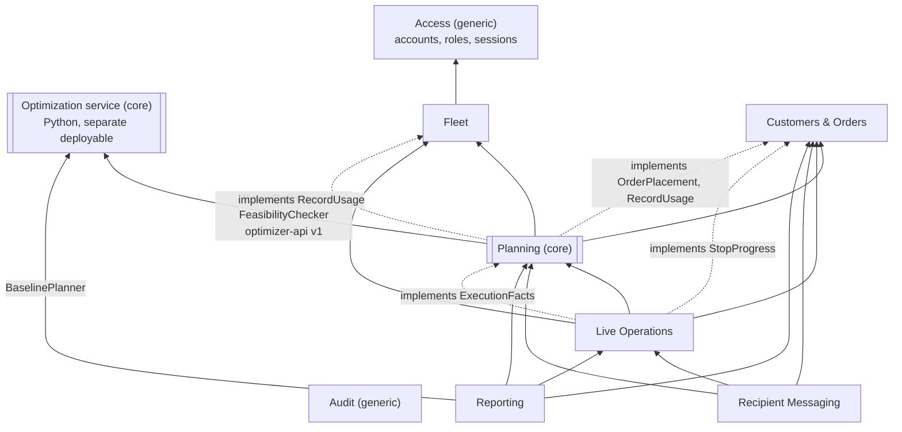
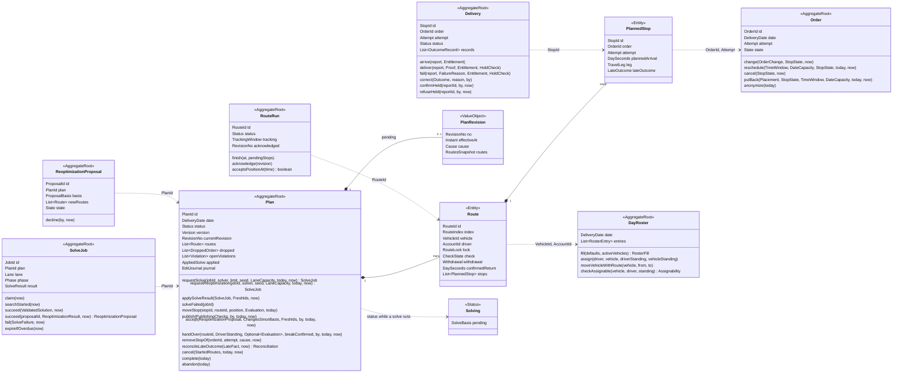
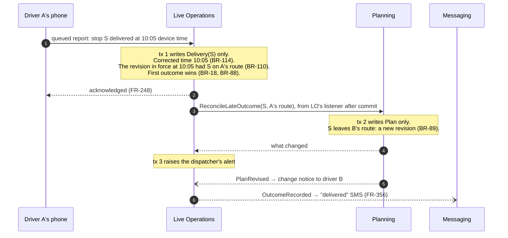
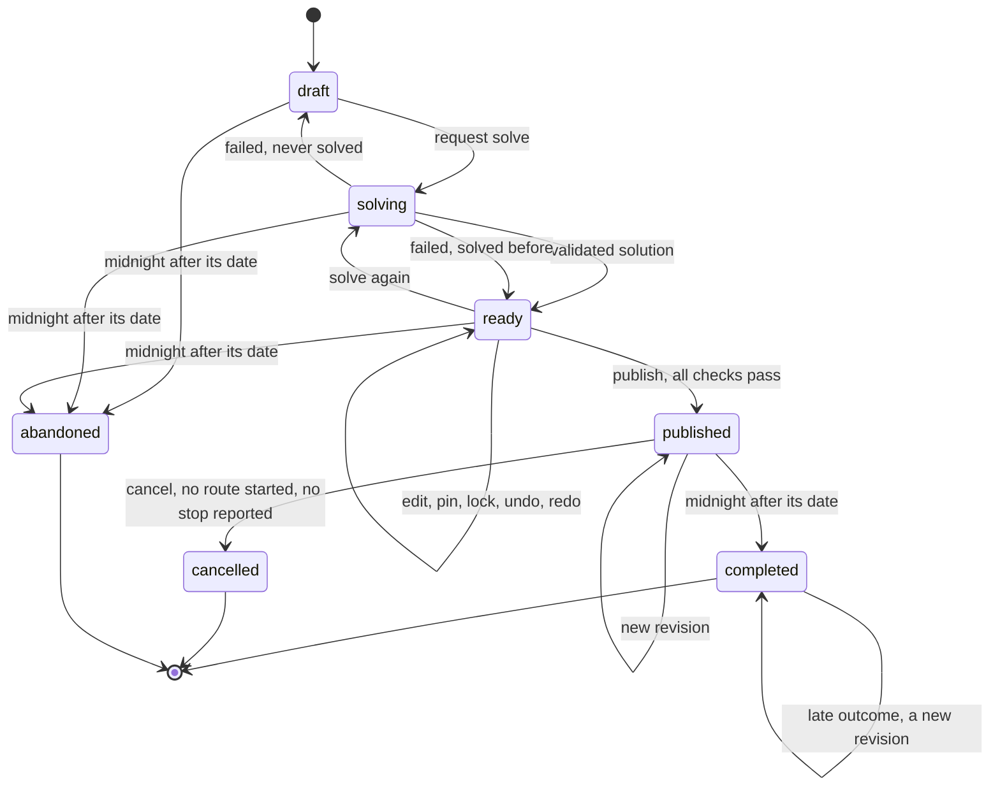
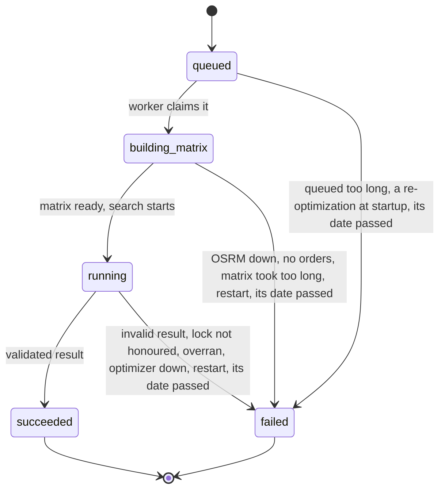
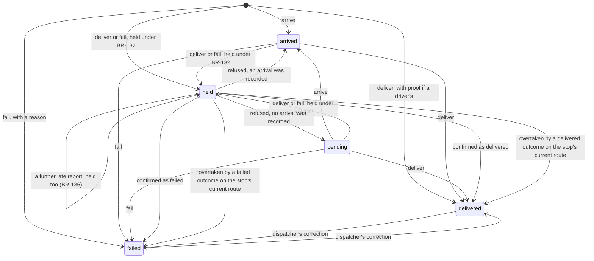
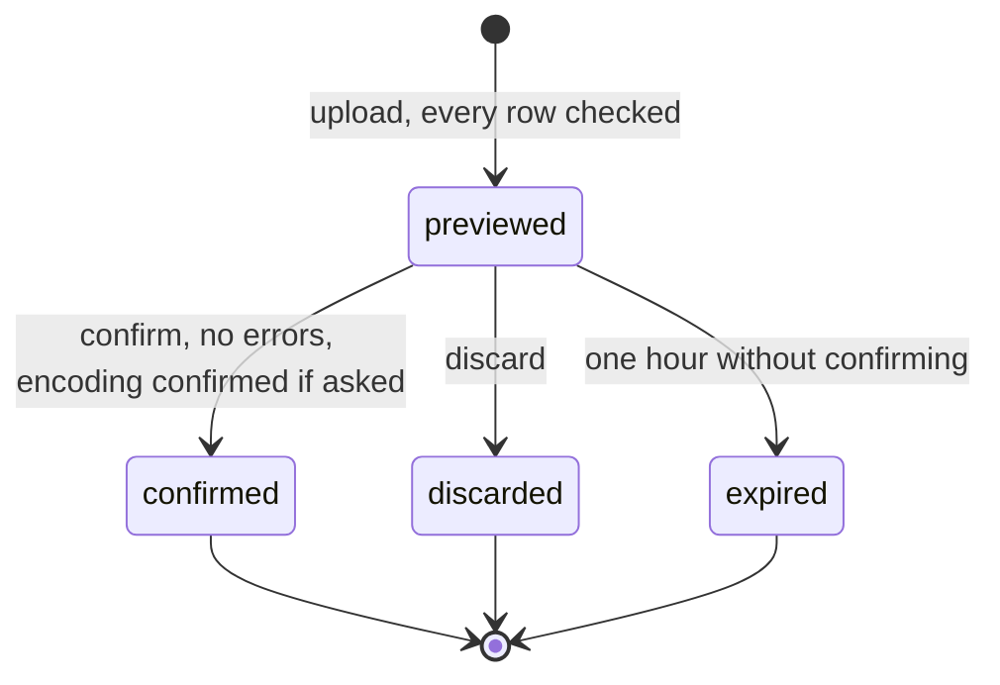
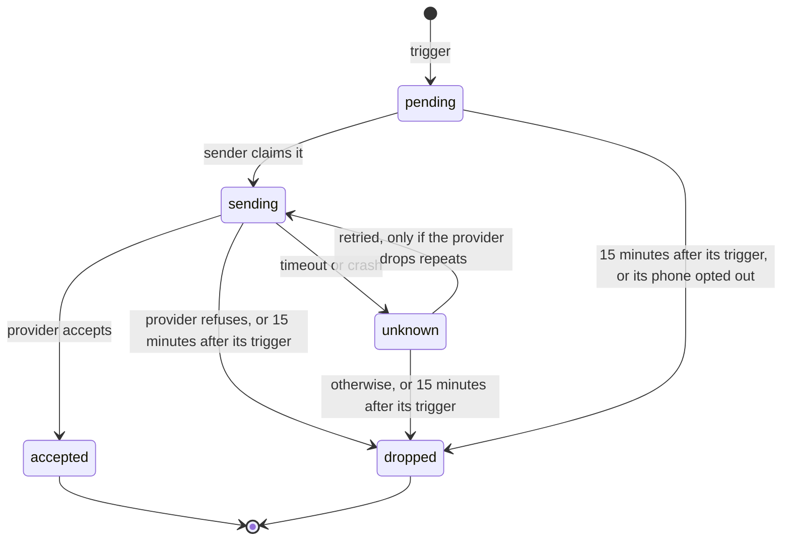
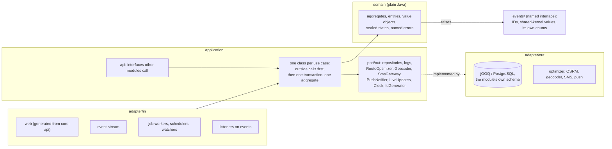
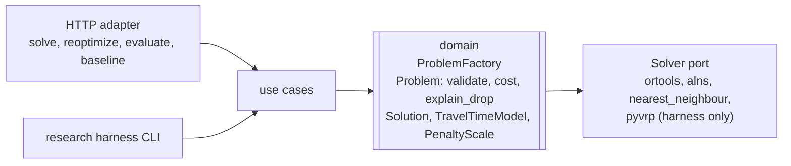

# DispatchFlow — Domain layer design

**Status:** Decided, 14 November 2026.

This is the one place that defines DispatchFlow's bounded contexts, aggregates, value objects, events,
domain errors and the rules between them. [`tech_stack.md`](../tech_stack.md) names the tools and
[`roadmap.md`](../../roadmap.md) says when each part is built;
neither repeats it. Where they disagree with this file, this file wins. IDs in brackets point to the
requirements (FR, BR, NFR, UC, Q). `Q-94 #1` means the first numbered sub-question in Q-94's row. Names
in `code` are the names in the code, and §17 defines every one of them.

**The design in seven lines**

1. **Nine bounded contexts** form a one-way dependency graph that Spring Modulith verifies. Each could
   become its own service by changing adapters only.
2. **A transaction changes one existing aggregate.** It may also create new aggregates of the same module
   and write technical records. Everything else follows by an event or a later call ([ADR-063]).
3. **Every business rule has exactly one owner**: an aggregate, or a value object that the one aggregate
   method able to break the rule requires. There are no domain services; §3.7 says why none was needed.
4. **Planning owns intent; Live Operations owns facts.** When a fact contradicts the plan, the fact
   stands, the plan is corrected, and a person is told ([ADR-065]).
5. **An event exists only where it beats a direct call and beats doing nothing** (§7, [ADR-064]).
6. **Feasibility, the objective, travel-time factors and the re-optimization rules exist once**, in the
   Python Optimization domain.
7. **The domain is pure.** It never reads the clock, makes IDs, or touches a framework, so every invariant
   and transition is tested with plain values and no mocks.

---

## 1. Subdomains and bounded contexts

| Context | Subdomain | What it owns | Module |
|---|---|---|---|
| **Planning** | Core | The plan for each delivery date: solving, editing, publishing, re-optimizing and handing over routes. The intent | `planning` |
| **Optimization** | Core | What a feasible, good plan is: the problem, the validator, the objective, the solvers | Python service |
| **Live Operations** | Supporting | What happened on the street: arrivals, outcomes, route runs, positions, projected arrivals, alerts | `liveops` |
| **Customers & Orders** | Supporting | Who receives what: customers and their locations, orders, imports | `orders` |
| **Fleet** | Supporting | What delivers: depots, vehicles, drivers, and who drives what on a date | `fleet` |
| **Recipient Messaging** | Supporting | SMS to recipients, their replies, ratings and opt-outs | `messaging` |
| **Reporting** | Supporting | The daily summary and the comparison with the baseline | `reporting` |
| **Access** | Generic | Accounts, roles, sessions and the company profile | `access` |
| **Audit** | Generic | The append-only audit trail | `audit` |

A boundary is drawn where the language changes or a consistency rule stops. A route in Planning is
intent that a dispatcher edits; in Live Operations a route run is what a driver did, and it must never
contend with a dispatcher's edit (BR-76). The core contexts get the richest model and the most tests; the
generic ones stay as simple as their rules allow. Why customers and orders share a context is in §16.

---

## 2. Context map

### 2.1 Module graph

Every arrow points upstream and means *depends on*. A dashed arrow means *implements a port the upstream
module owns*. No arrow points back, so `ApplicationModules.verify()` passes.

Every module depends on the shared kernel. Audit depends on nothing else. Every *other* module also
depends on Audit's `AuditLog` port, and every one of them but Access depends on Access for the acting user,
whom the web adapter passes to each use case as an `Actor` value (account ID and roles).

Audit's `AuditLog` takes shared-kernel IDs (account, session) and never an `Actor`, so Access may depend on
Audit without a cycle ([ADR-040]).

### 2.2 Relationships

| Upstream | Downstream | Relationship | How they talk |
|---|---|---|---|
| Access | Every core module | Open host for identity; the others conform to its account IDs and roles | The `Actor` value; Access's `Accounts` query; for Live Operations also the `SessionContacts` query, which answers whether any session of an account made contact within a window (BR-132) |
| Audit | Every core module | Open host | `AuditLog.record`, in the same transaction as the change (NFR-23) |
| Access | Fleet | Customer and supplier; shared identity: a `Driver` has the ID of the driver's account | Fleet asks `Accounts` whether an account is active and holds the Driver role; Fleet's `DriverRetired` listener calls Access's API to remove the Driver role (FR-307, [ADR-103]); Fleet's `AccountAnonymized` listener anonymizes the driver record (NFR-258, [ADR-103]) |
| Fleet | Planning | Customer and supplier | Planning reads the roster and the fleet register through Fleet's API, translating them into its own values; calls `MoveVehicleWithRoute`; implements Fleet's `RecordUsage` |
| Customers & Orders | Planning | Customer and supplier | Planning reads `OrdersForDate`; hears `OrderCancelled` and `OrderRescheduled`; implements `OrderPlacement` and `RecordUsage` |
| Planning | Live Operations | Customer and supplier | Live Operations hears `PlanPublished` and `PlanRevised`; asks `RouteMembership` and `PublishedRoutes`; calls `ReconcileLateOutcome`; implements `ExecutionFacts` |
| Customers & Orders | Live Operations | Customer and supplier | Live Operations reads the order details a report is judged by (leave at the door); implements `StopProgress` |
| Fleet | Live Operations | Customer and supplier | Live Operations reads shifts, for the start deadline and the tracking cut-off |
| Live Operations, Planning, Customers & Orders | Recipient Messaging | Customer and supplier | Messaging hears `RouteStarted`, `OutcomeRecorded`, `OutcomeCorrected`, `PlanRevised`, `OrderCancelled` and `OrderRescheduled`; asks `ArrivalProjections` and the recipient's phone; calls Live Operations' `RaiseAlert` |
| Planning, Live Operations, Customers & Orders | Reporting | Customer and supplier | Reporting hears `PlanPublished` and `PlanRevised`, and reads the read-only views each module publishes |
| Optimization | Planning, Reporting | Customer and supplier with a published language: `optimizer-api` v1 (OpenAPI). The core's optimizer adapter is an anti-corruption layer | HTTP. The optimizer knows nothing about the core |
| OSRM, the geocoders, the SMS provider, Expo push, Amazon SES | The module that uses each | Conformist, behind an anti-corruption adapter | Each sits behind a port named in DispatchFlow's language |

Fleet and Customers & Orders have no relationship. Neither does any pair not in the table.

### 2.3 Rules between contexts

1. **No domain object crosses a boundary.** A module's domain imports only its own domain, its own
   module's `events` package, the shared kernel and pure libraries. What another module's API returns is
   translated into the caller's own values by the caller's application layer. Contexts share IDs, events
   and API calls, never entities.
2. **An upstream module never imports a downstream type.** When it needs something from downstream, it
   owns a port that the downstream module implements (Planning asks `ExecutionFacts` whether a route has
   started), or the downstream module calls the upstream API from a listener on its own event, so a failed
   call is retried (§8).
3. **Each module owns its tables, in its own PostgreSQL schema.** No SQL reads another module's schema
   ([ADR-041]). Reporting reads read-only views that the owning module publishes as part of its API.
4. **A module's contract is three packages**, each a `@NamedInterface`: `api` (what other modules call),
   `events` (what they hear) and `spi` (the ports it owns for them to implement). Spring Modulith fails
   the build on any other dependency.
5. **The shared kernel is tiny.** It holds the typed IDs (UUIDv7) of every aggregate and every entity
   another context names (§3.1), and nine values that mean the same everywhere: `DeliveryDate`,
   `IsraelDateTime`, `DaySeconds`, `TimeWindow`, `GeoPoint`, `Weight`, `Volume`, `Priority` and
   `PhoneNumber`, plus the free-text rule `PlainText` ([ADR-106]). It also holds the building blocks
   every module's domain uses: `DomainError`, `RuleViolation(s)`, `StoredStateInvalid`, `Version`,
   `AggregateRoot`, `DomainEvent`, `EventId` and `FreshIds` ([ADR-097]), and the `PersonalData` marker
   ([ADR-106]). Nothing with behaviour specific to one context goes there, and a change to it needs the
   agreement of every module's owner.

**Splitting a module into a service later** changes adapters only: its API calls become HTTP clients
generated from a new contract, its events go through a message broker (Spring Modulith can externalize
them), the ports it implements become endpoints, and its schema moves to its own database. Because no
domain object crossed the boundary, no domain class changes. The one shared write is the audit record,
written in the same transaction; a split-off module would write it through an outbox instead.

---
## 3. Building blocks: the rules every module follows

### 3.1 Aggregates

- **An aggregate is drawn around a consistency rule, not around a noun or a table.** It holds exactly
  what one or more invariants must see together, and nothing more. §4 names each aggregate's invariants;
  an aggregate with none would be a record (§3.2).
- **A transaction changes one existing aggregate** and saves it with a version check (BR-76). §6 gives the
  two exceptions: creating new aggregates of the same module, and writing technical records.
- **Inside an aggregate, the root holds its entities and values directly**, as object references:
  `Plan` holds its `Route`s, each `Route` holds its `PlannedStop`s. Nothing outside the aggregate changes
  them, and the root never exposes a mutable collection (§3.10).
- **Between aggregates, only IDs.** `Delivery` holds a `StopId`, `Route` holds a `VehicleId`, never the
  object. An ID may name an entity inside another aggregate when the business refers to that thing
  directly (a stop, a route, a vehicle, a depot). Such an ID is part of the owner's published language:
  issued once, never reused, and stable while the entity moves inside its aggregate (a stop keeps its ID
  when it moves to another route). The holder only ever reaches that entity through its root's API, and
  never changes it.
- **An aggregate is loaded whole**, so its invariants are always checked against everything they cover.
  That is why each one stays small; §4 notes its size and its writers.

### 3.2 Records

Some things the business keeps have no rule between their entries: positions, audit records, inbound SMS
replies and opt-outs. They are **records**, not aggregates: immutable, appended with a plain insert, with
no version, so fifteen phones sending positions never contend. Each kind is written through an
append-only port (`PositionLog`, `AuditLog`, `ReplyLog`, `OptOutList`). The rule about whether to accept
one belongs to an aggregate that is not the record: whether a position is kept is `RouteRun`'s rule
(FR-328).

### 3.3 Value objects

A value object is an immutable Java record, a final class with a private constructor where only one
caller may build it, or a frozen dataclass in Python. It checks itself in its constructor or factory,
so an invalid one can't exist. Equality is by value. No signature in the domain takes a raw
`String`, `int`, `UUID` or `Instant` for a business concept. Every personal value implements the
kernel's `PersonalData` marker ([ADR-106]).

| Value | Context | What it holds and checks | Error |
|---|---|---|---|
| Typed IDs (`PlanId`, `StopId`, `OrderId`, …) | Shared | A UUIDv7 that names one kind of thing; one can't be passed for another | — |
| `DeliveryDate` | Shared | The calendar day a plan, its orders and its roster are for, in years 1 to 9999; knows whether it is before a given day | `DateOutOfRange` |
| `IsraelDateTime` | Shared | A local time in `Asia/Jerusalem`; refuses a time in the skipped hour, reads a repeated hour as its first occurrence (BR-31, BR-111) | `NonexistentLocalTime` |
| `DaySeconds` | Shared | Elapsed seconds since the date's local midnight, within that day's 23, 24 or 25 hours (§10) | `OutsideTheDay` |
| `TimeWindow` | Shared | A start before an end, both on one date (BR-35) | `InvalidTimeWindow` |
| `GeoPoint` | Shared | Latitude and longitude in range | `InvalidCoordinates` |
| `Weight`, `Volume` | Shared | Kilograms and litres, present and positive (BR-50), with at most two decimals and the digits their columns hold ([ADR-061]) | `NonPositiveQuantity`, `QuantityOutOfRange` |
| `Priority` | Shared | 1 to 5, default 3 (BR-53) | `PriorityOutOfRange` |
| `PhoneNumber` | Shared | E.164, parsed with region IL, refusing letters and extensions; knows whether it is an Israeli mobile (FR-377, FR-378). A stored number is checked as E.164 only, so a newer phone-number library never refuses it | `InvalidPhoneNumber` |
| `PlainText` | Shared | A name, an address or a note: NFC, with whitespace, space separators and format characters trimmed from the ends, and at most its `TextKind`'s cap in code points; raw input over 8 UTF-16 units per code point of the cap is refused before NFC. In a `NOTE`, CR and CRLF become a line feed. Refuses control characters, except a line feed in a `NOTE` (a CR in a `NAME` or an `ADDRESS` is refused); U+2028 and U+2029 outside a `NOTE`; interior format characters in a `NAME` or an `ADDRESS` other than U+061C and U+200C to U+200F; bidi embedding, override and isolate controls; unpaired surrogates; and private-use and unassigned code points. Text that renders as nothing counts as empty ([ADR-106]) | `TextTooLong`, `TextHasForbiddenCharacters` |
| `EmailAddress` | Access | The canonical form one account is keyed by (BR-45) | `InvalidEmail` |
| `RoleSet`, `Capability` | Access | A set of Admin, Dispatcher and Driver; `can(capability)` is the permission matrix (NFR-85). `Capability` has one constant per row of the matrix under FR-03, and a cell that starts "Only" is a limited grant whose limit the use case checks ([ADR-104], [ADR-068]) | — |
| `NewPassword` | Access | At least 8 characters and not on the bundled list of the 3,000 most common, which arrives as a `CommonPasswords` value (NFR-95) | `PasswordTooShort`, `PasswordTooCommon` |
| `AccountGeneration`, `SessionGeneration` | Access | Counters that only grow, one on the account and one on the session, of distinct types so neither is passed for the other; tokens issued under an older one are refused (NFR-177, NFR-227) | — |
| `ActiveAdmins` | Access | The active Admin accounts, read under row locks; refuses a change that leaves fewer than two (BR-19), and the first Admin while one exists (FR-291) | `TooFewAdmins`, `ActiveAdminExists` |
| `PasswordHash`, `TokenHash` | Access | Opaque results of the hashing adapter, printed redacted (NFR-36, NFR-91, NFR-211) | — |
| `CompanyName`, `DefaultWindow`, `DefaultServiceTime` | Access | The company's name, at most 19 characters (FR-382); the window a new customer starts with, opening before it closes, on no date (FR-125); the service duration a new customer starts with, positive (FR-184) ([ADR-104]) | `BlankCompanyName`, `CompanyNameTooLong`, `InvalidDefaultWindow`, `NonPositiveDefaultServiceTime` |
| `Capacity`, `Plate`, `ShiftHours`, `Shift`, `DepotHours`, `WeeklyShifts` | Fleet | A vehicle's weight and volume limits; a normalized plate ([ADR-103]); a shift's hours, with the end after the start; those hours placed on a date, where both must exist (FR-190, BR-111); one opening and closing time for every date (FR-129); per weekday an optional shift and no vehicle (FR-79) | `InvalidPlate`, `InvalidShift`, `InvalidDepotHours` |
| `VehicleName`, `DepotName`, `DriverName` | Fleet | Names read as `PlainText` `NAME` ([ADR-106]) and non-blank; a driver's is personal data | `BlankVehicleName`, `BlankDepotName`, `BlankDriverName`, `TextTooLong`, `TextHasForbiddenCharacters` |
| `PlanUses`, `Standing`, `RosterDefault`, `Assignability`, `RosterVehicle`, `RosterFill` | Fleet | The facts Fleet's methods judge: the plans that use a record (FR-305); Access's and the register's answer on whether a driver or vehicle is active; a driver's default for a date (FR-189); the roster's answer to a hand-over (FR-302). A roster entry's vehicle: not set, none, or a vehicle (FR-79); and what a fill filled and skipped ([ADR-103]) | — |
| `Address`, `NormalizedAddress` | Customers & Orders | The address as typed, whose normalized form holds a letter or a digit, and the form addresses are matched by (FR-310, FR-398, Q-94 #4); its abbreviation table starts with ADR-086's three ([ADR-102]) | `BlankAddress` |
| `ContactName`, `DriverNote`, `AccessDetails`, `Floor`, `Apartment`, `EntranceCode`, `Recipient` | Customers & Orders | A trimmed, non-blank name (FR-59, FR-87); a note the driver sees, a customer's (FR-08) or an order's (FR-135); an order's floor, apartment and entrance code, each a trimmed, non-blank text (FR-86); an order's own recipient (FR-87) | `BlankContactName` |
| `DailyWindow`, `OrderDefaults` | Customers & Orders | A customer's default window as times of day; the window and service time an order takes when given none, where the service time may be absent (BR-49, BR-124, [ADR-102]) | `InvalidDailyWindow` |
| `CustomerMatch` | Customers & Orders | None, one, or several active customers for a normalized address; several can't be used (FR-310 to FR-312) | `AmbiguousAddress` |
| `Location` | Customers & Orders | None, geocoded (with its quality), or placed by hand; a hand-placed location always wins (BR-13, FR-215) | — |
| `ServiceArea` | Customers & Orders | The company's area, from the road-data build; `contains(point)` (FR-320) | — |
| `ServiceTime`, `Attempt`, `ExternalReference` | Customers & Orders | Positive seconds (BR-124); 1 or more (FR-258); a non-blank reference | `NonPositiveServiceTime` |
| `DateCapacity` | Customers & Orders | A date's uncancelled orders with their references, read under the date's lock, and the limit (BR-101, BR-113, FR-211, [ADR-102]) | `DateFull`, `DuplicateOrderReference` |
| `StopState` | Customers & Orders | What has happened at an order's stop: nothing, arrived, or an outcome (BR-92) | — |
| `OrderStatus` | Customers & Orders | Derived from three owners (§9.6) | — |
| `SolveBasis`, `ProposalBasis` | Planning | What a result was computed from (§17, *basis*) | — |
| `LaneCapacity` | Planning | A lane's queued and started jobs with their plans, read under the lane's lock, and the limit of 5 (BR-112, BR-38) | `SolveQueueFull`, `ReoptimizationAlreadyRunning` |
| `Violation`, `DroppedOrder`, `DropReason`, `Pin`, `RouteLock`, `PlanRevision` | Planning | A broken rule with its references; an unserved order with its reason, FR-223's full list (FR-144); an order fixed to a vehicle or a driver (FR-91); a fixed route or stop sequence (FR-147); a published snapshot | — |
| `ValidatedSolution`, `Evaluation` | Planning | Solutions and checks only the optimizer adapter can build (§13); an evaluation names the plan version it checked and describes the plan after the change ([ADR-101]) | `StaleEvaluation`, `SolutionRejected`, `ValidatorUnavailable` |
| `RouteIndex`, `RuleCode`, `SolverName`, `SolveLimit` | Planning | A route's label and colour slot from 1 to 30 (FR-148); a broken rule's row ID, opaque (BR-42); a solver known only by its name (FR-224); a daily limit of 5 to 60 s, 45 by default, and the re-optimization's 20 s (NFR-06, FR-19, BR-84) | `MalformedRuleCode`, `InvalidSolverName`, `SolveLimitOutOfRange` |
| `PublishingChecks`, `DriverStanding`, `ChangesSinceBasis`, `StartedRoutes` | Planning | The facts from other modules that `Plan`'s methods judge (§4.4) | — |
| `CorrectedTime` | Live Operations | A report's device time moved by the phone's clock offset, and cut to the server's receipt time if it would be later (BR-44, BR-110, BR-114) | — |
| `Entitlement` | Live Operations | Planning's answer that a stop was on a driver's route in the revision in force at a time (BR-110) | — |
| `HoldCheck` | Live Operations | Where the stop is now (on the reporting driver's route, on another's, or its order cancelled), from Planning's `RouteMembership`, and whether any session of the reporting account made contact between 2 minutes after the corrected time and 2 minutes before the report arrived, from Access's `SessionContacts`. `holds(correctedTime, receivedAt)` is true when the report would move the stop or override a cancellation and such a contact exists (BR-132). It doesn't cover a stop that already has a held report: `Delivery` holds a further report for it without asking (BR-136) | — |
| `Proof`, `FailureReason`, `Outcome` | Live Operations | A signature or a photo (FR-367); a reason from the company's list; delivered or failed with its details | — |
| `ArrivalProjection`, `StartDeadline`, `TrackingWindow` | Live Operations | Projected arrivals (§10.4); shift start plus allowance plus 15 minutes (FR-101); start to 1 hour after shift end (FR-328) | — |
| `MessageText`, `Wording`, `Reply`, `Rating`, `Comment`, `PhoneHash`, `DailySendCap` | Messaging | A text starting with the company name, within 70 characters (FR-382), in its type's fixed wording (FR-349, [ADR-108]); a parsed reply (FR-363, FR-376); 1 to 10; a reply kept as a comment, cut to 500 characters (NFR-203, [ADR-108]); a keyed hash (NFR-202); the day's accepted messages and the cap (NFR-196) | `RatingOutOfRange`, `BlankComment` |
| `CompanyName`, `DispatchPhone`, `RecipientPhone`, `QuarterHour`, `OptOutRecord`, `OptOutStatus` | Messaging | The company name a message starts with, at most 19 characters (FR-382); the dispatch phone, at most 11 characters in national form (FR-382); the order's recipient phone, otherwise the customer's (FR-348); a projected arrival rounded half up to the quarter hour (FR-351); an opt-out or opt-in entry, and a phone's standing by its latest entry (FR-363, FR-380, [ADR-108]) | `UnusableCompanyName`, `DispatchPhoneTooLong` |
| `OnTimeRate` | Reporting | Delivered stops reached on time over delivered stops, as an exact share of two counts: by the window's end, or inside the window for a leave-at-door stop; reached at the arrival, or at the delivery when no arrival was reported; from the effective outcome after any correction, leaving out cancelled orders; *unavailable* when none is delivered (FR-264, FR-265, FR-333, FR-340, FR-370, BR-30, [ADR-109]) | `InvalidOnTimeCounts`, `StopCountedTwice` |
| `PlannedOnTimeRate` | Reporting | Orders a plan serves inside their windows over every order of the day, as an exact share of two counts: a dropped order counts as not on time and a cancelled one is left out; *unavailable* with no order (FR-266, FR-370, BR-30, [ADR-109]) | `InvalidOnTimeCounts` |
| `Distance`, `DriverHours`, `PlannedFigures`, `PlannedOrders`, `StopResult`, `CancelledOrders`, `PlanStanding`, `BaselineComparison` | Reporting | A plan's metres and driver-hours, never negative; a plan's figures, with each order of the day once; the facts the rates and the comparison judge, from other modules' views; a comparison on every measure, on kilometres and on-time only after a withdrawal, or none for a cancelled plan (FR-39, FR-269, FR-338, [ADR-109]) | `NegativeDistance`, `NegativeDriverHours`, `OrderCountedTwice` |
| `AuditRecord`, `AuditOutcome`, `ErrorCode` | Audit | NFR-93's fields, each an ID, a code, an enum, a number or an instant (NFR-94), and its year of retention (NFR-258); succeeded, or refused with the refusal's upper snake case error code, so refusals are audited too (NFR-23) ([ADR-110]) | `MalformedErrorCode` |
| `OperationName`, `NamedRecord`, `DeclaredApp`, `AppVersion`, `TraceId` | Audit | The `client-api` operation ID or a server step's name, an ASCII identifier of at most 100 characters; a kernel ID with its kind; the app (web or phone) and its version as the client declares them, as three numbers ([ADR-082]); a W3C trace-id (NFR-20) ([ADR-110]) | `MalformedOperationName`, `InvalidAppVersion`, `InvalidTraceId` |
| `Problem`, `Solution`, `TravelTimeModel`, `PenaltyScale`, `ValidationReport` | Optimization | Everything one solve needs, and what comes back (§4.9) | — |

DispatchFlow has no money in its domain: the objective's terms are in seconds, not shekels.

### 3.4 States and transitions

Every lifecycle is a sealed interface whose records are the states (`Plan.Status` is `Draft`,
`Solving(basis)`, `Ready`, `Published(revision)`, `Completed`, `Cancelled`, `Abandoned`). Each transition is one
method on the root, in business language, that checks the current state first and refuses with a named
error (`PlanNotReady`). A `switch` over a sealed state must cover every state, so adding a state makes
the compiler point at every place that has to decide about it. That is what sealed types guarantee; they
don't make an illegal call fail to compile. So every refused transition also has a test (§14). §9 draws
each lifecycle.

### 3.5 Factories

An aggregate is created only by a static factory on its root (`Plan.open`, `Order.place`,
`Delivery.firstFact`) that checks every invariant of a new one. The new ID and `now` are parameters;
the use case gets them from the `IdGenerator` and `Clock` ports. Repositories rebuild aggregates through a
separate `restore` factory that checks the structure again, so even a damaged row can't become an invalid
object; only persistence adapters may call `restore`. Python's `ProblemFactory` builds a `Problem` from a
request (§4.9).

### 3.6 Repositories

- **One repository per aggregate root**, as a secondary port in the module's `application` package,
  implemented with jOOQ in `adapter/out/persistence`. Records use their append-only logs instead (§3.2).
- **It speaks in whole aggregates**: `get(id)`, the lookups use cases need (`PlanRepository.forDate`),
  `add(newAggregate)` and `save(aggregate)`. `save` updates with `WHERE version = ?` and fails with
  `STALE_VERSION` when nothing matched (BR-76).
- **It has no queries for screens.** Screens and reports read read models (CQRS-lite), so a repository
  never grows a method per screen and never returns half an aggregate.
- **Events leave with the save.** An aggregate records the events its methods raise; the use case
  publishes them when it saves, in the same transaction, and Spring Modulith stores them with the change.

### 3.7 Domain services: none

A domain service is the right home for an operation that belongs to the domain but to no aggregate or
value object. Each candidate in this design found an owner:

- **A rule over one aggregate's own state goes on that aggregate**, with the facts it can't see passed in
  as values. Publishing, accepting a proposal and handing over a route are `Plan`'s methods.
- **A rule that defines a value goes on that value**: order status (`OrderStatus.derive`), an address
  match (`CustomerMatch`), a projected arrival (`ArrivalProjection`), the on-time rate (`OnTimeRate`), a
  message's text (`MessageText`), a solution's feasibility, cost and drop reasons (`Problem`'s methods).
- **A rule over a set of aggregates goes on an aggregate that holds the set**, when the set is small and
  changes together (`FleetRegister`, `DayRoster`, `StopMessages`). Otherwise it goes on a **value that is
  a snapshot of the set**, read under a lock, that the one aggregate method able to break the rule
  requires as a parameter (`ActiveAdmins`, `DateCapacity`, `LaneCapacity`); §5 lists them.

A domain service would be added for an operation that coordinates several domain objects and belongs to
none of them. None exists in the current requirements.

### 3.8 Domain errors

- **Every refusal is a named error** in business language, a record of the module's sealed error type
  (`PlanningError`), carrying what the message needs (`DriverAlreadyHasRoute(driver, route)`). §4 names
  the error of every invariant.
- **A method throws `RuleViolation` with one error, or `RuleViolations` with all of them** where the
  requirements say to list everything at once (publishing, BR-72; an import, every row).
- **Each error has a stable code** (`DRIVER_ALREADY_HAS_ROUTE`) that the web adapter puts in an RFC 9457
  response and both apps translate (NFR-69, NFR-144). A test fails when an error has no translation.
- **No generic errors.** Domain code never throws `IllegalArgumentException` or `IllegalStateException`
  for a business rule. Null and programming errors are caught by NullAway at compile time.

### 3.9 Purity

Six ArchUnit tests keep the Java domain pure ([ADR-040]); import-linter does the same in Python.

1. A module's domain imports only the JDK, the shared kernel, its own domain, its own module's `events`
   package (§7.3), JSpecify annotations and pure libraries (libphonenumber, JTS). Not Spring, jOOQ, Jackson, Jakarta or `java.net.http`, not any
   `application` or `adapter` package, and not another module.
2. No clock: domain code never calls `Instant.now()`, `LocalDate.now()`, `Clock.system…()` or
   `System.currentTimeMillis()`. `now` and `today` are parameters.
3. No ID generation: never `UUID.randomUUID()`. Factories take the new ID.
4. No randomness, I/O or logging.
5. No `new IllegalArgumentException` or `new IllegalStateException` (§3.8).
6. Only persistence adapters call `restore` (§3.5), and the factories of the snapshots read under a
   lock (`ActiveAdmins`, `DateCapacity`, `LaneCapacity`, §5).

Password hashing, token signing and hashing with a secret key are adapters behind ports (`PasswordHasher`,
`TokenSigner`, `Hmac`); the domain receives their results as values (`PasswordHash`, `PhoneHash`).

### 3.10 A rich model

- **Behaviour lives where the data is**, in methods named for what the business does: `publish`,
  `handOver`, `putBack`, `reconcileLateOutcome`, never `setStatus` or `setStops`.
- **No setters, and no mutable collection leaves an aggregate.** Getters return unmodifiable views or
  copies, and value objects copy their lists in their constructors (`List.copyOf`).
- **Tell, don't ask.** A use case calls the method that decides; it never reads an aggregate's state,
  decides in the use case, and writes the result back.
- **Queries on aggregates answer questions the business asks** (`DayRoster.checkAssignable`,
  `RouteRun.acceptsPositionAt`) and change nothing.

---
## 4. Aggregates, context by context

Each context lists its aggregates, then every invariant with its single owner and its named error. An
error of "—" means the rule can't be broken from outside: the owner simply does the right thing (it
ignores a stale result, or revokes tokens). Invariants checked by a value object are owned by that value,
and every aggregate that holds one inherits them.

### 4.1 Access

| Aggregate | Holds | Operations | Size and writers |
|---|---|---|---|
| `CompanyProfile` | The company's name, language, default window and default service time: the last two are what a new customer starts with (FR-125, FR-184, [ADR-104]) | `create`, `rename`, `changeLanguage`, `changeDefaultWindow`, `changeDefaultServiceTime` | One; Admins |
| `UserAccount` | `EmailAddress`, `RoleSet`, `PasswordHash`, state (*active*, *deactivated* or *anonymized*), language, its `AccountGeneration`, when it accepted the terms (FR-77), and its credential links (entities: purpose, token hash, expiry, *open*, *spent* or *voided*; an email-change link holds the new address) | `open`, `openFirstAdmin`, `checkSignInAllowed`, `changeRoles`, `removeDriverRole`, `deactivate`, `deactivateOnWrittenRequest`, `reactivate`, `endEverySession`, `changePassword`, `issueLink`, `setPasswordByLink`, `confirmEmailByLink`, `changeLanguage`, `acceptTerms`, `anonymize` | One per person; the person and Admins, rarely. It keeps its open links and those sent in the last 72 hours: `issueLink` drops older links that no longer work ([ADR-104]) |
| `Session` | Its account, the `AccountGeneration` it began under, its own `SessionGeneration`, state (*live* or *revoked*), when it last gave the password, its contact times (kept 14 days, at most one a minute; NFR-280), and its chain of refresh tokens (entities: hash, issue time, and *current*, *exchanged* with its successor, *replaced* or *superseded*) | `open`, `exchange`, `confirmPassword`, `requireFreshStepUp`, `recordContact`, `dropOldContacts`, `revoke`, `endedAt` | One per signed-in device; that device, and its user from another device (FR-127). It keeps its current token, those issued in the last 14 days and 30 s, and any successor a kept token names: `exchange` and `confirmPassword` drop the rest ([ADR-104]) |

| Invariant | Owner | Error |
|---|---|---|
| At least two active Admins (BR-19) | `UserAccount.changeRoles` and `deactivate`, which require `ActiveAdmins` | `TooFewAdmins` |
| The first Admin is created only when no active Admin exists (FR-291) | `UserAccount.openFirstAdmin`, which requires `ActiveAdmins` | `ActiveAdminExists` |
| The written-request step deactivates an Admin account without the minimum of BR-19 (FR-346) | `UserAccount.deactivateOnWrittenRequest` | `NotAnAdmin` |
| An Admin gives a user at least one role (FR-02) | `UserAccount.open`, `changeRoles` | `NoRoleGiven` |
| Retiring a driver removes only the Driver role, in any state; a repeat changes nothing (FR-307) | `UserAccount.removeDriverRole`, which Fleet's listener calls on `DriverRetired` ([ADR-104]) | — |
| One account per email (BR-45) | `UserAccount.open`, given the `EmailHolder`, backed by a unique index (§5) | `EmailInUse` |
| A new email takes effect only when the link sent to it is used, and an address another account holds is refused only then (FR-388, FR-392) | `UserAccount.confirmEmailByLink`, given the `EmailHolder` | `EmailInUse` |
| A password is at least 8 characters and not a common one (NFR-95) | `NewPassword` | `PasswordTooShort`, `PasswordTooCommon` |
| A role, password or email change, a deactivation, an Admin ending every session (FR-187), or losing the last role revokes every token and session at once (NFR-89, NFR-90, NFR-177, BR-123) | `UserAccount`: each of those methods increments its `AccountGeneration` and raises `SessionsRevoked` with the new generation | — |
| A deactivated account, or one with no role, can't sign in | `UserAccount.checkSignInAllowed` | `AccountDeactivated`, `AccountAnonymized`, `AccountHasNoRole` |
| Only an active account changes; a deactivated one is only reactivated, anonymized or loses its Driver role (FR-53, FR-297, FR-307) | `UserAccount` | `AccountDeactivated`, `AccountAnonymized`, `AccountNotDeactivated` |
| Every deactivated account, whatever its roles, is anonymized a year after deactivation: its email, password hash and links go. The record stays, because plans and audit records refer to it (NFR-258, NFR-260, [ADR-075]) | `UserAccount.anonymize(now)`, which raises `AccountAnonymized` so Fleet anonymizes the driver record ([ADR-104]) | `RetentionNotOver` |
| Acceptance of the terms and privacy notice is recorded (FR-77) | `UserAccount.acceptTerms` | — |
| A newer link voids older links of its kind; a change of password or email, a deactivation, or an Admin ending every session voids every unspent link (NFR-224) | `UserAccount.issueLink`, `changePassword`, `setPasswordByLink`, `confirmEmailByLink`, `deactivate`, `deactivateOnWrittenRequest`, `endEverySession` | — |
| A set-password link is sent only to an account with no password yet; a reset is a recovery link (FR-294, FR-345, [ADR-104]) | `UserAccount.issueLink` | `PasswordAlreadySet` |
| A link is spent once, before it expires, and only for what it allows (NFR-211, FR-294) | `UserAccount.setPasswordByLink`, `confirmEmailByLink` | `UnknownLink`, `LinkExpired`, `LinkAlreadyUsed`, `LinkVoided` |
| A refresh token is exchanged once. Presented again within 30 s of its exchange, while its successor is current, it gets a new token that replaces that successor and revokes nothing; once a step-up superseded the successor, it is refused and revokes nothing. A replaced token, or any later reuse, revokes the session (NFR-88, NFR-178), except a token the chain no longer keeps, which is refused as unknown ([ADR-104]) | `Session.exchange`, which answers with a `RefreshOutcome` instead of throwing, so the revocation is saved | `RefreshRefused` (the same answer for every refusal, NFR-92) |
| A refresh token lasts 14 days from its issue, with no cap on the session (NFR-87) | `Session.exchange` | `RefreshRefused` |
| Confirming the password refuses the session's older tokens (NFR-214, NFR-227) | `Session.confirmPassword`: its `SessionGeneration` + 1, and its current refresh token is superseded. A revoked session, or one whose account was revoked since, is refused (NFR-177) | `SessionRevoked` |
| Admin-only operations need the password confirmed in the last 5 minutes: the Admin-only rows, plus the limited rows used beyond their limit, such as changing another user's email; `Capability.requiresStepUp` names them (NFR-214, NFR-227, [ADR-104]) | `Session.requireFreshStepUp` | `StepUpRequired`, `SessionRevoked` |
| A session keeps its contact times for 14 days, as long as a late report can arrive (NFR-235, NFR-280): every request from it other than a token refresh or an outbox send, at most one a minute, and only for a session of an account with the Driver role. One time is not enough, because a later request would hide an earlier one inside the window. The endpoint decides which requests count, never a header the client sets (BR-132). The data inventory lists them (NFR-72, NFR-280) | `Session.recordContact(now)`, called only for an account with the Driver role. It appends a time unless the last one is under a minute old, and never moves the `Version` or the `SessionGeneration`, so it can't make a refresh fail `STALE_VERSION`. Times older than 14 days are dropped, here and by `Session.dropOldContacts`, which the retention job calls without waiting for a new contact | `SessionRevoked` |
| The company's name is at most 19 characters, so every message fits one SMS (FR-382) | `CompanyName` | `BlankCompanyName`, `CompanyNameTooLong` |
| A new customer's default window opens before it closes, and its default service duration is positive (FR-125, FR-184) | `DefaultWindow`, `DefaultServiceTime` | `InvalidDefaultWindow`, `NonPositiveDefaultServiceTime` |

**In the Alpha:** seeded accounts, sign-in and `RoleSet.can`. Sessions in full, links and step-up come
in Semester B.

### 4.2 Fleet

| Aggregate | Holds | Operations | Size and writers |
|---|---|---|---|
| `FleetRegister` | The company's depots (entities: name, a `GeoPoint` if known (FR-197), `DepotHours` if any, retirement) and vehicles (entities: name, `Plate`, `Capacity`, start and end depot, retirement) | `addDepot`, `changeDepot`, `changeDepotHours`, `retireDepot`, `addVehicle`, `changeVehicle`, `retireVehicle`, `reactivateVehicle`, and the queries `standingOf` and `activeVehicles` | One; at most 15 active vehicles plus retired ones; Admins, rarely |
| `Driver` | The person's ID (the account's), name and phone, default shift and vehicle (FR-06, FR-189), `WeeklyShifts`, and state (*active*, *retired* or *anonymized*) | `register`, `changeDetails`, `changeWeeklyShifts`, `retire`, `anonymize`, `anonymizeWithAccount`, and the query `rosterDefaultOn` | One per driver; Admins and dispatchers, rarely |
| `DayRoster` | For one delivery date: each driver's `Shift` and availability, the vehicle each drives, and vehicles marked unavailable | `open`, `fill`, `assign`, `unassign`, `markDriverUnavailable`, `markDriverAvailable`, `markVehicleUnavailable`, `markVehicleAvailable`, `changeShift`, `moveVehicleWithRoute`, and the query `checkAssignable` | One per date, 15 entries; dispatchers and the hand-over listener |

| Invariant | Owner | Error |
|---|---|---|
| At most 15 active vehicles (BR-36) | `FleetRegister.addVehicle`, `reactivateVehicle` | `FleetFull` |
| Active vehicles have unique names and plates (BR-48) | `FleetRegister` | `DuplicateVehicleName`, `DuplicatePlate` |
| A vehicle starts and ends at active depots (BR-40) | `FleetRegister.addVehicle`, `changeVehicle`, `reactivateVehicle`, `retireDepot` | `UnknownDepot`, `DepotHasActiveVehicles` |
| A depot may have no coordinates; such a depot starts and ends no route (FR-197) | `FleetRegister.addDepot`, `changeDepot` | — |
| Only a vehicle in the register is changed, retired or reactivated, and only an active one is changed or retired | `FleetRegister` | `UnknownVehicle`, `VehicleNotActive` |
| Records are retired, never deleted (BR-43) | Every removal is a `retire` method | — |
| A vehicle, depot or driver that an uncancelled plan for today or a later date uses can't be retired, and the refusal names the plan (FR-305) | `FleetRegister.retire…` and `Driver.retire`, which require `today` and the `PlanUses` answer read through `RecordUsage` | `VehicleInUse`, `DepotInUse`, `DriverInUse` |
| Retiring a driver removes the Driver role from their account, which keeps its other roles (FR-307) | `Driver.retire` raises `DriverRetired`; Fleet's listener calls Access's API ([ADR-103]) | — |
| A driver is registered only for an active account with the Driver role | `Driver.register`, which requires the account's standing | `NotAnActiveDriver` |
| A retired driver is anonymized a year after retirement, in Israel time (BR-98, NFR-152, NFR-184); a driver of any state is anonymized when Access anonymizes their account, a year after its deactivation (NFR-258, [ADR-103]) | `Driver.anonymize(now)`; `Driver.anonymizeWithAccount(now)`, from Fleet's listener on `AccountAnonymized` | `RetentionNotOver`; — |
| A driver has a default shift and vehicle; weekly shifts, when there are any, give each weekday its shift or none, with the default vehicle. A fill sets only the values nobody set: a new driver's shift and vehicle, or an existing driver's vehicle when it is not set; a dispatcher's "no vehicle" stays. A driver whose default can't be used is skipped, every other driver is filled, and the fill reports each skip with its reason (FR-06, FR-79, FR-189, [ADR-103]) | `Driver.rosterDefaultOn`, `DayRoster.fill`, which returns a `RosterFill` | — (reported, not thrown: `NotAnActiveDriver`, `VehicleNotActive`, `VehicleAlreadyAssigned`, `NonexistentLocalTime`) |
| On a date, a driver drives at most one vehicle and a vehicle has at most one driver (FR-54, FR-190) | `DayRoster.assign`, `moveVehicleWithRoute` | `VehicleAlreadyAssigned`, `DriverAlreadyHasVehicle` |
| Only active vehicles and active drivers are rostered | `DayRoster.assign`, `changeShift` and `markVehicleUnavailable`, which require their standing; `fill`, which skips non-active drivers and unusable defaults and reports them | `VehicleNotActive`, `NotAnActiveDriver` |
| A vehicle or a driver marked unavailable can be marked available again (FR-300) | `DayRoster.markVehicleAvailable`, `markDriverAvailable` | `DriverNotRostered` |
| A route is handed over only to an active driver on the date's roster who is available and drives no other vehicle (FR-302) | `DayRoster.checkAssignable`, given the driver's standing, before the hand-over; `moveVehicleWithRoute` after it (FR-191) | `NotAnActiveDriver`, `DriverNotRostered`, `DriverMarkedUnavailable`, `DriverAlreadyHasVehicle` |
| A shift ends after it starts and lies on its date (FR-190), and neither end falls in the hour the clock skips (BR-111) | `ShiftHours`; `Shift` | `InvalidShift`; `NonexistentLocalTime` |
| Depot hours are one opening and one closing time for every date, and close after they open (FR-129, BR-46, [ADR-103]) | `DepotHours` | `InvalidDepotHours` |
| A plate is trimmed, loses its spaces and hyphens, has its Latin letters upper-cased, and is then 1 to 10 ASCII letters or digits ([ADR-103]) | `Plate` | `InvalidPlate` |
| A vehicle's, depot's or driver's name is read as `PlainText` `NAME` ([ADR-106]) and is not blank | `VehicleName`, `DepotName`, `DriverName` | `BlankVehicleName`, `BlankDepotName`, `BlankDriverName`, `TextTooLong`, `TextHasForbiddenCharacters` |

A roster read that feeds a solve keeps only drivers whose standing is active, asked of Access each time
([ADR-062], FR-193): a driver on a filled roster may since have retired or lost the Driver role.

`FleetRegister` holds the set because the set is small by rule (BR-36), changes rarely, and two of its
rules are about the whole set. That replaces a set-wide check and an advisory lock with an ordinary
version check.

**In the Alpha:** the register, drivers and rosters, without weekly shifts (rosters are seeded).

### 4.3 Customers & Orders

| Aggregate | Holds | Operations | Size and writers |
|---|---|---|---|
| `Customer` | Name, `PhoneNumber`, `Address` and its `NormalizedAddress`, notes for drivers (FR-08), `Location`, address flags (FR-63), default window and service time, creation time, state (*active*, *retired* or *anonymized*). The defaults start as the company's, which Access's `CompanyProfile` holds and the application layer passes in; the service time may be absent ([ADR-104]) | `register`, `changeAddress`, `recordGeocode`, `placeLocation`, `retire`, `anonymize` | One per address; dispatchers, imports, geocoding results |
| `Order` | Customer, `DeliveryDate`, `TimeWindow`, `Weight`, `Volume`, `ServiceTime`, `Priority`, leave-at-door, `ExternalReference`, recipient, delivery note, floor, apartment and entrance code (FR-86), `Attempt`, state (*active* or *cancelled*), whether its personal fields were removed, last change time | `place`, `change`, `reschedule`, `cancel`, `putBack`, `anonymize` | One per order; dispatchers and imports |
| `ImportBatch` | One uploaded file: its hash and encoding, every row with its errors while previewed, state (*previewed*, *confirmed*, *discarded* or *expired*) | `preview`, `confirm`, `discard`, `expire` | One per upload; the dispatcher who uploaded it |

| Invariant | Owner | Error |
|---|---|---|
| An order's date isn't in the past (BR-116) | `Order.place`, `reschedule`, `putBack` | `DateInPast` |
| An order's window is valid and on its date (BR-35) | `TimeWindow`; `Order.place`, `change` | `InvalidTimeWindow`, `WindowNotOnDate` |
| Weight and volume are present and positive (BR-50); priority is 1 to 5, blank meaning 3 (BR-53); service time is positive, or the customer's default, and an order with neither is refused (BR-124) | `Weight`, `Volume`, `Priority`, `ServiceTime`; `Order.place` | `NonPositiveQuantity`, `PriorityOutOfRange`, `NonPositiveServiceTime`, `NoServiceTime` |
| A reference is unique among its date's uncancelled orders (FR-211); a reschedule or a put-back is checked as a new order on its date, and a cancelled order's reference no longer counts ([ADR-102]) | `Order.place`, `reschedule`, `putBack`, through the `DateCapacity`; `ImportBatch` within the file; a unique index (§5) | `DuplicateOrderReference` |
| A date holds at most 200 uncancelled orders, and a put-back on its own date doesn't count again (BR-101, BR-113) | `Order.place`, `reschedule`, `putBack` and `ImportBatch.confirm`, which require a `DateCapacity` with room | `DateFull` |
| An order can't be changed, rescheduled or cancelled once its stop has a fact (BR-92) | `Order`, given the `StopState` read through `StopProgress` | `StopAlreadyHasFact` |
| A cancelled order stays cancelled | `Order` | `OrderAlreadyCancelled` |
| A reschedule moves an order to another date (FR-315) | `Order.reschedule` | `AlreadyOnThatDate` |
| An anonymized order takes no further command (NFR-257) | `Order` | `OrderAnonymized` |
| Only a failed or dropped order is put back, and putting it back starts the next attempt (FR-75, FR-258, BR-95) | `Order.putBack`, given its placement and stop state, from which it derives its `OrderStatus` | `OnlyFailedOrDroppedOrdersArePutBack` |
| A hand-placed location always wins over geocoding (BR-13, FR-215) | `Customer.recordGeocode` ignores a result once a location was placed by hand | — |
| A hand-placed location is inside the service area (FR-320) | `Customer.placeLocation`, given the `ServiceArea` | `OutsideServiceArea` |
| A hand-placed location clears every address flag (FR-217) | `Customer.placeLocation` | — |
| A changed address clears the location, hand-placed or not, and its flags, and is geocoded again (BR-104) | `Customer.changeAddress` | — |
| An address matching several active customers can't be used (FR-310 to FR-312) | `CustomerMatch` | `AmbiguousAddress` |
| A customer that a plan not yet completed uses can't be retired (BR-43) | `Customer.retire`, given `InUse` | `CustomerInUse` |
| A retired customer's address and location don't change, and it isn't retired again (BR-43); an anonymized customer takes no command (BR-98) | `Customer` | `CustomerRetired`, `CustomerAnonymized` |
| A customer is anonymized a year after retirement, or, if never retired, a year after the later of its creation and its last order, in Israel's calendar (BR-98, NFR-257, [ADR-075], [ADR-102]) | `Customer.anonymize(now)`, given the date of its last order | `RetentionNotOver` |
| An order's personal fields are removed 90 days after its date (NFR-257) | `Order.anonymize(today)` | `RetentionNotOver` |
| An import writes every row or none, and lists every error at once | `ImportBatch.preview` and `confirm`, which run every row through the `Customer` and `Order` rules | `ImportHasErrors`, with a `RowRefused` per error naming its row |
| A row matching no customer creates one from its name and phone, and is refused without them (FR-311) | `ImportBatch` | `NewCustomerNeedsNameAndPhone` |
| A file read as Windows-1255 is confirmed only with explicit confirmation (FR-313) | `ImportBatch.confirm` | `EncodingNotConfirmed` |
| A preview is confirmed once, before it expires, and a discarded one never | `ImportBatch.confirm` | `ImportAlreadyConfirmed`, `ImportExpired`, `ImportDiscarded` |
| A preview expires only once its hour has passed (FR-399) | `ImportBatch.expire` | `ImportNotYetExpired` |
| A confirmed, discarded or expired batch keeps none of its rows (NFR-31, [ADR-086]) | `ImportBatch.confirm`, `discard`, `expire` | — |

`ImportBatch.confirm` checks every row again against the current data (customers, references and date
capacity may have changed since the preview) and returns the new customers and orders, which the use case
saves with the batch in one transaction (§6.1). The batch then keeps no rows. Rows arrive parsed from the
file reader, each read whole or with its fields' refusals. Rows whose addresses normalize alike, and match
no customer, share one new customer, made from the first of them ([ADR-102]).

**In the Alpha:** UTF-8 CSV imports matched to the seeded customers, which already have coordinates
(FR-310). A new address has no coordinates until geocoding arrives, so its order drops as *missing
location* (BR-14).

### 4.4 Planning

| Aggregate | Holds | Operations | Size and writers |
|---|---|---|---|
| `Plan` | For one delivery date: state, routes (entities: vehicle, driver, route index from 1 to 30 as label and colour slot, lock, check state, withdrawal with its cause, the confirmed return time of FR-394, and their stops as `PlannedStop` entities), dropped orders, pins, open violations, the solve its routes came from, the undo and redo journal, the current revision number, and a pending `PlanRevision` snapshot | `open`, `requestSolve`, `requestReoptimization`, `applySolveResult`, `solveFailed`, `moveStop`, `takeOffRoute`, `placeDropped`, `pin`, `unpin`, `lockRoute`, `unlockRoute`, `undo`, `redo`, `publish`, `accept`, `handOver`, `removeStopOf`, `reconcileLateOutcome`, `recordRouteCheck`, `cancel`, `complete`, `abandon` | One per date, up to 15 active routes and 200 stops, and up to 30 routes with the withdrawn ones; dispatchers and six automatic writers (§11) |
| `SolveJob` | Plan, lane, solver, limit, seed, phase, the time it was requested, its three deadlines, a re-optimization's basis revision, and a daily job's validated result ([ADR-101]) | `queue`, `claim`, `searchStarted`, `succeed`, `fail`, `expireIfOverdue` | One per solve; its worker, the watchdog, startup recovery and the midnight job |
| `ReoptimizationProposal` | Plan, job, `ProposalBasis` (revision and fact time), the new routes and drops, the changes per driver, withdrawn vehicles with their causes, the objective by term, the preview's late stops, vehicles without a usable position and goods hand-overs, state (*ready* or *declined*) | `decline` | One per finished re-optimization; written once |
| `PlanningSettings` | Travel buckets and buffer (FR-321, FR-322), the default daily limit (FR-183), the fixed vehicle cost (FR-21), and the departure allowance (FR-67), which starts at 0 minutes ([ADR-101]) | `change…` | One; Admins |

`Plan` is the one large aggregate, deliberately. Its rules cover the whole date: each order is served or
dropped exactly once (BR-07), each vehicle and driver has at most one route (BR-39), a move takes a stop
off one route and onto another atomically, and a revision is a consistent snapshot of every route
(BR-110). Splitting it per route would turn each of these into a rule across aggregates. Its writers are
few (dispatchers and six automatic writers, at most a few writes a minute), and the high-frequency writers, the
drivers' phones, are kept out of it on purpose: their facts live in Live Operations.

| Invariant | Owner | Error |
|---|---|---|
| One plan per date (BR-34) | `Plan.open`, backed by a partial unique index (§5) | `PlanAlreadyExists` |
| A plan for a past date isn't solved or changed (BR-118) | `Plan`, given `today` | `DateInPast` |
| The state moves only along BR-12's transitions (§9.1) | Each `Plan` method | `PlanNotDraftOrReady`, `PlanNotReady`, `PlanNotPublished`, `PlanNotDraftSolvingOrReady` |
| Each order is served or dropped exactly once (BR-07) | `Plan`, backed by unique (plan, order, attempt) | `OrderAlreadyInPlan` |
| Each vehicle and each driver has at most one route; a route withdrawn mid-route doesn't count, and a re-optimization's proposal gives a vehicle one route, withdrawn or not, and a driver one route that isn't withdrawn (BR-39, [ADR-101]) | `Plan.applySolveResult`, `accept`, `handOver`; `SolveJob.succeed`, which creates the proposal and refuses what its `restore` would | `VehicleAlreadyHasRoute`, `DriverAlreadyHasRoute`, `VehicleRoutedTwice`, `DriverRoutedTwice` |
| Only a validated solution replaces the routes (BR-15) | `SolveJob.succeed`, which takes only a `ValidatedSolution`; `Plan.applySolveResult` reads the job's result, and `Plan.accept` takes the `ReoptimizationProposal` itself, which only a succeeded job or persistence builds ([ADR-101]) | — (by type) |
| Only the plan's own basis job may end its solve; a result or failure from any other job, or in any other state, is ignored (BR-59) | `Plan.applySolveResult`, `solveFailed` | — |
| A failed solve keeps the routes the plan had, or returns it to *draft* (BR-57, BR-59) | `Plan.solveFailed` | — |
| Every edit is judged by the validator on the version it was made from, by an evaluation that describes the plan after the edit; its violations stay open until fixed (FR-23, FR-233). An edit while the optimizer is down is refused ([ADR-101]) | `Plan.moveStop`, `takeOffRoute`, `placeDropped`, `pin`, `unpin`, `undo`, `redo`, which require an `Evaluation` of the current version | `StaleEvaluation`, `ValidatorUnavailable` |
| A stop taken off by hand is dropped as *removed by dispatcher*; only a dropped order is placed by hand, and not one dropped for a missing or unreachable location (FR-146, FR-235, FR-237) | `Plan.takeOffRoute`, `placeDropped` | `StopNotInPlan`, `OrderNotDropped`, `OrderNotRoutable` |
| A locked route, or locked stop sequence, doesn't change by an edit or a solve, and a lock the solve can't keep fails it (FR-147, FR-238, [ADR-101]). A cancellation overrides a lock | `Plan`; the optimizer | `RouteLocked` |
| Undo and redo cover moves, removals, placements, pins and locks since the last solve; a new edit clears redo, and an applied solve or a removed stop clears the journal (FR-145, [ADR-101]) | `Plan.undo`, `redo` | `NothingToUndo`, `NothingToRedo` |
| A pinned order is served by its vehicle or driver, or dropped; pins are set in *draft* or *ready* (FR-91, FR-228) | `Plan.pin`; the validator | `OrderNotPinned` |
| Each route keeps a stable index from 1 to 30, its label and colour slot; a re-solve keeps a vehicle's index (FR-148, [ADR-101]) | `Plan` | `RouteIndexesUsedUp` |
| Publishing passes BR-72's four checks in order: vehicles and drivers (BR-20, BR-63), every order accounted for, none placed after the solve was requested or changed while it ran (BR-22, BR-71, FR-317), no open violation (BR-17), and the optimizer's re-check of this version (BR-21, BR-67 to BR-70). It stops at the first step that refuses and lists every refusal at that step. It publishes the re-checked times (BR-68) | `Plan.publish`, given `PublishingChecks` | `PublishingRefused(step, refusals)`: `RouteNotStaffed`, `OrderNotAccounted`, `OrderChangedSinceSolve`, `OpenViolation`, `RecheckFailed`, `RecheckUnavailable` |
| A published plan changes only by a new revision, which records its cause (BR-77, FR-104) | Every change to a published `Plan` | — |
| A re-optimization is requested only for a published plan, with a 20 s limit; a daily limit is 5 to 60 s, 45 by default (FR-35, NFR-06, FR-19, BR-84) | `Plan.requestReoptimization`; `SolveLimit` | `PlanNotPublished`, `SolveLimitOutOfRange` |
| A proposal is accepted only for this plan, undeclined, if nothing it moves, drops or relies on changed since its basis, a revision since it included, and if every vehicle it keeps driving still meets BR-20, each one named (BR-25, BR-64, BR-65, BR-82, BR-83) | `Plan.accept`, given `ChangesSinceBasis` | `ProposalForAnotherPlan`, `ProposalDeclined`, `ProposalOutdated(changes)`, `VehicleUnavailable(vehicles)` |
| A route is handed over only to an active, available driver with the Driver role and no other route that date; a broken shift (BR-06) needs the dispatcher's confirmation; reported stops keep their deliveries (FR-302 to FR-304). With no evaluation from the optimizer, the route is *not yet checked* (FR-395, [ADR-101]). When a confirmed hand-over puts the route past the shift, the confirmed return time, held on the route, becomes that day's shift end, and a re-optimization can't stretch it (FR-304, FR-394, Q-94 #3). A withdrawn route isn't handed over | `Plan.handOver`, given `DriverStanding` and an optional `Evaluation` | `NotAnActiveDriver`, `DriverNotAvailable`, `DriverAlreadyHasRoute`, `BreakNotConfirmed`, `RouteWithdrawn` |
| A late fact puts its stop on the route that served it (BR-89; §8). A completed plan takes it as a new revision and is not republished; a cancelled plan stays as it is ([ADR-101]) | `Plan.reconcileLateOutcome` | — |
| A plan is cancelled only while no route has started and no stop is reported (FR-336); its drivers are alerted (FR-337) | `Plan.cancel`, given `StartedRoutes` | `RouteAlreadyStarted`, `StopAlreadyReported` |
| A published plan completes at the midnight after its date (BR-102) | `Plan.complete(today)` | `DateNotOver` |
| A plan that is still unpublished (*draft*, *solving* or *ready*) is abandoned at the midnight after its date, and is then final and read-only (BR-12, BR-102, BR-127, [ADR-053]) | `Plan.abandon(today)` | `DateNotOver`, `PlanNotDraftSolvingOrReady` |
| Every queued or running solve job of a date that has passed is failed with the reason *its date passed*, before its plan completes or is abandoned (BR-128). A `SolveFailed` or `SolveSucceeded` that reaches an *abandoned* plan changes nothing ([ADR-053], [ADR-101]) | `SolveJob.fail(failure, now)`, called by the midnight job; `Plan.solveFailed`, `applySolveResult` | — |
| One queued or running re-optimization per plan (BR-38, [ADR-101]) | `SolveJob.queue`, given a `LaneCapacity` that names its jobs' plans; backed by a partial unique index | `ReoptimizationAlreadyRunning` |
| At most 5 jobs queued in a lane (BR-112) | `SolveJob.queue`, which requires a `LaneCapacity` with room | `SolveQueueFull` |
| A job waits at most 5 minutes in its queue (BR-112), builds its matrix within 2 minutes ([ADR-101]), and runs at most its limit plus 30 s (BR-32) | `SolveJob.expireIfOverdue(now)` | — (it fails the job as *queued too long*, *matrix took too long* or *overran*) |
| A job that has ended never changes again; its phases follow §9.2 | `SolveJob` | `JobAlreadyEnded`, `JobNotQueued`, `JobNotBuildingMatrix`, `JobNotRunning`, `ResultForAnotherLane` |
| A proposal never changes, except to be declined once | `ReoptimizationProposal` | `ProposalAlreadyDeclined` |

**What `Plan` loads.** Its current routes, drops, pins, locks, violations and journal, never past
revisions. A change that needs a revision fills the pending `PlanRevision` snapshot, which the repository
appends in the same transaction, as rows ([ADR-059]); history is read through Planning's queries (`RouteMembership`,
`PlanHistory`). So a plan with thirty revisions costs the same to change as a plan with one.

**What `Plan`'s methods are given.** The facts it can't see arrive as values the use case read first:
`PublishingChecks` (each route's roster answer, the date's uncancelled orders with their last change
time, and the optimizer's `Evaluation` of this version), `ChangesSinceBasis` (accepted outcomes and
arrivals, but not held reports; cancellations; order and roster changes since a proposal's basis; the
plan's own revisions since it count too), `DriverStanding` (the new driver's account, Driver role and
availability; whether the shift breaks comes from the optimizer's `Evaluation`) and `StartedRoutes`
(started routes and reported stops). An `Evaluation` names the plan version it was read for and
describes the plan after the change, and `Plan` refuses one read for another version or another
change (`StaleEvaluation`, [ADR-101]). A solve's validated result reaches the plan on its job, never
rebuilt from storage, because only the optimizer adapter builds a `ValidationReport` (§13).

**In the Alpha:** `Plan` (solve, view, publish) and `SolveJob` in the daily lane. Proposals, hand-overs
and manual edits come later; edits are in if M4 finishes early.

### 4.5 Live Operations

| Aggregate | Holds | Operations | Size and writers |
|---|---|---|---|
| `Delivery` | Its stop's ID, order and attempt; state (*held*, *arrived*, *delivered* or *failed*, from the effective outcome); every outcome record (entities: kind, reason, `Proof`, left at the door, by whom, on behalf or not, `CorrectedTime`, the revision that entitled it, what it corrects, and for a held report its state: *held*, *confirmed* or *refused*) | `firstFact`, `arrive`, `deliver`, `fail`, `recordOnBehalf`, `correct`, `confirmHeld`, `refuseHeld` | One per stop, created by its first fact; the driver's phone and dispatchers |
| `RouteRun` | Its route's ID, state (*started* or *finished*, with pending stops), `TrackingWindow`, the last revision the driver confirmed | `start`, `finish`, `acknowledge`, and the query `acceptsPositionAt` | One per route, created by its first fact; the driver and the first report |
| `Alert` | Kind, references, dedupe key, raise time, state (*open* or *acknowledged*) | `raise`, `acknowledge` | One per alert; any module through `RaiseAlert`, dispatchers |

Positions are records (§3.2), appended through `PositionLog` after `RouteRun.acceptsPositionAt` says yes.

An alert reaches an Admin or a Dispatcher in the phone app through the event stream while the app is open,
and through push while it is in the background. The push carries no personal data (NFR-218), and the app
fetches the details (Q-97, [ADR-083]).

| Invariant | Owner | Error |
|---|---|---|
| A driver reports only a stop that was on their route in the revision in force at the report's corrected time (BR-02, BR-110, BR-114) | `Delivery`, which requires an `Entitlement` for a driver's report | `StopNotOnYourRoute` |
| The first outcome wins; a report that contradicts it is refused, and the dispatcher is alerted (BR-18, BR-88, BR-90) | `Delivery` | `OutcomeAlreadyRecorded` |
| A late outcome that would take a stop off another driver's route, or override a cancellation, is held, not recorded, when any session of the reporting account was in contact between 2 minutes after the report's corrected time and 2 minutes before the report arrived. A held report changes no route and raises no `OutcomeRecorded`. The dispatcher is alerted, and the phone's outbox is told it was received (BR-132, §8) | `Delivery.deliver`, `fail`, given a `HoldCheck`, whose `holds(correctedTime, receivedAt)` makes the decision | — (the answer is *held*) |
| A further late report for a stop that already has a held report is held too, with no contact check (BR-136) | `Delivery.deliver`, `fail` | — (the answer is *held*) |
| While a report is held, an outcome recorded for the stop on its current route wins: the held report is refused, as BR-90 says, and shown to the dispatcher (BR-132, BR-90) | `Delivery.deliver`, `fail`, `recordOnBehalf` | — |
| A dispatcher confirms or refuses a held report, once. Confirming records the outcome it states; refusing is a BR-90 refusal, shown to the dispatcher (BR-132, BR-90) | `Delivery.confirmHeld`, `refuseHeld` | `ReportNotHeld` |
| A driver's *delivered* needs a proof (FR-367) | `Delivery.deliver` | `ProofRequired` |
| A *failed* report needs a reason | `Delivery.fail` | `FailureReasonRequired` |
| *Left at the door* is recorded only for a leave-at-door order (FR-366) | `Delivery.deliver`, given whether the order may be left at the door | `NotALeaveAtDoorOrder` |
| A correction keeps the original and gives a reason (FR-333) | `Delivery.correct` | `CorrectionReasonRequired` |
| A route run starts with the driver's start or the route's first report (FR-327), and finishes once | `RouteRun.start`, `finish` | `RouteAlreadyFinished` |
| A position is kept only between the run's start and its finish, or one hour after the shift ends (FR-328), and only from the route's current driver while available; after a hand-over or once the driver is marked unavailable, the old driver's positions are refused (NFR-30) | `RouteRun.acceptsPositionAt` | `TrackingClosed` |
| A driver's confirmation of a revision never goes backwards (FR-97, FR-250) | `RouteRun.acknowledge` | — (an older one is ignored) |
| An alert is raised once per dedupe key (FR-157, FR-260) | `Alert.raise`, backed by a unique key | — (raising it again does nothing) |

**In the Alpha:** `Delivery` and `RouteRun`, online reports only, with a signature as the proof; photos,
positions and alerts come later.

### 4.6 Recipient Messaging

| Aggregate | Holds | Operations | Size and writers |
|---|---|---|---|
| `StopMessages` | For one stop: the recipient's phone, and every message to it (entities: type, sequence, `MessageText`, the arrival it gave, trigger time, state, provider reference) | Triggers: `onRouteStarted`, `onJoinedStartedRoute`, `onArrivalProjected`, `onDeliveryChanged`, `onOutcome`. Sender: `claim`, `accepted`, `refused`, `outcomeUnknown`, `dropStale` | One per stop, a handful of messages; triggers and the sender |
| `RatingRequest` | The stop, the phone, when the question was accepted, state (*open*, *rated* or *closed*), comments, whether a reminder and a thank-you were sent | `open`, `answer`, `removePersonalData` ([ADR-108]) | One per *delivered* message carrying the rating question; replies |
| `MessagingSettings` | Messages on or off (FR-350), the rating question on or off, the dispatch phone | `change…` | One; Admins |

Opt-outs and inbound replies are records (§3.2).

| Invariant | Owner | Error |
|---|---|---|
| A message is added only while messages are on when it is triggered (FR-350), to the order's recipient phone, otherwise the customer's (FR-348), when that is an Israeli mobile (FR-378), and never to a phone that opted out (FR-363, NFR-202) | `StopMessages`, given the messaging settings and the opt-out answer | — (no message) |
| Each type is sent at most once per stop, except *time changed*: at most twice, each when the projection is 30 or more minutes from the arrival last sent (NFR-191, FR-353, FR-384) | `StopMessages`, backed by unique (stop, type, sequence) | — |
| No *out for delivery*, *arriving soon*, *time changed* or *your delivery changed* for a stop arrived at or with an outcome (FR-373); *time changed* and *your delivery changed* only once the route has started (FR-353, FR-354); *arriving soon* only when it is 15 minutes away or less on a route in progress and the stop before it has an outcome (FR-352); *delivered* or *missed you* only for the first outcome, and a correction sends none (FR-374) | `StopMessages` | — |
| Any message not accepted within 15 minutes of its trigger, whether pending, sending or of unknown outcome, is dropped (NFR-190) | `StopMessages.dropStale(now)` and `claim` | — |
| A send whose outcome is unknown is retried only if the provider drops repeats by DispatchFlow's reference (NFR-198) | `StopMessages.outcomeUnknown` | — |
| At most 1,000 messages accepted a day (NFR-196) | `DailySendCap`, which the sender reads before each claim | — (sending waits for midnight) |
| A reply counts as a rating only within 48 hours of the question, and only once; within those 48 hours every reply but a bare rating or an opt-out is kept as a comment, after the rating too, cut to 500 characters (NFR-203), up to 20 comments per request ([ADR-108]); the first reply that is not a rating, before the rating, gets one format reminder (FR-357 to FR-360, FR-371) | `RatingRequest.answer` | — (a reply with no request in the last 48 hours is discarded, FR-379) |
| An opt-out word opts the phone out at once, confirmed once if the phone was messaged in the last 48 hours (FR-363); a dispatcher records an opt-out, or removes one by appending an opt-in, and the latest entry wins (FR-380, [ADR-108]) | `Reply` and `OptOutStatus`, over the opt-out records | — |

**In the Alpha:** none of it.

### 4.7 Reporting

| Aggregate | Holds | Operations | Size and writers |
|---|---|---|---|
| `Baseline` | Its plan, the nearest-neighbour result (distance, driver-hours, and each order's planned service or drop), its cause (*published*, or *recomputed* with every vehicle withdrawn and every order added so far), when it was computed | `compute`, `recompute`, and the query `compareWith` | One per published plan; Reporting's listeners |

| Invariant | Owner | Error |
|---|---|---|
| A plan has one baseline, computed when it is published (FR-39, FR-342) | `Baseline.compute`, keyed by plan | — |
| The baseline is recomputed only when a revision withdraws a vehicle or adds orders, so both sides cover the same orders and fleet (FR-39, [ADR-109]); once a vehicle is withdrawn, the comparison uses kilometres and on-time only and names every vehicle withdrawn so far (FR-267 to FR-271). A cancellation only leaves the order out (BR-30) | `Baseline.recompute`, `compareWith` | — (a revision that did neither changes nothing) |
| A cancelled plan has no baseline comparison (FR-338) | `Baseline.compareWith`, given the plan's standing | — (the answer is *not compared*) |
| An on-time rate with no delivered stops is *unavailable*, never 0 (FR-265) | `OnTimeRate` | — |
| A stop is on time when it is reached by its window's end, or inside its window for a leave-at-door stop; the delivery time stands in for a missing arrival; the effective outcome counts, and a cancelled order doesn't (FR-264, FR-370, FR-340, FR-333, BR-30) | `OnTimeRate` | — |
| Planned on-time is the orders served inside their windows over every uncancelled order of the day, so a dropped order counts as not on time, on the plan's side and the baseline's (FR-266, FR-370, BR-30) | `PlannedOnTimeRate` | — |
| A rate is an exact share of two counts, and only a screen rounds it ([ADR-109]) | `OnTimeRate.Measured`, `PlannedOnTimeRate.Measured` | `InvalidOnTimeCounts` |

Everything else in Reporting is read models over the views other modules publish. Reporting holds no
personal data, so it has no retention period of its own: a baseline stays with its plan (NFR-152,
[ADR-109]).

**In the Alpha:** the daily summary and the baseline comparison.

### 4.8 Audit

Audit records are records (§3.2), written through `AuditLog` in the transaction of the change they
describe (NFR-23). They never carry personal data (NFR-94). An `AuditRecord` holds NFR-93's fields and
nothing else: when, the acting user and session when known, the app and its version as the client
declares them, the operation, the records it names, its outcome and its trace ID. Each is an ID, a
code, an enum, a number or an instant, never free text. The outcome is *succeeded* or *refused* with
the refusal's error code, so a refused attempt, such as a failed sign-in, is audited too; writing it so
that the refusal's rollback doesn't lose it is the application layer's job ([ADR-110]). The record
owns its retention, `AuditRecord.RETENTION`, a year on Israel's calendar. The application's database
role (`app`) can only insert and read them, and may execute one database function, owned by `dispatchflow_owner`, that
deletes only audit records older than 1 year and computes the cutoff itself. The core's nightly retention
job calls it (§10.3), so no separate step runs and the owner credential stays deploy-only (NFR-258,
[ADR-075], [ADR-041]).

### 4.9 Optimization (Python)

The optimizer keeps no state between calls, so it has no aggregates. Its domain is value objects whose
methods are the rules:

- **`Problem`** (frozen, structs of NumPy arrays) holds everything one solve needs, including the orders
  that can't enter it (no location, or no road route), each with its reason. Its methods are the single
  definition of what a solution means (BR-42):
  - `validate(solution) -> ValidationReport`: feasibility, one rule per `RuleId` named after its BR
    (BR-15, BR-16). In a re-optimization a stop served past its window end is a *late stop* the report
    flags, never a violation (BR-107).
  - `cost(solution, timings)`: the objective (BR-09, BR-56, BR-115, BR-120).
  - `explain_drop(order, solution) -> DropReason`: why an order was dropped, from no location, then
    no vehicle available on the date, to displaced by others (FR-144, FR-223, [ADR-100]).
- **`ProblemFactory`** builds a `Problem` from a daily request, or from a live state with every
  re-optimization convention applied (BR-10, BR-23, BR-24, BR-51, BR-52, BR-79, BR-80, BR-81, BR-91,
  BR-106 to BR-108, BR-115, BR-117; [ADR-050]). It writes each convention into the `Problem` once
  ([ADR-105]):
  - each vehicle's start and end, and a vehicle that is out as excluded for its state;
  - a `ReoptContext` with `now`, each vehicle's start time, the locked stops, the vehicle each stop
    stays on, the orphans, the vehicles with no usable position (`no_usable_position`, BR-81) and the
    warm start.

  A daily `Problem` has no context. Only a vehicle that is out may have no driver.
- **`Solution`**, **`TravelTimeModel`** (the only place bucket factors and the buffer are applied:
  FR-227, FR-321, FR-322) and **`PenaltyScale`** (the drop unit and the penalty rates) are values.
- **The drop unit** is K = 5L + 2T + F + 1, in seconds, where L is the larger of the date's longest
  shift and the longest a leave-at-door stop can spend outside its window during a shift, T the largest
  entry of the date's unbuffered per-bucket matrix at the highest factor, and F the fixed vehicle cost
  (BR-126). In a re-optimization L also covers the longest a stop can be late within a shift, the
  door term starts from each vehicle's start time instead of its shift start, and the 5 is the larger
  of the door-window and lateness rates ([ADR-105]). Dropping an order of priority p costs K × (6 − p) (BR-54), so even a priority-5 order costs
  at least K, and no solve drops an order to save its detour (BR-55), to avoid a window penalty
  (BR-121) or to save a vehicle (BR-08) ([ADR-049], [ADR-100], Q-93 #1).

The modules are split by size (`feasibility.py`, `objective.py`, `drops.py`), and `Problem`'s methods
delegate to them. Every solver, edit check, publishing re-check and research score goes through them.

**In the Alpha:** the daily-solve rules only. The re-optimization conventions come in M9.

---
## 5. Rules over sets of aggregates

A rule over many aggregates can't live inside one of them unless the set itself becomes the aggregate.
Where the set is small and changes together, it is one: `FleetRegister`, `DayRoster`, `StopMessages`,
`Plan`. Where it isn't, the table below gives the rule one owner anyway, and the database makes sure no
code path can break it.

| Rule | Why no aggregate holds the set | Owner | Backstop | Error |
|---|---|---|---|---|
| One plan per date (BR-34) | Plans of one date are one plan plus cancelled ones | `Plan.open` | Partial unique index on the date, excluding cancelled plans | `PlanAlreadyExists` |
| At least two active Admins (BR-19) | Roles live on each account, because changing them must revoke that account's tokens in the same transaction (NFR-177) | `ActiveAdmins`, which `changeRoles` and `deactivate` require | `ActiveAdmins` is read with `FOR UPDATE` on the active Admin accounts | `TooFewAdmins` |
| One account per email (BR-45) | Accounts are independent | `UserAccount.open`, `openFirstAdmin` and `confirmEmailByLink`, given the `EmailHolder` | Unique index on the canonical email | `EmailInUse` |
| The first Admin only while no active Admin exists (FR-291) | Accounts are independent, and with no active Admin there is no row for `FOR UPDATE` to lock | `ActiveAdmins`, which `UserAccount.openFirstAdmin` requires | A transaction-scoped advisory lock, taken before `ActiveAdmins` is read | `ActiveAdminExists` |
| At most 200 uncancelled orders a date (BR-101, BR-113) | Orders move between dates (FR-258, FR-315), so a per-date aggregate would change two aggregates per move | `DateCapacity`, which every method that adds an order to a date requires | `DateCapacity` is read under a transaction-scoped advisory lock on the date | `DateFull` |
| A reference is unique on its date (FR-211) | Same | `Order.place`, `reschedule` and `putBack`, through the `DateCapacity`; `ImportBatch` | Partial unique index on (date, reference), excluding cancelled orders ([ADR-102]) | `DuplicateOrderReference` |
| One running re-optimization per plan (BR-38) | Jobs end independently, and the plan must not be written for every job's phase | `SolveJob.queue` | Partial unique index on running re-optimization jobs per plan | `ReoptimizationAlreadyRunning` |
| At most 5 jobs queued in a lane (BR-112) | Same | `LaneCapacity`, which `SolveJob.queue` requires | `LaneCapacity` is read under an advisory lock on the lane | `SolveQueueFull` |
| An alert per dedupe key (FR-157) | Alerts are independent | `Alert.raise` | Unique dedupe key | — |

A snapshot value (`ActiveAdmins`, `DateCapacity`, `LaneCapacity`) is built only by the repository query
that takes its lock; an ArchUnit rule allows no other caller of its factory (§3.9). So the method that
could break the rule can't be called without the lock having been taken.

---

## 6. Transactions and commands

### 6.1 The rule

A command changes **one existing aggregate**, saved with a version check (BR-76). In the same transaction
it may also do two other things:

1. **Create new aggregates of the same module that only this command can see.** A new aggregate has no
   other writer and no version that could conflict, so creating it beside the change can't cause the
   contention the rule prevents, and it removes an asynchronous hop that could fail on its own. If two
   dispatchers request a solve at the same moment, the second save fails its version check, and the job
   it created rolls back with it.
2. **Write technical records:** the audit record (NFR-23), the idempotency record (NFR-65), Spring
   Modulith's event publications, and outbox rows such as geocoding requests.

Nothing else. A change to a second existing aggregate always follows by an event (§7) or by a later
call, never in the same transaction.

### 6.2 Commands

| Command | Changes | Creates | Then |
|---|---|---|---|
| Open a plan | — | `Plan` | — |
| Request a solve | `Plan` → *solving*, with the job's ID in its basis | `SolveJob` in the daily lane | The lane's worker claims it |
| A job ends (worker, watchdog, startup recovery or the midnight job) | `SolveJob` → *succeeded* or *failed* | A `ReoptimizationProposal`, for a re-optimization that succeeded | `SolveSucceeded` or `SolveFailed` → `Plan.applySolveResult` or `solveFailed` (BR-59) |
| Edit (move, take off, place), pin, lock, undo, redo | `Plan` | — | — (checked through `FeasibilityChecker` before the transaction) |
| Publish | `Plan` → revision 1 | — | `PlanPublished` |
| Request a re-optimization | — (`Plan.requestReoptimization` checks the plan is published and isn't saved, [ADR-101]) | `SolveJob` in the re-optimization lane | The lane's worker claims it |
| Accept a proposal | `Plan` → a revision that cites the proposal | — | `PlanRevised` |
| Decline a proposal | `ReoptimizationProposal` → *declined* | — | — |
| Hand over a route | `Plan` → a new revision | — | `PlanRevised`; `RouteHandedOver` → Fleet's roster follows (FR-191) |
| Cancel a published plan | `Plan` → *cancelled*, with no new revision | — | `PlanCancelled` → its drivers are alerted (FR-337) |
| Place or change an order | `Order`, or creates it | — | — |
| Cancel an order | `Order` → *cancelled* | — | `OrderCancelled` → `Plan.removeStopOf` (FR-207, FR-316) |
| Reschedule an order | `Order` | — | `OrderRescheduled` → `Plan.removeStopOf` (FR-315) |
| Put back a failed or dropped order | `Order` → the next attempt (FR-75, FR-258) | — | — |
| Upload a file | — | `ImportBatch` (*previewed*) | — |
| Confirm an import | `ImportBatch` → *confirmed* | Its `Customer`s and `Order`s; geocoding requests | — |
| A driver reports a stop | `Delivery`, or creates it. A report that BR-132 holds is stored as *held* and records no outcome | The `RouteRun`, on the route's first report (FR-327); a held report doesn't count until confirmed. An `Alert` for the dispatcher, when the report is held | `OutcomeRecorded` for an outcome; `RouteStarted` when the run was created. Nothing for a held report: the phone's outbox gets an acknowledgement (§8) |
| A dispatcher confirms a held report | `Delivery` → the outcome the report states | The `RouteRun`, if this is the reporting route's first report | `OutcomeRecorded` → reconciliation through Planning (§8) |
| A dispatcher refuses a held report | `Delivery` → the report *refused* (BR-90) | — | — |
| A dispatcher corrects an outcome | `Delivery` | — | `OutcomeCorrected` |
| The driver starts the route | — | `RouteRun` | `RouteStarted` |
| The driver finishes the route | `RouteRun` → *finished* | An `Alert` when stops are pending (FR-329) | — |
| A phone sends positions | — | Position records | — |
| Mark a vehicle or a driver unavailable, or available again (FR-300) | `DayRoster` | — | — (only a person starts a re-optimization, FR-332) |
| Retire a driver | `Driver` → *retired* | — | `DriverRetired` → Fleet's listener calls Access's API to remove the Driver role (FR-307) |
| Change roles, password or email; remove the Driver role (FR-307); deactivate; end every session (FR-187) | `UserAccount`, `AccountGeneration` + 1 | — | `SessionsRevoked` |
| Anonymize an account, a year after its deactivation (NFR-258) | `UserAccount` → *anonymized* | — | `AccountAnonymized` → Fleet anonymizes the driver record |
| Confirm the password (step-up) | `Session`, `SessionGeneration` + 1 | — | — |
| Sign out | `Session` → *revoked* | — | — |
| A message trigger | `StopMessages`, or creates it | — | — |
| The sender sends a message | `StopMessages` | A `RatingRequest`, when a *delivered* message with the rating question is accepted | — |
| A reply arrives | `RatingRequest`, if one is open | The reply record; an opt-out record for an opt-out word | `RatingReceived` for a rating |
| A dispatcher records or removes an opt-out (FR-380) | — | An opt-out record, or an opt-in record that removes it ([ADR-108]) | — |

### 6.3 Outside calls happen before the transaction

A use case calls the optimizer, OSRM or the geocoder **before** it opens its transaction. It then loads,
changes and saves the aggregate with the version it read. If the version moved in the meantime, the save
fails with `STALE_VERSION`, and only the call is lost. No database transaction ever waits on HTTP, so a
slow optimizer can't hold a connection or a row.

---

## 7. Domain events

### 7.1 When an event earns its place

An event is used only where one of these holds, and a direct call or doing nothing would be worse
([ADR-064]):

1. **Another module must react, and the emitter must not know it exists.** An upstream module can't call
   downstream (§2.3), so an event lets Live Operations, Messaging and Reporting react to a plan without
   Planning knowing about them.
2. **Another aggregate must change after this one, reliably.** One transaction changes one aggregate. An
   event is stored with the change and delivered again until its listener succeeds, which a call after
   commit can't promise.
3. **Several paths produce the same fact.** A job ends in its worker, in the watchdog or at startup
   recovery; one event means the plan's reaction is written once.

Two things are never reasons on their own. **Updating a screen**: the use case tells the `LiveUpdates`
port after commit, and a missed update costs the screen one refetch. **Calling another module that this
one may call anyway**: a direct call is simpler, unless it must be retried (reason 2).

### 7.2 The events

| Event | What happened, in business terms | Raised by | Heard by → reaction | Why not a direct call, or nothing |
|---|---|---|---|---|
| `SolveSucceeded`, `SolveFailed` | A solve job ended, with routes or with a reason | `SolveJob` | Planning → `Plan.applySolveResult` or `solveFailed`; dispatchers are told on screen | Three paths end a job (reason 3), and the plan must follow in its own transaction (reason 2) |
| `PlanPublished` | A plan became the drivers' plan | `Plan` | Live Operations → "route ready" push to each driver (FR-152); Reporting → computes the `Baseline` (FR-39, FR-342) | Both are downstream of Planning (reason 1) |
| `PlanRevised` | A published or completed plan has a new revision, with its cause, the routes it changed and the vehicles it withdrew | `Plan` | Live Operations → change notice and push to each affected driver (FR-71, FR-97, FR-249); Messaging → messages for stops that joined, moved or dropped (FR-354, FR-372); Reporting → recomputes the `Baseline` if a vehicle was withdrawn (FR-267 to FR-271) | All three are downstream (reason 1) |
| `RouteHandedOver` | A route moved to another driver | `Plan` | Planning's own listener → calls Fleet's `MoveVehicleWithRoute`, so the roster follows (FR-191) | Fleet's `DayRoster` must change reliably after the plan (reason 2) |
| `PlanCancelled` | A published plan was cancelled for a day that doesn't run; it names the plan and its routes | `Plan` | Live Operations → alerts each driver with a route (FR-337) ([ADR-101]) | Downstream (reason 1) |
| `OrderCancelled` | An order was cancelled | `Order` | Planning → `Plan.removeStopOf` (FR-207, FR-316); Messaging → the "your delivery changed" message (FR-354) | Both are downstream (reason 1) |
| `OrderRescheduled` | An order moved to another date | `Order` | Planning → `Plan.removeStopOf` on the old date's plan (FR-315); Messaging → the "your delivery changed" message (FR-354) | Both are downstream (reason 1) |
| `RouteStarted` | A driver started a route | `RouteRun` | Messaging → "out for delivery" for each stop not yet arrived (FR-351, FR-373) | Downstream (reason 1) |
| `OutcomeRecorded` | A stop was delivered or failed (the first outcome) | `Delivery` | Live Operations' own listener → late-outcome reconciliation through Planning (§8); Messaging → "delivered" or "missed you" (FR-355, FR-356, FR-374) | Planning is upstream, so the call must come from a retried listener (reason 2); Messaging is downstream (reason 1) |
| `OutcomeCorrected` | A dispatcher changed a stop's outcome | `Delivery` | Messaging → the message follows the effective outcome (FR-333) | Downstream (reason 1) |
| `RatingReceived` | A recipient rated a delivery | `RatingRequest` | Messaging's own listener → a 1 to 4 rating raises a Live Operations alert (FR-361) | The alert must follow reliably (reason 2) |
| `DriverRetired` | A driver was retired | `Driver` | Fleet's own listener → calls Access's API to remove the Driver role, keeping the account's other roles (FR-307, [ADR-103]) | Fleet is downstream of Access, so the call must come from a retried listener (reason 2; §2.3, rule 2) |
| `SessionsRevoked` | Every token and session of an account stopped being valid | `UserAccount` | The live-updates adapter → closes that account's streams opened under an older generation, which the event carries (NFR-188) | Several commands revoke (reason 3); the revocation cache itself is evicted at once, in the same thread, so "refused at once" doesn't wait for an event (NFR-177) |
| `AccountAnonymized` | An account's personal data was removed, a year after its deactivation (NFR-258) | `UserAccount` | Fleet → anonymizes the driver record keyed by the account ([ADR-104]) | Fleet depends on Access, so Access can't call it (reason 1) |

### 7.3 Shape and delivery

- **A past-tense, immutable record** in the raising module's `<module>/events/` package, which is its
  `events` named interface: its own ID, `occurredAt`, the aggregate's ID and version, and the fact's key
  data. It holds only IDs, shared-kernel values and small enums defined in its own `events` package (a
  revision cause, an outcome kind), never a copy of the aggregate's state; a listener
  that needs more asks the owner. The module's own domain may import its `events` package (§3.9); no
  other module's domain may.
- **The events package is published language.** A field is added, never renamed or removed, so a
  listener in another module (or, later, another service) never breaks.
- **At least once.** Spring Modulith stores each publication in the same transaction as the change and
  delivers it after commit, again and again until its listener succeeds ([ADR-064]). So every reaction
  is idempotent: by nature (`applySolveResult` ignores a job it has applied) or by recording
  `(listener, event ID)` first.
- **Raised by aggregates, not by use cases.** An event says that the aggregate's state changed, so only
  the aggregate's method can raise it.

### 7.4 Considered and left out

| Candidate | Why it isn't an event |
|---|---|
| A proposal is ready | Only a screen reacts. The worker tells `LiveUpdates` after the commit that stores the proposal |
| A late outcome was reconciled | The caller gets the answer from its own call to `ReconcileLateOutcome`, and raises the alert itself (§8) |
| A route finished | The only reaction, the pending-stops alert, is created in the same transaction (§6.2) |
| A projected arrival changed | Projections change as time passes, not only when something is reported. Messaging asks for them every minute instead (§10.3) |
| An order's details changed | Nobody must react at once. On a published plan, the answer to the edit says that the order is on a published route and that the driver sees the change only after a re-optimization (FR-206, FR-396), and the live view marks the stop *changed since publishing* until a re-optimization applies the change or the stop has an outcome (FR-397). Neither covers a date change, which takes the stop off at once (FR-315). Both read the order's last change time, as do publishing, accepting a proposal and re-optimizing (BR-22, BR-82) |
| A user's roles changed | Every role change also revokes, so `SessionsRevoked` covers it, and nothing else reacts to roles |
| A stop was arrived at | Nothing reacts to an arrival alone: projections and messages read it when they run |

---

## 8. When a fact contradicts the plan

Facts arrive late. A phone can work offline for hours (FR-69, FR-70), so a report can reach the server
after a dispatcher has moved, dropped or cancelled the stop. No lock can prevent this, because the
delivery has already happened on the street. The design accepts the fact and corrects the plan.

1. **Entitlement decides whether the fact is accepted.** A driver's report is accepted if the stop was on
   that driver's route in the revision in force at the report's corrected time (BR-02, BR-110, BR-114):
   the use case asks Planning's `RouteMembership` and passes the answer to `Delivery` as an
   `Entitlement`. A report that contradicts an outcome already recorded is refused, and the dispatcher is
   alerted (BR-18, BR-88, BR-90). One timed before the order or plan was cancelled is not refused (BR-130).
   A report that would move a stop off another driver's route, or override a cancellation, is *held*
   for the dispatcher's confirmation if any session of the reporting account was in contact with the
   server between 2 minutes after the report's corrected time and 2 minutes before the report arrived
   (BR-132). A further late report for a stop that already has a held report is held too (BR-136). A phone that was
   in contact after the time it claims was not offline, so its corrected time is in doubt. A token
   refresh and an outbox send are not contact, because the phone makes them while it empties its queue.
   The use case builds a `HoldCheck` from `RouteMembership` and Access's `SessionContacts`, which looks
   across every session of the account, and `Delivery` decides.
   - **What the outbox gets back:** the report is acknowledged, so the phone stops resending it
     (FR-248). The dispatcher is alerted, and the report waits as *held*. It records no outcome, raises
     no `OutcomeRecorded` and changes no route.
   - **The dispatcher decides:** confirming records the outcome the report states, and step 2 follows
     as for any accepted fact. Refusing is a BR-90 refusal: the report is refused and shown to the
     dispatcher.
   - **An outcome on the stop's current route wins:** while a report is held, an outcome recorded for
     the stop on its current route (the driver's, or a dispatcher's on their behalf) stands, and the
     held report is refused as BR-90 says. The first outcome wins (BR-18) in both orders.
2. **An accepted fact stands.** `Delivery` records it and raises `OutcomeRecorded`. Live Operations'
   listener compares it with the current revision, through `RouteMembership`. If the two disagree, it
   calls `ReconcileLateOutcome`, which changes `Plan` and returns what it changed; the listener then
   raises the dispatcher's alert with a dedupe key, so a retry raises it once. Both steps are idempotent:
   `Plan.reconcileLateOutcome` does nothing if the stop is already where the fact puts it.

| In the current plan, the stop is… | `Plan.reconcileLateOutcome` | Who is told |
|---|---|---|
| still on the reporting driver's route | Nothing | — |
| on another driver's route | Removes it from that route and records it as *served late* on the reporting driver's route: a new revision (BR-89) | The dispatcher (alert) and the other driver (change notice, from `PlanRevised`) |
| dropped by a later re-optimization | Moves it from *dropped* to *served late* on the reporting driver's route. No other route changes | The dispatcher |
| gone because its order was cancelled | If the report's corrected time is before the cancellation, keeps the cancellation and records the stop as *served after cancellation* on the reporting driver's route (BR-130); no other route changes. A report timed after it is refused (BR-88, BR-90) | The dispatcher |

In every case the stop ends up on the route that actually served it, so reports, the next
re-optimization and the "every order accounted for" check (BR-22) all see the truth. The one exception is
a report held under BR-132 (step 1): it changes no route until the dispatcher confirms it.

3. **The order's status follows the fact** (§9.6).

This one path also settles a race: a cancellation that commits a moment before an *arrived* report.
`Order.cancel` still refuses when the `StopState` it was given already shows a fact (BR-92). When the fact
lands after that read, the table above settles it.

*Why not lock instead?* An advisory lock per order would serialize the online cancel-versus-report race,
but not the offline case, which is the common one. One mechanism that handles both is simpler than two.

---
## 9. Lifecycles

Each lifecycle is a sealed state type with guarded transitions (§3.4). Every arrow is one method; a
method called from any other state is refused with a named error. The named exceptions are reactions
that change nothing where they have nothing to do ([ADR-101]):

- `Plan.applySolveResult` and `solveFailed` act only on a plan solving for that job (BR-59). In any
  other state they do nothing, an *abandoned* plan included: the midnight job fails a date's solve
  jobs just before it abandons the plan, and a job's `SolveSucceeded` or `SolveFailed` may arrive
  after that ([ADR-053], BR-128).
- `Plan.removeStopOf` and `recordRouteCheck` act only on a *ready* or *published* plan, and do
  nothing in any other state.
- `Plan.reconcileLateOutcome` on a *cancelled* plan changes nothing and answers that the plan is
  cancelled; Live Operations records the fact as *served after cancellation*. On a plan never
  published it is refused.

### 9.1 Plan (BR-12)

A published plan's revisions come from an accepted re-optimization, a hand-over, a removed stop (a
cancelled or rescheduled order, or a correction after a put-back, FR-404) and a late outcome. Each
records its cause (BR-77). A completed plan takes only late outcomes, each as a new revision, and is
never republished; a cancelled plan stays as it is, and cancelling makes no revision ([ADR-101]).

A plan that is not published by the midnight after its date becomes *abandoned*, which is final and
read-only (BR-127, [ADR-053]). The midnight job that completes published plans (BR-102) does this too. First it
fails every queued or running solve job of that date, published plan or not, with the reason *its date
passed* (§9.2, BR-128). Orders on an abandoned plan show *unplanned* (§9.6, BR-131).

### 9.2 SolveJob

`building_matrix` is separate from `running` because building the matrix counts toward the response time
(NFR-07) but not toward the search limit (BR-75). Each phase has its own deadline: 5 minutes queued
(BR-112), 2 minutes to build the matrix, a starting value ([ADR-101]), and the limit plus 30 s of
search (BR-32, BR-84).

A failed job records its reason. *Its date passed* is the reason when the midnight job fails the job of a
plan whose date is over (§9.1).

### 9.3 Delivery (BR-87)

A `Delivery` is created by the first fact, so *pending* means no fact stands: no `Delivery` exists yet,
or its only report was refused.

A report is held only when it would move a stop off another driver's route or override a cancellation,
or when the stop already has a held report (BR-136), and only an outcome (*delivered* or *failed*) can
be held, never an arrival. Each held report is one of three things in the end. **Confirmed** by a dispatcher: it becomes the stop's outcome. **Refused** by a
dispatcher: it is a BR-90 refusal, shown to the dispatcher. **Overtaken**: an outcome recorded for the
stop on its current route becomes the stop's outcome, and the held report is refused as BR-90 says. In
the last two cases the held report stays on record, marked *refused*. An arrival recorded while a
report is held doesn't change the state (BR-132). Once one held report is confirmed, the stop has its
outcome, and every other report held for it is refused as BR-90 says (BR-18).

A dispatcher may correct a failed stop to delivered after a put-back (FR-258) while the new attempt's
stop has no outcome. The new stop then leaves its route, and the change is audited. Once the new stop has
an outcome, the correction is refused and the conflict is named (FR-404, FR-333, Q-94 #2).

### 9.4 ImportBatch

The hour is decided ([ADR-086]). The rows of an expired or discarded preview are deleted, and so are a
confirmed batch's, whose orders and customers now hold them ([ADR-102]).

### 9.5 A message to a recipient

### 9.6 Order status (BR-33) is derived, not stored

`OrderStatus.derive(order, placement, progress)` takes one value from each of its three owners and
returns the first match:

1. **delivered / failed**: the effective outcome of the current attempt's `Delivery`. This is a fact. A
   held report (§9.3) is not an outcome, so it changes nothing here until a dispatcher confirms it.
2. **cancelled**: the `Order` is cancelled.
3. **planned / dropped**: where the `Plan` holds the current attempt, unless that plan is *abandoned* or
   *cancelled*.
4. **unplanned**: anything else, including a put-back that starts a new attempt (FR-258) and an order
   on an abandoned or cancelled plan (BR-131, FR-337, BR-96).

The outcome comes before *cancelled*: the other way round would show *cancelled* for an order a driver
delivered, which hides a fact. The cancellation still shows beside the outcome. BR-33 states this
precedence ([ADR-065]). Customers & Orders' `OrderStatuses` query reads its own orders, `OrderPlacement` and
`StopProgress` for a whole date at once, and calls `derive` per order, so a screen of 200 orders makes
three queries, not 600. Every state change in BR-93 to BR-96 is a precondition on a command in its owner,
so no mirrored status can drift.

**A stop unreported at midnight.** When its plan completes (BR-102), the stop's order stays *planned*.
The daily summary shows the stop as *not reported*, and a late report or a dispatcher's record settles it
(BR-33, BR-102, BR-129, Q-94 #1).

### 9.7 How things end

Nothing the business keeps history about is deleted. It ends in a named state, and the record stays.

| Thing | How it ends | What stays |
|---|---|---|
| Plan | *completed*, or *cancelled* | Every revision (BR-37) |
| Plan never published | *abandoned*, at the midnight after its date (BR-12, BR-102, BR-127) | The plan as it was, read-only; its orders show *unplanned* (BR-131) |
| Solve job | *succeeded* or *failed* | Its input, result and failure code |
| Proposal | *declined*; accepted (a revision cites it); or refused as outdated when someone tries to accept it | The proposal |
| Order | *cancelled*; or put back, starting a new attempt | The order and every attempt's facts |
| Delivery | Corrected | The original outcome, beside the correction (FR-333) |
| Held report | *confirmed*, or *refused* by a dispatcher or by an outcome on the stop's current route (BR-132, BR-90) | The report, with who decided |
| Stop with no report at midnight | Its order stays *planned*; a late report or a dispatcher's record settles it (BR-129, Q-94 #1) | The stop, shown as *not reported* in the summary |
| Route | *withdrawn* by a re-optimization, or handed over | The revision history |
| Route run | *finished* | The run |
| Customer, driver | *retired*, then *anonymized* a year later; a customer never retired is anonymized a year after the last order (BR-98, NFR-152) | The figures, without personal data |
| Vehicle, depot | *retired* (BR-43) | The record |
| Account, of any role | *deactivated*, then *anonymized* a year later (NFR-258, NFR-260) | The record, without personal data: plans and audit records refer to it |
| Session | *revoked*, or its current token expired: `Session.endedAt` is the earlier | The record, until retention |
| Credential link | *spent*, *voided* or expired | The record, until a later link drops it 72 hours after it was sent ([ADR-104]) |
| Alert | *acknowledged* | The alert |
| Message | *accepted* or *dropped* | The message, until retention |
| Rating request | *rated*, or closed after 48 hours | The rating; its phone and comments go 90 days after its last reply ([ADR-108]) |
| Import | *confirmed*, *discarded* or *expired* | The batch; a discarded or expired one without its rows |

Deletion happens only where retention requires it (NFR-31, NFR-184, NFR-257 to NFR-260, [ADR-075]).
A row that other records refer to is anonymized in place instead.

- **Deleted:** positions after 7 days; proofs, messages and replies after 90 days; audit records after
  1 year, by the purge function that `dispatchflow_owner` owns and the core's nightly retention job calls
  (§4.8); sessions 30 days after `Session.endedAt`; contact times 14 days after they are made, by `Session.dropOldContacts` (NFR-280); geocode cache
  entries unused for 1 year; research instances 1 year after the project ends; backups, which age out of the bucket after 35 days.
- **Anonymized:** an order's personal fields 90 days after its date; a customer 1 year after retirement,
  or after the last order if never retired; a driver 1 year after retirement; every account, whatever its
  roles, 1 year after deactivation.

The rows of a discarded or expired import preview are also deleted (§9.4).

---

## 10. Time

### 10.1 Principles

- **The domain never reads the clock.** Use cases pass `now` and `today` in, from the `Clock` port
  (NFR-13, NFR-175).
- **A scheduled job is only a trigger.** It reads the clock and calls the owner's method with `now`; the
  rule itself is in the owner and is tested with a fixed time.
- **`DaySeconds`** are elapsed seconds since the delivery date's local midnight in `Asia/Jerusalem`. On a
  clock-change day a 09:00 window is 8 or 10 hours after midnight, which is what travel durations need
  (BR-31, BR-111).

### 10.2 One travel-time model, in Python

The core sends OSRM's base durations and the bucket profile; the Python `TravelTimeModel` alone applies
factors and the buffer (FR-227, FR-321, FR-322). Every leg's travel seconds and metres come back with the
routes, and the plan stores them, so the core never applies a factor. The rules below are Q-20's answers
([ADR-048]):

- **An arc takes the factor of the bucket it departs in** (FR-400), read from the departure's local
  wall-clock time. A bucket's hours are start-inclusive and end-exclusive, so 07:00 to 09:30 means
  [07:00, 09:30).
- **Three kinds of travel time.** The validator and the ETAs use *buffered* times (the factor and the
  buffer). The objective's travel cost uses per-bucket times *without* the buffer. The search's upper
  bound is the highest factor × (1 + buffer). The lateness and door-window penalties use the validator's
  times.
- **Door stops.** A solver may plan a wait at a door stop. The validator re-times the stop with no waiting
  (BR-122) and charges an early arrival as time outside the window (BR-120).
- **Buckets.** They start as 07:00 to 09:30 (morning peak) and 15:30 to 18:30 (evening peak), and the
  rest of the day is off-peak. These hours are an estimate, not a measurement, and are calibrated
  together with the factors from pilot arrivals (FR-227, FR-321).
- **The upper bound stays.** Solvers plan with the highest factor and the buffer (FR-322). M1 solves the
  demo day both that way and with per-bucket times. If the upper bound needs an extra vehicle, or drops an
  order that the per-bucket solve serves, an ADR decides whether FR-322 changes.
- **Drop penalty.** The objective counts seconds, so a drop costs K × (6 − priority) seconds, with K from
  §4.9 (BR-126, Q-93 #1).

### 10.3 Every rule that depends on time

| Rule | Owner | When it is checked |
|---|---|---|
| A plan for a past date isn't solved or changed (BR-118) | `Plan`, with `today` | Each command |
| An order's date isn't in the past (BR-116) | `Order`, with `today` | Place, reschedule, put back |
| A job waits at most 5 minutes queued (BR-112), builds its matrix within 2 minutes ([ADR-101]), and runs at most its limit plus 30 s (BR-32) | `SolveJob`'s deadlines | The watchdog, every 15 s, calls `expireIfOverdue(now)` |
| A proposal is accepted only if nothing it relies on changed after its basis time (BR-25, BR-82) | `Plan.accept` | On acceptance |
| A report is judged at its corrected time (BR-110, BR-114) | `CorrectedTime`, `Entitlement` | Each report |
| A route not started 15 minutes after its shift start plus allowance raises an alert (FR-101) | `StartDeadline` | A job every minute |
| Positions are kept until an hour after the shift ends (FR-328) | `RouteRun`'s `TrackingWindow` | Each batch of positions |
| *Arriving soon* and *time changed* (FR-352, FR-353) | `ArrivalProjection`, `StopMessages` | Messaging's job, every minute, asks `ArrivalProjections` and calls `onArrivalProjected` |
| A message is dropped 15 minutes after its trigger (NFR-190) | `StopMessages.dropStale` | The sender, every 5 s |
| A rating counts only within 48 hours of the question (FR-357, FR-371) | `RatingRequest.answer` | Each reply |
| A password confirmation lasts 5 minutes for Admin-only operations (NFR-214) | `Session` | Each Admin-only call |
| Access tokens last 15 minutes, refresh tokens 14 days from their issue with no cap on the session, and a reused refresh token has 30 s of grace (NFR-86, NFR-87, NFR-178) | The token check; `Session.exchange` | Each request and each refresh |
| Credential links expire (NFR-211, NFR-224) | `UserAccount`'s links | When spent |
| An import preview expires after an hour, and its rows are deleted | `ImportBatch.confirm` and `expire` | On confirmation, and an hourly sweep |
| A published plan completes at midnight, and a plan still unpublished is abandoned (BR-102, BR-127). Before either, every queued or running solve job of the date fails (BR-128) | `Plan.complete(today)` and `Plan.abandon(today)`, after `SolveJob.fail` for every queued or running job of that date | A job at 00:00 |
| A geocoding lookup is retried for 24 hours (FR-64) | The geocoding request (outbox row) | Every 15 minutes |
| Positions are kept 7 days; proofs, messages and replies 90 days. An order's personal fields are removed 90 days after its date. A customer is anonymized 1 year after retirement, or after the later of creation and the last order, a driver 1 year after retirement, every account, whatever its roles, 1 year after deactivation. Sessions are deleted 30 days after they end, contact times after 14 days (NFR-280), geocode cache entries unused for 1 year, research instances 1 year after the project ends (NFR-31, NFR-184, NFR-257 to NFR-260, BR-98, [ADR-075]). Backups age out of the bucket after 35 days | `RetentionPeriods`; `Order.anonymize(today)`, `Customer.anonymize(now)`, `Driver.anonymize(now)`, `UserAccount.anonymize(now)` | A job at 03:00 |
| Audit records are deleted after 1 year (NFR-258, [ADR-075]) | `AuditRecord.RETENTION`, the period, and `AuditRecord.isPastRetention(now)` ([ADR-110]); a database function owned by `dispatchflow_owner`, which deletes only records older than 1 year and computes the cutoff itself. The application's role (`app`) may only execute it, because it can only insert and read audit records ([ADR-041]) | The same retention job, at 03:00 in `Asia/Jerusalem` |

### 10.4 Projected arrivals

`ArrivalProjection.of(legs, facts, now)` doesn't re-apply factors. It propagates what has happened along
the legs the optimizer stored for the current revision ([ADR-067]):

1. **Leaving the last reported stop:** `d` is the outcome's corrected time if that stop has one. If it is
   only *arrived*, `d = max(arrival + service, now)`, because the vehicle is still there. Before the first
   report, the planned times stand.
2. **The next stop:** `arrival = max(d + leg, now)`. The vehicle is either still on the leg, or it is late
   and hasn't reported, and in both cases it can't arrive before now.
3. **Every stop after that:** `start = max(arrival, window start)` for a stop with a hard window, so
   waiting absorbs delay; `start = arrival` for a door stop (BR-122). Then
   `next arrival = start + service + leg`.

If a delay pushes a departure into another bucket, the projection keeps the planned bucket; exact
re-timing happens whenever the optimizer produces a new revision. A projection informs messages and
at-risk alerts (FR-253, FR-254, FR-383); it never decides feasibility. Because it depends on `now`, it is
computed when asked, never stored.

---

## 11. Concurrency

Every aggregate root has a version, and every save checks it (BR-76, [ADR-057]). The table names the aggregates more
than one writer may change at once.

| Aggregate | Who may change it at the same moment | How a conflict ends |
|---|---|---|
| `Plan` | Dispatchers (edit, publish, accept, hand over), and six automatic writers: the solve-result listener, the listeners for cancelled and for rescheduled orders, Live Operations' late-outcome call, the route re-check job, and the midnight job (`complete`, `abandon`) | A dispatcher gets `STALE_VERSION` (412) and refetches. A listener retries at once, up to three times, then the event registry resubmits it. The version check refuses whichever of a dispatcher and the midnight job saves second, as it does for the other writers; a refused dispatcher then reads a completed or abandoned plan, which no longer changes (BR-118). When the version check refuses the midnight job, it reloads the plan and retries, up to three times like a listener, then alerts the team |
| `DayRoster` | Dispatchers, and the hand-over listener | The same |
| `SolveJob` | Its worker, the watchdog, startup recovery and the midnight job | The version check refuses the loser, which finds the job ended (`JobAlreadyEnded`) and stops |
| `Delivery` | The driver, a dispatcher correcting, reporting on behalf, or confirming or refusing a held report, and the phone's own retries | A retry carries the same idempotency key and gets the stored answer (NFR-65, NFR-130); otherwise the version decides, and the first outcome wins. A dispatcher who confirms a held report that an outcome on the stop's current route has overtaken meanwhile is refused, because the report is no longer held (`ReportNotHeld`) |
| `RouteRun` | Two first reports from one route at once | The second insert fails on the key, and the report is retried as a change |
| `StopMessages` | Message triggers and the sender | The sender retries its claim |
| `Session` | Two tabs refreshing at once | The version decides; within the 30 s grace the second gets a new token that replaces the first one's successor (NFR-178) |
| `UserAccount` | The person and an Admin | The version decides; `ActiveAdmins` is read under row locks |
| `Order`, `Customer` | Dispatchers, imports, geocoding results | The version decides; a geocoding result that arrives after a hand-placed location is ignored |
| `ImportBatch` | A double-clicked confirm | The second gets `ImportAlreadyConfirmed` |
| `FleetRegister`, the settings | Admins | The version decides |

**Hotspots.** `Plan` is the only aggregate with several writers in a normal day, and it sees a few writes
a minute at peak. The one high-volume stream, positions from 15 phones, is records with no version, and
the 15 phones' reports go to 200 separate `Delivery`s, never to `Plan`. The set rules of §5 serialize on
small locks (one date, one lane, the Admin accounts) that a request holds for milliseconds.

---

## 12. Who notices when an asynchronous step doesn't happen

Each step that crosses a commit has a watcher, so a lost step can't leave something stuck ([ADR-066]).

| Step | Expected outcome | Watcher | What the watcher does |
|---|---|---|---|
| A queued or running `SolveJob` | Ends within its limit plus 30 s (BR-32); waits at most 5 minutes (BR-112); builds its matrix within 2 minutes ([ADR-101]) | The queue watchdog, every 15 s | `expireIfOverdue(now)` fails it, and `SolveFailed` returns the plan to *draft* or *ready* |
| A plan still unpublished at the midnight after its date | It is *abandoned*, with no solve job of it queued or running | The midnight job, at 00:00 (BR-102, BR-127, BR-128) | Fails every queued or running solve job of that date with the reason *its date passed*, then calls `Plan.complete(today)` or `Plan.abandon(today)`. A save the version check refuses is reloaded and retried up to three times, then alerts the team (§11) |
| The nightly retention run: the anonymizations, the deletions and the audit purge | Completes each night | A Healthchecks.io ping at the end of each run, as for backups | A missed ping alerts the team |
| Any event listener | Completes | Spring Modulith's staleness monitor, a resubmission every minute, and republication at restart ([ADR-064]) | Resubmits at most 5 times, then alerts the team with the listener's name |
| A route handed over or removed while the optimizer was down | Checked when it is back. Meanwhile the hand-over or cancellation completes, the route shows *not yet checked*, and publishing refuses (BR-70) | A job every minute while routes of a *ready* or *published* plan show *not yet checked* (FR-304, FR-315, FR-395, NFR-42, [ADR-058], [ADR-101]) | Evaluates them and calls `Plan.recordRouteCheck`, which records the check and the violations, and changes no time or stop |
| `PlanRevised` → the driver confirms | The driver taps "Seen" (FR-97, FR-250) | `RouteRun`'s confirmed revision, on the live screen | The dispatcher sees who hasn't confirmed |
| A message | Accepted within 15 minutes of its trigger (NFR-190) | The sender | `dropStale` drops and counts it |
| A geocoding request | Answered | The geocoding retry, every 15 minutes for 24 hours (FR-64) | Leaves the customer flagged for a hand-placed location |
| A server restart | Nothing half-done survives silently | Startup recovery | Running jobs fail, queued daily solves stay, queued re-optimizations fail (BR-74, BR-85, NFR-12) |

---
## 13. Inside each module (hexagon)

- **A module exposes three things**, each marked `@NamedInterface`: `api` (the use cases and queries
  other modules call), `events` (`<module>/events/`, a package beside `domain`, holding only IDs,
  shared-kernel values and its own enums, so the module's own domain may import it, §3.9), and `spi` (the
  ports it owns for others to implement).
- **An interface only where it earns its place.** Use cases that only the module's own adapters call are
  plain classes. A use case another module calls gets an interface in `api`, because that is the seam a
  remote client replaces if the module is split out. Secondary ports are interfaces because tests replace
  them with in-memory fakes.
- **`ValidatedSolution`** has one factory, `ValidatedSolution.of(ValidationReport)`, which refuses a
  report that isn't accepted. Only the optimizer adapter builds `ValidationReport`s and `Evaluation`s,
  from the optimizer's answer. So no code path can hand `Plan` an unvalidated solution (BR-15).

**Optimization service (Python)**

---

## 14. Testing the domain

- **Every invariant has a test that breaks it** and checks the named error, and every transition has one
  test that takes it and one per other state that is refused. The invariant tables in §4 are the test
  list.
- **No mocks.** Aggregates and values take facts, `now` and new IDs as parameters, so a domain test builds
  them with plain test builders (`aPlan().on(date).withRoute(...)`) and calls methods. Fakes appear only in
  application tests, for secondary ports.
- **Sequences, not just single steps.** For `Plan` and `Delivery`, a test runs seeded random sequences of
  commands and checks after every step that the invariants still hold: each order served or dropped once,
  one route per vehicle and driver, the first outcome wins. The seed is printed, so a failure replays.
- **Python** uses Hypothesis for generated instances, and the violation catalogue names the `RuleId` each
  crafted case must trigger (NFR-169).
- **The architecture is tested too**: Spring Modulith's `verify()`, the purity rules of §3.9, and
  import-linter in Python.

---

## 15. Growth: likely changes and where they go

The most likely changes, and whether each fits by adding code or needs existing aggregates rewritten.

| Likely change | Fits by |
|---|---|
| Excel and Windows-1255 imports (M7) | Adding a file reader. `ImportBatch` doesn't change |
| Geocoding, or a second geocoder | Adding a `Geocoder` adapter. `Customer.recordGeocode` already exists |
| Photo proofs, barcode checks (FR-98) | Adding a `Proof` variant. "A driver's *delivered* needs a proof" doesn't change |
| A new solver, or a new OR-Tools version | Adding a `Solver` adapter in Python. The validator and the objective don't change |
| A new message type or channel (email, WhatsApp) | Adding a `MessageType` and a channel adapter. `StopMessages`' frequency rules cover it |
| A second source of orders (an API, a shop integration) | Adding an inbound adapter that calls `PlaceOrder`. `Order`'s factory doesn't change |
| New report figures | Adding a read model over the published views |
| A tracking page for recipients | Adding a read model over `ArrivalProjection` |
| Vehicle types and road limits (FR-118) | Adding a `VehicleType` value to `Vehicle`, and allowed arcs to `Problem`. A new field, not a rewrite |
| More vehicles or orders than 15 and 200 | Changing two limits (BR-36, BR-101). `Plan` and `FleetRegister` still load whole at ten times the size |
| Customer accounts, billing or a CRM | Splitting Customers & Orders (§16) |
| Moving a module into its own service | Changing its adapters (§2.3) |
| **Pickups or returns** | **Not additive.** A second kind of stop, with its own capacity rule, changes `Plan`, `Problem` and the validator |
| **More than one company** | **Not additive.** Every aggregate would need the company's ID. Out of scope for the pilot |

---
## 16. Why it looks like this

| Decision | Reason |
|---|---|
| `Plan` holds intent; `Delivery` and `RouteRun` hold facts | Reports from 15 offline phones must never bump the version that protects dispatchers' edits (BR-76) |
| `Plan` is one aggregate per date, not one per route | Its rules cover every route at once: each order once (BR-07), one route per vehicle and driver (BR-39), atomic moves between routes, and revisions as consistent snapshots (BR-110). Its writers are few |
| `Delivery` per stop, not inside `RouteRun` | "First outcome wins, contradictions refused" is a per-stop rule (BR-18, BR-88, BR-90), and stops move between routes (BR-89) |
| Fact aggregates are created by the first fact | Publishing changes only `Plan`. Fifteen `RouteRun`s and 200 `Delivery`s are never written ahead of time |
| A command may create new aggregates of its module beside its one change | A new aggregate has no other writer. Creating `SolveJob` with the plan's *solving* state removes a hop that could fail by itself and strand the plan |
| No domain services | Every rule found an owner (§3.7). A service that read repositories or called other modules would be a use case in the wrong layer, and one that held a single aggregate's rule would leave that aggregate anaemic |
| Set rules owned by lock-read snapshots (`ActiveAdmins`, `DateCapacity`, `LaneCapacity`) | The method that could break the rule can't be called without the snapshot, and the lock and the database back it (§5) |
| `FleetRegister` holds every depot and vehicle | The set is small by rule (BR-36) and two of its rules are about the whole set (BR-36, BR-48). One version check replaces a set-wide check and a lock |
| `StopMessages` holds every message about a stop | The frequency rules are about the messages of one stop (NFR-191, FR-353, FR-384). One message per aggregate would split them |
| Positions, audit records, replies and opt-outs are records | They have no rule between entries. As aggregates they would be the busiest write path in the system, versioned for nothing |
| Settings split by context (`CompanyProfile`, `PlanningSettings`, `MessagingSettings`) | Each setting belongs with the rules that use it. One settings aggregate in Access would couple every context to it. The one exception is a new customer's defaults, on `CompanyProfile` because FR-125 puts them on the company's settings page; Customers & Orders reads them through Access's API ([ADR-104]) |
| Events only where they beat a direct call or doing nothing (§7) | Each event is a contract another module depends on. Seven candidates did no better than a call or nothing |
| Facts outrank intent, and a person is told | An offline phone can't be prevented from delivering a stop that was moved or cancelled meanwhile. One reconciliation path handles every case, online or offline |
| Hand-over is a `Plan` revision | Late reports are judged by route history (BR-110), and published route changes are audited (BR-77). Both break if the driver changes outside the plan |
| `PlanRevision` snapshots are appended, never loaded to change the present | One structure answers late-report judging, re-optimization history (FR-104), driver diffs (FR-249) and history kept after changes (BR-37), without slowing every change as the day goes on |
| Events sit in `<module>/events/`, outside `domain` | They hold only IDs, shared-kernel values and enums of their own, so a module's domain can raise its own events without importing a framework or another module, and other modules hear them through one named interface (§7.3) |
| A plan never published ends *abandoned* | A plan whose date has passed can't be solved, changed or published (BR-118). A named terminal state says so, and the midnight job that completes published plans already runs. The cost is one state, its transitions and tests (§9.1, [ADR-053]) |
| `ReoptimizationProposal` is immutable; accepting it is a revision that cites it | Accepting changes one aggregate, and a stale preview is caught by its basis (BR-25, BR-82) |
| Order status is derived, with facts first | It has three owners. Mirroring it through the actions of BR-93 to BR-96 invites drift, and putting *cancelled* above an outcome would hide a delivery |
| Revocation is a generation counter on `UserAccount`, and another on `Session` | "Refused at once" (NFR-177) without writing every session, with an exact integer comparison. A timestamp compared with a JWT's `iat`, which has one-second resolution, could refuse or accept wrongly within the same second |
| The validator, the objective, the conventions, the bucket factors and every drop reason live only in Python | One definition of feasibility (BR-42), so the product and the research score routes identically (BR-58, NFR-25) |
| `ArrivalProjection` propagates delay instead of re-timing | Live arrival times keep working while the optimizer is down, and the core still never applies a factor |
| Outside calls before the transaction | No transaction waits on HTTP; a stale version costs one repeated call, never a lost write |
| Ports owned upstream, implemented downstream | Keeps the module graph acyclic, which Spring Modulith checks in CI |
| One schema per module, and published views for Reporting | Ownership is visible and checkable, and a module can be split out without untangling joins |
| Customers and orders are one context | A customer exists here to give orders an address, a location, a phone and a default window; nothing about a customer lives apart from its deliveries. The two share one language, and one rule spans both: an import creates customers and orders all or nothing, after matching each address (FR-310). They are already separate aggregates that refer to each other by ID, so a later split moves packages and adds an API. Split when a customer gains a life of its own (accounts, billing, a portal), when orders arrive through a second channel that brings its own customer data, or when managing addresses grows into its own work |

---

## 17. Ubiquitous language

One word per concept, and one meaning per word within a context. The code uses these names, the screens
use the Hebrew column, and the documents use the English one. The Hebrew terms are the working terms. The
code and screens use them, and the company's dispatcher checks them when there is one: a term changes
where the company's own word differs. "—" in the Hebrew column marks a design term that no screen shows.

| Term | Context | Meaning | Hebrew | In code |
|---|---|---|---|---|
| Delivery date | All | The day a plan, its orders and its roster are for | תאריך חלוקה | `DeliveryDate` |
| Time window | Customers & Orders, Planning, Optimization | When an order may be served; hard, except for a leave-at-door order | חלון זמן | `TimeWindow` |
| Priority | Customers & Orders, Planning | 1 to 5, default 3; sets what dropping the order costs (BR-53, BR-54) | עדיפות | `Priority` |
| Account | Access | A person's sign-in identity, with an email and roles | חשבון משתמש | `UserAccount` |
| Role | Access | Admin, Dispatcher or Driver; one person can hold several | תפקיד | `Role`, `RoleSet` |
| Admin | All | Manages accounts and settings | מנהל מערכת | `Role.ADMIN` |
| Dispatcher | All | Plans and runs the day | סדרן | `Role.DISPATCHER` |
| Session | Access | One signed-in device | התחברות | `Session` |
| Step-up | Access | Confirming the password before an Admin-only operation | אימות סיסמה חוזר | `Session.confirmPassword` |
| Capability | Access | One row of the permission matrix: what a role may do (FR-03) | — | `Capability` |
| Credential link | Access | A one-time emailed link to set a password or confirm an email | קישור לאימות | `CredentialLink` |
| Fleet register | Fleet | The company's depots and vehicles | מאגר רכבים | `FleetRegister` |
| Depot | Fleet, Planning | Where vehicles start and end | מרכז הפצה | `Depot` |
| Vehicle | Fleet, Planning, Live Operations | A delivery vehicle. Not "van" | רכב | `Vehicle` |
| Driver | Fleet, Planning, Live Operations | A person who drives routes; their account holds the Driver role | נהג | `Driver` |
| Shift | Fleet | When a driver works on a date | משמרת | `Shift` |
| Roster | Fleet | For one date: who works, when, and with which vehicle | סידור עבודה | `DayRoster` |
| Customer | Customers & Orders | A delivery address with a name, phone and defaults | לקוח | `Customer` |
| Location | Customers & Orders | A customer's coordinates, geocoded or placed by hand. Not "pin" | מיקום | `Location` |
| Address flag | Customers & Orders | A doubt about a customer's location (FR-63) | סימון כתובת | `AddressFlag` |
| Order | Customers & Orders, Planning, Optimization | Goods to deliver to a customer on a date | הזמנה | `Order` |
| Attempt | Customers & Orders, Live Operations | Which try at delivering an order this is; a put-back starts the next one | ניסיון מסירה | `Attempt` |
| Put back | Customers & Orders | Returning a failed or dropped order for a new attempt (FR-75, FR-258) | החזרה לתכנון | `Order.putBack` |
| Reschedule | Customers & Orders | Moving an order to another date (FR-315) | שינוי תאריך | `Order.reschedule` |
| Leave-at-door order | Customers & Orders | An order the recipient allows to be left at the door; its window is a preference (BR-119) | השארה ליד הדלת | `leaveAtDoor` |
| Recipient | Customers & Orders, Messaging | The person who receives an order and its messages; may differ from the customer | נמען | `Recipient` |
| Import | Customers & Orders | A file of orders, previewed and then confirmed all or nothing | ייבוא | `ImportBatch` |
| Order status | Customers & Orders | Derived: delivered, failed, cancelled, planned, dropped or unplanned (BR-33) | סטטוס הזמנה | `OrderStatus` |
| Plan | Planning | The intent for one delivery date: routes and dropped orders | תוכנית | `Plan` |
| Route | Planning | One vehicle's and driver's ordered stops in a plan | מסלול | `Route` |
| Stop | Planning, Live Operations, Messaging | An order's place on a route. Its ID stays the same while it moves between routes | תחנה | `PlannedStop`, `StopId` |
| Drop | Planning, Optimization | An order a plan leaves unserved, with its reason (FR-144) | לא שובצה | `DroppedOrder` |
| Solve | Planning | Computing a date's routes from scratch | חישוב מסלולים | `RequestSolve` |
| Solve job | Planning | One queued or running call to the optimizer | — | `SolveJob` |
| Lane | Planning | One of two job queues: daily solves and re-optimizations | — | `Lane` |
| Basis | Planning | What a result was computed from: for a plan, the solve that made its routes; for a proposal, the revision and time it started from | — | `SolveBasis`, `ProposalBasis` |
| Violation | Planning, Optimization | A broken rule the validator reports; while open it blocks publishing (BR-17). Not "flag" | הפרה | `Violation` |
| Pin | Planning | An order fixed to a vehicle or a driver (FR-91). The Hebrew term still names only a vehicle and needs updating to the company's word | הצמדה לרכב | `Pin` |
| Lock | Planning | A route, or the sequence of its stops, the dispatcher fixed against edits and solves (FR-147) | נעילה | `RouteLock` |
| Publish | Planning | Making a plan the drivers' plan, as revision 1 | פרסום | `Plan.publish` |
| Abandoned plan | Planning | A plan never published by the midnight after its date: final and read-only (BR-12, BR-102, BR-127). Not a *drop*, which is an unserved order | נזנחה | `Plan.Status.Abandoned` |
| Revision | Planning | A numbered state of a published plan; every change makes one. Not "version" | גרסת תוכנית | `PlanRevision` |
| Version | All | The technical counter that optimistic locking checks. Never shown | — | `Version` |
| Re-optimization | Planning, Optimization | Solving the rest of a day from what has happened. Not "re-opt" in text | חישוב מחדש | `RequestReoptimization` |
| Proposal | Planning | A re-optimization's result, waiting for a dispatcher | הצעה | `ReoptimizationProposal` |
| Hand-over | Planning | Moving a route to another driver during the day | העברת מסלול | `Plan.handOver` |
| Withdrawn vehicle | Planning, Reporting | A vehicle a re-optimization took off its route after it had served stops (FR-267) | רכב שהוצא | `Withdrawal` |
| Served late | Planning | A stop whose fact arrived after the plan moved, dropped or cancelled it (§8) | — | `LateOutcome` |
| Report | Live Operations | What a driver sends about a stop: arrived, delivered or failed | דיווח | `StopReport` |
| Fact | Live Operations, Planning | Something that happened on the street: an arrival or an outcome | — | — |
| Delivery | Live Operations | The facts recorded for one stop | מסירה | `Delivery` |
| Outcome | Live Operations, Customers & Orders | Delivered or failed; the first one wins | תוצאת מסירה | `Outcome` |
| Proof | Live Operations | A signature or a photo; a driver's *delivered* needs one (FR-367) | אישור מסירה | `Proof` |
| Correction | Live Operations | A dispatcher's change of an outcome; the original stays (FR-333) | תיקון | `Delivery.correct` |
| Corrected time | Live Operations | A report's device time moved by the phone's clock offset (BR-114) | — | `CorrectedTime` |
| Route run | Live Operations | A route being driven: started, finished, the revision the driver confirmed | ביצוע מסלול | `RouteRun` |
| Position | Live Operations | A vehicle's reported location at a time | מיקום רכב | `VehiclePosition` |
| Projected arrival | Live Operations, Messaging | When a stop is now expected to be reached (§10.4) | זמן הגעה משוער | `ArrivalProjection` |
| At-risk stop | Live Operations | A stop projected to miss its window (FR-253) | תחנה בסיכון | — |
| Alert | Live Operations | Something a dispatcher must look at | התראה | `Alert` |
| Message | Messaging | An SMS to a recipient about a stop | הודעה | `OutgoingMessage` |
| Reply | Messaging | An SMS from a recipient | תשובה | `Reply` |
| Opt-out | Messaging | A recipient's choice to get no more messages, kept as entries in the phone's history; a dispatcher's opt-in removes it, and the latest entry wins ([ADR-108]) | הסרה | `OptOutRecord`, `OptOutStatus` |
| Rating | Messaging, Reporting | A recipient's answer, 1 to 10, to the rating question | דירוג | `Rating` |
| Baseline | Reporting | The nearest-neighbour plan for the same day, which the plan is compared with (FR-39) | קו בסיס | `Baseline` |
| On-time rate | Reporting | Delivered stops reached on time, by their window's end or, for a leave-at-door stop, inside it, over delivered stops; cancelled orders are left out (FR-264, FR-265, FR-370, BR-30) | אחוז מסירות בזמן | `OnTimeRate` |
| Planned on-time rate | Reporting | Orders a plan serves inside their windows, over every order of the day; a dropped order counts as not on time (FR-266); cancelled orders are left out (BR-30) | אחוז בזמן מתוכנן | `PlannedOnTimeRate` |
| Problem | Optimization | Everything one solve needs | — | `Problem` |
| Solution | Optimization | The routes and drops a solver proposes | — | `Solution` |
| Validator | Optimization | The single definition of feasibility (BR-42) | — | `Problem.validate` |
| Objective | Optimization | The cost every solver and every score uses | — | `Problem.cost` |
| Door stop | Planning, Optimization | The stop of a leave-at-door order | — | `door` |
| Reported prefix | Optimization | A route's stops already reported, fixed during a re-optimization (BR-10, BR-23) | — | `ReoptContext` |
| Travel bucket | Planning, Optimization | A part of the day with its own travel-time factor (FR-321) | — | `TravelBucket` |
| Buffer | Planning, Optimization | The safety margin added to travel times (FR-322) | — | `buffer` |

**Words not used:** "van" (say *vehicle*), "re-opt" (say *re-optimization*), "flag" for a plan's
violation (say *violation*; *address flag* is a different thing), "pin" for a customer's location (say
*hand-placed location*), "version" for a plan's revision, and "plan date" or "order date" (say *delivery
date*).

---

## 18. Still open and design-relevant

Nothing. These ADRs record the decisions of this document:

- [ADR-063]: a transaction changes one aggregate, every rule has one owner, and there are no domain
  services (§3.7, §5, §6.1).
- [ADR-064]: events only where they earn their place, delivered through Spring Modulith's registry (§7).
- [ADR-065]: facts outrank intent (§8).
- [ADR-066]: every asynchronous step has a watcher (§12).
- [ADR-067]: live arrivals propagate delay along stored legs when asked (§10.4).
- [ADR-040]: the core is a Spring Modulith monolith with one module per context (§2, §3.9, §13).
- [ADR-041]: one PostgreSQL schema per module (§2.3).
- [ADR-048], [ADR-049], [ADR-100]: travel times from buckets and a buffer, and the drop-penalty unit (§4.9, §10.2).
- [ADR-053]: the plan lifecycle, with the *abandoned* state (§9.1).

[ADR-040]: ../../ADRs/ADR-040-core-is-a-spring-modulith-monolith-with-one-module-per-context.md
[ADR-041]: ../../ADRs/ADR-041-one-postgresql-schema-per-module-read-and-written-through-jooq.md
[ADR-048]: ../../ADRs/ADR-048-travel-times-from-buckets-and-a-buffer-with-no-live-traffic.md
[ADR-049]: ../../ADRs/ADR-049-drop-penalty-unit-k-scaled-by-priority.md
[ADR-050]: ../../ADRs/ADR-050-re-optimization-conventions-live-only-in-the-python-problem-factory.md
[ADR-053]: ../../ADRs/ADR-053-plan-lifecycle-publishing-stability-drop-reasons-and-abandoned-plans.md
[ADR-057]: ../../ADRs/ADR-057-concurrent-changes-to-a-plan-use-optimistic-locking.md
[ADR-058]: ../../ADRs/ADR-058-routes-changed-while-the-optimizer-is-down-are-checked-when-it-returns.md
[ADR-059]: ../../ADRs/ADR-059-plan-revisions-are-stored-as-rows.md
[ADR-061]: ../../ADRs/ADR-061-capacity-is-weight-and-volume.md
[ADR-062]: ../../ADRs/ADR-062-fleet-checks-the-driver-role-when-it-reads.md
[ADR-063]: ../../ADRs/ADR-063-a-transaction-changes-one-aggregate-and-every-rule-has-one-owner.md
[ADR-064]: ../../ADRs/ADR-064-events-only-where-they-earn-their-place-through-the-modulith-registry.md
[ADR-065]: ../../ADRs/ADR-065-facts-outrank-intent.md
[ADR-066]: ../../ADRs/ADR-066-every-asynchronous-step-has-a-watcher.md
[ADR-067]: ../../ADRs/ADR-067-live-arrivals-propagate-delay-along-stored-legs-when-asked.md
[ADR-068]: ../../ADRs/ADR-068-every-web-handler-is-authorized-by-role-from-the-contract.md
[ADR-075]: ../../ADRs/ADR-075-retention-deletes-records-and-anonymizes-people-in-place.md
[ADR-082]: ../../ADRs/ADR-082-supported-phone-app-versions.md
[ADR-083]: ../../ADRs/ADR-083-admins-and-dispatchers-get-alerts-by-stream-and-push-in-the-phone-app.md
[ADR-086]: ../../ADRs/ADR-086-csv-imports-upload-then-confirm-within-an-hour.md
[ADR-097]: ../../ADRs/ADR-097-the-shared-kernel-holds-the-domains-building-blocks.md
[ADR-100]: ../../ADRs/ADR-100-k-covers-door-windows-outside-a-shift-and-no-vehicle-is-a-drop-reason.md
[ADR-101]: ../../ADRs/ADR-101-completed-plans-take-late-outcomes-as-revisions-and-routes-keep-an-index.md
[ADR-102]: ../../ADRs/ADR-102-order-references-are-checked-on-every-move-to-a-date.md
[ADR-103]: ../../ADRs/ADR-103-fleet-normalizes-plates-keeps-one-pair-of-depot-hours-holds-no-vehicle-in-weekly-shifts-and-retires-and-anonymizes-drivers-through-events.md
[ADR-104]: ../../ADRs/ADR-104-the-company-profile-holds-customer-defaults-and-capabilities-follow-the-role-matrix.md
[ADR-105]: ../../ADRs/ADR-105-a-re-optimizations-problem-carries-its-conventions-and-only-a-vehicle-that-is-out-has-no-driver.md
[ADR-106]: ../../ADRs/ADR-106-free-text-is-normalized-and-capped-by-one-kernel-rule.md
[ADR-108]: ../../ADRs/ADR-108-messaging-appends-opt-ins-holds-its-fixed-wording-and-cuts-comments-to-500-characters.md
[ADR-109]: ../../ADRs/ADR-109-reporting-computes-exact-on-time-shares-from-current-facts-and-keeps-no-personal-data.md
[ADR-110]: ../../ADRs/ADR-110-audit-records-hold-only-ids-codes-enums-numbers-and-instants-record-refusals-and-are-kept-a-year.md
