# DispatchFlow — Domain layer visual guide

**Status:** Describes the code at commit `6e3028f` on `dev`, 15 November 2026.

This guide is a map of the domain layer **as it is built today**, for a person learning the repository
before building a milestone. After reading it you should be able to find any aggregate, value, event or
error in the code, say which module owns it, and say how the pieces fit.

It decides nothing and states no rule. The decided model is
[`domain_layer_design.md`](domain_layer_design.md) (the "DL"), and **where this guide and the DL
disagree, the DL wins**: the guide is out of date, or the code is behind the design. Each section links
the DL section that owns its topic instead of repeating it. [`bounded-contexts.md`](../bounded-contexts.md)
and [`optimization-engine.md`](../optimization-engine.md) are the short prose versions of the same map.

**Paths.** Four prefixes keep the paths short:

| Prefix | Means |
|---|---|
| `core/` | `src/backend/core/src/main/java/com/dispatchflow/` |
| `core-test/` | `src/backend/core/src/test/java/com/dispatchflow/` |
| `optimizer/` | `src/backend/optimizer/src/dispatchflow_optimizer/` |
| `optimizer-test/` | `src/backend/optimizer/tests/` |

[ADR-123](../../ADRs/ADR-123-the-code-keeps-its-grouped-layout-and-three-components-take-new-names.md) keeps this tree and gave the optimizer its name: `src/backend/optimizer`, with the
package `dispatchflow_optimizer`. The prefixes above use those names.

**Reading the diagrams.** They use no colour. In a class diagram, `<<root>>` is an aggregate root,
`<<entity>>` an object held inside a root, `<<value>>` a value object, `<<fact>>` a value the use case
reads first and passes in, and `<<sealed>>` a sealed interface whose records are listed as its
members. A filled diamond means "holds inside the aggregate". A dotted arrow is a dependency that its
label names (raises, throws, requires, returns); between two aggregates it means "names the other by its
ID only" (DL [§3.1](domain_layer_design.md#31-aggregates)). Class diagrams show the fields and methods
that explain the shape, not every member.

**Contents**

1. [Where the domain sits](#1-where-the-domain-sits)
2. [The nine contexts on one map](#2-the-nine-contexts-on-one-map)
3. [The shared kernel](#3-the-shared-kernel)
4. [Anatomy of one aggregate](#4-anatomy-of-one-aggregate)
5. [Each context](#5-each-context)
6. [Lifecycles the DL does not draw](#6-lifecycles-the-dl-does-not-draw)
7. [Events across modules](#7-events-across-modules)
8. [The Python Optimization domain](#8-the-python-optimization-domain)
9. [How a use case will drive the domain](#9-how-a-use-case-will-drive-the-domain)
10. [Where the code is behind the design](#10-where-the-code-is-behind-the-design)
11. [Names that look alike](#11-names-that-look-alike)
12. [A reading path](#12-a-reading-path)

---

## 1. Where the domain sits

The domain is the only layer that is built. Each Java module and the Python optimizer has three layers on
paper, but only the inner one holds working code.

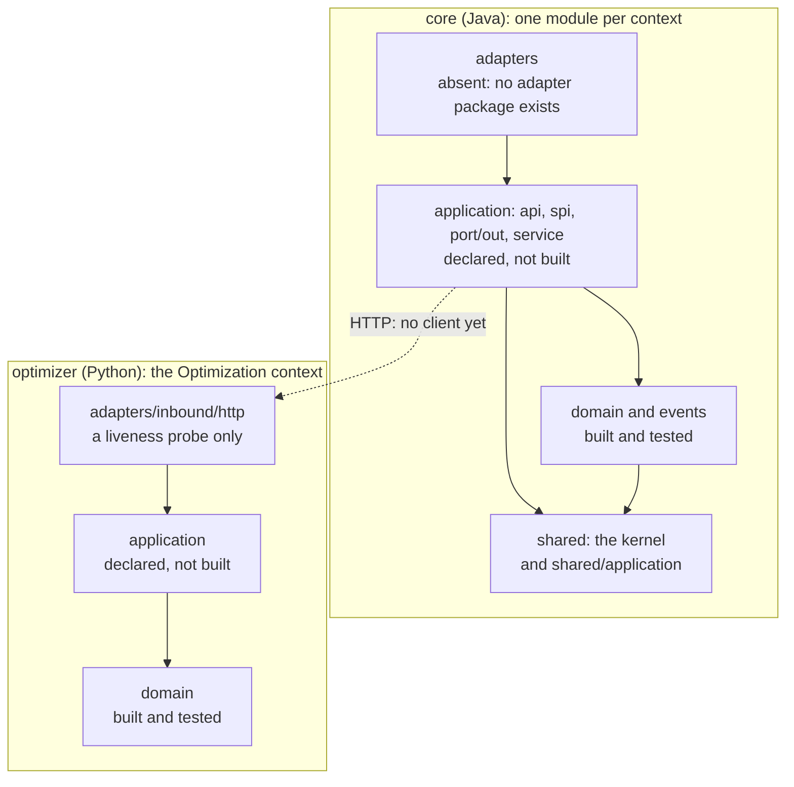

An arrow means *depends on*. The sources for each box:

- **Built and tested.** Every module's `domain/` and `events/`, and the kernel `shared/`, under `core/`;
  `optimizer/domain/`. Their tests are in `core-test/` and `optimizer-test/domain/`.
- **Declared, not built** ([ADR-119](../../ADRs/ADR-119-the-application-layer-is-declared-ahead-as-signatures-whose-bodies-throw.md)).
  Each module's `application/` holds the use cases, ports and module APIs as signatures with Javadoc.
  A body that would do work throws `UnsupportedOperationException("Built in M<n>")`. At this commit
  there are 243 such bodies in 181 files under `core/`, and 7 `NotImplementedError("Built in M<n>")`
  in `optimizer/application/`. `grep -rn "Built in M5" src/backend` lists one milestone's remaining work.
  The two kernel errors in `shared/application/` (`NotFound`, `StaleVersion`) are complete classes; its
  three ports (`Clock`, `IdGenerator`, `ProcessedEvents`) are interfaces with no implementation.
- **Absent.** No use case, port or adapter is wired, and there is no `adapter/` package under `core/`.
  The only Spring annotations are `@SpringBootApplication` on the entry point
  `core/DispatchFlowApplication.java` and `@RestControllerAdvice` on the one error handler in
  `core/web/`. The optimizer's only adapter is the liveness probe in `optimizer/adapters/inbound/http/app.py`.

**Dependency direction.** Dependencies point inwards, as DL [§13](domain_layer_design.md#13-inside-each-module-hexagon)
draws. The rules that keep the domain pure are DL [§2.3](domain_layer_design.md#23-rules-between-contexts)
and [§3.9](domain_layer_design.md#39-purity), and ArchUnit tests in `core-test/architecture/` fail the
build when one breaks (`DomainPurityTest`, `DomainShapeTest`, `DomainPackageTest`, `ApplicationTest`). A
scan of every `import` at this commit finds no file under any `domain/` or `events/` package that imports
another module. The only cross-module imports are in `application/` packages. In Python,
import-linter does the same job (`src/backend/optimizer/pyproject.toml`, section `[tool.importlinter]`).

---

## 2. The nine contexts on one map

Eight contexts are Java modules in `core`. The ninth, Optimization, is the Python optimizer. DL
[§1](domain_layer_design.md#1-subdomains-and-bounded-contexts) defines them; DL
[§2.1](domain_layer_design.md#21-module-graph) draws the module graph. The diagram below is the same
graph with each module's aggregates inside it, which the DL does not show. An arrow points upstream and
means *depends on*.

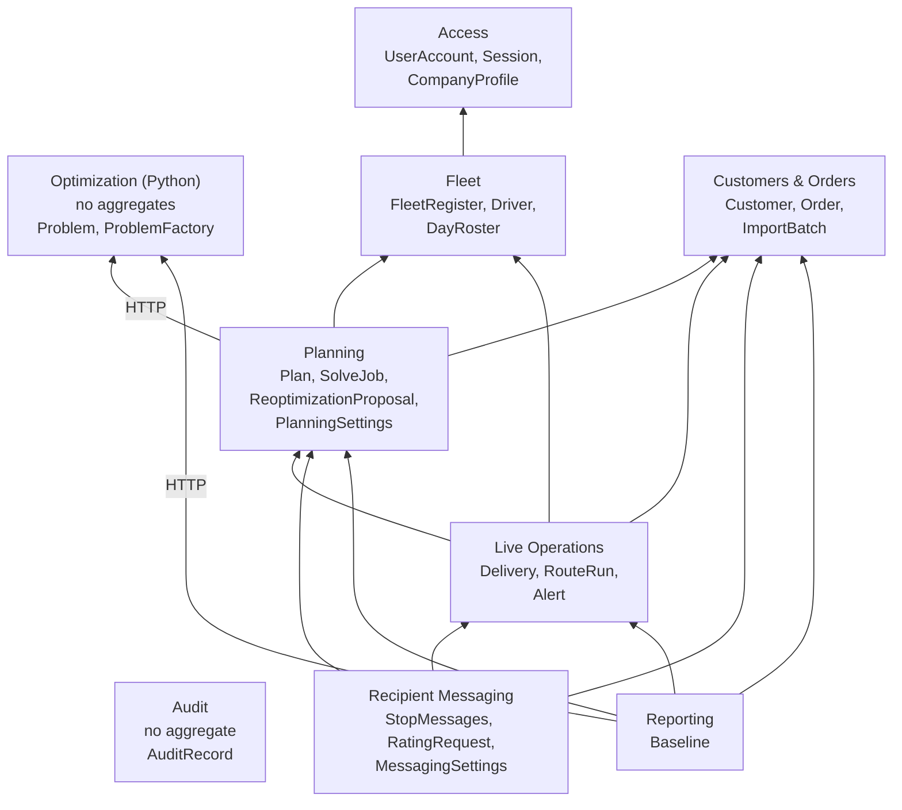

Not drawn, because every module has them: each depends on the kernel and on Audit's `AuditLog` port, and
each but Access depends on Access for the acting user (DL §2.1). The four dashed "implements a port the
upstream module owns" arrows are in the DL diagram.

The import scan agrees with the graph: every cross-module `import` in `core/` points along one of these
arrows (or to Access or Audit), and `audit/` imports no other module.

### The modules in numbers

| Module (`core/`) | Domain packages | Domain files | Events |
|---|---|---|---|
| `access` | root, `account`, `session`, `companyprofile` | 38 | 2 |
| `audit` | flat | 11 | none |
| `fleet` | root, `driver`, `register`, `roster` | 34 | 1 |
| `liveops` | root, `delivery`, `alert`, `routerun` | 47 | 3 |
| `messaging` | root, `message`, `rating`, `settings` | 42 | 1 |
| `orders` | flat | 41 | 3 |
| `planning` | root, `plan`, `solution`, `drop`, `basis`, `revision`, `reconciliation`, `settings` | 81 | 6 |
| `reporting` | flat | 21 | none |

"Domain files" counts `.java` files under `<module>/domain/`, not counting `package-info.java`.
A package above 20 files splits by aggregate, then by concept, wherever a group of 4 files can move
([ADR-118](../../ADRs/ADR-118-a-domain-package-above-30-files-splits-by-aggregate.md), [ADR-125](../../ADRs/ADR-125-a-folder-above-20-files-splits-wherever-a-group-of-four-can-move.md)):
the root `domain/` keeps the module's error type and what several packages use, and imports none of its
subpackages. `orders` has 41 files and stays flat, because its types form a cycle (`OrderStatus`,
`OrdersError` and `Order` name each other) and `ImportBatch` calls package-private methods of `Customer`
and `Order`; ADR-118 records it. The kernel and every `api/`, `spi/` and `events/` package stay flat
(ADR-118, ADR-125).

### Every aggregate root

There are 20 roots in Java (`extends AggregateRoot`). Audit has none, and the Python domain has none.

| Aggregate (module) | Key | Creation factory | Lines |
|---|---|---|---|
| `UserAccount` (Access) | `AccountId` | `open`, `openFirstAdmin` | 763 |
| `Session` (Access) | `SessionId` | `open` | 573 |
| `CompanyProfile` (Access) | none: one per company | `create` | 153 |
| `FleetRegister` (Fleet) | none: one per company | `empty` | 368 |
| `Driver` (Fleet) | `AccountId`, the driver's account | `register` | 273 |
| `DayRoster` (Fleet) | `DeliveryDate` | `open` | 427 |
| `Customer` (Orders) | `CustomerId` | `register` | 447 |
| `Order` (Orders) | `OrderId` | `place` | 547 |
| `ImportBatch` (Orders) | `ImportBatchId` | `preview` | 457 |
| `Plan` (Planning) | `PlanId` | `open` | 2,113 |
| `SolveJob` (Planning) | `JobId` | `queue`, package-private | 467 |
| `ReoptimizationProposal` (Planning) | `ProposalId` | `create`, package-private | 178 |
| `PlanningSettings` (Planning) | none: one per company | `startingValues` | 111 |
| `Delivery` (Live Operations) | `StopId` | `firstFact` | 737 |
| `RouteRun` (Live Operations) | `RouteId` | `start` | 341 |
| `Alert` (Live Operations) | `AlertId` | `raise` | 121 |
| `StopMessages` (Messaging) | `StopId` | `open` | 642 |
| `RatingRequest` (Messaging) | `RatingRequestId` | `open` | 378 |
| `MessagingSettings` (Messaging) | none: one per company | `create` | 104 |
| `Baseline` (Reporting) | `PlanId` | `compute` | 238 |

Lines are the line counts of the root's file at this commit. Where a root lives: `core/<module>/domain/`
plus the aggregate's package from the table above (`Plan.java` is in `core/planning/domain/plan/`).

---

## 3. The shared kernel

`core/shared/` holds what every module's domain is made of. DL [§2.3](domain_layer_design.md#23-rules-between-contexts)
rule 5 and [ADR-097](../../ADRs/ADR-097-the-shared-kernel-holds-the-domains-building-blocks.md) set what
may go in it: building blocks, typed IDs, ten shared values and one text rule, and nothing that holds one
context's rule. It is 38 files; its tests are the 21 files in `core-test/shared/`.

### The building blocks

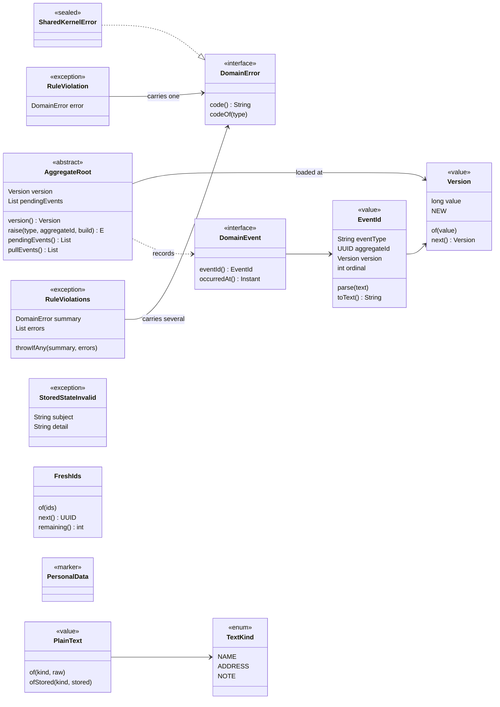

How the pieces work together:

- **`AggregateRoot`** (`core/shared/AggregateRoot.java`, 93 lines) holds the `Version` the aggregate was
  loaded at and the events its methods raised. `raise` builds the event's `EventId` from the type's
  simple name, the aggregate's UUID, `version().next()` (the version this change will be saved at) and
  the event's position in the change. It throws `AssertionError` when the event is not exactly the
  type given or does not carry that ID, because that is a bug and not a refusal. `pullEvents` hands the
  recorded events to the use case's save and forgets them (DL
  [§3.6](domain_layer_design.md#36-repositories)).
- **`EventId`** has a text form, `<eventType>:<aggregateId>:<version>:<ordinal>`, which `toText` writes
  and `parse` reads. Optimistic locking lets one change commit per aggregate and version, so the four
  parts are unique without a random part.
- **`DomainError`** is the interface of every named refusal. `code()` derives the stable code from the
  record's simple name (`DriverInUse` becomes `DRIVER_IN_USE`), so a code can't drift from its type. Each
  module has a sealed error interface (`FleetError`, `OrdersError`, …); the kernel's own are
  `SharedKernelError` (DL [§3.8](domain_layer_design.md#38-domain-errors)).
- **`FreshIds`** is a supply of new UUIDs for a method that creates an unknown number of children, such
  as the routes and stops of a solve result. The use case fills it from `IdGenerator`, because the
  domain never makes an ID.
- **`PersonalData`** is a marker. A type that identifies or describes a person implements it and prints
  itself redacted; a rule in `DomainShapeRules`, run by `DomainShapeTest`, refuses it in an error or
  event field.

### What can go wrong, and what is thrown

| Situation | Thrown | Where it is defined |
|---|---|---|
| A business rule refuses | `RuleViolation` with one `DomainError`, or `RuleViolations` with all of them (publishing, an import) | `core/shared/` |
| Stored state can't become a valid object | `StoredStateInvalid`, not a `DomainError`: a damaged row is an incident | `core/shared/` |
| A use case is asked about a record that does not exist | `NotFound` (404) | `core/shared/application/` |
| A version moved since the caller read it | `StaleVersion` (412, or 503 after three retries for a call that sent no version) | `core/shared/application/` |
| An aggregate's caller broke a contract | `AssertionError` in `AggregateRoot.raise`, `NoSuchElementException` in `FreshIds.next` | `core/shared/` |

### Typed IDs

Every ID is a record wrapping a UUID, so one kind can't be passed for another (DL
[§3.3](domain_layer_design.md#33-value-objects)). There are 14, each in `core/shared/`:

| ID | Names | Also the key of |
|---|---|---|
| `AccountId` | an account | `Driver`, whose ID is the account's |
| `SessionId` | a signed-in device | none |
| `CustomerId`, `OrderId`, `ImportBatchId` | the three Orders aggregates | none |
| `DepotId`, `VehicleId` | entities in `FleetRegister` | none |
| `PlanId` | a plan | `Baseline` |
| `RouteId` | a route, an entity in `Plan` | `RouteRun` |
| `StopId` | a stop, an entity in `Plan` | `Delivery`, `StopMessages` |
| `JobId`, `ProposalId` | the other two Planning aggregates | none |
| `AlertId` | an alert | none |
| `RatingRequestId` | a rating request | none |

Ids that only one module names stay in that module: `RefreshTokenId` in `core/access/domain/session/`,
`CredentialLinkId` in `core/access/domain/account/`, `OutgoingMessageId` in `core/messaging/domain/`,
`HeldReportId` in `core/liveops/domain/` and `ProofId` in `core/liveops/domain/delivery/`.

### Shared values

DL [§3.3](domain_layer_design.md#33-value-objects) lists what each checks and the error it raises.

| Value | In `core/shared/` | Notes |
|---|---|---|
| `DeliveryDate` | `DeliveryDate.java` | The calendar day; `midnight()` and `lengthInSeconds()` know the day's 23, 24 or 25 hours |
| `IsraelDateTime` | `IsraelDateTime.java` | A local time in `Asia/Jerusalem`; holds the zone as `ZONE` |
| `DaySeconds` | `DaySeconds.java` | Seconds since the date's local midnight, within that day |
| `TimeWindow` | `TimeWindow.java` | Start before end, on one date; built by `TimeWindow.on` |
| `GeoPoint`, `Weight`, `Volume` | one file each | `Weight` and `Volume` share the checks in the package-private `Quantities` |
| `Priority`, `Attempt` | one file each | `Priority.DEFAULT` is 3; `Attempt.FIRST` and `next()` |
| `PhoneNumber` | `PhoneNumber.java` | `parse` for input, `ofStored` for a stored number |
| `PlainText`, `TextKind` | two files | The one rule for names, addresses and notes ([ADR-106](../../ADRs/ADR-106-free-text-is-normalized-and-capped-by-one-kernel-rule.md)) |

---

## 4. Anatomy of one aggregate

Most of the 20 roots follow one pattern. The clearest small example with an event is `Driver`
(`core/fleet/domain/driver/Driver.java`, 273 lines). `Alert` (`core/liveops/domain/alert/Alert.java`,
121 lines) is a small root that raises none.

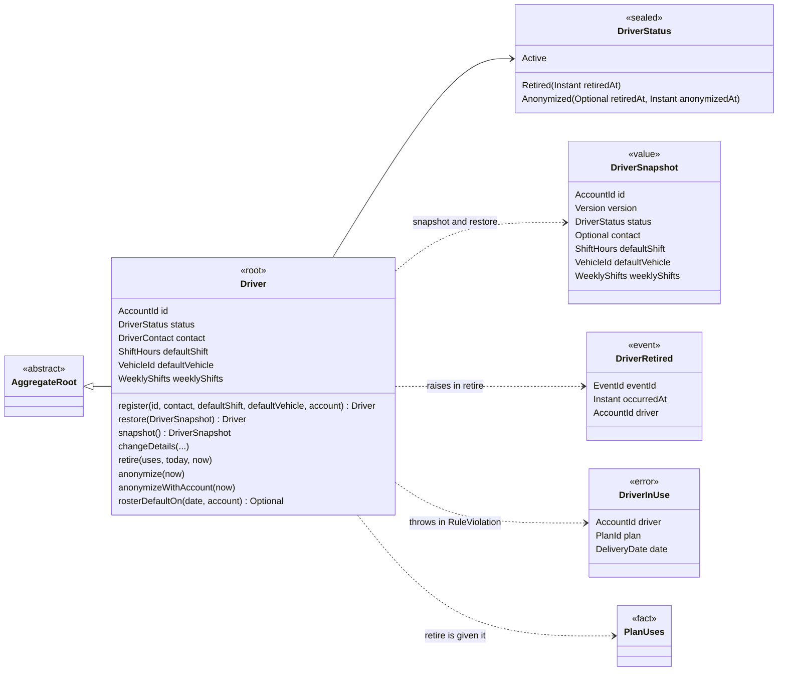

The pattern, with where `Driver` shows each part:

1. **A private constructor**, which `DomainShapeRules` requires, usually taking the snapshot:
   `private Driver(DriverSnapshot stored)`. A few roots take their fields instead (`UserAccount`,
   `Session`, `CompanyProfile`, `FleetRegister`, `DayRoster`). Either way, nothing outside the class can
   build an instance except through a static factory.
2. **A creation factory checks every invariant of a new aggregate** and returns it at `Version.NEW`. Its
   name says what the business does: `register` here, `place`, `open`, `start`, `raise`, `compute` in the
   table of roots in §2. The new ID and `now` are parameters, never made inside (DL
   [§3.5](domain_layer_design.md#35-factories)). `Driver.register` also takes the account's `Standing`,
   a fact the driver can't see itself.
3. **`restore(snapshot)` is for persistence only.** It rebuilds a stored aggregate and checks its
   structure again, throwing `StoredStateInvalid` for a damaged row (`Driver.restore` checks that a
   driver has a name and phone exactly until anonymized). Only a persistence adapter may call it; an
   ArchUnit rule enforces that.
4. **`snapshot()` is the stored form**, including `version()`. The repository stores it.
5. **Business methods are named for what the business does** and are called once per command (`retire`,
   not `setStatus`). Each checks the current state first, then throws `new RuleViolation(new FleetError.X(...))`,
   then changes state, then raises events. A refused call changes nothing and records nothing.
6. **State is a sealed interface of records** (`DriverStatus`). A `switch` over it must cover every case,
   as `Driver.anonymize` does (DL [§3.4](domain_layer_design.md#34-states-and-transitions)).
7. **Events are recorded by the root**, never by a use case: `raise(DriverRetired.class, id.value(), …)`.
   The record is in the module's `events/` package, `core/fleet/events/DriverRetired.java`.
8. **Facts the aggregate can't see arrive as parameters**: `PlanUses`, `today`, `now`, `Standing`. That is
   why no domain test needs a mock or a clock.

A call to `Driver.retire`, from a use case that is declared but not built (`RetireDriver`,
`core/fleet/application/service/RetireDriver.java`):

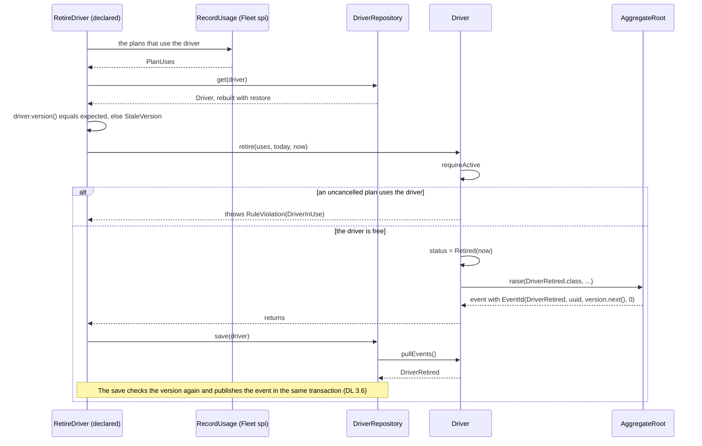

---

## 5. Each context

Each subsection gives the aggregates and what they hold, the package layout, the events, and where to
start reading. The invariants and their errors are in DL [§4](domain_layer_design.md#4-aggregates-context-by-context);
this guide does not repeat them.

### 5.1 Access

DL [§4.1](domain_layer_design.md#41-access). Accounts, roles, sessions and the company profile.

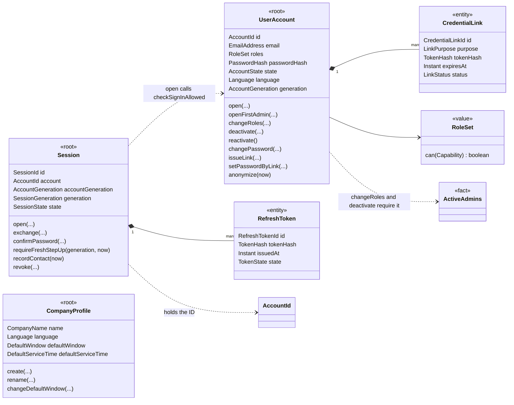

- **Packages** (`core/access/domain/`): the root holds `AccessError`, `AccountGeneration`,
  `CommonPasswords`, `Language`, `NewPassword` and `TokenHash`; `account/` (18 files) holds
  `UserAccount`, `CredentialLink`, `RoleSet`, `Role`, `Capability`, `ActiveAdmins`, `EmailAddress`,
  `EmailHolder` and the states; `session/` (9) holds `Session`, `RefreshToken`, `TokenState`,
  `RefreshOutcome`; `companyprofile/` (5) holds `CompanyProfile`, `CompanyName`, `DefaultWindow`,
  `DefaultServiceTime`. `session/` imports `account/` once: `Session.open` takes the `UserAccount`.
- **Two counters, not one.** `AccountGeneration` is on the account and `SessionGeneration` on the
  session, as distinct types. A token issued under an older generation is refused (DL §3.3).
- **Step-up lives on the session.** `confirmPassword` is the Admin step-up (NFR-214, NFR-227): it
  supersedes the current refresh token and issues a new one under a new `SessionGeneration`.
  `requireFreshStepUp` refuses an Admin-only operation once `STEP_UP_LIFETIME` (5 minutes) has passed
  since the password was last given. An Admin-only use case calls it rather than checking by itself.
- **Events:** `SessionsRevoked` and `AccountAnonymized`, both raised by `UserAccount`.
- **Start reading:** `CompanyProfile.java` (153 lines) for the pattern, then `Session.java` (573, the
  refresh-token chain), then `UserAccount.java` (763). Tests: `core-test/access/domain/account/`
  (`UserAccountTest`, `UserAccountLifecycleTest`, `CapabilityMatrixTest`), `session/` (`SessionTest`,
  `SessionLifecycleTest`) and `companyprofile/`.

### 5.2 Fleet

DL [§4.2](domain_layer_design.md#42-fleet). Depots, vehicles, drivers, and who drives what on a date.

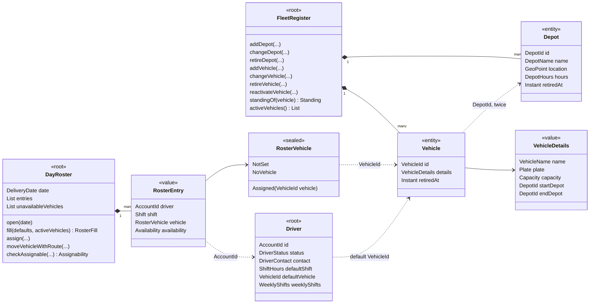

- **Packages** (`core/fleet/domain/`): the root holds `FleetError`, `PlanUse`, `PlanUses`, `RosterDefault`,
  `ShiftHours` and `Standing`; `register/` (13 files) holds `FleetRegister`, `Depot`, `Vehicle`, `Plate`,
  `Capacity`, `DepotHours`, `DepotName`, `VehicleName`; `driver/` (6) holds `Driver`, `DriverStatus`,
  `DriverName`, `WeeklyShifts`; `roster/` (9) holds `DayRoster`, `RosterEntry`, `Shift`, `RosterFill`, `Assignability`.
  The three aggregate packages import only the root.
- **`Depot` and `Vehicle` are package-private classes.** Nothing outside `register/` can change one; the
  only way is through `FleetRegister`. ADR-118 names this as an example of package-private access that
  binds a root to its parts.
- **Two kinds of fact come in.** `Standing` (active or not active) is what Access and the register say
  about a driver or vehicle; `PlanUses` is what Planning says about plans that use a record. Both arrive as
  parameters.
- **Events:** `DriverRetired`, raised by `Driver.retire`. `Driver.anonymize` and
  `anonymizeWithAccount` raise none; the second one is called from the listener for Access's
  `AccountAnonymized`.
- **Start reading:** `Driver.java` (§4 above), then `FleetRegister.java` (368), then `DayRoster.java`
  (427). Tests: `core-test/fleet/domain/driver/DriverTest`, `register/FleetRegisterTest`,
  `roster/DayRosterTest`.

### 5.3 Customers & Orders

DL [§4.3](domain_layer_design.md#43-customers--orders). Who receives what: customers, orders and
imports. This is the one flat module with more than 30 files, for the reason in §2.

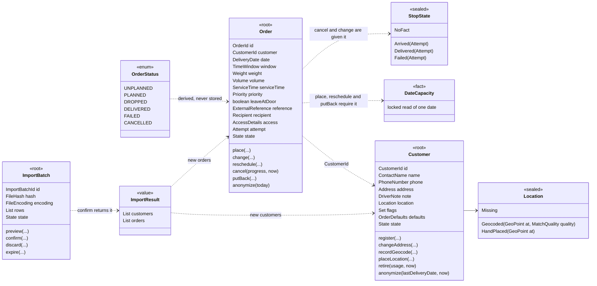

- **Package:** one flat package, `core/orders/domain/` (41 files, the largest of the flat ones). Beyond
  the three roots: the personal-data values (`Address`, `ContactName`, `DriverNote`, `Floor`,
  `Apartment`, `EntranceCode`, `AccessDetails`, `Recipient`), `NormalizedAddress` and `CustomerMatch` for
  matching, `OrderDefaults` and `DailyWindow`, `ServiceArea` for the area test, and the import types
  (`ImportLine`, `ImportRow`, `PreviewRow`, `ImportContext`, `ImportResult`).
- **`OrderStatus` is derived, not stored.** It comes from the order's own `State`, a `Placement`
  (Planning's answer) and a `StopState` (Live Operations' answer). DL
  [§9.6](domain_layer_design.md#96-order-status-br-33-is-derived-not-stored) draws it.
- **`ImportBatch.confirm` creates other aggregates.** It returns an `ImportResult` holding new
  `Customer`s and `Order`s, which the use case saves with the batch in one transaction (DL
  [§6.1](domain_layer_design.md#61-the-rule)). ImportBatch's lifecycle is DL
  [§9.4](domain_layer_design.md#94-importbatch).
- **Events:** `OrderCancelled`, `OrderRescheduled` and `OrderPutBack`, all raised by `Order`.
- **Start reading:** `Order.java` (547) with `OrderStatus.java` and `DateCapacity.java`, then
  `Customer.java` (447), then `ImportBatch.java` (457). Tests: `core-test/orders/domain/` (`OrderTest`,
  `OrderStatusTest`, `CustomerTest`, `ImportBatchTest`, `CustomerMatchTest`, `NormalizedAddressTest`),
  with builders `OrderBuilder`, `CustomerBuilder`, `ImportBatchBuilder`.

### 5.4 Planning

DL [§4.4](domain_layer_design.md#44-planning), whose class diagram already draws `Plan`, `Route`,
`PlannedStop`, `PlanRevision`, `SolveJob` and `ReoptimizationProposal`. This guide adds what the DL
does not draw: the package map, why three aggregates share one package, and what `Plan` holds beyond
its routes. Planning is the largest module: 81 domain files and about 7,000 lines.

**Package map.** Arrows point from the package that imports to the package it imports (ADR-118 rule 7).
The root imports none of its subpackages.

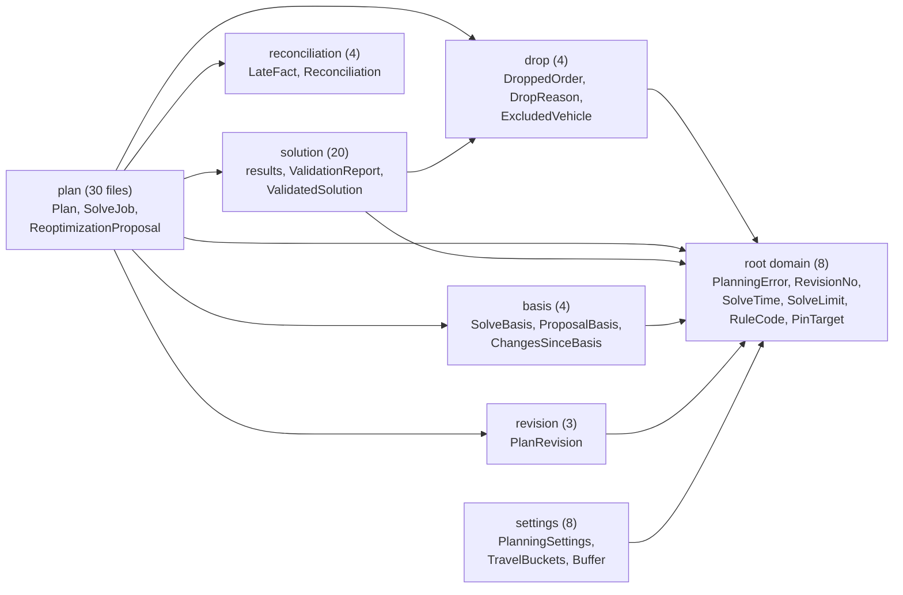

**Why `SolveJob` and `ReoptimizationProposal` live in `plan/`.** Because of Java's package-private
access, not because of size. `SolveJob.queue` is a package-private static factory that only `Plan.requestSolve` and
`Plan.requestReoptimization` call, so a job exists only with a plan that can hold it. And
`ReoptimizationProposal.create` is a package-private static factory that only `SolveJob.succeed` calls,
so a proposal exists only for a job that succeeded. Java's package-private access needs the three in one
package, and ADR-118 forbids widening visibility to move a file. The package Javadoc says the same
(`core/planning/domain/plan/package-info.java`).

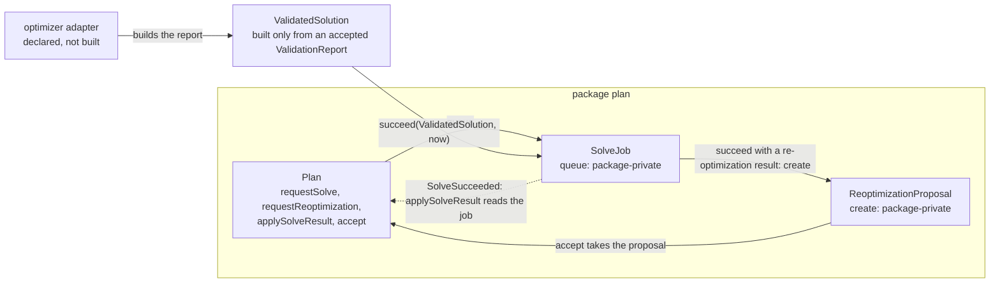

The solid arrows are Java calls. The dotted one is an event (§7). Only the optimizer adapter may build a
`ValidationReport` or an `Evaluation`, so `Plan` can't be handed an unvalidated solution (DL
[§13](domain_layer_design.md#13-inside-each-module-hexagon); the rule is
`DomainPurityRules.optimizerResultsOnlyFromOptimizerAdapter`, run by `DomainPurityTest`).

**What `Plan` holds.** Its fields are in `core/planning/domain/plan/Plan.java`, and its stored form in
`PlanSnapshot.java`.

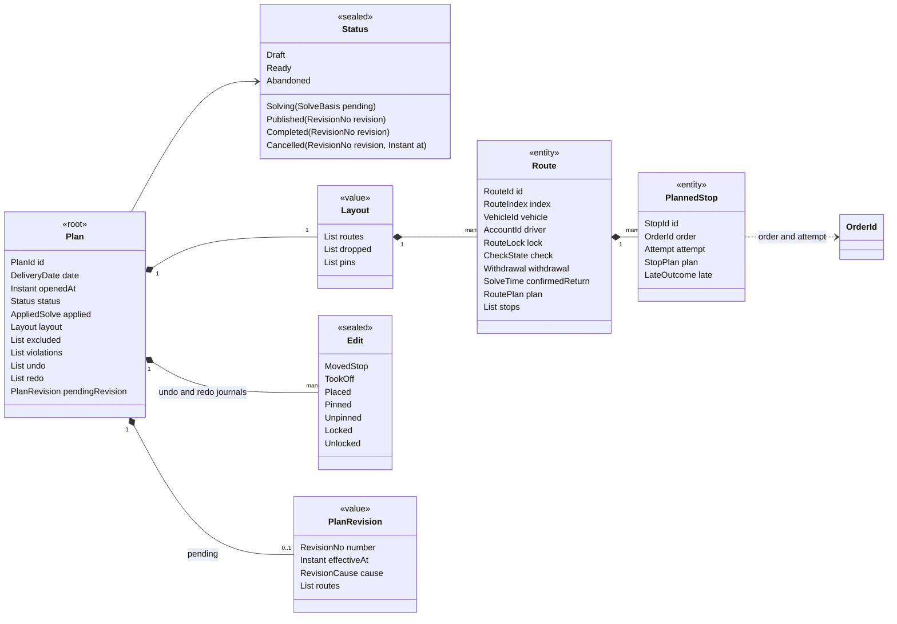

- **`Route` and `PlannedStop` are package-private records**, not public classes. Other code sees a plan
  through `PlanLayout` (public: routes, dropped orders and pins by ID) and the `snapshot()`.
- **`Edit` is the undo journal.** Each of the seven records stores what an edit changed, so `undo` and
  `redo` reverse it. DL [§4.4](domain_layer_design.md#44-planning) states its limit of 100 edits.
- **The `after…` queries** (`afterMove`, `afterTakeOff`, `afterPlacing`, `afterPin`, `afterUnpin`,
  `afterUndo`, `afterRedo`, `afterHandOver`) return the `PlanLayout` an edit would leave, so a use case
  can ask the optimizer to check it before the transaction (DL
  [§6.3](domain_layer_design.md#63-outside-calls-happen-before-the-transaction)).
- **What is in `solution/`.**

| Role | Types in `core/planning/domain/solution/` |
|---|---|
| What a solve returns | `SolveResult`, `SolvedRoute`, `SolvedStop`, `StopPlan`, `StopTimes`, `RoutePlan`, `TravelLeg`, `RouteTimes`, `StopTiming` |
| Gate types only the optimizer adapter builds | `ValidatedSolution`, `ValidationReport`, `Evaluation` |
| What a re-optimization previews | `ReoptimizationResult`, `ObjectiveTerms`, `LateStop`, `DriverChange`, `VehicleWithdrawal`, `Withdrawal` |
| Other | `Violation`, `SolveFailure` |

Why an order or a vehicle is out sits in `drop/`: `DropReason` (a sealed interface of eleven
records), `DroppedOrder`, `ExcludedVehicle` and `ExclusionCause`, which `solution` and `plan` use
([ADR-125](../../ADRs/ADR-125-a-folder-above-20-files-splits-wherever-a-group-of-four-can-move.md)).
`PinTarget` sits in the root, because `plan` and `drop` both use it.

- **Events** (`core/planning/events/`): `PlanPublished`, `PlanRevised`, `RouteHandedOver`, `PlanCancelled`
  from `Plan`; `SolveSucceeded`, `SolveFailed` from `SolveJob`. The package also holds the enums these
  events use: `Lane`, `RevisionCause`, `SolveFailureReason`, `WithdrawalCause`.
- **Start reading:** `SolveJob.java` (467) and `ReoptimizationProposal.java` (178) first. Then `Plan.java`
  (2,113 lines) by section: its source has banner comments (`// ---- Solving ----`), and its tests are split
  by topic, so read a section beside its test. Tests: `core-test/planning/domain/plan/`
  (`PlanLifecycleTest`, `PlanSolvingTest`, `PlanEditingTest`, `PlanPublishingTest`, `PlanPublishedTest`,
  `PlanRoutesAndFactsTest`, `PlanSequenceTest`, `SolveJobTest`, `ReoptimizationProposalTest`,
  `PlanRestoreTest`, `PlanRefusalsTest`) and `core-test/planning/events/PlanningEventsTest`.

### 5.5 Live Operations

DL [§4.5](domain_layer_design.md#45-live-operations). What happened on the street: arrivals, outcomes,
route runs and alerts. Planning owns intent and Live Operations owns facts (DL
[§8](domain_layer_design.md#8-when-a-fact-contradicts-the-plan)).

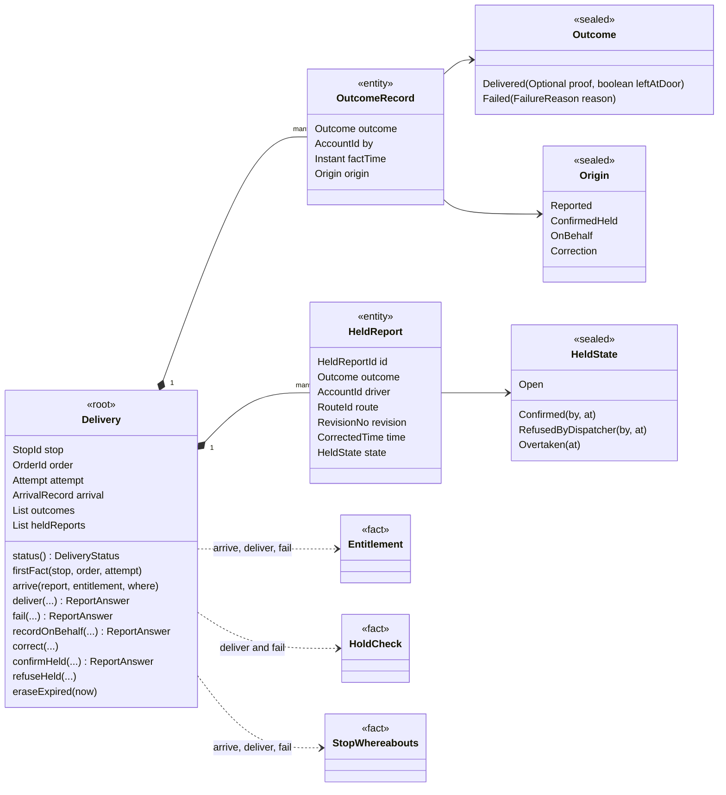

The other two aggregates are smaller.

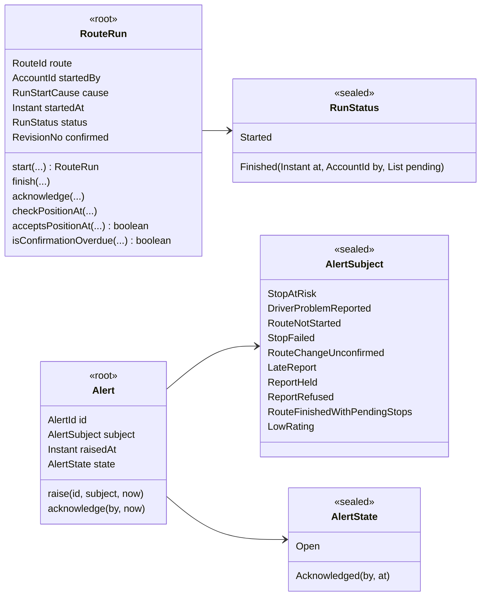

- **Packages** (`core/liveops/domain/`): the root (8 files) holds `LiveOpsError`, `CorrectedTime`,
  `DriverReport`, `ContactWindow`, `RevisionNo`, `HeldReportId`, `CancellationKind`, `TrackingRefusal`;
  `delivery/` (24) holds `Delivery`, its snapshot types, `Outcome`, `Proof`, `FailureReason`,
  `ArrivalProjection`, `RetentionPeriods`; `alert/` (9) holds `Alert`, `AlertSubject`, `AlertKind`,
  `DedupeKey`; `routerun/` (6) holds `RouteRun`, `RunStatus`, `TrackingWindow`, `ConfirmationDeadline`.
- **`Delivery`'s status is derived.** `DeliveryStatus` (`PENDING`, `ARRIVED`, `HELD`, `DELIVERED`,
  `FAILED`) is computed from the outcomes and held reports, effective outcome first; it is not stored.
  DL [§9.3](domain_layer_design.md#93-delivery-br-87) draws it.
- **Each alert kind has its own subject record**, and each `AlertSubject` defines its `DedupeKey`, so an
  alert is raised once per key. `Alert.raise` is the creation factory. It raises no event, because
  screens and push follow the commit.
- **Many facts are passed in**: who may report (`Entitlement`), where the stop is now (`StopWhereabouts`),
  whether a late report must be held (`HoldCheck`), whether a later attempt exists (`LaterAttempt`). Each
  is read by the use case from another module first (DL
  [§4.5](domain_layer_design.md#45-live-operations)).
- **Events** (`core/liveops/events/`): `OutcomeRecorded` and `PutBackSuperseded` from `Delivery`;
  `RouteStarted` from `RouteRun.start`. Enums beside them: `OutcomeKind`, `RunStartCause`.
- **Start reading:** `Alert.java` (121), `RouteRun.java` (341), then `Delivery.java` (737) with
  `DeliveryInvariants.java`. Tests: `core-test/liveops/domain/alert/AlertTest`, `routerun/RouteRunTest`,
  `delivery/` (`DeliveryLifecycleTest`, `DeliveryReportsTest`, `DeliveryCorrectionTest`,
  `DeliveryRefusalsTest`, `DeliverySequenceTest`, `ArrivalProjectionTest`).

### 5.6 Recipient Messaging

DL [§4.6](domain_layer_design.md#46-recipient-messaging). SMS to recipients, their replies, ratings and
opt-outs.

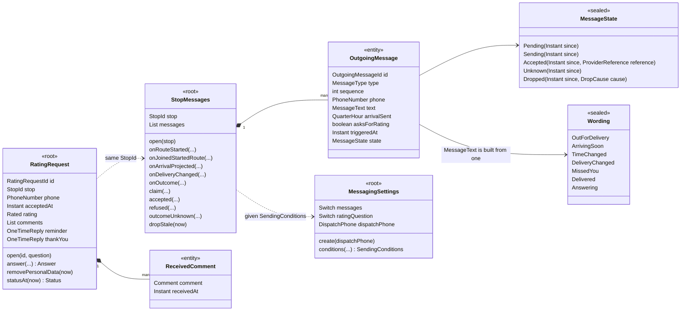

- **Packages** (`core/messaging/domain/`): the root (19 files) holds `MessagingError`, `MessageText`,
  `Wording`, `PhoneHash`, `OptOutRecord`, `OptOutStatus`, `QuarterHour`, `SendingConditions`;
  `message/` (13) holds `StopMessages`, `OutgoingMessage`, `MessageState`, `MessageType`, `DailySendCap`;
  `rating/` (8) holds `RatingRequest`, `Rating`, `Comment`, `Reply`, `ReplyText`; `settings/` (2) holds
  `MessagingSettings`.
- **Records, not aggregates.** Opt-outs (`OptOutRecord`, `OptOutStatus`) and inbound replies are
  append-only records (DL [§3.2](domain_layer_design.md#32-records)). A message's lifecycle is DL
  [§9.5](domain_layer_design.md#95-a-message-to-a-recipient).
- **`RatingRequest` has a status that is not stored.** `statusAt(now)` returns `OPEN`, `RATED` or
  `CLOSED`, and it is closed once 48 hours have passed (`ANSWER_WINDOW`).
- **Event:** `RatingReceived`, raised by `RatingRequest.answer` (`core/messaging/events/`).
- **Start reading:** `MessagingSettings.java` (104), `RatingRequest.java` (378), then `StopMessages.java`
  (642). Tests: `core-test/messaging/domain/message/` (`StopMessagesTriggersTest`,
  `StopMessagesSendingTest`), `rating/` (`RatingRequestTest`, `ReplyTest`), `settings/`, and the root
  (`MessageTextTest`, `OptOutStatusTest`).

### 5.7 Reporting

DL [§4.7](domain_layer_design.md#47-reporting). The daily summary and the comparison with the baseline.
It has one aggregate; everything else in Reporting is a value or, later, a read model.

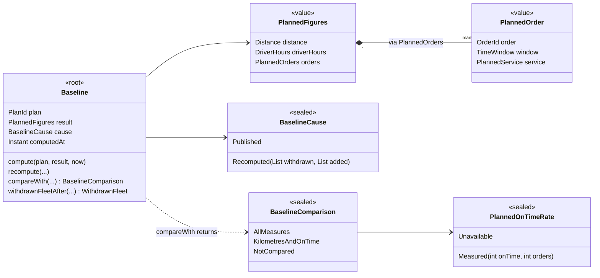

- **Package:** one flat package, `core/reporting/domain/` (21 files). Besides `Baseline`: the two rate
  types, `Distance`, `DriverHours`, `WithdrawnFleet`, `Withdrawal`, `WithdrawalCause`, `PlanStanding`
  and the input facts `StopResult` and `StopOutcome`.
- **The rates are exact shares of two counts.** `PlannedOnTimeRate` (in the diagram) and `OnTimeRate`
  (the actual rate, from `StopResult`s) are each `Measured` with two integers, or `Unavailable`; only a
  screen rounds. With no delivered stop the answer is `Unavailable`, never 0.
- **`WithdrawalCause` here is Reporting's own copy**, mapped from Planning's `WithdrawalCause` event enum
  when `PlanRevised` is heard (§11).
- **No events and no personal data.**
- **Start reading:** `OnTimeRate.java` (87), then `Baseline.java` (238). Tests: `core-test/reporting/domain/`
  (`BaselineTest`, `OnTimeRateTest`, `PlannedOnTimeRateTest`, `WithdrawnFleetTest`).

### 5.8 Audit

DL [§4.8](domain_layer_design.md#48-audit). The append-only audit trail. **It has no aggregate.** An
`AuditRecord` is an immutable record (DL [§3.2](domain_layer_design.md#32-records)), written through the
`AuditLog` port in the same transaction as the change it describes.

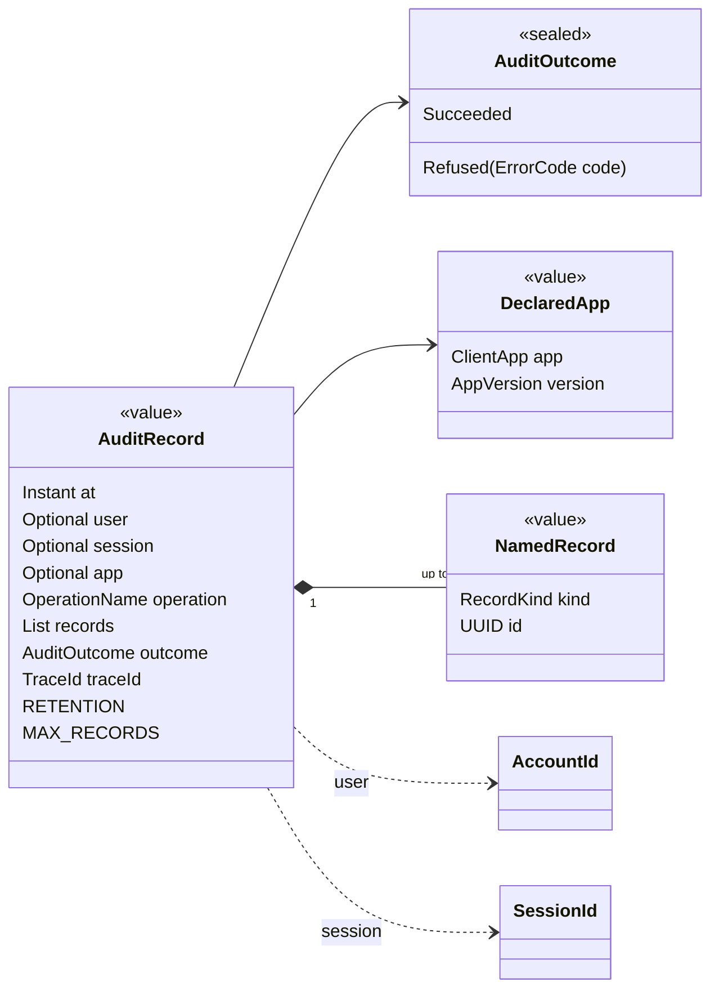

- **Package:** one flat package, `core/audit/domain/` (11 files): `AuditRecord`, `AuditOutcome`,
  `ErrorCode`, `OperationName`, `NamedRecord`, `RecordKind`, `DeclaredApp`, `ClientApp`, `AppVersion`,
  `TraceId`, `AuditError`. Every field is an ID, a code, an enum, a number or an instant, never free text.
- **Audit depends on nothing but the kernel.** It takes `AccountId` and `SessionId`, never an `Actor`
  (DL [§2.1](domain_layer_design.md#21-module-graph)). It raises no events.
- **Start reading:** `AuditRecord.java` (94 lines). Tests: `core-test/audit/domain/` (`AuditRecordTest`,
  `AuditOutcomeTest`, `NamedRecordTest`).

### 5.9 Optimization (Python)

DL [§4.9](domain_layer_design.md#49-optimization-python). The optimizer's domain has no aggregates and keeps
no state between calls. It is value objects whose methods are the rules. §8 maps its modules.

---

## 6. Lifecycles the DL does not draw

DL [§9](domain_layer_design.md#9-lifecycles) draws five: [Plan](domain_layer_design.md#91-plan-br-12),
[SolveJob](domain_layer_design.md#92-solvejob), [Delivery](domain_layer_design.md#93-delivery-br-87),
[ImportBatch](domain_layer_design.md#94-importbatch) and
[a message to a recipient](domain_layer_design.md#95-a-message-to-a-recipient). Order status, which is
derived, is [§9.6](domain_layer_design.md#96-order-status-br-33-is-derived-not-stored), and the table of
how every kind of thing ends is [§9.7](domain_layer_design.md#97-how-things-end). The lifecycles below
come from the sealed state types in the code and the methods that move between them. Each arrow is one
method, except where its label says that time passes.

### UserAccount (`AccountState`)

`core/access/domain/account/AccountState.java`. Anonymized is final.

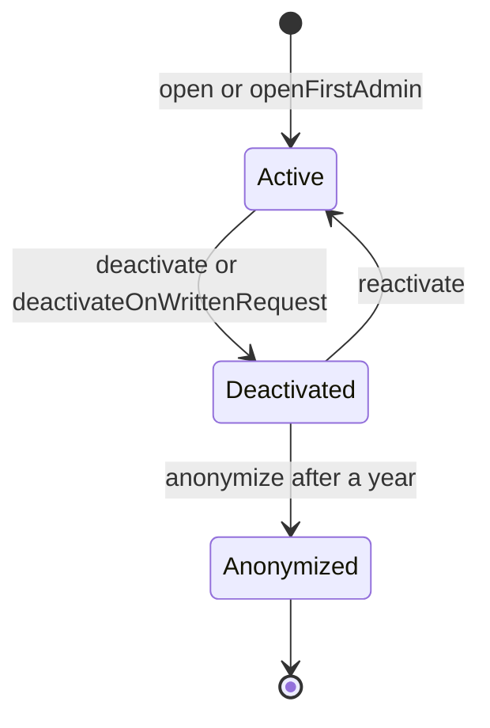

`deactivate` and `deactivateOnWrittenRequest` also void every open link and revoke every session, which
raises `SessionsRevoked`. `anonymize` raises `AccountAnonymized`. An active account that is anonymized is
refused with `AccountNotDeactivated`.

### Session (`SessionState`) and its refresh tokens (`TokenState`)

`core/access/domain/session/SessionState.java` and `TokenState.java`. The session has two states; the
interesting part is the chain of refresh tokens inside it (NFR-88, NFR-178 in the requirements).

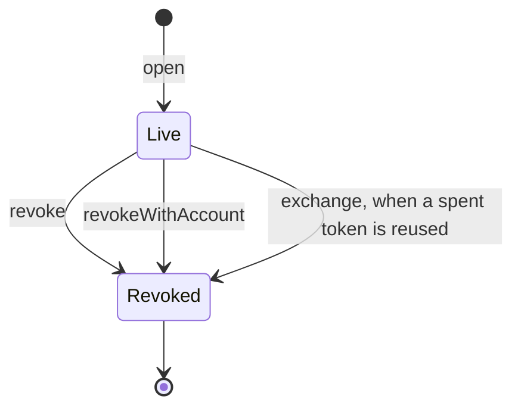

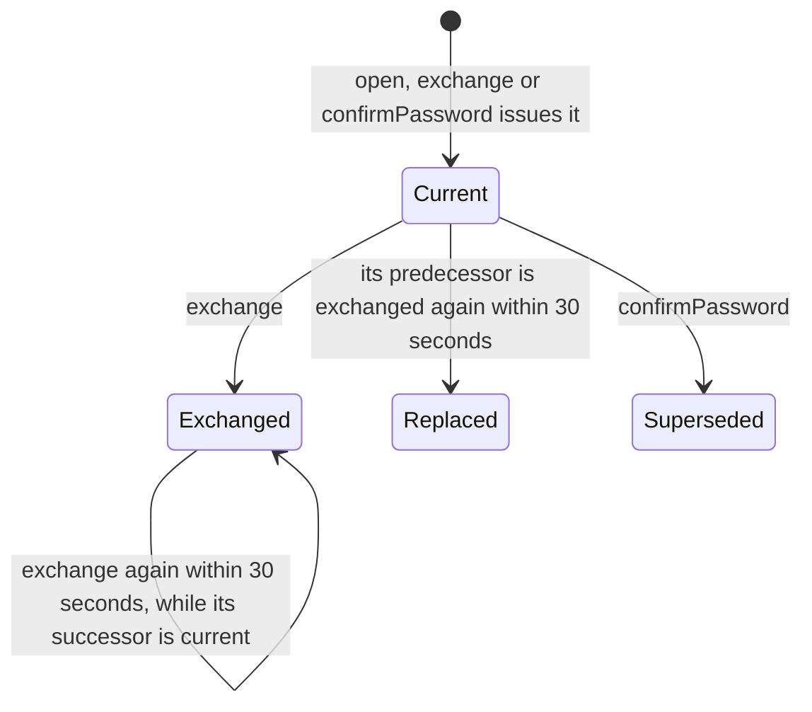

These revoke the session: a `Replaced` token presented again, an `Exchanged` one after its 30 seconds,
and an `Exchanged` one within them whose successor is no longer current (for example, because it was
exchanged too). A `Superseded` token is refused and revokes nothing, and so is an `Exchanged` one,
within its 30 seconds, whose successor a password confirmation superseded (`Session.exchange` and its
private `repeated`). `Session.exchange` answers with a `RefreshOutcome`
(`Issued` or `Refused`) instead of throwing, so the caller can save the revocation.

### Driver (`DriverStatus`)

`core/fleet/domain/driver/DriverStatus.java`.

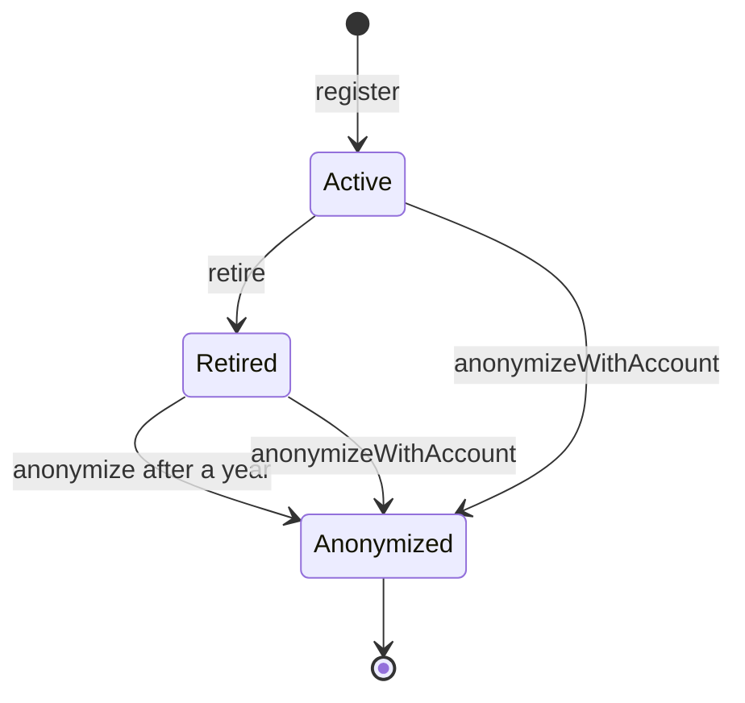

`retire` raises `DriverRetired`. The `anonymize` call on a driver that is already anonymized changes
nothing, because the nightly run repeats.

### Customer (`Customer.State`)

`core/orders/domain/Customer.java`.

```mermaid
stateDiagram-v2
  [*] --> Active : register
  Active --> Retired : retire when no plan uses it
  Retired --> Anonymized : anonymize a year after retirement
  Active --> Anonymized : anonymize a year after the later of creation and last order
```

### Order (`Order.State`, plus a flag)

`core/orders/domain/Order.java`. An order has only two states. A reschedule or a put-back changes its
date or attempt but not its state, and anonymizing sets a boolean (`anonymized`) beside the state.

```mermaid
stateDiagram-v2
  [*] --> Active : place
  Active --> Active : change, reschedule or putBack
  Active --> Cancelled : cancel
  Cancelled --> [*]
```

What the business calls the order's status (`UNPLANNED`, `PLANNED`, `DROPPED`, `DELIVERED`, `FAILED`,
`CANCELLED`) is the derived `OrderStatus`, in DL §9.6.

### RouteRun (`RunStatus`)

`core/liveops/domain/routerun/RunStatus.java`.

```mermaid
stateDiagram-v2
  [*] --> Started : start, by the driver or the first report
  Started --> Finished : finish
  Finished --> [*]
```

`acknowledge` records the revision the driver confirmed and changes no state. A second `start` on an
existing run is the instance overload `RouteRun.start(report, routeDriver, currentDriver, now)`, which
only refuses.

### Alert (`AlertState`)

`core/liveops/domain/alert/AlertState.java`.

```mermaid
stateDiagram-v2
  [*] --> Open : raise
  Open --> Acknowledged : acknowledge
  Acknowledged --> [*]
```

An acknowledged alert's dedupe key stays used, so the same alert is never raised again.

### RatingRequest (`Status`, derived from the time)

`core/messaging/domain/rating/RatingRequest.java`. Its status is computed by `statusAt(now)` and never
stored; what is stored is a rating and, separately, when the phone number was removed.

```mermaid
stateDiagram-v2
  [*] --> OPEN : open, when the question is accepted
  OPEN --> RATED : answer, with the first rating
  OPEN --> CLOSED : 48 hours pass
  RATED --> CLOSED : 48 hours pass
  CLOSED --> [*]
```

`removePersonalData` takes the phone away 90 days after the question was accepted, and each comment 90
days after its own reply, without changing the status.

### ReoptimizationProposal (`State`)

`core/planning/domain/plan/ReoptimizationProposal.java`. It never changes except to be declined once.
Accepting it is not a state of the proposal: `Plan.accept` takes it and makes a revision that cites it
(DL [§9.7](domain_layer_design.md#97-how-things-end)).

```mermaid
stateDiagram-v2
  [*] --> Ready : SolveJob.succeed creates it
  Ready --> Declined : decline
```

---

## 7. Events across modules

DL [§7](domain_layer_design.md#7-domain-events) says when an event earns its place and
[§7.2](domain_layer_design.md#72-the-events) lists them. At this commit the `events/` packages hold **16
event records**, in the 15 rows of the DL table (one row names two events). Six modules raise them;
Audit and Reporting raise none. An event is raised by an aggregate's method and recorded on the root
(§3), and is a past-tense record of IDs and kernel values.

The diagram below shows which module raises each event and which module's declared listener hears it.
An arrow from a module to itself is a listener in the same module. The listeners are in the
`application/service/` packages and are declared, not built.

```mermaid
flowchart LR
  ACC["Access"]
  FL["Fleet"]
  CO["Customers & Orders"]
  PL["Planning"]
  LO["Live Operations"]
  MS["Recipient Messaging"]
  RP["Reporting"]

  CO -->|"OrderCancelled, OrderRescheduled, OrderPutBack"| PL
  CO -->|"OrderCancelled, OrderRescheduled"| MS
  PL -->|"PlanPublished, PlanRevised, PlanCancelled, RouteHandedOver"| LO
  PL -->|"PlanRevised"| MS
  PL -->|"PlanPublished, PlanRevised"| RP
  PL -->|"SolveSucceeded, SolveFailed, RouteHandedOver"| PL
  LO -->|"RouteStarted, OutcomeRecorded"| MS
  LO -->|"OutcomeRecorded, PutBackSuperseded"| LO
  MS -->|"RatingReceived"| MS
  ACC -->|"AccountAnonymized"| FL
  ACC -->|"SessionsRevoked"| ACC
  FL -->|"DriverRetired"| FL
```

| Event | Raised by | Declared listeners (`core/<module>/application/service/`) |
|---|---|---|
| `SolveSucceeded` | `SolveJob.succeed` | `plan/ApplySolveResult` (Planning) |
| `SolveFailed` | `SolveJob.fail`, `expireIfOverdue` | `plan/RecordSolveFailure` (Planning) |
| `PlanPublished` | `Plan.publish` | `routerun/TellDriversRoutesReady` (Live Operations); `ComputeBaseline` (Reporting) |
| `PlanRevised` | `Plan.accept`, `handOver`, `removeStopOf`, `reconcileLateOutcome` | `routerun/TellDriversOfRevision` (Live Operations); `MessagePlanRevised` (Messaging); `RecomputeBaseline` (Reporting) |
| `RouteHandedOver` | `Plan.handOver` | `plan/MoveRosterWithRoute` (Planning); `routerun/TellDriversOfRevision` (Live Operations) |
| `PlanCancelled` | `Plan.cancel` | `routerun/TellDriversPlanCancelled` (Live Operations) |
| `OrderCancelled` | `Order.cancel` | `plan/RemoveStopOfOrder` (Planning); `MessageDeliveryChanged` (Messaging) |
| `OrderRescheduled` | `Order.reschedule` | `plan/RemoveStopOfOrder` (Planning); `MessageDeliveryChanged` (Messaging) |
| `OrderPutBack` | `Order.putBack`, on another date only | `plan/RemovePutBackOrder` (Planning) |
| `RouteStarted` | `RouteRun.start` | `MessageRouteStarted` (Messaging) |
| `OutcomeRecorded` | `Delivery.deliver`, `fail`, `recordOnBehalf`, `confirmHeld` | `delivery/ReconcileOutcome` (Live Operations); `MessageOutcome` (Messaging) |
| `PutBackSuperseded` | `Delivery.correct` | `delivery/RemoveSupersededStop` (Live Operations) |
| `RatingReceived` | `RatingRequest.answer` | `AlertLowRating` (Messaging) |
| `DriverRetired` | `Driver.retire` | `RemoveRoleOfRetiredDriver` (Fleet) |
| `SessionsRevoked` | `UserAccount` methods that revoke every session | `session/RevokeSessionsWithAccount` (Access) |
| `AccountAnonymized` | `UserAccount.anonymize` | `AnonymizeDriverWithAccount` (Fleet) |

The reason each is an event and not a call is DL §7.2's last column. Two things to know when you read
the listeners:

- **Delivery is at least once.** A listener must be idempotent by nature, or record
  `(listener, event ID)` through `ProcessedEvents` first (DL
  [§7.3](domain_layer_design.md#73-shape-and-delivery)).
- **`SessionsRevoked` has a second listener that is not declared.** DL §7.2 names a live-updates adapter
  that closes the account's open streams. Adapters are absent, so only Access's own listener exists.

---

## 8. The Python Optimization domain

DL [§4.9](domain_layer_design.md#49-optimization-python) and `optimization-engine.md`. The optimizer's
domain is `optimizer/domain/`: 15 modules plus `__init__.py`, about 4,100 lines, with about 5,300 lines of
tests in `optimizer-test/domain/`. It is pure: import-linter
forbids frameworks, clocks, randomness and I/O in it (`pyproject.toml`).

```mermaid
flowchart LR
  FACT["factory<br/>ProblemFactory"]
  PROB["problem<br/>Problem"]
  DROP["drops<br/>explain_drop"]
  OBJ["objective<br/>cost"]
  FEAS["feasibility<br/>validate"]
  VIEW["problem_view<br/>ProblemView protocol"]
  PART["problem_parts<br/>Orders, Vehicles, Drivers,<br/>ReoptContext, Pin"]
  PEN["penalty<br/>PenaltyScale"]
  TT["travel_time<br/>TravelTimeModel"]
  LEAF["solution, rules, exclusions<br/>import no other domain module"]
  FND["errors, indices, _arrays<br/>input checks"]

  FACT --> PROB
  FACT --> TT
  FACT --> PEN
  FACT --> LEAF
  FACT --> FND
  PROB --> DROP
  PROB --> FEAS
  PROB --> OBJ
  PROB --> PART
  PROB --> PEN
  PROB --> TT
  PROB --> LEAF
  PROB --> FND
  DROP --> FEAS
  DROP --> VIEW
  DROP --> PART
  DROP --> LEAF
  DROP --> FND
  OBJ --> FEAS
  OBJ --> VIEW
  OBJ --> LEAF
  FEAS --> VIEW
  FEAS --> LEAF
  FEAS --> FND
  VIEW --> PART
  VIEW --> PEN
  VIEW --> TT
  VIEW --> LEAF
  PART --> PEN
  PART --> LEAF
  PART --> FND
  PEN --> FND
  TT --> FND
```

An arrow means *imports*. An arrow to a grouped node means the module imports at least one module in the
group. The arrows come from the `import` lines of each file in `optimizer/domain/`.

- **Why `feasibility`, `objective` and `drops` never import `problem`.** `Problem`'s methods delegate to
  them, so if they imported `problem` there would be a cycle. Each types its argument as `ProblemView`, a
  `typing.Protocol` in `problem_view.py`, which `Problem` satisfies by shape. The module docstrings say so
  and import-linter enforces it (ADR-113). `problem` is imported in the domain by `factory` only.
- **`Problem`** (`optimizer/domain/problem.py`, 511 lines) is a frozen dataclass holding the orders,
  vehicles, drivers, the two matrices (`durations`, `distances`), the `TravelTimeModel`, the
  `PenaltyScale`, `drop_penalties`, `day_length`, `breaks_reserved`, `removed_by_dispatcher` and an
  optional `ReoptContext`. Its three rule methods are `validate(solution) -> ValidationReport`,
  `cost(solution, timings) -> Cost` and `explain_drop(order, solution) -> DropReason`. It also has two
  small helpers, `unserved(solution)` and `is_locked(order)`, which the `ProblemView` protocol requires.
- **`ProblemFactory`** (`optimizer/domain/factory.py`, 1,060 lines) has two static methods:
  `daily(...)` builds a `Problem` from the date's orders, depots, vehicles and drivers, and
  `reoptimization(...)` builds one from a live day. The conventions for a re-optimization are decided
  once there and written into the `Problem` (ADR-050, ADR-105). The inputs are small dataclasses in the
  same file: `OrderSpec`, `DepotSpec`, `VehicleSpec`, `DriverSpec`, `LiveVehicleSpec`, `StopFact`,
  `VehiclePosition` and the enums `VehicleState` and `Report`.
- **Values:** `Solution` and `Route` (`solution.py`, no domain imports), `TravelTimeModel` and `TravelBucket`
  (`travel_time.py`), `PenaltyScale` (`penalty.py`), `ValidationReport` and `Violation` (`feasibility.py`),
  `Cost` (`objective.py`), the drop-reason dataclasses (`drops.py`), and the two enums `OrderExclusion`
  and `VehicleExclusion` (`exclusions.py`). `rules.py` holds `RuleId`, one member per rule named after its
  requirement row. Two errors guard input: `InvalidProblemError` and `InvalidSolutionError`.
- **Start reading:** `solution.py` (117), `rules.py` (77), `problem_view.py` (74), `feasibility.py` (611),
  `problem.py`, then `factory.py`. Tests in `optimizer-test/domain/` include `test_solution.py`, `test_problem.py`,
  `test_violation_catalogue.py` (the `RuleId` each crafted case must trigger), `test_objective.py`,
  `test_drops.py`, `test_factory.py`, `test_reoptimization.py`, and `test_properties.py` (Hypothesis).
  `optimizer-test/test_dependency_boundary.py` keeps PyVRP out.

---

## 9. How a use case will drive the domain

Nothing runs this today. This sequence follows DL [§6.1](domain_layer_design.md#61-the-rule),
[§6.2](domain_layer_design.md#62-commands) and [§6.3](domain_layer_design.md#63-outside-calls-happen-before-the-transaction)
for the command "Request a solve" and shows the classes the code declares for it. **Everything outside
`Plan`, `SolveJob` and the kernel is declared, not built.**

The use case is `RequestSolve` (`core/planning/application/service/plan/RequestSolve.java`); the lane's
worker is `RunSolveJob` (`core/planning/application/service/solvejob/`); the listener that ends the
solve is `ApplySolveResult` (`service/plan/`). The repositories are ports in
`core/planning/application/port/out/`.

```mermaid
sequenceDiagram
  participant Web as Web adapter (absent)
  participant UC as RequestSolve (declared)
  participant Opt as RouteOptimizer (port)
  participant PR as PlanRepository
  participant JR as SolveJobRepository
  participant P as Plan
  participant J as SolveJob
  participant W as RunSolveJob (declared)
  participant L as ApplySolveResult (declared)
  Web->>UC: request(actor, plan, solver, limit, expected)
  Note over UC,Opt: From M4: outside calls first, before any transaction (DL 6.3). M0 asks no list and runs OR-Tools
  UC->>Opt: solvers()
  Opt-->>UC: the solvers on offer
  Note over UC,J: One transaction: one existing aggregate changes
  UC->>PR: get(plan)
  PR-->>UC: Plan, loaded whole
  UC->>UC: plan.version() equals expected, else StaleVersion
  UC->>JR: capacityUnderLock(Lane.DAILY)
  JR-->>UC: LaneCapacity
  UC->>P: requestSolve(jobId, solver, limit, seed, capacity, today, now)
  P->>J: queue(jobId, plan, DAILY, ...)
  J-->>P: SolveJob, queued
  P->>P: status = Solving(SolveBasis)
  P-->>UC: the new SolveJob
  UC->>PR: save(plan), which checks the version again
  UC->>JR: add(job)
  Note over UC,JR: The audit record is written in this transaction
  UC-->>Web: JobId
  Note over W,J: Later, in the daily lane's worker. Each phase change is its own transaction: load, change, save
  W->>JR: claimNext(Lane.DAILY)
  JR-->>W: the oldest queued SolveJob, locked
  W->>J: claim(now)
  W->>JR: save(job)
  Note over W,Opt: The matrix is built here, outside any transaction (M3)
  W->>JR: get(job)
  W->>J: searchStarted(now)
  W->>JR: save(job)
  W->>Opt: solve(request), outside any transaction
  Opt-->>W: DailyAnswer
  W->>PR: get(plan)
  W->>P: locksBrokenBy(solution)
  P-->>W: no lock broken
  W->>JR: get(job)
  W->>J: succeed(ValidatedSolution, now)
  J->>J: raises SolveSucceeded
  W->>JR: save(job), which stores the event with it
  Note over L,P: The event is delivered after the commit, at least once
  L->>P: applySolveResult(job, ids, now)
  P->>P: status = Ready
```

Reading the diagram:

- **Who supplies what.** `now` and `today` come from the `Clock` port, the job's ID from `IdGenerator`, the
  seed from `Seeds`. The domain makes none of them (DL §3.9).
- **The version check.** `expected` is the plan version the dispatcher saw. The use case compares it with
  the loaded plan's version and throws `StaleVersion` when they differ; `save` then catches only a change
  made between the load and the save. Either way, only the optimizer call is lost (DL §6.3).
- **The worker saves each phase.** `claim` and `searchStarted` are each saved in their own transaction,
  so `SolveJob.expireIfOverdue` judges the job by its current phase's deadline (DL
  [§9.2](domain_layer_design.md#92-solvejob)). A daily result is checked against the plan's locks
  (`Plan.locksBrokenBy`) before `succeed`; a broken lock fails the job instead (`RunSolveJob`'s Javadoc).
- **Two aggregates, one transaction.** The plan changes (`Solving`) and a new `SolveJob` is created. This
  is the allowed case of DL §6.1: one existing aggregate changes, and a new one of the same module is
  created beside it.
- **The plan follows by an event.** `ApplySolveResult` is idempotent by nature: `Plan.applySolveResult`
  ignores a job the plan no longer waits for, an abandoned plan included.

Other commands follow the same shape; DL §6.2 lists each one with what it changes, creates and raises.

---

## 10. Where the code is behind the design

The DL and the accepted ADRs describe a model that the code does not fully have yet. The code says so
itself: the Javadoc of the declared use case or port that needs the missing piece mentions a domain gap. `grep -rn -i "domain gap" src/backend/core/src/main` lists them all at this commit. A milestone's
pull request closes each one. The ones below are the ones a reader is most likely to trip over.

| Module | What is missing in the domain | Written in | Closed by |
|---|---|---|---|
| Orders | `Order.endPutBack`, and a put-back keeping the earlier attempt's date and window ([ADR-121](../../ADRs/ADR-121-the-application-skeletons-review-settles-its-seams-conflicts-retention-and-scoring-inputs.md)) | `orders/application/service/order/EndSupersededPutBackService.java` | M8 |
| Orders | A `Customer` method that changes the customer's fields; `Customer.activeDefaults()` | `orders/application/service/customer/ChangeCustomer.java`, `order/PlaceOrder.java` | M2 |
| Orders | A method that copies an order to another date | `orders/application/service/order/CopyOrdersFromDate.java` | the milestone that builds it |
| Planning | A default solver of each kind in `PlanningSettings` | `planning/application/service/plan/RequestSolve.java` | M4 |
| Planning | `SolveJob.succeed` and `fail` keep no objective and no stats, which NFR-11 records | `planning/application/port/out/solvejob/DailyAnswer.java`, `planning/application/service/solvejob/RunSolveJob.java` | M0 |
| Planning | Retention periods in Planning's domain | `planning/application/service/EraseExpiredLocations.java` | M13 |
| Access | `UserAccount.dropOldLinks`, and a method that voids every open link | `access/application/service/account/DropOldLinks.java`, `session/SecureAfterRestore.java` | M13 |
| Access | `AccessError` codes for an unknown address and a wrong password, which the audit refusal needs (audit only: the answer stays one `SignInRefused`, NFR-145) | `access/application/service/session/SignIn.java` | M5 |
| Messaging | `Rating.isLow()`; a key version on `PhoneHash` and an `OptOutRecord` factory that copies an entry under a new hash | `messaging/application/service/AlertLowRating.java`, `RehashOptOuts.java` | M12 |
| Reporting | `PlannedFigures` has a plain `Distance`, so a plan with an untimed route can't say so | `reporting/application/port/out/PlannedVsActualView.java` | M5 |

The milestone for each row is the one the Javadoc names. [`roadmap.md`](../../roadmap.md) holds the dates.

---

## 11. Names that look alike

The same simple name is used for different things in different modules. The type checker tells them
apart; a reader scanning a file does not. The table lists those that a scan of every type name in the
domain and `events/` packages finds.

| Name | Where each one lives |
|---|---|
| `CompanyName` | `access/domain/companyprofile/` and `messaging/domain/`: two types, two rules |
| `RevisionNo` | `planning/domain/` and `liveops/domain/`: Live Operations keeps its own copy (DL §3.3) |
| `WithdrawalCause` | `planning/events/` and `reporting/domain/`: Reporting maps Planning's into its own |
| `Withdrawal` | `planning/domain/solution/` and `reporting/domain/` |
| `AccountAnonymized` | an event in `access/events/`, and an error record in `AccessError` |
| `PlanStanding` | `orders/domain/Placement.java` (a nested enum) and `reporting/domain/PlanStanding.java` |
| `Published` | `Plan.Status.Published` and `BaselineCause.Published` |
| `Capacity`, `Shift`, `TimeWindow`, `DepotHours` | the Fleet and kernel values, and records of the same name nested in Planning's `DropReason` |
| `Delivered`, `Failed`, `Dropped` | variants of `Outcome`, `DispatcherOutcome`, `StopState`, `StopOutcome`, `ReportedOutcome`, `Placement`, `StopWhereabouts`, `MessageState` and `PlannedService` |
| `State`, `Status` | nested in `Customer`, `Order`, `ImportBatch`, `ReoptimizationProposal` (`State`) and `Plan`, `RatingRequest` (`Status`) |

Two uniqueness rules are tested. `ErrorCodeUniquenessTest` fails when two error records derive the same
code, except for three allow-listed codes that several modules share on purpose: `DATE_IN_PAST`,
`RETENTION_NOT_OVER` and `NOT_AN_ACTIVE_DRIVER`. `EventNameUniquenessTest` fails when two events share a
name. Both are in `core-test/architecture/`.

---

## 12. A reading path

Read in this order. Each step names the tests to open beside the code. To run one Java test class, use
`./mvnw -Dtest=<ClassName> test` from `src/backend/core`; to run one Python test, use
`uv run --locked pytest tests/path/test_x.py::test_name` from `src/backend/optimizer` (both from the
component `CLAUDE.md` files).

| Step | Read | With the tests |
|---|---|---|
| 1. The words | DL [§17](domain_layer_design.md#17-ubiquitous-language) and [§3](domain_layer_design.md#3-building-blocks-the-rules-every-module-follows) | none |
| 2. The kernel | `core/shared/AggregateRoot.java`, `DomainError.java`, `RuleViolation.java`, `Version.java`, `EventId.java` | `core-test/shared/AggregateRootTest`, `DomainErrorTest`, `EventIdTest` |
| 3. The smallest aggregate | `core/liveops/domain/alert/Alert.java` and its state | `liveops/domain/alert/AlertTest` |
| 4. An aggregate with an event | `core/fleet/domain/driver/Driver.java` and `core/fleet/events/DriverRetired.java` | `fleet/domain/driver/DriverTest` |
| 5. A sealed lifecycle | `core/access/domain/session/Session.java`, `TokenState.java` | `access/domain/session/SessionLifecycleTest` |
| 6. A rule over a set | `core/orders/domain/DateCapacity.java`, `Order.java` | `orders/domain/OrderTest` |
| 7. A register and a roster | `core/fleet/domain/register/FleetRegister.java`, `roster/DayRoster.java` | `fleet/domain/register/FleetRegisterTest`, `roster/DayRosterTest` |
| 8. Facts from the street | `core/liveops/domain/delivery/Delivery.java`, `routerun/RouteRun.java` | `liveops/domain/delivery/DeliveryLifecycleTest`, `DeliverySequenceTest` |
| 9. Planning | `core/planning/domain/plan/SolveJob.java`, `ReoptimizationProposal.java`, then `Plan.java` by section | `planning/domain/plan/SolveJobTest`, `PlanLifecycleTest`, `PlanSequenceTest` |
| 10. Messaging and reporting | `core/messaging/domain/rating/RatingRequest.java`, `reporting/domain/OnTimeRate.java`, `Baseline.java` | `messaging/domain/rating/RatingRequestTest`, `reporting/domain/BaselineTest` |
| 11. The optimizer | `optimizer/domain/solution.py`, `problem_view.py`, `feasibility.py`, `problem.py`, `factory.py` | `optimizer-test/domain/test_problem.py`, `test_violation_catalogue.py` |
| 12. The guards | The rules: `core-test/architecture/DomainPurityRules.java`, `DomainShapeRules.java`, `DomainPackageRules.java`, `ApplicationRules.java`, which `DomainPurityTest`, `DomainShapeTest`, `DomainPackageTest` and `ApplicationTest` run over the production classes | `DomainPurityRulesTest`, `DomainShapeRulesTest`, `DomainPackageRulesTest`, `ApplicationRulesTest`: each rule must flag its deliberately wrong fixture in `core-test/archfixture/` |
| 13. What is next | `core/planning/application/service/plan/RequestSolve.java`, then `grep -rn "Built in M0" src/backend` | none: bodies throw |

After step 4 you can read any other aggregate with the §4 pattern in hand. Step 9 is the longest: `Plan.java`
is 2,113 lines, so read it by the banner comments and keep the matching test open.
