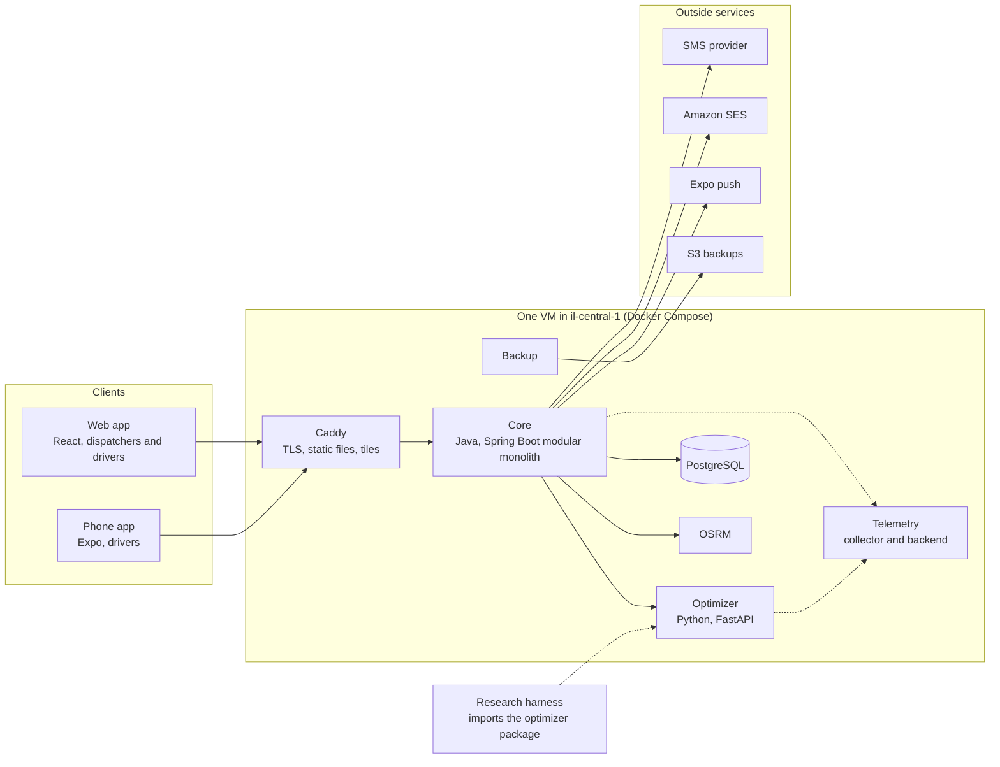

# DispatchFlow — Technical implementation plan

**Status:** Proposed, 13 November 2026 · Naim Elijah.

This plan says how to build the design in [`domain_layer_design.md`](../architecture/domain_layer/domain_layer_design.md) with the
tools in [`tech_stack.md`](../architecture/tech_stack.md). It repeats neither: contexts, aggregates, events and
cross-aggregate rules live in the domain document; tool choices and versions live in the tech stack.
Where this plan disagrees with the domain document, the domain document wins. IDs in brackets point to
the requirements (FR, BR, NFR, UC, Q). As in the domain document, four open questions whose IDs need checking
against the ARD are named in words until it settles them.

## Contents

1. [The calendar this plan answers to](#1-the-calendar-this-plan-answers-to)
2. [Architecture at a glance](#2-architecture-at-a-glance)
3. [Build sequence](#3-build-sequence)
4. [The Alpha](#4-the-alpha)
5. [Repository and local environment](#5-repository-and-local-environment)
6. [Contracts](#6-contracts)
7. [Optimization service](#7-optimization-service)
8. [OR-Tools model](#8-or-tools-model)
9. [Re-optimization](#9-re-optimization)
10. [DispatchFlow solver (ALNS)](#10-dispatchflow-solver-alns)
11. [Core service](#11-core-service)
12. [Database schema](#12-database-schema)
13. [Key flows](#13-key-flows)
14. [Travel times and geodata](#14-travel-times-and-geodata)
15. [Imports and geocoding](#15-imports-and-geocoding)
16. [Access and security](#16-access-and-security)
17. [Live updates and push](#17-live-updates-and-push)
18. [Web app](#18-web-app)
19. [Phone app](#19-phone-app)
20. [Messages to recipients](#20-messages-to-recipients)
21. [Reporting and baseline](#21-reporting-and-baseline)
22. [Research harness and disruption simulation](#22-research-harness-and-disruption-simulation)
23. [Deployment and operations](#23-deployment-and-operations)
24. [Testing](#24-testing)
25. [Decisions to record as ADRs](#25-decisions-to-record-as-adrs)

---

## 1. The calendar this plan answers to

The course sets the dates; every milestone below is placed against them. From the course syllabus
(Semester A, 2026–27):

| Date | What the course asks | What must exist by then |
|---|---|---|
| Sun 15 Nov 2026 | ARD submitted (by the end of the day) | The requirements, with the question IDs checked |
| Tue 1 Dec | Oral exam on the ARD, graded per student (15%). A presentation of one or two slides per topic: the Alpha version, set together with the mentor at this meeting; each challenge and how the project solves it; and a Gantt chart to the end of the project, detailed to the end of the semester | The walking skeleton running on every laptop; the Alpha definition (§4.2); the Gantt chart from the milestones in §3 |
| Before 29 Dec | A meeting where each team declares its goals for the hackathon | The demo script (§4.3) as the stated goal |
| Tue 29 Dec | Hackathon: a working Alpha shown at the end of the day, even if not fully tested (10%) | The Alpha demo script runs end to end |
| Tue 5 Jan 2027 | Iteration 1, by the end of the day: the ADD; the full Alpha demo; a usability-study plan that walks through every screen, with a usability questionnaire and the main flows run to confirm the menus | The ADD, assembled from these three documents; the study plan |
| Tue 12 Jan | Meeting with the mentor: project status and the plan for Semester B; Alpha demo (40%); oral exam on iteration 1 (15%); the customer's impression (20%) | The demo, shown to the customer |
| Semester B | Live operations, the phone app, messages, the own solver, the research study, the pilot | M6 to M13 |
| June 2027 | End of the project | — |

Two things follow. The Alpha is graded as a **demo**, so its "done" is a script that runs in front of
people, not only a test suite. And it must work by **29 December**, which leaves about six and a half
weeks for four people who also have other courses, an oral exam and the ADD. Attendance at the
seminar meetings and the hackathon is mandatory, and missing them costs points.

---

## 2. Architecture at a glance

DispatchFlow is two services, a Java core and a Python optimizer, plus PostgreSQL and OSRM, all on one VM
behind Caddy. The core is the only part that talks to the apps and to outside services. The optimizer is
a pure function from a problem to routes, which the research harness also calls directly, without HTTP.



The phone app's web build and the usability VM reuse the same images with faked outside services. Both
apps also report client errors to Sentry directly, which the drawing leaves out.

---

## 3. Build sequence

Each milestone ends with something that runs, and a check that proves it. M0 to M5 make the **Alpha**
(about six and a half weeks). M6 to M13 make the **pilot**, in Semester B.

### 3.1 Lanes

Four people, four lanes. Names are the team's to fill in; a lane has one owner and the others help.

| Lane | Alpha | Semester B |
|---|---|---|
| **Optimizer** | M0's optimizer, M1 | M11 (own solver), M9's `ProblemFactory`, the research harness |
| **Core** | M0's core, M2, M4 and M5 back ends | M6, M8, M9 |
| **Front end** | M0's map, M4 workspace, M5 driver screens and summary | M10 (phone app), live screens |
| **Integration** | M0 tooling and CI, M3, the demo script and the ADD | M7, M12, M13 |

### 3.2 Alpha track

| # | Milestone | Dates | What gets built | Done when |
|---|---|---|---|---|
| M0 | Walking skeleton | 12–22 Nov | Monorepo, `mise`, `justfile`, `compose.dev.yaml`; both contracts with one endpoint each; core with a Planning module, Flyway V1 and jOOQ codegen; optimizer with an OR-Tools adapter and a validator for capacity, windows and shifts; `just seed`; a web page that shows the solved routes on a MapLibre map; CI with unit tests and `ApplicationModules.verify()` | On all four laptops: `just dev`, click *Solve* on a seeded day, routes appear on the map |
| M1 | Optimizer for daily solves | 16 Nov–6 Dec | `Problem` with its three rules (`validate` for every daily rule, `cost`, `explain_drop`), `ProblemFactory.daily`, `Solution`, `TravelTimeModel`, `PenaltyScale`, `nearest_neighbour`; `/v1/evaluate`, `/v1/baseline`. Re-optimization conventions wait for M9 | Accepts best-known Solomon solutions; rejects the crafted violation catalogue, naming each rule; a 200-stop synthetic day solves inside its limit |
| M2 | Records and CSV import | 23 Nov–6 Dec | Fleet, Customers & Orders, per-date rosters; UTF-8 CSV import with upload and confirm, all or nothing, address matching | The import tests: all-or-nothing, row errors listed together, address matching |
| M3 | Travel times | 23–29 Nov | OSRM adapter, matrix builder with deduplicated locations, unreachable points, route shapes | A 216-point matrix in under 5 s on a laptop (NFR-57); unreachable points detected |
| M4 | Solve jobs and the planning workspace | 30 Nov–13 Dec | `solve_job` queue, one worker per lane, the queue watchdog, event resubmission; SSE progress; map, timeline and table with one shared selection | Request a solve in the browser and watch it finish without reloading; kill the core mid-solve and the plan returns to *draft* or *ready* |
| M5 | Publish, drive, report | 7–20 Dec | Publishing checks in BR-72's order, plan revisions; driver screens in the browser, online only, with a signature as proof; `Delivery` and `RouteRun`; live status on the dispatcher's screen; daily summary and baseline comparison | The demo script (§4.3) runs end to end, in CI under Playwright and by hand |
| — | Freeze | 21–28 Dec | Bug fixes only; demo rehearsal twice; ADD draft | A full rehearsal on a clean laptop |
| — | Hackathon | 29 Dec | The Alpha, shown | — |
| — | Iteration 1 | 30 Dec–5 Jan | ADD, usability-study plan | Submitted |

**Checkpoint, 1 December:** the walking skeleton is part of the Alpha definition presentation, with the
Gantt chart (this section's milestones, the Semester B ones in weeks). Showing routes on a map three
weeks in is worth more than any slide.

### 3.3 Semester B track

Sized in weeks; dates go in once the Semester B calendar is known.

| # | Milestone | Weeks | What gets built | Done when |
|---|---|---|---|---|
| M6 | Access in full | 2 | Sessions, refresh rotation, revocation, links, rate limits, step-up for Admin operations | Every Access row has a passing API test; the permission-matrix test is generated |
| M7 | Imports in full and geocoding | 2 | Excel import, Windows-1255 with confirmation; the Q-02 geocoder test, cache, retries, flags | The full import suite, encodings included; Q-02 decided |
| M8 | Live operations | 3 | Idempotent reports, clock correction, positions, late-outcome reconciliation, arrival projection, at-risk stops, alerts | A replayed report stream gives the same state twice; the live map updates within 5 s |
| M9 | Re-optimization | 3 | `ProblemFactory` conventions, warm start, immutable proposals, `Plan.accept`; hand-over, cancel and reschedule | UC-10 and UC-11 pass end to end; NFR-07 measured at p95 |
| M10 | Phone app | 4 | Expo app, encrypted store, outbox, background location, push, route-change diff | The device checklist passes on one Android phone and one iPhone |
| M11 | DispatchFlow solver | from January, research lane | ALNS behind the `Solver` port, repair mode, Numba kernels; harness and simulation | Property tests pass; deterministic across processes; a Solomon smoke run in CI |
| M12 | Messages to recipients | 2 | Triggers, the outgoing-message state machine, provider adapter, inbound webhook, reply parser | UC-14 end to end against the fake gateway |
| M13 | Production and pilot | 3 | Terraform, Caddy, backups, observability, security scans | Restore drill under 4 h; ASVS Level 1 self-check passed |

M11 depends only on M1. M13 needs a partner company: its AWS account, store accounts, SMS contract and
data. If no company is confirmed when Semester B starts, M13 stays last, and the pilot-only work (real
SMS, store distribution, Terraform) waits until one is.

---

## 4. The Alpha

### 4.1 What's in, what waits

| Area | In the Alpha | Waits for | Why it can wait |
|---|---|---|---|
| Orders | UTF-8 CSV import, upload then confirm | Excel and Windows-1255 (M7) | The demo file is ours; the encoding rules matter with real company files |
| Locations | Customers come from `just seed` with coordinates; the demo CSV names them by address, so the import matches them (FR-310) | Geocoding (M7) | Synthetic addresses are drawn from the OSM extract and already carry coordinates. A row with a new address creates a customer without coordinates, and its order drops as *missing location* (BR-14), which the demo can show |
| Optimizer | Daily rules, OR-Tools, nearest neighbour | Re-optimization conventions (M9), ALNS (M11) | Nothing in the Alpha re-optimizes |
| Planning | Solve, view, publish | Manual edits with undo (a Should, FR-145): in if M4 finishes early | The demo story doesn't need it |
| Drivers | Browser screens, online, with a signature (`signature_pad`) as proof | Photo proofs, offline outbox, the phone app (M10) | A driver's *delivered* needs a proof (FR-367), and a signature is the cheapest one that works with a mouse; online reports exercise the same `Delivery` rules |
| Access | Seeded accounts, sign-in, roles | Sessions in full, links, rate limits, step-up (M6) | The Alpha runs on a laptop with synthetic data |
| Architecture checks | `ApplicationModules.verify()`; the ArchUnit purity rules of domain §3.9 | Error Prone and NullAway (January) | Those checks catch most structural mistakes from the first commit; the compiler plugins are cheaper to add once the build has settled |
| Contract checks | Code generated from both contracts | Schemathesis, oasdiff (January) | Breaking changes matter once a phone app version is in someone's hands |
| End-to-end tests | One Playwright flow: the demo script | UC-10, UC-11, UC-14 (with their milestones) | — |

### 4.2 Alpha definition (for 1 December)

The Alpha is a local, web-only DispatchFlow on synthetic data. A dispatcher imports a day's orders,
solves the day with OR-Tools, sees routes on a map, timeline and table, and publishes. A driver, in a
browser, sees only their own route and reports each stop, signing for each delivery. The dispatcher
watches the reports arrive and ends with a daily summary that compares the plan with a
nearest-neighbour baseline. Out of scope for the Alpha: geocoding, Excel imports, photos, the phone
app, re-optimization and recipient messages (§4.1). The mentor sets the final scope on 1 December.

### 4.3 Demo script

The same script runs under Playwright in CI and by hand at the hackathon and on 12 January.

1. Sign in as a dispatcher. Open tomorrow's date.
2. Import a CSV of 200 synthetic orders for the seeded customers. One row has an error; the preview
   names it. Fix it, confirm.
3. Show the roster: 12 vehicles, 12 drivers, two depots.
4. Solve with OR-Tools, 45-second limit. The progress bar moves by itself.
5. Routes appear on the map, the timeline and the table. Select a stop in one, and it's selected in all
   three. Open the dropped list: each drop says why (FR-144).
6. Publish. The checks pass, and the plan becomes revision 1.
7. In a second window, sign in as a driver. The driver sees only their own route. Mark three stops:
   delivered with a signature, delivered with a signature, failed with a reason.
8. Back on the dispatcher's screen, the three stops have changed colour without a reload.
9. Open the daily summary: kilometres, driver-hours and planned on-time percentage, against the
   nearest-neighbour baseline.

Step 9 is the line the room remembers ("12% fewer kilometres than the baseline"), so measure it on the
demo day's data before the hackathon, and keep that day's seed fixed.

---

## 5. Repository and local environment

One repository holds both services, both apps, the contracts and the research harness. A new laptop goes
from clone to a running stack with four commands.

```text
contracts/            core-api.v1.yaml, optimizer-api.v1.yaml
src/core/             Spring Boot modular monolith (Maven)
src/optimizer/        FastAPI service, package dispatchflow_opt (uv)
src/research/         harness CLI, study configs, results (uv; depends on optimizer as a path dependency)
src/web/              React + Vite console
src/mobile/           Expo app (from M10)
src/packages/         api-client, schemas, i18n, map-style, formatters
deploy/               compose.yaml, compose.dev.yaml, Caddyfile, osrm/, tiles/, backup/, observability/
infra/                Terraform (from M13)
e2e/                  Playwright: the demo script and the use-case flows
data/                 git-ignored: OSM extract, OSRM files, PMTiles, Solomon and Gehring-Homberger instances
```

**Bootstrap**

```bash
mise install          # JDK 25, Node LTS, Python 3.14, uv, pnpm, just
just setup            # pnpm install, uv sync, ./mvnw -q verify -DskipTests, lefthook install
just data             # downloads the Geofabrik extract, clips it, builds OSRM and PMTiles into data/
just dev              # compose.dev.yaml + core + optimizer + web with hot reload
```

**`justfile` targets used daily:** `dev`, `test` (all unit and architecture tests), `test-core`,
`test-opt`, `test-web`, `e2e` (Playwright against the Compose stack), `demo` (resets the database and
seeds the demo day), `gen` (regenerates clients from both contracts), `db-reset`,
`seed DAY=2026-12-01 SEED=42`, `study CONFIG=...`, `lint`, `fmt`.

**`compose.dev.yaml` services**

| Service | Image | Port | Notes |
|---|---|---|---|
| `postgres` | `postgres:18` | 5432 | One database `dispatchflow`. Role `dispatchflow_owner` owns the tables and runs the migrations; the core connects as `app`, which has only the grants it needs (INSERT and SELECT on `audit_record`) |
| `osrm` | OSRM 26.x | 5000 | `--algorithm ch --max-table-size 1000`, files from `data/osrm/` |
| `optimizer` | built from `src/optimizer` | 8081 | Runs from source with reload in development |
| `mailpit` | Mailpit | 8025, 1025 | Catches every email |
| `wiremock` | WireMock | 8089 | Fake SMS provider and fake GovMap |
| `tiles` | Caddy | 8090 | Serves `data/tiles/israel.pmtiles` with range requests |

The core runs from the IDE with Spring Boot's Docker Compose support, which starts the services above.
The web app runs under Vite with a proxy to the core, so the browser sees one origin, as in production.

**Windows laptops.** jOOQ's code generation and the adapter tests start PostgreSQL in Testcontainers, so
Docker Desktop must be running for `./mvnw verify`. Check this on every laptop in the first two days of
M0, together with line endings (`.gitattributes`) and the WSL 2 backend. These are the problems that eat a
week if they're found in December.

**Synthetic data from day one.** `just seed` calls the research package's generator. It draws real
addresses from the OSM extract around the depots, uses `he_IL` names and phones from the NFR-207 range,
draws windows and demands from configurable distributions, and takes a fixed seed. Every developer,
test and demo runs on the same reproducible days.

---

## 6. Contracts

Both APIs are written first, in OpenAPI 3.1, and code is generated from them on both sides (ADR-006). The
optimizer API is stateless: every call carries the whole problem, matrix included. So the optimizer stays
a pure function (NFR-13), and the research harness can call the same application layer without the core.

### 6.1 Optimizer API v1

| Endpoint | Purpose | Called by |
|---|---|---|
| `POST /v1/solve` | Solve a day from scratch with the named solver, within a limit or a budget | Core daily-lane worker; harness |
| `POST /v1/reoptimize` | Solve the rest of the day from a live state, warm-started or repaired | Core re-optimization worker; simulation |
| `POST /v1/evaluate` | Run the validator and the objective on given routes; return times and violations; no search | Manual edits, publishing re-check, acceptance |
| `POST /v1/baseline` | Nearest-neighbour plan for the same input, validated and scored | Reporting |
| `GET /v1/solvers` | Names and versions of the available solvers | Core settings screen; run manifests |
| `GET /health`, `GET /ready` | Liveness; readiness once the solver workers are up and the Numba kernels compiled | Compose, Caddy, uptime checks |

The request body of `solve`, abridged:

```json
{
  "problemId": "0193c1e2-...",
  "solver": "ortools",
  "limit": { "kind": "time", "seconds": 45 },
  "seed": 42,
  "travel": {
    "locations": 160,
    "durationsS": "<base64 little-endian int32, locations x locations, OSRM base durations>",
    "distancesM": "<base64 little-endian int32, locations x locations>",
    "buckets": [ { "fromS": 25200, "toS": 34200, "factor": 1.3 },
                 { "fromS": 55800, "toS": 68400, "factor": 1.3 } ],
    "offPeakFactor": 1.0,
    "buffer": 0.10
  },
  "depots": [ { "id": "depot-1", "location": 0, "opensS": 25200, "closesS": 68400 } ],
  "vehicles": [ { "id": "vehicle-3", "startDepot": "depot-1", "endDepot": "depot-1",
                  "weightKg": 800, "volumeL": 6000, "earliestDepartS": 27000, "latestReturnS": 61200,
                  "breakReserveS": 2700, "fixedCost": 0, "maxStops": null } ],
  "orders": [ { "id": "ord-17", "location": 15, "weightKg": 12.5, "volumeL": 40, "serviceS": 300,
                "windowStartS": 32400, "windowEndS": 39600, "priority": 3, "leaveAtDoor": false,
                "pinnedVehicle": null } ],
  "penalties": { "dropUnit": "auto", "doorWindowPerS": 5 }
}
```

- **Locations, not orders, index the matrix.** Two orders at one address share a location, but each
  order is its own stop in the problem. OSRM is asked about each distinct point once.
- **Orders without a location** are sent with `"location": null`, and an entry of −1 in `durationsS`
  means OSRM found no road route. `ProblemFactory` keeps such orders out of the search, and
  `Problem.explain_drop` names the reason, *missing location* or *unreachable location* (BR-14, FR-66),
  so every drop reason comes from one place.
- **Times** are `DaySeconds`: seconds of elapsed time since the delivery date's local midnight (§7.1).
- **The matrix travels as base64 `int32`.** A 216 × 216 matrix as a JSON array of numbers costs about
  three times the bytes and the parse time.

The response carries:

- `routes`: per vehicle, the stops with arrival, start, departure, seconds late, seconds outside a door
  window, and the leg's travel seconds and metres. The plan stores the legs, so the core never applies
  bucket factors itself.
- `dropped`: order, reason, and the fact behind the reason.
- `objective`, broken into its terms.
- `validation`: accepted or not, and the violations with their rule IDs.
- `stats`: solver, version, seed, iterations or solutions reached, search milliseconds, for the run
  manifest (NFR-115).

### 6.2 Core API conventions

- **Paths** under `/api/v1`, resource-oriented: `/plans/{date}`, `/plans/{id}/solves`,
  `/plans/{id}/edits`, `/plans/{id}/publish`, `/plans/{id}/reoptimizations`,
  `/reoptimizations/{id}/accept`, `/routes/{id}/hand-over`, `/routes/{id}/reports`, `/positions`,
  `/orders`, `/imports`, `/customers`, `/vehicles`, `/drivers`, `/rosters/{date}`, `/alerts`,
  `/reports/daily/{date}`, `/auth/*`, `/users`, `/settings`, `/stream`.
- **Every operation carries `x-capability`** (for example `PLAN_PUBLISH`, `ROUTE_REPORT_OWN`,
  `USERS_MANAGE`). The Spring generator's `x-operation-extra-annotation` extension turns it into a
  `@RequiresCapability` annotation. One interceptor checks it with `RoleSet.can`, Access's permission
  matrix, and the permission-matrix test is generated from the same mapping (NFR-85, NFR-176).
- **Optimistic locking:** reads return `ETag: "<aggregate version>"`; changes send `If-Match`. A stale
  version answers 412 with code `STALE_VERSION` (BR-76).
- **Idempotency:** driver reports and position batches send `Idempotency-Key`. The same key with a
  different body answers 409 `IDEMPOTENCY_KEY_REUSED` (NFR-65, NFR-130).
- **Client headers:** `X-App` (web or phone), `X-App-Version`, and `X-Device-Time` on every driver call,
  for audit records and clock correction (NFR-93, BR-114).
- **Errors** are RFC 9457 Problem Details with a stable `code`, `params` for the message template, and
  the `traceId`. Both apps translate `code` through `@dispatchflow/i18n`; no stack trace or bare code
  reaches a screen (NFR-69, NFR-143, NFR-144). Validation failures list every field or row at once.
- **Breaking changes** are caught by `oasdiff` against `main` in CI (from January). A breaking change to
  a call the phone app makes needs a new path version, because the previous app version must keep
  working (NFR-44, NFR-134).

---

## 7. Optimization service

The optimizer's domain is NumPy code with no I/O (domain §4.9): the value objects `Problem`, `Solution`,
`TravelTimeModel` and `PenaltyScale`, and `ProblemFactory`. `Problem` owns the three rules that say what a
solution means: `validate` (the validator), `cost` (the objective) and `explain_drop` (drop reasons). They
live in `feasibility.py`, `objective.py` and `drops.py`, and `Problem`'s methods delegate to them. Every
solver, edit check, publishing re-check and research score goes through them (BR-42), so they are written
and tested first, and solvers come after.

### 7.1 Time model

- **Elapsed seconds since the date's local midnight.** The core converts every window, shift and depot
  hour with `ZonedDateTime` in `Asia/Jerusalem`:
  `s = Duration.between(midnight(date), instant).toSeconds()`. On a clock-change day, a 09:00 window is
  8 or 10 hours after midnight in elapsed time, which is what travel durations need (BR-31, BR-111).
- **Integers in the product.** Seconds and metres as `int32`. Research instances (Solomon,
  Gehring-Homberger) run in `float64` with a stated tolerance of 1e-6, so the validator accepts published
  best-known solutions, which use unrounded Euclidean distances (NFR-167).
- **Travel time** is a function of the departure time:

```latex
t_{ij}(\tau) = \left\lceil d_{ij} \cdot f_{b(\tau)} \cdot (1 + \beta) \right\rceil
```

Here d is the OSRM base duration, f the factor of the bucket that the departure time τ falls in (1.3,
1.3 and 1.0 to start), and β the buffer (0.10). Solvers search on the upper bound d × max f × (1 + β), so
a solved plan stays feasible all day (FR-322). The validator and arrival times then re-time each route
with the real bucket of every departure. The static study sets f = 1 and β = 0 (NFR-110).

**Why re-timing never breaks a plan.** Re-timed arrivals are never later than the upper-bound arrivals:
if a departure is no later, then its arrival, at a factor no higher than the maximum, is no later either,
and waiting only absorbs the difference. This holds even though step-shaped factors don't keep "leave
earlier, arrive earlier" true in general, because the search always used the maximum factor. If a solver
ever searches on time-dependent times, this argument no longer holds and the validator becomes the only
guard.

**Measure the cost of the upper bound early (M1).** Planning every leg at 1.3 × 1.1 = 1.43 times the base
duration is safe but conservative. On the demo day, solve once at the upper bound and once at per-bucket
times, re-time both, and compare vehicles used and orders dropped. If the gap is large, it is the biggest
single lever on plan quality, and an ADR should decide whether to keep FR-322's upper bound.

**Proposed answers to Q-20, to confirm:** an arc takes the factor of its departure bucket; the validator
uses the same buffered times as arrival projections, so what is published is what was checked; the
objective uses per-bucket times without the buffer, since the buffer is a margin, not a cost.

### 7.2 Problem and solution

```python
@dataclass(frozen=True, slots=True)
class Problem:
    dur: NDArray[np.int32]        # L x L base durations between distinct locations, seconds
    dist: NDArray[np.int32]       # L x L metres
    travel: TravelTimeModel       # buckets, buffer, upper-bound matrix (cached)
    orders: Orders                # struct of arrays: loc, weight, volume, service, tw_start, tw_end,
                                  #   priority, door, pinned_vehicle (-1 = none), allowed_mask
    vehicles: Vehicles            # start_loc, end_loc, cap_w, cap_v, depart_min, return_max,
                                  #   break_reserve, fixed_cost, max_stops, start_time (re-optimization)
    reopt: ReoptContext | None    # reported prefixes, origin vehicle per stop, now
    penalties: PenaltyScale       # drop unit K, door window 5/s, stability 300 s, lateness 5/s
    excluded: Mapping[int, DropReason]  # orders kept out of the search: no location, no road

    def validate(self, s: Solution) -> Report: ...                    # feasibility.py (§7.3)
    def cost(self, s: Solution, timings: Timings) -> Cost: ...        # objective.py (§7.4)
    def explain_drop(self, order: int, s: Solution) -> DropReason: ...  # drops.py (§7.5)

@dataclass(frozen=True, slots=True)
class Solution:
    routes: tuple[NDArray[np.int32], ...]   # one array of order indices per vehicle
    dropped: frozenset[int]
```

Arrays of structs would be easier to read, but Numba (M11) and vectorized checks need structs of
arrays, so the code starts with them.

### 7.3 The validator

The validator, `Problem.validate`, re-times each route and reports every broken rule. It never repairs
anything (BR-16). The sketch is the function in `feasibility.py` that the method delegates to.

```python
def validate(p: Problem, s: Solution) -> Report:
    v: list[Violation] = []
    check_single_assignment(p, s, v)                  # BR-07: each order served once or dropped
    check_allowed(p, s, v)                            # BR-14 coordinates, pins, BR-106 goods stay on vehicle, BR-108
    for k, route in enumerate(s.routes):
        t = p.vehicles.start_time_or_depart_min(k)    # shift start + allowance, depot opening (BR-06, BR-46)
        w = vol = 0
        at = p.vehicles.start_loc[k]
        for o in route:
            arrive = t + p.travel.t(at, loc(o), t)
            if door(o):                               # BR-122: served on arrival, never waits
                start = arrive                        # outside its window: a penalty, not a violation
                if not on_date_and_in_shift(start):
                    v.append(Violation(Rule.BR119, order=o))
            else:
                start = max(arrive, tw_start(o))
                late = start - tw_end(o)
                if late > 0 and not (p.reopt and in_shift(start)):   # BR-03; BR-107 relaxes it in re-optimization
                    v.append(Violation(Rule.BR03, order=o, seconds=late))
            w += weight(o); vol += volume(o)
            t = start + service(o); at = loc(o)
        if w > cap_w(k) or vol > cap_v(k):
            v.append(Violation(Rule.BR05, vehicle=k))
        back = t + p.travel.t(at, p.vehicles.end_loc[k], t)
        if back > return_max(k) - break_reserve(k):   # BR-06, BR-105, BR-46
            v.append(Violation(Rule.BR06, vehicle=k))
    timings = ...                                     # collected in the loop above
    return Report(accepted=not v, violations=v, timings=timings, objective=objective(p, s, timings))
```

In re-optimization, the reported prefix (stops already reported) is taken as fact, and only what follows `now` is
checked (BR-23). Each rule is one `RuleId` value named after its BR, and each crafted case in the
violation catalogue names the rule it expects (NFR-169).

### 7.4 The objective

```latex
z = \sum_{r} \sum_{(i,j) \in r} t^{obj}_{ij} + \sum_{o \in D} K (6 - p_o) + 5 \sum_{o \in \mathrm{door}} \mathrm{outside}_o + F \cdot |R_{used}| + 300 \cdot |M| + 5 \sum_{o} \mathrm{late}_o
```

The last two terms apply only to re-optimization. M is the set of stops that leave their vehicle, dropped
stops included (FR-256, BR-115). D is the set of dropped orders, p the priority, F the fixed vehicle cost.

**Drop unit K, a proposal for the drop-penalty question:** K = 5 × L + 2 × T + F + 1, where L is the
longest shift on the date in seconds, T the largest matrix entry and F the fixed vehicle cost. An order
of priority p drops for K × (6 − p), so even priority 5 pays at least K.

Serving one order can cost, directly, at most the sum of three things, and K is larger than that sum:

- **Its detour:** at most 2T. So it's never worth dropping an order just to save its detour (BR-55).
- **Its own penalty:** a door stop outside its window, or in re-optimization a stop past its window,
  pays 5 a second, for at most L seconds, so at most 5L. So dropping a door order is always worse than
  serving it at any time in the shift (BR-121).
- **A vehicle it needs alone:** at most F. So the solver never drops an order to avoid paying for a vehicle
  (BR-08).

The three can happen together, which is why they are added. Their maximum, `max(5L, 2T + S, F) + 1`,
isn't enough: a door order that needs its own vehicle and can only be reached late in the shift costs
F + 2T + its penalty. With L = 11 h, T = 1 h and F = 20,000, OR-Tools 9.15 dropped such an order with K
at that maximum (198,001, against a serving cost of 206,900) and served it with K at the sum (225,201).
Service time
is left out: it isn't a cost term in the objective. Not covered: an insertion that pushes *other* door
stops later. That cost depends on the whole route and has no simple bound.

### 7.5 Drop reasons

After a solve, `Problem.explain_drop` checks each dropped order against these tests in order and stops
at the first one that fails. The fact it returns fills the message of FR-144.

1. **Missing location** or **unreachable location:** decided by `ProblemFactory`; the order never enters
   the search (BR-14, FR-66).
2. **Pin:** pinned to a vehicle or driver that is out, or that can't serve it even alone (FR-228).
3. **Capacity:** heavier or larger than every allowed vehicle; gives the order's weight and the largest
   capacity.
4. **Time window:** the earliest possible arrival, direct from any allowed depot at the earliest
   departure, is after the window ends; gives both times.
5. **Shift**, **depot hours** or **vehicle limit:** depot to order to depot doesn't fit the latest return.
6. **Displaced:** it would fit alone; other orders took its place (Q-51).

### 7.6 Process model

A solve can run for 60 seconds of pure CPU, so it never runs in the process that answers HTTP.

- **Uvicorn runs one HTTP process.** It answers `/evaluate`, `/baseline` and the health checks itself,
  because those take milliseconds (NFR-08). `/evaluate` and `/baseline` are plain `def` endpoints, which
  FastAPI runs in its thread pool, so their CPU work never blocks the event loop that waits on the solver
  workers.
- **One solver worker process per lane** (daily and re-optimization), started with `multiprocessing` in
  `spawn` mode. Each worker imports OR-Tools and compiles the Numba kernels when it starts, and `/ready`
  waits for both workers.
- **One job per lane at a time.** The HTTP handler passes the problem to its lane's worker over a pipe
  and awaits the answer without blocking the event loop (the pipe's `recv` runs in a thread through
  `asyncio.to_thread`). The core never sends a second job to a busy lane, because its own queue is per
  lane.
- **Overrun backstop** (BR-32, BR-84): if a worker hasn't answered 30 s past its limit, the HTTP process
  kills it, starts a new one and answers 504 `SOLVE_TIMEOUT`.
- **Study mode** (NFR-119): the search budget is the limit minus the validator's measured p99 time for
  that instance size, so receiving to returning, validation included, stays inside the 5 s.

---

## 8. OR-Tools model

Every business rule maps to a standard OR-Tools routing construct, so the adapter is about 300 lines with
no custom search. OR-Tools proposes routes; the validator re-times them and decides. The core
constructs below (registered matrices, two capacity dimensions, windows, soft door bounds, disjunctions,
the fixed cost, pins and the warm start) were run against OR-Tools 9.15 on a synthetic day with two
depots, 12 vehicles and 200 orders. The span bound and locked pairs weren't, so test them when they're built.

| Rule | OR-Tools construct |
|---|---|
| Vehicles start and end at depots (BR-40) | `RoutingIndexManager(n, V, starts, ends)`: one routing node per depot and per order, so different depots work |
| Travel and service (BR-04) | `RegisterTransitMatrix(transit)`, where `transit[i][j] = T[loc i][loc j] + service[i]` on the upper-bound matrix; `AddDimension(transit, horizon, horizon, False, "Time")`, where `horizon` is the date's length in `DaySeconds` (23, 24 or 25 hours on clock-change days). The slack is waiting |
| Arc cost (BR-09) | A second, travel-only `RegisterTransitMatrix`, set with `SetArcCostEvaluatorOfAllVehicles` |
| Time windows (BR-03) | `time.CumulVar(idx).SetRange(tw_start, tw_end)` |
| Door windows are preferences (BR-119, BR-120) | Range set to the shift; `SetCumulVarSoftUpperBound(idx, tw_end, 5)`. No soft lower bound: OR-Tools can always wait before a node, so a lower bound never charges anything (tested: the stop was scheduled at 08:00 with no penalty, although the vehicle would arrive at 07:10). The validator charges early door arrivals (the door-stop gap, below) |
| Shifts, allowance, depot hours, break reserve (BR-06, BR-46, BR-105, FR-67) | Start cumul in `[shift_start + allowance, …]` intersected with depot opening; end cumul at most `min(shift_end, depot_close) - break_reserve` |
| Weight and volume (BR-05) | Two `AddDimensionWithVehicleCapacity` over `RegisterUnaryTransitVector(demand)`. Kilograms and litres scaled to grams and millilitres, because OR-Tools takes integers |
| Dropping by priority (BR-08, BR-54, BR-55) | `AddDisjunction([idx], K * (6 - priority))` |
| Fixed vehicle cost (FR-21) | `SetFixedCostOfAllVehicles(F)` |
| Pins (FR-91) | `VehicleVar(idx).SetValues([-1, v])`. The `-1` keeps the order droppable, and the drop explainer names the pin. (`SetAllowedVehiclesForIndex` doesn't accept a Python list in 9.15) |
| Max stops, duration, distance (FR-133) | A count dimension, or `SetSpanUpperBoundForVehicle`, or a distance dimension |
| Locked routes (FR-147, a Could) | Pins plus `solver.Add(NextVar(a) == b)` for each locked pair |

```python
horizon = day_length_s(delivery_date)                                        # 23, 24 or 25 hours in DaySeconds
travel = [[T[loc[i]][loc[j]] for j in range(n)] for i in range(n)]        # n routing nodes
transit = [[travel[i][j] + service[i] for j in range(n)] for i in range(n)]
arc = routing.RegisterTransitMatrix(travel)     # no Python callback runs during the search
time_cb = routing.RegisterTransitMatrix(transit)
routing.SetArcCostEvaluatorOfAllVehicles(arc)
routing.AddDimension(time_cb, horizon, horizon, False, "Time")
for name, demand, caps in (("Weight", grams, cap_g), ("Volume", millilitres, cap_ml)):
    routing.AddDimensionWithVehicleCapacity(
        routing.RegisterUnaryTransitVector(demand), 0, caps, True, name)

params = pywrapcp.DefaultRoutingSearchParameters()
params.first_solution_strategy = routing_enums_pb2.FirstSolutionStrategy.PARALLEL_CHEAPEST_INSERTION
params.local_search_metaheuristic = routing_enums_pb2.LocalSearchMetaheuristic.GUIDED_LOCAL_SEARCH
if limit.kind == "time":
    params.time_limit.FromSeconds(limit.seconds)
else:                                   # tests and studies: never a wall clock (NFR-82, NFR-175)
    params.solution_limit = limit.solutions
# The routing search runs on one thread, so a run is repeatable on the same machine.
```

**Registered matrices, not Python callbacks.** On a 216-node, 15-vehicle test, the same search reached the same local optimum in 0.44 s with registered matrices and 1.97 s with
callbacks. Under a fixed time limit, that is about 4.5 times more search, which matters for the 20-second
re-optimization and for a fair OR-Tools-versus-ALNS comparison in the study.

**The door-stop gap.** OR-Tools lets a vehicle wait before any node, but a door stop is served on arrival
(BR-122). Forbidding waiting only at some nodes would need a custom constraint. Instead, OR-Tools may
wait, and the validator re-times the route with no waiting at door stops. That can only move a door stop
earlier. An earlier arrival never breaks a later window, because later stops can still wait, and never
breaks the shift (§7.1). So feasibility holds, and only the door penalty changes, which the validator
scores. The cost of the gap: OR-Tools never sees what arriving early at a door stop costs, so a route it
proposes can score worse than it believed. The validator's score is the one stored, shown and compared,
for every solver alike.

**Warm start** for re-optimization and FR-280: `routing.ReadAssignmentFromRoutes(routes, True)`, then
`SolveFromAssignmentWithParameters(assignment, params)`. The routes are routing indices, so convert each
node with `manager.NodeToIndex`. Reading the routes runs the solver to set the dimension values, which
takes part of the limit; measure it in M9. If the read fails, the run is marked `warm_start=false` and the
study leaves it out (FR-282).

**Gotchas to test early:**

- `GUIDED_LOCAL_SEARCH` with `solution_limit` alone can stop very early. Set the limit high for tests that
  need a good solution.
- Penalties, the fixed cost and the soft-bound coefficients all share the cost scale of the arc evaluator
  (seconds), so everything stays in seconds.
- Pin the exact OR-Tools wheel version, because search behaviour changes between releases (NFR-62).

---

## 9. Re-optimization

The core sends raw facts; `ProblemFactory.reoptimization` applies every convention and turns them into an
ordinary, smaller problem. The product and the disruption simulation call the same function. So BR-10,
BR-23, BR-24, BR-51, BR-79, BR-80, BR-91, BR-106 to BR-108 and BR-117 exist once, in Python (BR-42).

### 9.1 What the core sends (`POST /v1/reoptimize`)

- `now`, and the routes of the plan's latest revision.
- Each stop's delivery status and actual times, from Live Operations through `ExecutionFacts`.
- Each vehicle's state: active, unavailable, no driver, out of shift, finished, withdrawn.
- Each vehicle's last two positions, with their server receive times and an in-service-area flag (the core
  holds the polygon).
- New and put-back orders.
- The matrix, with an extra source row for each vehicle's latest position.
- Solver, limit, seed, and the chosen routes if FR-159 is used.

### 9.2 What `ProblemFactory.reoptimization` does

1. **Fixes what happened** (BR-10, BR-91). Delivered and failed stops leave the problem. A stop marked
   *arrived* is in progress: the vehicle's new start is that stop, at `max(now, arrival + service)`. Stops
   reported out of order count as done in the order reported.
2. **Places each vehicle** (BR-79, BR-80, BR-24, BR-51). It uses the vehicle's latest position if it is usable:
   less than 5 minutes old at `now`, inside the service area, and implying no more than 200 km/h from the
   position before. Otherwise it uses the vehicle's last reported stop, and otherwise its start depot. It
   returns the vehicles with no usable position, for the preview (BR-81).
3. **Decides which vehicle each stop may go to** (BR-106, BR-117, BR-108). A stop on an active vehicle may only
   stay there. Stops on a vehicle that is out become orphans, allowed on any active vehicle. New orders, dropped
   orders and orders moved to the date may go anywhere. A failed stop put back stays with its vehicle.
   Finished and withdrawn routes get nothing.
4. **Relaxes windows that are already lost** (BR-107). Non-door stops keep a hard window start. The
   window end becomes a soft bound at 5 per second late, with the vehicle's latest return as the hard limit.
   A daily solve never does this.
5. **Charges for instability** (FR-37, BR-115). Under BR-106 a stop can only leave its vehicle by being
   dropped or orphaned, so 300 s is added to the drop penalty of every stop now on a vehicle. The orphans'
   300 s each is a constant: scored, but unable to steer the search.
6. **Builds the warm start** from the current remaining sequences, with orphans left out (FR-280).

### 9.3 What comes back, and what happens to it

The answer is the remaining routes with new times, drops, late minutes, the objective by term, and the
validator's report under these conventions. The worker stores it as an immutable
`ReoptimizationProposal` **in the same transaction** that marks the job succeeded (domain §6.1). The
proposal holds its basis (the plan revision it started from, and the server time it gathered facts at)
and a per-driver diff: stops added, removed and reordered, arrival changes, and goods hand-overs
(FR-334).

**Limits.** The search gets 20 s (BR-84). NFR-07 allows 30 s from request to preview on screen, so
everything else must fit in 10 s: the OSRM rows for 15 positions (one `table` call with `sources=`, about
100 ms), serialization, reading the warm start, validation inside the optimizer, storing the proposal and
the SSE message. Each step gets a tracing span from the first day. If p95 misses, the first fix is to
lower the default limit to 15 s.

**Acceptance belongs to Planning.** `AcceptProposal` reads what happened since the proposal's basis,
through `ExecutionFacts` and Planning's own history, and passes it to `Plan.accept` as
`ChangesSinceBasis`; `Plan` judges it (BR-25, BR-82, BR-83) and changes only itself. A report that lands
between that read and the commit is not lost. It is judged against the revision in force at its
corrected time (BR-110), so it is accepted. If its stop has moved, Live Operations calls
`ReconcileLateOutcome` (domain §8). That is the designed outcome of the race, not a bug
to lock away.

---

## 10. DispatchFlow solver (ALNS)

The DispatchFlow solver is Clarke-Wright savings followed by ALNS, as Ropke and Pisinger (2006) describe
it, with one difference: a constant-time insertion check. That check decides whether Python can reach
enough iterations (Q-17), so it is built before any operator.

### 10.1 Route state and the constant-time insertion check

Each route keeps arrays, rebuilt in O(route length) whenever the route changes:

- `seq[k, :]`: order indices, padded; `length[k]`.
- `start[k, i]`: service start times; `load_w[k, i]`, `load_v[k, i]`: prefix loads.
- `slack[k, i]`: the forward time slack (Savelsbergh), that is, how far service at position i can be
  pushed later without breaking any later window or the return time. Computed backwards:
  `slack[i] = min(tw_end[i] - start[i], wait[i+1] + slack[i+1])`, where waiting absorbs delay. A door
  stop has no waiting and no window bound, only the shift bound.
- `slope[k, i]`: how much the penalty terms grow per second that stop i's service start is pushed later
  (a small push). A push passes unchanged through a stop with no waiting, and a small one is absorbed by
  the first stop that waits. Checked against brute-force re-timing on 19,404 random pushes. So, computed backwards with the slack:
  `slope[i] = own[i] + (slope[i+1] if wait[i+1] == 0 else 0)`, where `own[i]` is +5 for a door stop at
  or past its window end, −5 for a door stop before its window start, +5 in re-optimization for a stop at
  or past its soft window end, and 0 otherwise.

Inserting order u between positions i and i+1 of route k is then checked in O(1):

1. **Capacity:** `load_w[k, last] + w[u] <= cap_w[k]`, and the same for volume.
2. **u's window:** `a_u = start[i] + s[i] + T[i, u]`; `b_u = max(a_u, tw_start[u])`; `b_u <= tw_end[u]`.
   For a door order, `b_u = a_u` and its window is a penalty, not a check.
3. **The push on the rest:** `delta = b_u + s[u] + T[u, i+1] - start[i+1]`. When positive, it must be at
   most `slack[i+1]`. `start` already includes any waiting, so the push on the next stop is
   `max(0, delta)`.
4. **Cost:** `T[i, u] + T[u, i+1] - T[i, i+1]`, plus u's own door-window penalty, plus
   `slope[k, i+1] * max(0, delta)`.

Feasibility (steps 1–3) is exact. The cost (step 4) is exact while the push crosses no window boundary
and is fully passed on; otherwise it is an estimate, and the move's true cost is recomputed for the route
when the move is applied. Without the slope, the cost would ignore penalty changes downstream and
mis-rank insertions on days with many door orders, and in every re-optimization. Log how often the
estimate and the true cost pick different moves on a door-heavy day (FR-163), and report it with the
study.

The checks use the upper-bound matrix, like OR-Tools. The validator re-times the final result with the
real buckets.

### 10.2 Operators

| Kind | Operator | What it does |
|---|---|---|
| Construction | Clarke-Wright, parallel | Merge routes by savings `T[0,i] + T[0,j] - T[i,j]`, checking windows, capacity and shift at each merge; leftovers by greedy insertion; the rest dropped |
| Destroy | Random | Remove q random stops |
| Destroy | Worst | Remove the stops with the largest cost saving, randomized with p = 3 |
| Destroy | Related (Shaw) | A seed stop plus the stops closest to it in distance, time window and demand |
| Destroy | Route | Empty the shortest route, which lets the fixed vehicle cost pay off |
| Destroy | Time-related | Stops whose service starts close to a seed stop's |
| Repair | Greedy | Cheapest feasible insertion, best first |
| Repair | Regret-2, Regret-3 | Insert first the stop that loses most by waiting |

q is drawn uniformly from [min(4, 0.1n), min(40, 0.4n)]. These are starting values, to tune with the
ablation runs (FR-164).

### 10.3 Search control

- **Acceptance:** simulated annealing. The start temperature accepts a solution 5% worse with probability
  0.5, and cooling is geometric toward 1/1000 of it over the budget. With an iteration budget the
  schedule is exact; with a time limit, the temperature follows the fraction of time used.
- **Adaptive weights:** scores of 33 for a new global best, 9 for an improvement and 13 for an accepted
  worse solution; segments of 100 iterations; reaction factor 0.1.
- **Objective:** the shared objective, evaluated incrementally per changed route. The returned solution
  goes through the validator like any other (BR-15).
- **Determinism** (NFR-13, NFR-174): one `np.random.Generator(PCG64(seed))` passed everywhere; no
  iteration over sets or dicts whose order depends on hashing; under an iteration budget, nothing reads
  the clock.
- **Logging** (FR-163): every Nth iteration, the operators chosen, weights, current and best objective,
  temperature, and the estimate-versus-true cost disagreement count, into a Parquet file. Off in the
  product.

### 10.4 Re-optimization mode (FR-273)

Start from the current routes. The first destroy step is fixed: remove the orphans and insert the new
orders, then remove k related stops around each disrupted point. After that, the normal loop runs, with
every move filtered by the allowed-vehicle mask (BR-106).

### 10.5 Speed plan (Q-17)

1. Pure NumPy and Python first, with the O(1) check. Measure iterations per second on 100-stop Solomon
   instances and on 200-stop synthetic days.
2. Profile with `py-spy`. The insertion search over all routes and positions is the expected hot spot.
3. Move `best_insertion`, `rebuild_route_state` and `route_cost` into `@njit(cache=True, nogil=True)`
   kernels over the arrays above. Compile them when a worker starts, so the first 5-second run doesn't
   pay for it (`/ready` waits for this).
4. Target ten times the starting rate, from about 60 iterations a second on 200 stops to about 600. Move
   to Rust through PyO3 only if Numba falls short.

---

## 11. Core service

The core builds the domain document's design: nine contexts in a one-way module graph, one existing
aggregate per transaction, facts that outrank intent, and a watcher for every asynchronous step. This
section is about how; the domain document is the what.

### 11.1 Module skeleton

```text
src/core/src/main/java/.../dispatchflow/planning/
  package-info.java   @ApplicationModule(allowedDependencies = {"shared", "fleet::api", "fleet::spi",
                      "orders::api", "orders::spi", "orders::events", "access::api", "audit::api"})
  domain/             Plan, Route, PlannedStop, PlanRevision, SolveJob, ReoptimizationProposal,
                      PlanningSettings, value objects, events, PlanningError
  application/
    api/              ReconcileLateOutcome, RouteMembership, PublishedRoutes, PlanHistory   (@NamedInterface "api")
    spi/              ExecutionFacts, which Live Operations implements                     (@NamedInterface "spi")
    port/out/         PlanRepository, SolveJobRepository, RouteOptimizer, FeasibilityChecker
    service/          one class per use case (RequestSolve, EditStop, PublishPlan, AcceptProposal, HandOverRoute, ...):
                      outside calls first, then load one aggregate, call one method, save;
                      SolveRequestAssembler, which reads Fleet and Orders to build a solve's input
  events/             SolveSucceeded, SolveFailed, PlanPublished, PlanRevised, RouteHandedOver (@NamedInterface "events")
  adapter/in/web/     implements the generated core-api interfaces
  adapter/in/job/     lane workers, the queue watchdog, the route re-check
  adapter/in/listen/  listeners on SolveSucceeded/SolveFailed, OrderCancelled, OrderRescheduled, RouteHandedOver
  adapter/out/        jOOQ repositories (schema planning), optimizer client, implementations of
                      Fleet's and Orders' RecordUsage and Orders' OrderPlacement
```

The other eight modules follow the same shape. `ApplicationModules.verify()` runs in CI and fails any
cycle or any use of a module's internals.

### 11.2 Rules every use case follows

- **Outside calls, then one transaction.** A use case calls the optimizer, OSRM or the geocoder first.
  Then a `@Transactional` method loads one existing aggregate, calls one method, saves it with a version
  check (BR-76), and publishes the events the aggregate raised. It may also create new aggregates of
  its module and write the audit, idempotency and outbox records (domain §6.1).
- **Reactions are idempotent.** Listeners are `@ApplicationModuleListener` (after commit, in their own
  transaction), and delivery is at least once. Each reaction is idempotent by nature, or records
  `(listener, event_id)` in `event_receipt` first. Every reaction's test publishes its event twice
  (§24).
- **Events only where they earn their place** (domain §7.1), and they flow with the graph. When an
  upstream module must change because of a downstream fact, it owns a port or exposes a use case that the
  downstream module calls. Screens are told through `LiveUpdates` after commit, never through an event.
- **A listener that loses a version race retries.** `@Retryable` on `STALE_VERSION`, three attempts, then
  the publication fails and the registry resubmits it (§11.3).
- **Rules become types.** `Plan.applySolveResult` takes only a `ValidatedSolution`, whose single factory
  refuses a report that isn't accepted (BR-15). Plan and delivery states are sealed interfaces (BR-12,
  BR-87).
- **Use cases gather; the domain decides.** A use case reads what an aggregate's method can't see,
  through repositories, ports and other modules' APIs, and passes it in as values. A value read for one
  version of an aggregate names that version, and the aggregate refuses it at another (domain §3.7).
  Other modules' API results are translated into the module's own values here, never passed into its
  domain (domain §2.3).
- **Order status is derived, never stored** (BR-33). The `OrderStatuses` query reads a whole date at once,
  through `OrderPlacement` (Planning implements it) and `StopProgress` (Live Operations implements it),
  and `OrderStatus.derive` applies the precedence (domain §9.6).
- **Rules over sets have database backstops** (domain §5): partial unique indexes for one plan per date,
  one running re-optimization per plan and one reference per date (BR-34, BR-38, FR-211);
  `pg_advisory_xact_lock` on the date and on the lane, taken by the queries that build `DateCapacity` and
  `LaneCapacity` (BR-101, BR-112, BR-113); `FOR UPDATE` on the active Admin accounts when building
  `ActiveAdmins` (BR-19). The 15-vehicle limit (BR-36) is a `FleetRegister` invariant and needs no lock.

### 11.3 Event publication: making retries happen

Spring Modulith's registry stores each publication in the same transaction as the change and delivers it
after commit. In Modulith 2.x, a listener that throws leaves its publication *failed*. Nothing retries it
unless the application is configured to, so DispatchFlow configures all three mechanisms:

```properties
# one instance (NFR-14), so republishing at startup is safe
spring.modulith.events.republish-outstanding-events-on-restart=true
# a publication stuck in published, processing or resubmitted for 2 minutes is marked failed
spring.modulith.events.staleness.published=PT2M
spring.modulith.events.staleness.processing=PT2M
spring.modulith.events.staleness.resubmitted=PT2M
```

- **Every minute**, a scheduled job resubmits failed publications through `FailedEventPublications`, at
  most 5 times each. The sixth failure raises a team alert with the listener's name.
- **Every night**, the retention job purges completed publications older than 7 days through
  `CompletedEventPublications`.
- **Startup** republishes outstanding publications. Startup recovery (§11.4) may run before or after
  that; the order doesn't matter, because every reaction is idempotent.

### 11.4 Scheduled jobs and watchers

Spring `@Scheduled` with `zone = "Asia/Jerusalem"`. There is one instance, so no distributed lock is
needed (NFR-14).

| Job | When | What |
|---|---|---|
| Queue watchdog | Every 15 s | `SolveJob.expireIfOverdue(now)` on queued and running jobs: queued more than 5 min, or running more than 30 s past their limit (BR-32, BR-112). `SolveFailed` then returns the plan to *draft* or *ready* |
| Route re-check | Every minute, while any route is *not yet checked* | Evaluates those routes once the optimizer answers, and calls `Plan.recordRouteCheck` (FR-304, FR-315, NFR-42) |
| Event resubmission | Every minute | §11.3 |
| Plan completion | 00:00 | Published plans of the day before become *completed* (BR-102) |
| Route-not-started check | Every minute | Alert 15 min after shift start plus allowance (FR-101) |
| Arrival messages | Every minute | Messaging asks `ArrivalProjections` for routes in progress and calls `StopMessages.onArrivalProjected` (FR-352, FR-353) |
| Import expiry | Hourly | `ImportBatch.expire(now)` on previews older than an hour |
| Geocoding retry | Every 15 min | Retry failed lookups for 24 h (FR-64), within the daily cap (NFR-135) |
| Message sender and stale drop | Every 5 s | §20 |
| Retention | 03:00 | Delete expired positions, proofs, messages and replies; `anonymize(now)` on retired customers and drivers past retention (NFR-184, BR-98); purge completed event publications |
| Startup recovery | At boot | Running jobs fail; queued daily solves stay; queued re-optimizations fail (BR-74, BR-85, NFR-12) |

No job enforces the location cut-off: `RouteRun.acceptsPositionAt` refuses each late batch (FR-328).
Each job only reads the clock and calls the owner's method with `now` (domain §10.1).

### 11.5 Framework versions

Start on Spring Boot 4.1.x. Spring Boot 4.2 is scheduled for 19 November 2026; move to 4.2.x in the
January break, after the Alpha demo, when a minor upgrade can't put the demo at risk. 4.1's open-source
support runs to 31 July 2027 and 4.2's to 31 December 2027 (see the tech stack).

---

## 12. Database schema

About 40 tables in PostgreSQL 18. Each module owns one schema (`fleet`, `orders`, `planning`, `liveops`,
`messaging`, `reporting`, `access`, `audit`), and no SQL touches another module's schema; Reporting reads
the views each module publishes (domain §2.3). Each aggregate maps to a root table, which carries the
version, plus child tables; records are insert-only tables with no version. Rules over sets have a
constraint or a lock as a backstop (domain §5). The order status has no column, because it is derived
(BR-33). The excerpt leaves out the schema prefixes and the columns that only carry data.

```sql
-- conventions: uuid keys (UUIDv7, made in the app); version int on every aggregate root (BR-76);
-- timestamptz for instants, date and time for Israel-local values; retired_at, never DELETE (BR-43).
-- Flyway runs as dispatchflow_owner, which owns every table; the core connects as app, which gets only
-- the grants it needs. An owner can always re-grant itself, so app must never own a table.

-- Fleet: the register is one aggregate, and its depots and vehicles are its entities
create table fleet_register (id smallint primary key check (id = 1), version int not null);     -- aggregate root
create table depot (id uuid primary key, name text not null, lat double precision not null,
  lon double precision not null, opens time not null, closes time not null, retired_at timestamptz,
  check (closes > opens));
create table vehicle (id uuid primary key, name text not null, plate text not null,
  weight_kg numeric(8,2) not null check (weight_kg > 0), volume_l numeric(9,2) not null check (volume_l > 0),
  start_depot_id uuid not null references depot, end_depot_id uuid not null references depot,
  retired_at timestamptz);                                                                      -- versioned by the register
create unique index vehicle_name_active  on vehicle (lower(name)) where retired_at is null;      -- BR-48 backstop
create unique index vehicle_plate_active on vehicle (plate)       where retired_at is null;
create table driver (id uuid primary key, name text not null, phone_e164 text, weekly_shifts jsonb not null,
  retired_at timestamptz, anonymized_at timestamptz, version int not null);                     -- id = the account's
create table day_roster (delivery_date date primary key, version int not null);                -- aggregate root
create table day_roster_entry (delivery_date date not null references day_roster, driver_id uuid not null,
  vehicle_id uuid, shift_start time not null, shift_end time not null, available boolean not null,
  primary key (delivery_date, driver_id), check (shift_end > shift_start));                     -- FR-54, FR-190
create unique index roster_one_vehicle on day_roster_entry (delivery_date, vehicle_id) where vehicle_id is not null;

-- Customers & Orders
create table customer (id uuid primary key, name text not null, phone_e164 text not null, address text not null,
  address_norm text not null, lat double precision, lon double precision, location_source text,
  address_flags text[] not null default '{}', default_tw_start time not null, default_tw_end time not null,
  retired_at timestamptz, anonymized_at timestamptz, version int not null);
create index customer_addr on customer (address_norm) where retired_at is null;                 -- FR-310
create table orders (id uuid primary key, customer_id uuid not null, delivery_date date not null,
  attempt int not null default 1,                                                              -- FR-258 put-back
  tw_start time not null, tw_end time not null, weight_kg numeric(8,2) not null check (weight_kg > 0),
  volume_l numeric(9,2) not null check (volume_l > 0), service_s int not null check (service_s > 0),
  priority smallint not null default 3 check (priority between 1 and 5), leave_at_door boolean not null,
  external_ref text, cancelled_at timestamptz, created_at timestamptz not null, changed_at timestamptz not null,
  version int not null, check (tw_end > tw_start));                                             -- no status column
create unique index order_ref_per_date on orders (delivery_date, external_ref) where external_ref is not null;
create table import_batch (id uuid primary key, uploaded_by uuid not null, file_hash bytea not null,
  encoding text not null check (encoding in ('utf-8', 'windows-1255')), rows jsonb not null,
  status text not null check (status in ('previewed', 'confirmed', 'discarded', 'expired')),
  uploaded_at timestamptz not null, expires_at timestamptz not null, confirmed_at timestamptz,
  version int not null);                                                                        -- domain §9.4

-- Planning: plan_route and plan_stop hold the current routes; plan_revision_stop keeps every published version
create table plan (id uuid primary key, delivery_date date not null, status text not null,
  basis_requested_at timestamptz, basis_job_id uuid,                                            -- only this job's result applies (BR-59)
  matrix bytea, matrix_locations jsonb, violations jsonb not null default '[]',
  current_revision int not null default 0, version int not null);
create unique index plan_one_per_date on plan (delivery_date) where status <> 'cancelled';     -- BR-34
create table plan_route (id uuid primary key, plan_id uuid not null, vehicle_id uuid not null,
  driver_id uuid not null, label text not null, colour smallint not null, lock text,
  check_state text not null default 'checked',                                                  -- 'not_yet_checked' while the optimizer is down
  withdrawn_at timestamptz);                                                                    -- FR-267 to FR-271
create table plan_stop (id uuid primary key, plan_id uuid not null, route_id uuid, order_id uuid not null,
  attempt int not null, seq int, planned_arrival timestamptz, planned_start timestamptz,
  leg_travel_s int, leg_distance_m int, drop_reason text, drop_fact jsonb,
  late_outcome text check (late_outcome in ('served_late', 'served_after_cancel')),             -- domain §8
  unique (plan_id, order_id, attempt));                                                         -- BR-07
create table plan_edit (plan_id uuid, seq int, edit jsonb not null, inverse jsonb not null,
  undone boolean not null default false, primary key (plan_id, seq));                           -- FR-145
create table plan_revision (plan_id uuid, no int, effective_at timestamptz not null, cause text not null,
  proposal_id uuid, by_user_id uuid, primary key (plan_id, no));                                -- FR-104, BR-77
create table plan_revision_stop (plan_id uuid, revision_no int, stop_id uuid, route_id uuid, vehicle_id uuid,
  driver_id uuid, order_id uuid, attempt int, seq int, planned_arrival timestamptz,
  primary key (plan_id, revision_no, stop_id));                                                 -- BR-110, FR-249
create table solve_job (id uuid primary key, plan_id uuid not null, lane text not null, phase text not null,
  solver text not null, limit_s int, seed bigint, input jsonb, result jsonb, failure_code text,
  requested_at timestamptz not null, started_at timestamptz, search_started_at timestamptz, finished_at timestamptz);
create index solve_job_queue on solve_job (lane, requested_at) where phase = 'queued';
create unique index one_reopt_per_plan on solve_job (plan_id)
  where lane = 'reopt' and phase in ('queued', 'building_matrix', 'running');                  -- BR-38
create table reoptimization_proposal (id uuid primary key, plan_id uuid not null, job_id uuid not null unique,
  basis_revision int not null, basis_as_of timestamptz not null, routes jsonb not null, changes jsonb not null,
  declined boolean not null default false);                                                     -- immutable but for declined

-- Live Operations: a row exists only once a fact happens
create table delivery (stop_id uuid primary key, plan_id uuid not null, order_id uuid not null,
  attempt int not null, status text not null, version int not null);
create table delivery_outcome (id uuid primary key, stop_id uuid not null references delivery, kind text not null,
  failure_reason text, note text, proof_id uuid, left_at_door boolean, by_user_id uuid not null,
  on_behalf boolean not null, device_time timestamptz, received_at timestamptz not null, clock_offset_ms bigint,
  corrected_time timestamptz not null, corrects_id uuid, correction_reason text);               -- FR-333 keeps the original
create table route_run (route_id uuid primary key, plan_id uuid not null, status text not null,
  started_at timestamptz, finished_at timestamptz, tracking_until timestamptz not null,          -- FR-328
  acknowledged_revision int not null default 0, version int not null);                          -- FR-97, FR-250
create table request_key (user_id uuid, idem_key text, body_hash bytea not null, response jsonb not null,
  created_at timestamptz not null, primary key (user_id, idem_key));                           -- NFR-65, NFR-130
create table vehicle_position (vehicle_id uuid not null, route_id uuid, device_time timestamptz,   -- a record
  received_at timestamptz not null, lat double precision, lon double precision, accuracy_m real);
create index position_latest on vehicle_position (vehicle_id, received_at desc);
create table alert (id uuid primary key, plan_id uuid, kind text not null, refs jsonb not null,
  dedupe_key text unique, raised_at timestamptz not null, ack_by uuid, ack_at timestamptz);       -- FR-157, FR-260

-- Recipient Messaging
create table stop_messages (stop_id uuid primary key, phone_e164 text not null, version int not null); -- aggregate root
create table outgoing_message (id uuid primary key, stop_id uuid not null references stop_messages,
  type text not null, type_seq smallint not null default 0, body text not null, state text not null,
  triggered_at timestamptz not null, provider_ref text, accepted_at timestamptz,
  unique (stop_id, type, type_seq));                                                            -- NFR-191 backstop
create table rating_request (stop_id uuid primary key, phone_e164 text not null, asked_at timestamptz not null,
  status text not null check (status in ('open', 'rated', 'closed')),
  rating smallint check (rating between 1 and 10), reminder_sent boolean not null default false,
  version int not null);                                                                        -- FR-357 to FR-360
create table inbound_sms (provider_msg_id text primary key, phone_e164 text, body text, received_at timestamptz); -- NFR-199
create table opt_out (phone_hmac bytea primary key, created_at timestamptz, by_user_id uuid);      -- NFR-202

-- Reporting
create table plan_baseline (plan_id uuid primary key, computed_at timestamptz not null,
  cause text not null check (cause in ('published', 'vehicle_withdrawn')),                          -- FR-39, FR-342, FR-267
  result jsonb not null, version int not null);

-- Access: credential links belong to the UserAccount aggregate (NFR-224)
create table user_account (id uuid primary key, email_canonical text not null unique, roles text[] not null,
  password_hash text, active boolean not null, language text not null,
  token_generation int not null default 0,                                                      -- + 1 revokes every token (NFR-177)
  version int not null);                                                                        -- BR-45
create table credential_link (hash bytea primary key, user_id uuid not null references user_account,
  kind text not null, new_email text, expires_at timestamptz not null, spent_at timestamptz, voided_at timestamptz);
create table session (id uuid primary key, user_id uuid not null, created_at timestamptz not null,
  last_used_at timestamptz, device text, revoked_at timestamptz, password_confirmed_at timestamptz,
  user_generation int not null,                               -- the user's token_generation when the session began
  generation int not null default 0,                          -- + 1 at step-up refuses the session's older tokens
  version int not null);                                      -- live = not revoked and user_generation = user.token_generation
create table refresh_token (hash bytea primary key, session_id uuid not null references session,
  issued_at timestamptz not null, exchanged_at timestamptz, replaced_by bytea);

-- Audit and plumbing
create table audit_record (id uuid primary key, at timestamptz not null, user_id uuid, session_id uuid, app text,
  app_version text, operation text not null, record_ids uuid[], outcome text not null, trace_id text);
grant select, insert on audit_record to app;                                                    -- nothing else (NFR-23)
create table event_receipt (listener text, event_id uuid, primary key (listener, event_id));      -- idempotent reactions
create table geocode_request (customer_id uuid primary key, address_norm text not null,
  attempts int not null default 0, next_at timestamptz not null);                               -- outbox, FR-64
-- plus Spring Modulith's event_publication table
```

**Judging a late report** (BR-110) is one indexed query behind Planning's `RouteMembership` API, "was this
stop on this driver's route at that moment?". Live Operations calls the API; it never reads Planning's
tables.

```sql
select exists (
  select 1 from plan_revision_stop s
  where s.plan_id = :plan and s.stop_id = :stop and s.driver_id = :driver
    and s.revision_no = (select max(no) from plan_revision
                         where plan_id = :plan and effective_at <= :corrected_time));
```

**Migrations** (NFR-77, NFR-165): one Flyway file per change, never edited after merge. CI starts
PostgreSQL with the schema of the last `main` merge, loads a seeded synthetic day, applies the branch's
migrations and checks the moved values with assertion queries. Migrations expand, then contract: add the
new column, backfill, switch the code, and drop the old column in a later release. So rolling back the
app never needs a schema rollback.

---

## 13. Key flows

Five flows carry most of the business rules. In each, a numbered step that writes is its own
transaction, and an arrow (→) is an event delivered after commit. Each flow gets an end-to-end test of
its main path and one failure.

### 13.1 Solve

1. **`RequestSolve`** reads the lane's `LaneCapacity` under its lock, then calls
   `Plan.requestSolve(jobId, solver, limit, capacity, today, now)`. The plan refuses unless it is *draft*
   or *ready*, its date isn't past (BR-118) and the lane has room (BR-112). In one transaction the plan
   becomes *solving*, with the job's ID in its basis, and the new `SolveJob` is queued in the daily lane.
2. **The lane's worker**, on a virtual thread, claims the oldest job:

```sql
update solve_job set phase = 'building_matrix', started_at = now()
where id = (select id from solve_job where phase = 'queued' and lane = :lane
            order by requested_at for update skip locked limit 1)
returning *;
```

3. **The worker assembles the input** with `SolveRequestAssembler`, an application service that reads
   the Fleet and Orders APIs and builds the matrix. Orders without coordinates go with `location: null`,
   and pairs with no road route as −1, so the optimizer's `ProblemFactory` keeps them out of the search
   and names their reason (BR-14, FR-66). The worker calls `SolveJob.searchStarted(now)` and `/v1/solve`,
   with a client timeout of the limit plus 30 s (BR-32, BR-75). SSE progress goes out every second, from
   the elapsed time (FR-142).
4. **The worker writes `SolveJob`**: `succeed` with the validated result, or `fail` with its code. →
   `SolveSucceeded` or `SolveFailed`. The watchdog and startup recovery end jobs through the same methods,
   so they raise the same events.
5. **Planning's listener** writes `Plan`: `applySolveResult(jobId, ValidatedSolution)` makes it *ready*,
   or `solveFailed` returns it to *draft* or *ready* (BR-57, BR-59); a result from any job but the basis
   job is ignored. The listener then tells `LiveUpdates`: SSE `solve.finished` (FR-222, FR-65).
6. **If step 5 fails**, the event registry resubmits it (§11.3); the reaction is idempotent by job ID.

### 13.2 Publish

1. **`PublishPlan` gathers the checks' inputs**, before any transaction: each route's answer from Fleet's
   roster (`checkAssignable`), the date's uncancelled orders with their last change time, and the
   optimizer's `Evaluation` of the plan's current version against the current fleet (`/v1/evaluate`). An
   optimizer that can't be reached becomes an `Evaluation` that says so.
2. **`Plan.publish(PublishingChecks, now)`** walks BR-72's order and stops at the first step that refuses,
   listing every refusal at that step (`PublishingRefused`):
   1. **Vehicles and drivers** (BR-20, BR-63, FR-175, FR-194): every route's answer is *assignable*.
   2. **Every order accounted for** (BR-22, BR-71, FR-317): the date's uncancelled orders equal the
      plan's served plus dropped, and none was created or changed after the basis's `requestedAt`.
   3. **No open violation** (BR-17).
   4. **Re-check** (BR-21, BR-67 to BR-70): the `Evaluation` is of this version, and it is clean.

   On success, `Plan` becomes revision 1 with the re-checked times (BR-68), and only `Plan` is written. →
   `PlanPublished` → Live Operations pushes "route ready" (FR-152), and Reporting computes and stores the
   `Baseline`. No `RouteRun` or `Delivery` is created now; each appears with its first fact.

### 13.3 Driver report

`ReportStop` on `POST /routes/{routeId}/reports`:

1. **Idempotency:** look up `(user, Idempotency-Key)` in `request_key`. The same body hash returns the
   stored response (BR-28); a different hash answers 409 (NFR-130).
2. **Clock correction:** a `CorrectedTime`. The offset is the server receive time minus `X-Device-Time`;
   the corrected time is the report's device time plus the offset (BR-44, BR-114).
3. **Entitlement** (BR-02, BR-27, BR-110): the use case asks Planning's `RouteMembership` whether the
   stop was on this driver's route in the revision in force at the corrected time, and passes the answer
   to `Delivery` as an `Entitlement`. So a late report on a stop that has since moved is still accepted.
4. **Writes `Delivery`**, creating it with `Delivery.firstFact` if absent, and creates the route's
   `RouteRun` in the same transaction if this is the route's first report (FR-327). The first outcome
   wins; a contradicting report is refused with `OutcomeAlreadyRecorded`, and the use case raises an alert
   in its own transaction (BR-18, BR-88, BR-90). A driver's *delivered* needs a proof (FR-367); *left at
   the door* needs a leave-at-door order (FR-366). The `request_key` row and the audit record go in the
   same transaction. → `OutcomeRecorded` for an outcome; `RouteStarted` if the run was created. Then the
   use case tells `LiveUpdates` (SSE `stop.updated`).
5. **Reactions:** Messaging sends *delivered* or *missed you* (FR-374). Projected arrivals aren't pushed:
   anyone who needs them asks `ArrivalProjections`, which computes them from the stored legs and the
   latest facts (domain §10.4). Live Operations' minute job raises at-risk alerts from them (FR-253,
   FR-254, FR-383).
6. **If the current plan disagrees**, because the stop moved, was dropped, or its order was cancelled,
   Live Operations' listener on `OutcomeRecorded` calls `ReconcileLateOutcome`, so a failed call is
   retried with the event. That writes `Plan` as in domain §8 and returns what changed; the listener then
   raises the dispatcher's alert, with a dedupe key so a retry raises it once. → `PlanRevised` (when a
   route changed) → change notice to the other driver.

**Proofs** upload first, through an idempotent `PUT /proofs/{outboxId}`. The server checks size and pixel
dimensions before decoding, re-encodes without metadata, and stores the file under
`/data/proofs/yyyy/mm/dd/{id}.jpg` (NFR-37, NFR-205). Proofs are served only through an authorized call
(NFR-38).

### 13.4 Re-optimize and accept

1. **`RequestReoptimization`** reads the lane's `LaneCapacity` and calls `SolveJob.queue` in the
   re-optimization lane. The partial unique index refuses a second running job for the plan (BR-38).
2. **The worker** gathers facts through `ExecutionFacts`, builds the extra matrix rows, and calls
   `/v1/reoptimize` with a 20 s limit (BR-84). In one transaction, `SolveJob.succeed` marks the job
   succeeded and creates the immutable `ReoptimizationProposal`, with its basis and per-driver diff. The
   worker then tells `LiveUpdates`: SSE `reopt.ready`. Nothing reaches drivers yet (FR-255). A failure
   marks the job failed and leaves the plan as it was (BR-26).
3. **`AcceptProposal`** reads what happened since the proposal's basis: deliveries, cancellations, order
   changes, roster changes and plan revisions, as `ChangesSinceBasis`.
4. **`Plan.accept(proposal, changes, now)`** refuses, naming each one, if the proposal moves or drops a
   changed stop, or relies on a changed order, vehicle or driver, or if a vehicle it keeps driving is no
   longer available (BR-64, BR-65). A report on a stop left on the same vehicle in the same order stands
   (BR-25, BR-82, BR-83). On success it writes `Plan` only: a new revision that cites the proposal. →
   `PlanRevised` → push and SSE to each affected driver, who confirms (`RouteRun`'s confirmed revision,
   FR-97, FR-250); Messaging sends *time changed* and *your delivery changed* messages.
5. **Declining** calls `ReoptimizationProposal.decline` and writes nothing else.

### 13.5 Hand-over, cancellation and rescheduling

- **`HandOverRoute`** reads the new driver's `DriverStanding` from Access and Fleet (account active, Driver
  role, available, shift and breaks) and calls `Plan.handOver`. `Plan` checks the standing, that the
  driver has no other route that date (BR-39, FR-302), and that a break in their shift was confirmed
  (FR-304). It writes a new revision; reported stops keep their deliveries (FR-303). → `PlanRevised` →
  pushes to both drivers; `RouteHandedOver` → Planning's listener calls Fleet's `MoveVehicleWithRoute`
  (FR-191). While the optimizer is down, the route is marked *not yet checked* until the re-check job
  evaluates it (FR-304, FR-315, NFR-42).
- **`CancelOrder`** reads the stop's `StopState` through `StopProgress` and calls `Order.cancel`, which
  refuses once the stop is *arrived* or has an outcome (BR-92). → `OrderCancelled` → `Plan.removeStopOf`:
  on a published plan, a new revision without re-optimizing (FR-207); on a ready plan, the stop goes at
  once (FR-316).
- **`RescheduleOrder`** does the same through `Order.reschedule`, which also needs the new date's
  `DateCapacity`. → `OrderRescheduled` → `Plan.removeStopOf` on the old date's plan (FR-315).
- If a fact for the stop arrives after either change committed, the late-outcome path settles it
  (§13.3, step 6).

---

## 14. Travel times and geodata

Road routing, map tiles and the service area all come from one monthly OSM extract, built by one script,
so the road data's date is known and reportable (NFR-43, NFR-129).

**Build** (`deploy/osrm/build.sh`, run by `just data` and by a monthly CI job that publishes the files as
a release artifact):

```bash
curl -fsSLO https://download.geofabrik.de/asia/israel-and-palestine-latest.osm.pbf
osmium fileinfo -g header.option.osmosis_replication_timestamp israel-and-palestine-latest.osm.pbf > ROAD_DATA_DATE
osrm-extract  -p /opt/car.lua israel-and-palestine-latest.osm.pbf
osrm-contract israel-and-palestine-latest.osrm
pmtiles extract https://build.protomaps.com/<latest>.pmtiles israel.pmtiles --bbox=34.2,29.4,35.9,33.4
```

`osrm-routed` runs with `--algorithm ch --max-table-size 1000`. The core reads `ROAD_DATA_DATE` at
startup, shows it in settings, and alerts the team past 60 days.

**Matrix builder** (`TravelTimes` adapter):

- **Distinct locations only.** Depots plus the distinct customer locations, at most 15 + 200, go into one
  `table` request with `annotations=duration,distance`: about 47,000 entries, well under NFR-57's 5 s with
  contraction hierarchies. Measured in M3.
- **`null` entries mean no road route:** the order is dropped as *unreachable location* (FR-66). A snap
  distance over 300 m (`waypoints[].distance`) also flags a doubtful address (FR-63). The 300 m threshold
  is a starting value.
- **Cached by the hash of the coordinate list**, so solving a plan again doesn't call OSRM again. The plan
  stores its matrix, zstd-compressed, with the location list, so past plans stay reproducible (BR-37).
- **Re-optimization adds rows only:** one `table` call with `sources=` the vehicle positions and
  `destinations=` all stop locations.

**Route shapes** for the map (FR-24): one OSRM `route` call per route with
`overview=full&geometries=polyline6`, decoded in the core and served as GeoJSON. Cached by plan version
and route, and refreshed after an edit or an accepted re-optimization.

**Buckets** (FR-321): stored in `PlanningSettings` as local times and factors. The solve job converts them
to `DaySeconds` for the date, so clock-change days come out right. Calibration from pilot arrivals
(FR-227) is a research script that fits the factors and buffer from planned against actual leg times, and
writes a proposed settings change for review.

**Service area** (FR-320): the Geofabrik boundary polygon, simplified, loaded into a JTS
`PreparedGeometry` at startup. Address and position checks run in memory; PostGIS isn't needed (Q-18).

**Map tiles:** the PMTiles file is served by Caddy with range requests. The style comes from
`@protomaps/basemaps` with `name:he` labels, self-hosted glyphs and the right-to-left text plugin, in the
shared `@dispatchflow/map-style` package. Attribution shows on every map (NFR-18).

---

## 15. Imports and geocoding

An import is two calls. Upload creates an `ImportBatch` in *previewed*, holding every parsed row and
every error, and returns the preview. Confirm writes everything or nothing (domain §9.4). Geocoding of new customers runs after the commit, from an
outbox, so a slow geocoder never holds up an import (NFR-60). **The Alpha builds the UTF-8 CSV path and
the row checks; Excel, Windows-1255 and geocoding come in M7.**

### 15.1 Reading the file

1. **Size:** refuse over 5 MB (NFR-37), enforced by the multipart limit before anything is read.
2. **Kind:** an `.xlsx` (zip magic bytes) goes to Apache POI; everything else is treated as CSV.
3. **Encoding** (FR-61, FR-209, FR-313, FR-314):
   1. UTF-16 byte order mark, or any NUL byte: refuse.
   2. UTF-8 byte order mark: UTF-8.
   3. Decodes as strict UTF-8 (`CodingErrorAction.REPORT`): UTF-8.
   4. Otherwise strict Windows-1255. Bytes undefined in 1255 refuse the file. The response is marked
      `needsEncodingConfirmation` with a preview of the first rows, and confirm requires the flag.
4. **Excel** (FR-138, FR-319, NFR-96, NFR-97): `ZipSecureFile.setMinInflateRatio(0.01)` and a 50 MB cap
   on unpacked size; the first sheet only; cached cell values only, never formula evaluation, so external
   references are never followed.
5. **Columns** are fixed and named (FR-309): `customer_name, address, phone, date, window_start,
   window_end, weight_kg, volume_l, service_min, priority, leave_at_door, reference, delivery_note, floor,
   apartment, entrance_code, recipient_name, recipient_phone`. Header names are accepted in Hebrew or
   English through one alias table, which the template download uses too (FR-84).

### 15.2 Validating rows

Every row goes through the `Customer` and `Order` factories, which collect every broken rule instead of
stopping at the first, and `ImportBatch` adds the rules across rows. Per row: the date isn't
past (BR-116); the window is valid and on the date (BR-35); weight and volume are positive and present
(BR-50); priority is 1 to 5, and blank means 3 (BR-53); service is positive, or the customer's default
(BR-124); `leave_at_door` is yes, no, כן, לא or blank (FR-364); phones are parsed by libphonenumber with
region IL and stored as E.164 (FR-377); the reference is unique on the date (FR-211). Across rows: the
date's order limit, counting existing orders (BR-101, BR-113).

**Matching a customer** (FR-60, FR-310 to FR-312) on normalized address text, a `NormalizedAddress`
value; `CustomerMatch` says whether none, one or several active customers have that text:

```text
normalize(a) = NFC(a)
  -> trim, collapse whitespace
  -> unify geresh and gershayim: ' ’ ׳ -> ׳ ;  " ” ״ -> ״
  -> expand abbreviations: רח׳ -> רחוב, שד׳ -> שדרות, ת״א -> תל אביב  (a table, not code)
  -> drop punctuation except digits and letters; lower-case Latin letters
```

Zero matches among active customers: create one from the row's name and phone, flagged for a pin check,
or reject the row if they are missing. One match: use it. Several: reject the row, naming them. The exact
definition of "normalized" is still an open question in the ARD; this proposal is easy to change because
it lives in one value object, with a table-driven test.

**Confirm** reads the current matches, references and each date's `DateCapacity` (under the date's
lock), because they may have changed since the preview, and calls `ImportBatch.confirm`. The batch checks
every row again and returns the new customers and orders. One transaction then marks the batch
*confirmed*, creates them, writes the audit record, and adds a `geocode_request` row for each new
customer (domain §6.1). A preview not confirmed within an hour expires.

### 15.3 Geocoding (M7)

- **Port:** `Geocoder.lookup(address) -> Match | Ambiguous | NotFound | Unavailable`, with adapters for
  Nominatim, GovMap and a fake. Q-02's accuracy test runs both real adapters over the same address list
  through this port.
- **Cache** (FR-13): `geocode_cache(address_norm, provider, lat, lon, quality, fetched_at)`. Customers copy
  the coordinates. A hand-placed location is stored on the customer with `location_source = 'hand'` and always
  wins (BR-13, FR-215).
- **Flags** (FR-63): no match, partial match (the provider's quality below street level), ambiguous,
  outside the service area, or a snap distance over 300 m. Flags show before a solve and never block it
  (FR-216).
- **Unavailable** (FR-64): save the customer without coordinates and retry every 15 minutes for 24 hours,
  then leave it flagged for a hand-placed location. A daily counter row enforces the 1,000-lookup cap
  (NFR-135).

---

## 16. Access and security

Short-lived signed access tokens, rotating opaque refresh tokens, and two generation counters: one per
user and one per session. That combination meets "refused at once" (NFR-177) with an in-memory check,
not a database read per request, and without writing every session when a user is revoked.

**Why counters and not a revocation time.** A JWT's `iat` has one-second resolution. Compared with a
millisecond revocation time, a token issued later in the same second as the revocation reads as older
and is refused; rounding the other way would accept a token issued just before it. An end-to-end test
that changes a role and signs in again would fail at random. An integer comparison has no such edge.

### 16.1 Tokens

- **Access token:** JWT, ES256, 15 minutes (NFR-86). Claims: `sub` (user), `sid` (session), `roles`,
  `ugen` (the user's `token_generation`), `sgen` (the session's `generation`), `iat`, `exp`, `jti`. The
  signing key comes from SSM; two keys are accepted during rotation (`kid`).
- **Check on every request:** signature and expiry; then `ugen == user.token_generation`,
  `sgen == session.generation`, and the session not revoked. The values come from a Caffeine cache.
  The use case that changes them evicts the user's entry right after its commit, in the same thread, so
  the very next request sees the change; entries also expire after 60 seconds as a backstop. The
  `SessionsRevoked` event closes open streams (NFR-188).
- **Refresh token:** 256 random bits, stored as a SHA-256 hash, 14 days from issue (NFR-87, NFR-91). A
  session is live if it isn't revoked and its `user_generation` equals the user's `token_generation`.
  Exchange:

```text
row = refresh_token[hash(presented)]
if row is null or session not live or expired        -> 401 REFRESH_REFUSED (always the same answer, NFR-92)
if row.exchanged_at is null                          -> mark exchanged, issue access + new refresh (replaced_by)
elif now - row.exchanged_at <= 30 s and session live -> issue again; the new token replaces row.replaced_by  (NFR-178)
else                                                 -> revoke the session (reuse detected, NFR-88); 401 REFRESH_REFUSED
```

- **Where tokens live:** in the web app, the access token is held in memory, and the refresh token in a
  `__Host-` cookie that is Secure, HttpOnly, SameSite=Strict and scoped to `/api/v1/auth`, with a
  double-submit CSRF header on refresh (NFR-106, NFR-107). In the phone app, both are in
  `expo-secure-store`.
- **Revocation triggers** (NFR-89, NFR-90, FR-173, FR-178, FR-187, BR-123): sign-out revokes its own
  session. A role, password or email change, a deactivation, or losing the last role increments
  `user.token_generation`. That one write refuses every older token and session, and the event ends open
  streams (NFR-188).

### 16.2 Passwords and links

- **Argon2id** through Spring Security with Bouncy Castle, at OWASP's minimum (19 MiB, 2 iterations,
  parallelism 1) or above, measured on the VM (NFR-36). `NewPassword` refuses fewer than 8 characters
  and anything on the bundled list of the 3,000 most common (NFR-95).
- **Unknown emails** are checked against a fixed dummy hash, so timing and answers don't reveal which
  addresses exist (NFR-145, NFR-225). Recovery answers "if the address exists, a link was sent" and
  queues the email; it never waits for the send.
- **Link tokens** (FR-294, FR-345, FR-388, NFR-211, NFR-224): 256 bits in the URL fragment
  (`/set-password#t=...`), so the token never reaches a server log. The page reads it, removes it from the
  address bar with `history.replaceState`, and posts it with `Referrer-Policy: no-referrer` and
  `Cache-Control: no-store` (NFR-212). Only a hash is stored. Spending one link voids older links of its
  kind; a password or email change voids all of them.
- **First Admin and lost Admin** (FR-291, FR-292, FR-346): a Spring Boot `CommandLineRunner` behind a
  profile, `java -jar core.jar --spring.profiles.active=admin-step --email=...`, run through SSM. It
  refuses when an active Admin exists (in first-Admin mode), writes an audit record, and sends a
  set-password link.

### 16.3 Limits and checks

- **Sign-in limits** (NFR-35, NFR-216, NFR-226): Bucket4j buckets keyed by (typed email, source IP), 10
  failures per rolling 15 minutes; and by typed email alone, after 10 failures one attempt per 5 seconds.
  A success resets both. Neither ever locks an account.
- **API limits** (NFR-53, NFR-102, NFR-200): 120 a minute per user; 20 a minute per IP without a token;
  600 a minute for signed SMS callbacks. A 429 carries `Retry-After`.
- **Step-up for Admin operations** (NFR-214, NFR-227): Admin-only capabilities need
  `session.password_confirmed_at` within 5 minutes, or they answer 403 `STEP_UP_REQUIRED`. Confirming the
  password increments `session.generation` and issues the session new tokens, so its old ones are
  refused.
- **Authorization** (FR-03, BR-02, BR-41, NFR-85): role checks happen at the web adapter, through the
  `x-capability` mapping, before any use case runs. Data scope ("only your own route", "no unpublished
  plans through the Driver role") is checked inside use cases, because those are domain rules.
- **Headers** (NFR-55): Caddy sets HSTS, a CSP allowing only self plus the tile origin,
  `frame-ancestors 'none'`, and the CORS allow-list (NFR-108).
- **Logs** (NFR-19): a Logback converter and an OpenTelemetry Collector redaction processor both scrub
  the fields named in the data inventory. Request bodies are never logged.

### 16.4 Personal data

- **Retention** (NFR-31, NFR-184, NFR-193): the nightly job deletes location pings after 7 days, and
  proofs, messages and replies after 90 days. It anonymizes customers and driver records 1 year after
  retirement: names, phones, addresses, coordinates and notes are replaced, and the figures stay (BR-98,
  NFR-152). Opt-out hashes are kept (NFR-202).
- **Requests** (NFR-49, NFR-185): an `admin-step` command finds every row about a phone or an email, from
  the data inventory's list of personal columns. It exports them, and corrects or anonymizes them in one
  audited transaction.
- **Company exit** (NFR-150, BR-99): a full export (CSV per table, plus proof files), and a scheduled
  wipe 30 days later. The backup bucket's lifecycle rule ages old snapshots out.
- **The data inventory** (NFR-72, NFR-217) lives in `docs/operations/data-inventory.md`. A test compares
  it with an annotation (`@PersonalData`) on each personal column's jOOQ field, so a new personal column
  can't slip past retention.

---

## 17. Live updates and push

Events on the stream carry only what changed, plus a version, and clients then refetch through the
normal API. A missed or duplicated event therefore costs a refetch, never a wrong screen, and the stream
needs no replay log.

**Server-sent events** (ADR-026): `GET /api/v1/stream`, with the access token in the `Authorization`
header (the web app uses `fetch` with `eventsource-parser`). The core keeps a registry of emitters per
user, each holding the user's roles and route scope.

| Event | Payload | Who receives it | The client then |
|---|---|---|---|
| `solve.progress` | plan id, phase, elapsed and limit seconds | Admins, Dispatchers | Updates the progress bar (FR-142) |
| `solve.finished` | plan id, outcome, failure code | Admins, Dispatchers | Refetches the plan (FR-222, FR-65) |
| `plan.changed` | plan id, version | Admins, Dispatchers | Refetches the plan |
| `route.changed` | route id, version | That route's driver; dispatchers | Refetches the route and shows the diff (FR-347, FR-249) |
| `stop.updated` | stop id, status, delivery version | Dispatchers; that route's driver | Patches the stop in the cache (NFR-09) |
| `vehicle.position` | vehicle id, lat, lon, time | Dispatchers | Moves the marker |
| `alert.raised` | alert id, kind | Dispatchers | Refetches the alert list |
| `reopt.ready` | proposal id | Dispatchers | Opens the preview (FR-36) |

- **Authorization per event** (NFR-85): the registry filters each event by the receiver's roles, and, for
  drivers, by whether the route is theirs and published (BR-41).
- **Heartbeat** every 15 seconds, as a comment line. Caddy doesn't buffer `text/event-stream`.
- **Token expiry** (NFR-188): each emitter schedules its own close at the token's `exp`, and
  `SessionsRevoked` closes it at once. The client reconnects with a fresh token and refetches what it
  shows (FR-347).
- **Several tabs:** HTTP/2 through Caddy, so each stream is one stream on a shared connection, not one of
  the browser's six connections per host.

**Push to phones** (FR-71, FR-152): after sign-in, the app registers its Expo push token with
`POST /devices`. The `PushNotifier` adapter sends `{ "type": "route_changed" }` and nothing else
(NFR-218), with Expo's push access token turned on. On receipt, the app fetches the route with its own
token. Tokens are deleted at sign-out and when Expo reports `DeviceNotRegistered`. For Admins and
Dispatchers in the phone app (Q-97), the proposal is the same: a stream while the app is open, and push
for alerts while it is in the background.

---

## 18. Web app

The web app is a thin client: it shows what the server computed and never decides feasibility. Its hard
parts are the planning workspace, where the map, timeline and table share one selection, and right-to-left
Hebrew everywhere.

**Structure:** `src/features/<context>` mirrors the bounded contexts (`planning`, `liveops`, `fleet`,
`orders`, `access`, `reporting`, `settings`, `driver`). Only `@dispatchflow/api-client` talks to the
server. TanStack Query owns server state. TanStack Router owns the URL, with typed parameters such as
`/plans/$date`. Zustand holds UI state that crosses components: the selected stop, the selected route,
the map viewport and which panels are open.

| Route | Screen | Main rows | Alpha |
|---|---|---|---|
| `/plans/$date` | Planning workspace: routes list, dropped list, violations, map, timeline, table, solve and publish | FR-15 to FR-26, FR-141 to FR-151 | Yes |
| `/live/$date` | Live map, route progress, alert list, re-optimization preview | FR-33 to FR-37, FR-157, FR-158 | Route progress only |
| `/orders/$date`, `/imports` | Orders by date with states; import upload, preview and confirm | FR-09 to FR-11, FR-76, FR-203 | Yes |
| `/customers`, `/fleet/*`, `/rosters/$date` | Records and per-date rosters | FR-04 to FR-08, FR-54, FR-56 | Read-only, seeded |
| `/reports/$date` | Daily summary, baseline comparison, export | FR-38, FR-39, FR-107 | Summary and baseline |
| `/settings`, `/users`, `/audit` | Admin screens | FR-125, FR-02, FR-126 | No |
| `/driver` | Driver screens for a phone browser | FR-27 to FR-30, FR-243, FR-326 | Yes, without proofs |

**Map** (MapLibre through react-map-gl): one GeoJSON source per kind of layer: route lines, stops (circle
plus a sequence-number symbol), depots, dropped orders, flagged addresses and vehicle positions.
Selection and hover use `feature-state`, never a data rebuild, which keeps 200 stops and 15 routes at
30 fps (NFR-109). Positions from SSE update the vehicles source in place. If a tile request fails, the map
panel shows a notice and the rest keeps working (NFR-66).

**Timeline:** an SVG per route, with x from `d3-scale`; stops as focusable rectangles from planned start
to departure; windows as faint bands behind; violations outlined. The table (TanStack Table) is the
accessible alternative, with the same columns (FR-151).

**Manual edits** (FR-22, FR-23, FR-233, FR-145, a Should): drag with dnd-kit in the timeline or table, or
use "Move to route…" from the keyboard (WCAG 2.2 SC 2.5.7). On drop, the client shows the move at once
and sends `POST /plans/{id}/edits` with `If-Match`. The server calls `/v1/evaluate` before its
transaction and returns new times and violations. The 500 ms budget (NFR-08) is mostly the evaluate call,
which takes milliseconds for one route. Undo and redo are server-side, as a stack of inverse edits on the
plan.

**Right to left and languages** (NFR-27, NFR-136): `<html dir>` follows the language; Mantine's
`DirectionProvider`; CSS logical properties only (`margin-inline-start`, never `margin-left`); `<bdi>`
around addresses, phones and plates; numbers and times always formatted through
`@dispatchflow/formatters` (NFR-68). A Vitest suite renders the sample strings of NFR-136 and compares
them with snapshots.

**Driver screens in the browser:** proof photos from `getUserMedia` into a canvas, never a file input
(NFR-222); location from `watchPosition` while the page is visible, posted every 30 s (FR-243); a banner
says offline work and background alerts need the phone app (FR-326).

**Errors:** every API error goes through one hook that looks up `code` in the i18n package and shows the
text and the next step (NFR-69). Sentry receives unexpected errors with personal data scrubbed (NFR-74,
NFR-163).

---

## 19. Phone app

The phone app is built around one local encrypted database: the route the driver last received, and an
outbox of reports waiting for the server's acknowledgement. Screens read only from that database, so the
app works the same online and offline (FR-69, FR-70).

**Screens** (Expo Router): `(auth)/sign-in`; `(driver)/today` (route list, start and finish, sync
state); `(driver)/stop/[id]` (details, call, Navigate, arrived, delivered with proof, failed with a
reason); `(driver)/loading-list`; `(driver)/summary`; `(driver)/report-problem`. Admin and Dispatcher
screens open the web app in a web view if FR-120 goes that way. Every driver action is reachable by thumb,
targets are at least 48 dp, and no prompt covers the route (NFR-137, NFR-139, NFR-71).

**Local database** (expo-sqlite with SQLCipher; the key is 32 random bytes in `expo-secure-store`,
NFR-39):

```sql
create table route_cache (route_id text primary key, route_date text, version int, body text, received_at text);
create table outbox (
  id text primary key,                 -- the Idempotency-Key, a UUID made when the driver acts
  user_id text not null,               -- reports wait for this user to sign in again (FR-331)
  route_id text not null, seq int not null,          -- per-route order (FR-247)
  kind text not null, body text not null, device_time text not null,
  state text not null,                 -- pending | sending | refused
  attempts int not null default 0, last_error text, created_at text not null);
create table proof_blob (outbox_id text primary key, bytes blob not null);  -- never in the gallery (NFR-204)
create table position_queue (id text primary key, route_id text, lat real, lon real, accuracy real, device_time text);
```

**Sending the outbox** (FR-246 to FR-248, NFR-100, NFR-101): one sender loop at a time.

1. Take the oldest `pending` row by `(route_id, seq)`.
2. If it has a proof, `PUT /proofs/{outbox_id}` first; it is idempotent, so a retry is harmless.
3. `POST` the report with `Idempotency-Key = id` and `X-Device-Time = now`.
4. On 2xx, delete the row and its proof blob. On 409 or 422, mark it `refused` and show it to the driver.
   On 429, wait `Retry-After`, silently, without counting an attempt. On a network error or 5xx, back off
   5, 10, 20, 40, then 60 seconds.
5. NetInfo's reconnect event and the app coming to the foreground both start the loop at once, which
   meets the 60-second rule.

**Background location** (FR-31, NFR-47, NFR-149):

```ts
await Location.startLocationUpdatesAsync(LOCATION_TASK, {
  accuracy: Location.Accuracy.Balanced,
  timeInterval: 30_000,                // Android only
  distanceInterval: 0,                 // iOS delivers by distance; the task throttles to one per 30 s
  pausesUpdatesAutomatically: false,
  activityType: Location.ActivityType.AutomotiveNavigation,
  showsBackgroundLocationIndicator: true,
  foregroundService: { notificationTitle: t('location.on.title'), notificationBody: t('location.on.body') },
});
```

`timeInterval` is honoured only on Android. On iOS, updates come as the phone moves, so the task keeps a
position only if 30 s have passed since the last one it kept. It writes kept positions to
`position_queue` and posts batches of up to 20 to `/positions`. Updates start when the route starts and
stop when it finishes, or 1 hour after shift end (FR-328). The permission is asked after sign-in and
before the route starts, with an explanation first (NFR-48, NFR-157). A refused permission is sent to
the server, so the dispatcher sees "location unavailable" (NFR-187).

**Route changes** (FR-71, FR-249, FR-97): on a push or a `route.changed` event, the app fetches the
route, compares it with the cached version by stop ID and sequence, and shows added, removed and
reordered stops in a banner that never covers the list. "Seen" sends the confirmation.

**Sign-out and revocation** (FR-330, NFR-98, NFR-179): sign-out warns if the outbox has rows, then
deletes the tokens and the route cache but keeps the outbox for the same user. Every refused refresh
looks the same (NFR-92), so the app treats any refused refresh as a possible revocation: it wipes the
route cache and asks the driver to sign in, keeping the outbox. This answers part of Q-92. A phone
offline for 14 days wipes the route cache at its next start.

**Versions** (NFR-44, NFR-134): every call sends `X-App-Version`. Below the minimum, the server answers
`APP_UPDATE_REQUIRED` on screen loads but still accepts reports and positions, so the queue always
drains.

---

## 20. Messages to recipients

Messages are a small state machine (domain §9.5) owned by the `StopMessages` aggregate: every message
about one stop, with the rules on which may be sent and how often (domain §4.6). `MessageText` owns the
wording, and the `RatingRequest` aggregate judges replies. A unique key per message backs the frequency
rules. The sender treats any send whose outcome it doesn't know as dropped, unless the provider drops
repeats by DispatchFlow's reference (NFR-191, NFR-198).

| Trigger | Message | Conditions |
|---|---|---|
| `RouteStarted` | Out for delivery, with the projected arrival rounded to the quarter hour, ±30 min | Each stop on the route not yet *arrived* (FR-351, FR-373) |
| `PlanRevised` (a stop joined a started route) | Out for delivery | Route in progress (FR-372) |
| Messaging's minute job, from `ArrivalProjections` | Arriving in about 15 minutes | Projected 15 min away or less, route in progress, the previous stop in plan order has an outcome (FR-352) |
| Messaging's minute job, from `ArrivalProjections` | Time changed, with the new window | 30 min or more from the last time sent; at most 2 per stop, so `type_seq` is 1 or 2 (FR-353, FR-384) |
| `PlanRevised` (a stop dropped), `OrderRescheduled`, `OrderCancelled` | Your delivery changed | Route already started (FR-354) |
| `OutcomeRecorded`, first outcome only; `OutcomeCorrected` | Delivered (left at the door or not, plus the rating question if on); or Missed you, with the dispatch phone | FR-333, FR-355, FR-356, FR-374 |

Each trigger loads the stop's `StopMessages` (or creates it) and calls the trigger's method with the
messaging settings and whether the phone's keyed hash is in `opt_out`. The aggregate adds a message only
if messages are on (FR-350), the phone is an Israeli mobile (FR-378), the phone hasn't opted out (FR-363,
NFR-202) and the frequency rules allow it. Texts are fixed templates in the company language, starting
with the company name, and a test checks that every `MessageText` fits 70 characters at the FR-382
limits.

**Sender** (every 5 s, one worker):

1. Read the `DailySendCap`. If 1,000 messages were accepted today, stop until midnight and alert the
   team once (NFR-196, NFR-197).
2. Find `pending` messages with `for update skip locked`, and call `StopMessages.dropStale(now)` on each
   one's aggregate: a message triggered more than 15 minutes ago becomes `dropped` and is counted
   (NFR-190).
3. `claim` the message (`sending`), commit, and call the provider with `reference = id` and a 10 s
   timeout.
4. Accepted: `accepted`, with the provider's ID; a *delivered* message carrying the rating question also
   creates its `RatingRequest`, in the same transaction. Refused: `refused`. Timeout or crash:
   `outcomeUnknown`, which retries only if the provider drops repeats by reference, otherwise drops it
   (NFR-198). On startup, every `sending` message becomes `unknown`.

**Inbound** (`POST /api/v1/sms/inbound` and `/sms/status`): check the signature or header secret in
constant time, with two secrets accepted during rotation (NFR-192); insert into `inbound_sms` by provider
ID, so a repeat does nothing (NFR-199); answer 200 only after the commit (NFR-201).

**Reading a reply** (`Reply.parse` classifies the text; `RatingRequest.answer` decides what it counts as):

```text
text = trim(body)
if first_word(casefold(strip_punct(text))) in {הסר, הסרה, להסרה, stop}  -> opt out; confirm once if messaged in 48 h  (FR-363)
req = latest rating request to this phone accepted within 48 h               (FR-371, FR-357)
if req is none                                                -> discard, no answer           (FR-379)
if text matches ^(?:10|[1-9])(?![0-9])(?!\.[0-9])  and unrated  -> rating; thank you once     (FR-376, FR-358)
else                                                          -> keep as comment, cut to 500 chars (FR-360, NFR-203);
                                                                 first such reply before a rating gets one format reminder (FR-359)
a rating of 1 to 4 raises an alert, through RatingReceived and Live Operations' RaiseAlert (FR-361)
```

---

## 21. Reporting and baseline

Reporting has one aggregate, `Baseline`, and otherwise SQL read models, computed when asked, over the
read-only views that Planning, Live Operations and Customers & Orders publish (`planning.report_stops`,
`liveops.report_outcomes`, …). It never reads their tables, so each of those modules can change its
tables freely as long as its views keep their columns. jOOQ writes these queries well, which is one
reason the persistence choice was jOOQ.

**Daily summary** (FR-38, FR-264 to FR-266, FR-339 to FR-341, FR-362, FR-370), per route and in total:

- **Planned distance and driving time:** sums of the per-leg seconds and metres the optimizer returned
  and the plan stores. The core never applies bucket factors itself; only the Python `TravelTimeModel`
  does.
- **Stops, delivered, failed, dropped, vehicles used:** counts from the current stops and the effective
  outcome per stop. A corrected outcome replaces the original (FR-333). Stops with a `late_outcome` count
  as served on the route that served them.
- **On-time rate** (`OnTimeRate`, so the definition is in one tested value): delivered stops whose
  arrival was at or before the window end, over delivered stops. The arrival is the corrected time of the *arrived* report, or of the *delivered* report when
  there is none (FR-340). A door stop counts only if it was served inside its preferred window (FR-370).
  With no delivered stops the value is `null`, shown as "unavailable", never 0 (FR-265).
- **Ratings:** the day's average rating, and the share of accepted rating requests that were answered
  (FR-362), never per route or per driver (FR-381).

**Baseline** (FR-39, FR-266, FR-342): on `PlanPublished`, Reporting calls `/v1/baseline` with the solve's
input and stores the result as the plan's `Baseline`. Nearest neighbour: each vehicle in turn takes the
nearest feasible next stop until nothing fits, then the next vehicle takes over; the leftovers are dropped.
The validator checks it like any solution. The comparison shows kilometres, driver-hours and planned
on-time percentage, where dropped orders count as late.

**Days with a vehicle withdrawn mid-route** (FR-267 to FR-271): when a re-optimization leaves out a vehicle
that still has stops it made, its route is marked `withdrawn_at`. That day's comparison uses kilometres
and on-time only, names the withdrawn vehicles, and recomputes the baseline after the re-optimization. The
baseline leaves out vehicles marked unavailable or left without a driver, and gives a vehicle whose shift ran
out its whole shift.

**Exports** (FR-107, NFR-203): Apache POI on the server. Every cell starting with `=`, `+`, `-`, `@`, a
tab or a carriage return is prefixed with an apostrophe.

**Metrics** (NFR-161): Micrometer counters and timers for solve latency, re-optimization latency, queue
depth, error rate, dropped-order rate, on-time percentage, failed event publications and jobs the watchdog failed, exported over OTLP and charted in Grafana.

---

## 22. Research harness and disruption simulation

The harness is a second front door to the optimizer's application layer. It imports `dispatchflow_opt`
directly, with no HTTP and no core. Every study is one YAML file, one command, and one results folder
that can't be separated from the configuration that made it (NFR-121, NFR-122).

```yaml
# src/research/studies/static-solomon.yaml
study: static-solomon
instances: { set: solomon, classes: [C1, C2, R1, R2, RC1, RC2] }   # 56 instances
solvers: [ortools, alns, pyvrp]
limit: { kind: time, seconds: 60 }
runs: 10
seeds: { base: 20270101 }            # run r uses base + r
scoring: { travel_factor: 1.0, buffer: 0.0, fixed_vehicle_cost: 0, drop_unit: auto }   # NFR-110
alns: { operators: default, weights: adaptive }   # ablation studies override these (FR-164)
```

**Commands:** `just study CONFIG=...` runs `dispatchflow-research run`, then `report`. The runner:

1. Writes `manifest.json` first: the git commit and dirty flag, the configuration's SHA-256, CPU model and
   core count, cloud instance type, the `uv` lock hash, and the OR-Tools, PyVRP, NumPy and Numba versions
   (NFR-62, NFR-115).
2. Runs each (instance, solver, run) in a fresh subprocess, one at a time, so a crash or memory growth
   can't leak between runs (NFR-111).
3. Validates every result with the shared validator and scores it with the shared objective (FR-279). A
   rejected run is recorded as rejected, never dropped (NFR-113, NFR-114).
4. Appends one row per run to `results.parquet`. A rerun skips keys already present, so a crashed study
   resumes where it stopped.

**Fairness.** Every solver gets the same instance, the same limit, one thread and the same validator.
The OR-Tools adapter uses registered matrices (§8), so it isn't slowed by Python callbacks that a fair
reviewer would call a handicap.

**Reading instances** (FR-43, FR-275, FR-390): `vrplib` reads Solomon and Gehring-Homberger files and
their best-known solutions. Demands become weights; volume is unlimited; distances are Euclidean in
`float64`.

**Statistics** (FR-165, FR-288): per-instance paired means; `scipy.stats.wilcoxon`, one-sided, on
(gap − 0.05) for "within 5%" (NFR-24); the rank-biserial effect size, computed in a small function with
its own unit test. A plain difference test can't show "within 5%"; agree on this test with the advisor
before the measured runs. Figures come from scripts in `src/research/figures/`, never from notebooks.

**Disruption simulation** (FR-46, FR-167, FR-280 to FR-282): a discrete-event loop over one synthetic or
pseudonymized day.

```python
rng = np.random.default_rng(seed)                         # the only randomness (NFR-13)
events = schedule(day, rng, cfg)                          # delays, breakdowns, new orders, cancellations,
                                                          #   unavailable drivers, window changes, late reports
state = LiveState.from_plan(day.published_plan)
for ev in sorted(events, key=lambda e: (e.time, e.seq)):
    state.advance_to(ev.time)                             # drive routes: actual times = planned * delay draws
    state.apply(ev)
    if ev.triggers_reopt:
        problem = ProblemFactory.reoptimization(state.snapshot(ev.time))   # the same function the product uses
        for solver in cfg.solvers:
            for limit in cfg.limits:                      # 1, 2, 5, 10, 30 s (NFR-120)
                res = run_isolated(solver, problem, limit, warm_start=state.routes)
                record(ev, solver, limit, res)            # objective, stability, time, new order served
        state.accept(choose(cfg.policy))                  # which proposal drives the day forward
```

The NFR-25 study generates 30 full-scale synthetic plans, inserts 10 seeded new orders into each, and
runs both solvers on every insertion at each limit (NFR-182). For NFR-118 it also solves each insertion
from scratch with OR-Tools, to see whether the new order can be served at all.

**Hardware** (NFR-111): non-burstable compute instances of one fixed type, one run at a time per
machine. The static Solomon study alone is about 28 hours of runs (56 instances × 10 runs × 3 solvers ×
60 s), so it is split across identical machines that are started for the study and stopped after.

---

## 23. Deployment and operations

Production is one VM in AWS Tel Aviv running one Compose file (NFR-14, NFR-16, NFR-209). Terraform builds
everything around it, so a lost VM is rebuilt by `terraform apply`, a restore script and a DNS check.

**`deploy/compose.yaml`**: every service has a health check, a memory limit, a non-root user and an image
pinned by digest (NFR-54, NFR-208).

| Service | Memory limit (16 GB VM) | Health check |
|---|---|---|
| `caddy` | 256 MB | `/healthz` |
| `core` | 3 GB, `-XX:MaxRAMPercentage=75` | `/actuator/health/readiness` |
| `optimizer` | 3 GB (two solve workers) | `/ready` |
| `postgres` | 2 GB | `pg_isready` |
| `osrm` | 2.5 GB (CH data for Israel) | A one-point `route` call |
| `otel-collector`, Prometheus, Loki, Tempo, Grafana, Alertmanager | 3 GB together | Each service's own |
| `backup` | 256 MB | Its last Healthchecks ping |

OSRM's memory figure is an estimate; measure it in M3 before choosing the VM size (Q-62).

**Caddyfile** (abridged):

```text
app.dispatchflow.example {
  encode zstd gzip
  header Strict-Transport-Security "max-age=31536000; includeSubDomains"
  header Content-Security-Policy "default-src 'self'; img-src 'self' blob: data:; connect-src 'self' https://<sentry-ingest-host>; worker-src blob:; frame-ancestors 'none'"
  handle /api/v1/stream { reverse_proxy core:8080 { flush_interval -1 } }
  handle /api/*         { reverse_proxy core:8080 }
  handle /tiles/*       { root * /srv; file_server }
  handle /.well-known/* { root * /srv/applinks; file_server }   # Universal Links and App Links (NFR-213)
  handle                { root * /srv/web; try_files {path} /index.html; file_server }
}
```

**Terraform** (`infra/`): VPC and subnet; a security group with only 80 and 443 open (no SSH; SSM
Session Manager, NFR-26); an EC2 instance with an encrypted gp3 volume and an Elastic IP; an IAM role for
SSM, the S3 backup bucket and SES; an S3 bucket with versioning and a lifecycle rule; an SES domain
identity with DKIM, SPF and DMARC records and a configuration set with tracking off (NFR-223); a Route 53
zone; an AWS Budgets alert (NFR-52); and a daily EBS snapshot policy as a second, crash-consistent layer
under the backups. State lives in S3. cloud-init installs Docker and pulls the stack.

**Deploying** (NFR-127): a GitHub Actions workflow builds `linux/amd64` images and pushes them to GHCR with
SBOMs and scans, then waits for manual approval. Approval runs an SSM command on the VM: pull by digest,
run Flyway through the core's startup, `docker compose up -d`, then poll readiness. Deploys happen outside
operating hours. Rollback is the previous digest, which works because migrations only ever expand.

**Backups** (NFR-28, NFR-125, NFR-126, NFR-164): every hour during operating hours, and once a night, the
`backup` container runs `pg_dump -Fc`, then `restic backup` of the dump and the proof directory to S3 in
`il-central-1`, then pings Healthchecks. The dump goes first and the files second, so every proof a row
points to is in the same snapshot. `deploy/backup/restore.sh` restores the latest snapshot onto a fresh
VM. Time the rehearsal and write the result in the runbook.

**Secrets** (NFR-03): SSM Parameter Store SecureStrings, read by the instance role at deploy into a
root-only env file. Each secret has a rotation step in `docs/operations/runbook.md`, and Gitleaks blocks
commits that contain one.

---

## 24. Testing

Most tests run without a network, a clock or a real solver. Ports make that possible: every outside
service and every source of time or randomness has a fake that the tests and the end-to-end profile share
(NFR-175).

| Layer | What is tested | How | Lives in |
|---|---|---|---|
| Optimizer domain | `Problem.validate`, `cost` and `explain_drop`; the time model; `ProblemFactory` with every re-optimization convention | pytest; best-known Solomon solutions; the violation catalogue as one YAML case per rule; Hypothesis for generated instances | `src/optimizer/tests/domain` |
| Solvers | Every result passes the validator; known-feasible instances are fully served; reported stops stay; same seed, same answer in two processes | Hypothesis with a recorded seed, solution or iteration budgets only (NFR-82, NFR-171 to NFR-174) | `src/optimizer/tests/solvers` |
| Core domain | Every invariant and its named error, every transition and every refusal (the tables of domain §4); late-outcome reconciliation for each case of domain §8; Israel time on clock-change days; seeded random command sequences for `Plan` and `Delivery` (domain §14) | JUnit and AssertJ, no Spring and no mocks: aggregates take values, `now` and new IDs as parameters | `src/core/src/test/.../domain` |
| Core application | Each use case against in-memory fakes of its ports, including `FakeRouteOptimizer` with an infeasible mode (NFR-170) | JUnit | `.../application` |
| Adapters | jOOQ repositories and migrations; OSRM on the small extract; WireMock for the geocoder and SMS provider; Toxiproxy for slow and dead services (NFR-42) | Testcontainers | `.../adapter` |
| Architecture | Modules and named interfaces; the six purity rules of domain §3.9; each persistence adapter uses only its module's schema | Spring Modulith, ArchUnit, import-linter | Each service's test root |
| Contracts | Provider tests generated from both OpenAPI files; `oasdiff` against `main` | Schemathesis, oasdiff (from January) | CI |
| Permissions | Every role and pair of roles against every capability; one driver against another driver's data (NFR-176, NFR-210) | API tests generated from the `x-capability` mapping and the matrix | `src/core/src/test/.../permissions` |
| Web and phone units | Components, hooks, formatters, the outbox sender, the route diff, the bidirectional sample strings | Vitest and React Testing Library; jest-expo | Each app |
| End to end | The Alpha demo script; then UC-10, UC-11 and UC-14, each with one failure | Playwright against the Compose stack, `page.clock`, the `e2e` profile with fake push, SMS and email (NFR-83) | `e2e/` |

**Module and event tests.** Each core module has `@ApplicationModuleTest` tests that boot it alone, with
the modules it depends on mocked, which keeps the suite fast. Event reactions are tested with Spring
Modulith's `Scenario` API: trigger the command, wait for the reaction's state change, then publish the
same event again and check that nothing changes.

**Watcher and revocation tests:**

- Make the `SolveSucceeded` listener throw once. The publication is marked failed, resubmitted within a
  minute, and the plan reaches *ready*.
- Let the watchdog fail an overdue job while the `SolveFailed` listener throws. The registry resubmits
  the publication, the plan returns to *draft* or *ready*, and a second delivery of the event changes
  nothing more.
- Make the `ReconcileLateOutcome` call fail once. The publication is resubmitted and the stop ends up on
  the route that served it.
- Change a user's role and sign in again within the same second. The new token works and the old one
  doesn't.
- Report a stop delivered with a corrected time before its order's cancellation. The report is accepted,
  the stop is *served after cancellation*, the order shows *delivered*, and the dispatcher has an alert.
- The same for a stop moved to another driver, and for one dropped by a re-optimization.

**Test data builders.** One builder per aggregate in each language
(`aPlan().on(date).withRoute(...)`), and the synthetic day generator for anything bigger. No test
reads a shared fixture file that other tests also change.

**The `e2e` profile** swaps in: a controllable clock moved by a test-only endpoint that exists only in
this profile; solves under an iteration budget; fake push, SMS and email adapters that record what they
would send, readable through test-only endpoints; and the small fixed OSRM extract. It never starts in
production: the profile refuses to boot when the SMS credential is present (NFR-206).

**Fault drills before the pilot** (NFR-64, BR-74, BR-85): kill the core during a solve and check that the
job fails and the plan reverts; kill it right after acknowledging a report and check that the report is
there; cut the phone's network mid-route and check that the outbox drains in order when it returns.

---

## 25. Decisions to record as ADRs

This plan and the domain document settle these points that the requirements leave open or mark "ADR
pending". Each needs an ADR before the code it governs is merged, so the team agrees with it rather than
inheriting it.

| Decision | Where | Rows it settles |
|---|---|---|
| A transaction changes one existing aggregate, may create new aggregates of its module, and may write technical records | Domain §6.1 | BR-76; the transaction pattern for every use case |
| Every rule has one owner: an aggregate, or a value the one method able to break it requires; no domain services; set rules as snapshots read under a lock | Domain §3.7, §5 | The shape of every domain package; BR-19, BR-101, BR-112 |
| Events only where they beat a direct call or doing nothing; screens are told through `LiveUpdates` | Domain §7 | The event catalogue |
| One PostgreSQL schema per module; Reporting reads published views | Domain §2.3; §12 | Module ownership; splitting a module later |
| Facts outrank intent: late outcomes are reconciled into the plan | Domain §8 | BR-89, BR-92, BR-110; the BR-33 precedence |
| Every asynchronous step has a watcher; Modulith resubmission and staleness on | Domain §12; §11.3 | BR-59, BR-74, BR-85 |
| Live arrival times propagate delay along stored legs, computed when asked | Domain §10.4 | FR-253, FR-254, FR-383 |
| Re-optimization conventions, usable positions included, live only in the Python `ProblemFactory` | §9 | BR-23, BR-24, BR-80; ADR pending: validator and re-optimization conventions |
| An arc takes its departure bucket's factor; the validator uses buffered times; the objective unbuffered ones | §7.1 | Q-20 |
| Keep or revisit FR-322's upper bound, after measuring its cost | §7.1 | FR-322 |
| Drop unit K = 5L + 2T + F + 1, scaled by 6 minus priority | §7.4 | The drop-penalty question, BR-08, BR-54, BR-55, BR-121 |
| OR-Tools may wait before a door stop and gets only a soft upper bound; the validator re-times with no waiting and scores early arrivals | §8 | BR-122 |
| The matrix travels as base64 `int32` over distinct locations, and each plan stores its own | §6.1 | BR-37, NFR-57; ADR pending: past plans keep their values |
| One solver worker process per lane, killed 30 s past its limit | §7.6 | BR-32, BR-84; ADR pending: solve job timeout |
| Plan revisions stored as rows, so BR-110 is one query | §12 | BR-110, FR-104 |
| Report sync: user-scoped keys, the `request_key` store, a per-route outbox order | §13.3, §19 | BR-28, NFR-65, NFR-130, FR-247; ADR pending: driver report sync and idempotency |
| Roles enforced from `x-capability` on each contract operation | §6.2, §16 | NFR-85, NFR-176; ADR pending: authorize every web handler by role |
| Revocation and step-up as generation counters on the user and the session | §16.1 | NFR-177, NFR-89, NFR-90, NFR-214 |
| Tables owned by a migration role; the application role gets grants only | §12 | NFR-23 |
| Imports as upload then confirm, with an explicit Windows-1255 confirmation | §15 | FR-313; ADR pending: CSV order import |
| The address normalization rule, in `NormalizedAddress` | §15.2 | FR-310, the normalization question |
| Any refused refresh wipes the phone's route cache | §19 | NFR-179, Q-92 |
| A 300 m snap distance raises an address flag | §14 | FR-63 |
| Retention anonymizes in place; personal columns are annotated and checked against the data inventory | §16.4 | BR-98, NFR-72, NFR-184 |
