# DispatchFlow — Use cases

This file walks through the use cases of [`requirements.md`](requirements.md#use-cases) one step at
a time: who takes part, what they do, how DispatchFlow responds, what can go wrong, and a sequence
diagram of each. The table in requirements.md stays the authority. This file expands its rows, cites
rows by ID and copies none of their text, so a use case that changes there changes here in the same
pull request. `use-cases.html` is a visual companion built from this file.

How to read it:

- Each step ends with the IDs of the rows it exercises, in parentheses. An alternative is numbered
  after the step it branches from ("3a."). An alternative that happens later in a person's life,
  such as a leaver, branches from the last step.
- DispatchFlow is one black box. The flows say what a person does and sees, not how the system does
  it. A step-by-step technical flow is written by the code that builds it, not ahead of it.
- The words follow the [ubiquitous
  language](../architecture/domain_layer/domain_layer_design.md#17-ubiquitous-language): a
  customer's *location* (not "pin"), *vehicle*, *re-optimization*, *violation*, *revision* and
  *delivery date*.
- An Admin or a Dispatcher can do everything in the phone app that the web app allows
  ([ADR-035](../ADRs/ADR-035-both-apps-serve-every-role.md)). A driver uses the phone app, or the
  web app online only. The sequence diagrams show the web app, except for the driver.
- Limits and durations are written as "within the limit". The row holds the value.

## Actors

- **Admin** manages the company's settings and its users (UC-01, UC-02). An Admin may also do
  everything a Dispatcher does (FR-03).
- **Dispatcher** plans and runs the day (UC-03 to UC-12). A Dispatcher also receives the alerts and
  comments that recipients cause (UC-14).
- **Driver** drives a published route (UC-08). A driver uses the phone app, or the web app online
  only (NFR-132, NFR-15).
- **Recipient** receives an order. A recipient takes part only by SMS and has no account (FR-49).
- **Team (research)** is the DispatchFlow team comparing the solvers: OR-Tools, the DispatchFlow
  solver and PyVRP as a reference (UC-13).
- **Team member with server access** creates the first Admin and acts on written requests for Admin
  accounts (FR-291, FR-292, FR-346).
- **Email** carries set-password and recovery links (FR-294, FR-386).
- **Geocoding provider** turns addresses into coordinates (FR-12, FR-64).
- **Waze or Google Maps** takes over navigation to a stop (FR-28).
- **SMS provider** carries messages to recipients and their replies back, through a two-way virtual
  number (FR-49).

## Overview

Solid arrows join a use case to its main actor. Dotted arrows join the other people and outside
parties that take part.

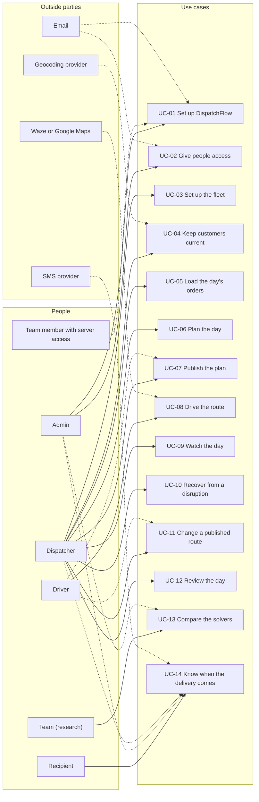

## The day

The order in which the use cases happen. Setup happens as needed, not every day. Recovery happens
only when the day goes wrong. UC-13 is research and sits off to the side.

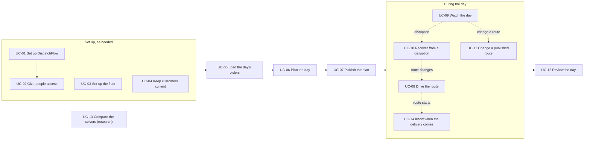

## UC-01: Set up DispatchFlow

| | |
|---|---|
| Actor | Admin. A team member with server access creates the first account. |
| Client | A server step for the first account, then the web app or the phone app |
| Trigger | DispatchFlow is deployed and nobody can sign in yet. |
| Preconditions | No active Admin exists. The Admin has an email address. |
| Outcome | The Admin is signed in, the company's settings are saved and audited, and messages to recipients stay off until the Admin turns them on. |

### Main flow

1. A team member with server access creates the first Admin account. The step works only when no
   active Admin exists, sends a set-password link, sets no default credential and leaves an audit
   record. There is no public sign-up. (FR-01, FR-291)
2. The step reads the person's identifier at a prompt that does not echo it, so the identifier never
   enters a command line or shell history. (FR-393)
3. The Admin opens the set-password link from their email. The link works once, expires, and allows
   nothing but setting a password that meets the password policy. (FR-294, FR-52)
4. The Admin signs in with their own email address and the new password. (FR-296)
5. While the company has fewer than the minimum number of active Admins, DispatchFlow warns the
   Admin at every sign-in. (FR-299)
6. The Admin opens the company's settings, all in one place, and sets the company's name, its
   dispatch phone, the default interface language and the time window a new customer starts with.
   (FR-125)
7. The Admin also sets the departure allowance, the fixed cost per vehicle used and the default
   solve time limit. Where the options are built, the same place holds the service duration a new
   customer starts with and the cost per kilometre and per driver-hour. (FR-183, FR-184, FR-185)
8. The Admin turns messages to recipients and the rating question on or off. Both start off. A
   change applies to messages triggered after it. (FR-350, FR-375)
9. DispatchFlow audits each change to the settings. (FR-186)

### Alternatives and failures

- **1a.** An active Admin already exists. The first-Admin step creates nothing. (FR-291)
- **1b.** A person the pilot agreement names asks in writing for another Admin. A team member runs a
  step that creates the Admin with a set-password link and leaves an audit record. (FR-292)
- **1c.** On the same written request, that step can deactivate each Admin account the request names
  and end its sessions. It is an exception to the rule that protects the last Admins. (FR-346)
- **3a.** The link was already used or has expired, so it no longer works. TODO: the rows do not say
  how a person who never set a password gets a new link. (FR-294)
- **4a.** Sign-in fails. DispatchFlow does not let the person in. The rows of this use case say no
  more about the failure; see Discrepancies. (FR-296)
- **4b.** The Admin forgot the password. They ask for a recovery link by email, without help from
  the DispatchFlow team. Asking leaves the current password working. The link works once, expires,
  and ends every session of the user when it is used. Attempts to recover are limited per account.
  (FR-52, FR-386, FR-345, FR-172)
- **8a.** Messages are off. DispatchFlow sends none, and replies are still read. (FR-350)

### Sequence

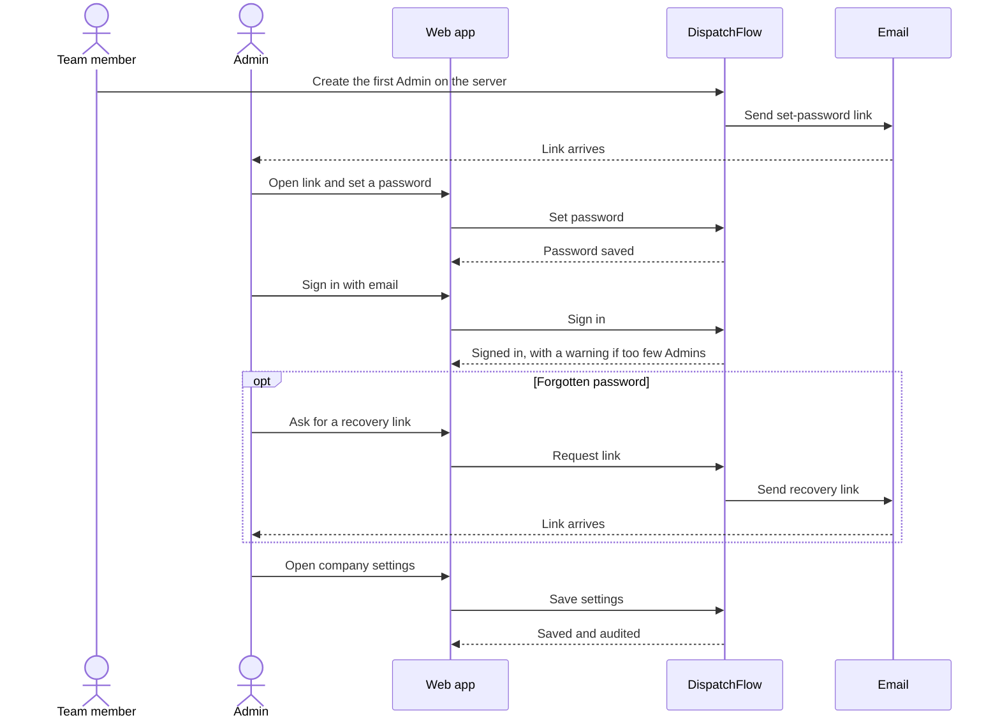

### Rows exercised

FR-01, FR-52, FR-125, FR-291, FR-393, FR-172, FR-183, FR-184, FR-185, FR-186, FR-292, FR-299,
FR-294, FR-296, FR-386, FR-346, FR-345, FR-350, FR-375

## UC-02: Give people access

| | |
|---|---|
| Actor | Admin |
| Client | Web app or phone app |
| Trigger | A person needs access to DispatchFlow, or must lose it. |
| Preconditions | The Admin is signed in. |
| Outcome | The new user has an account with at least one role, has set a password, and can use only the functions their roles permit. |

### Main flow

1. The Admin creates a user and gives them one or more of the roles Admin, Dispatcher and Driver.
   Each person has one account and signs in with their own email address. (FR-02, FR-293, FR-296)
2. DispatchFlow emails the new user a set-password link. The user needs no help from the
   DispatchFlow team. The link works once, expires, and allows nothing but setting a password.
   (FR-294, FR-52)
3. The user sets a password that meets the password policy. (FR-179)
4. The user signs in and can use only the functions their roles permit. An account with several
   roles may do everything any of them allows. (FR-03, FR-293)
5. When the new account holds the Admin role, DispatchFlow emails every active Admin. (FR-389)

### Alternatives and failures

- **1a.** The user has no role. DispatchFlow refuses the account and gives the reason. An account
  that holds no role cannot sign in, recovery sends it nothing, and losing its last role ends its
  sessions. (FR-02, BR-123)
- **4a.** A user forgot their password. They ask for a recovery link by email, without help from the
  DispatchFlow team. Asking leaves the current password working. The link works once, expires, and
  ends every session of the user when it is used. Attempts are limited per account. (FR-52, FR-386,
  FR-345, FR-172)
- **4b.** A signed-in user changes their own password by giving the current one. A wrong current
  password counts toward the sign-in limits. The new password must meet the policy. The change ends
  every session of that user, so they sign in again, and a token issued earlier is refused at once.
  When an Admin's password changes, DispatchFlow emails every active Admin. (FR-123, FR-177, FR-179,
  FR-178, FR-180, FR-389)
- **5a.** A leaver is deactivated. The Admin deactivates the account. Sign-in stops, every session
  ends and the history stays. A token issued before is refused at once. (FR-53, FR-173)
- **5b.** A deactivated driver counts as no driver when a plan is published. Their queued reports
  cannot be sent, so a dispatcher records those outcomes. (FR-175, FR-298)
- **5c.** The Admin reactivates a deactivated user, whose history stays intact. Reactivating an
  Admin account emails every active Admin. (FR-297, FR-389)
- **5d.** An Admin cannot be deactivated while the company has only the minimum number of active
  Admins, and a deactivated Admin does not count toward that minimum. (FR-174, BR-19)
- **5e.** The last Admins cannot be demoted. An account cannot lose the Admin role while the company
  has only the minimum number of active Admins. (BR-19)

### Sequence

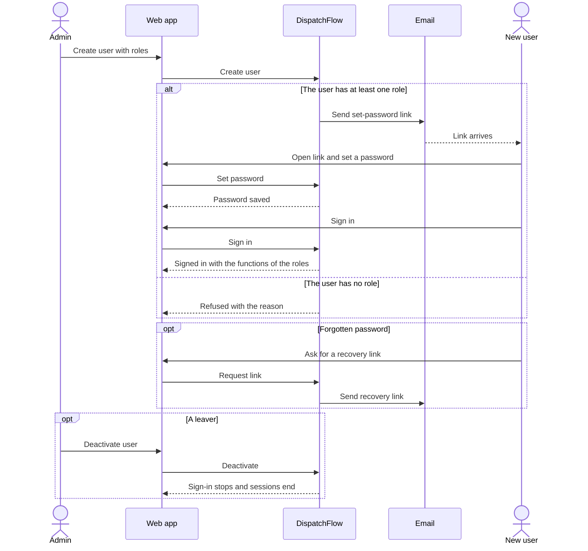

### Rows exercised

FR-02, FR-03, FR-52, FR-53, FR-123, BR-19, FR-172, FR-173, FR-174, FR-175, FR-177, FR-178, FR-179,
FR-180, FR-293, FR-294, FR-296, FR-386, FR-297, FR-298, FR-345, FR-389, BR-123

## UC-03: Set up the fleet

| | |
|---|---|
| Actor | Dispatcher. An Admin may do the same. |
| Client | Web app or phone app. A driver can also call the company's dispatch phone from either app. |
| Trigger | The company starts using DispatchFlow, or its depots, vehicles, drivers or shifts change. |
| Preconditions | The Dispatcher is signed in. |
| Outcome | Depots, vehicles and drivers are registered, a delivery date has its drivers, shifts and vehicles, and what is no longer used is retired. |

### Main flow

1. The Dispatcher defines a depot with a location. The location comes from the address, geocoded as
   a customer's is, or from placing it on the map. A depot can have opening hours. (FR-04, FR-130,
   FR-129)
2. The Dispatcher registers each vehicle with a weight capacity, a volume capacity, a start depot
   and an end depot. A vehicle has a display name and a licence plate, each unique among active
   vehicles. The display name identifies the vehicle on the map, the timeline, the phone app and
   printouts. (FR-05, FR-131, FR-198)
3. The Dispatcher registers each driver with a shift start, a shift end and an assigned vehicle, and
   a contact phone that the web app shows beside the driver's route. The contact phone is never a
   recovery channel. A driver can call the company's dispatch phone with one tap. (FR-06, FR-132,
   FR-200, FR-199)
4. For one delivery date, the Dispatcher sets which drivers work, their shift hours and which
   vehicle each takes. The values registered for each driver are the default for the date, and a
   weekly shift template fills any value the Dispatcher has not set. A shift ends after it starts
   and lies on its date. (FR-54, FR-189, FR-79, FR-190)
5. The Dispatcher sees, changes and retires depots, vehicles, drivers and customers. A retired
   record is not offered for new plans and stays on past ones. Retiring a driver removes the Driver
   role from their account, which keeps its other roles. A retired vehicle does not count toward the
   vehicle limit. (FR-56, FR-193, FR-307)

### Alternatives and failures

- **1a.** A depot without coordinates cannot start or end a route. A solve leaves its vehicles out
  and names them. (FR-197)
- **1b.** An order cannot be served because of a depot's hours. DispatchFlow drops it with the
  reason *depot hours*. A manual edit that breaks the opening hours raises a violation. (FR-195,
  FR-196)
- **4a.** A vehicle breaks or a driver falls sick during the day. No row of this use case covers it.
  It continues in UC-10. See Discrepancies.
- **5a.** An uncancelled plan for today or a later date uses the record. DispatchFlow refuses to
  retire it and names the plan. (FR-305)
- **5b.** A changed record applies to later plans. On an open plan, the re-check at publishing, or a
  violation, catches any conflict. (FR-306)

### Sequence

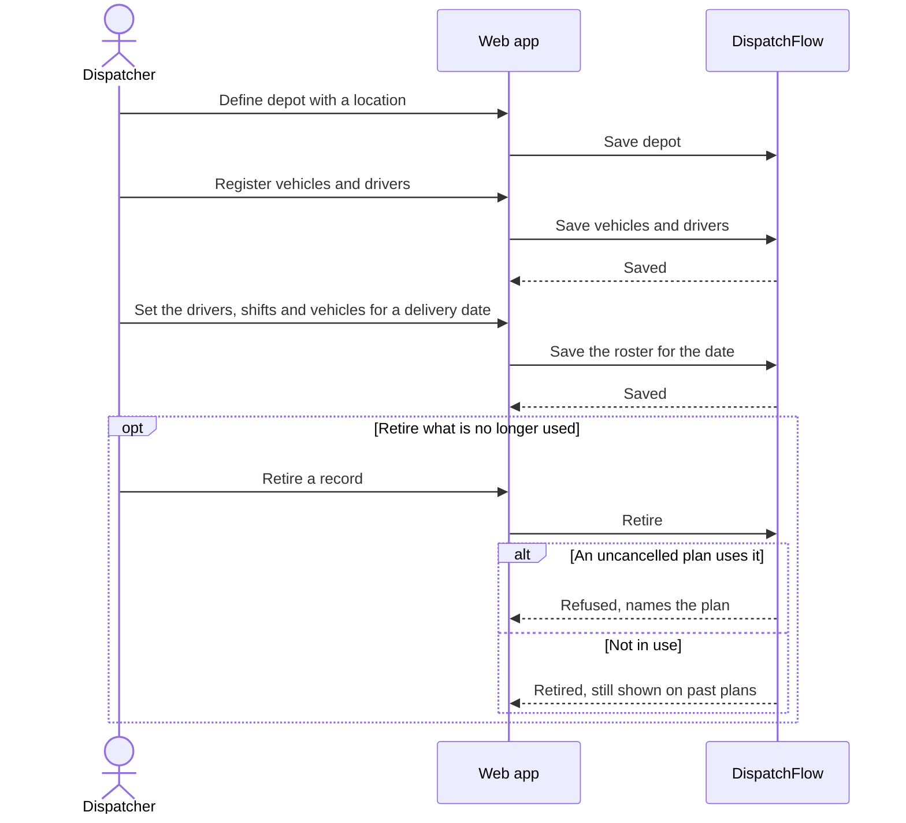

### Rows exercised

FR-04 to FR-06, FR-54, FR-56, FR-79, FR-129 to FR-132, FR-189, FR-190, FR-193, FR-195, FR-196,
FR-197, FR-198, FR-199, FR-200, FR-305, FR-306, FR-307

## UC-04: Keep customers current

| | |
|---|---|
| Actor | Dispatcher. An Admin may do the same. |
| Client | Web app or phone app |
| Trigger | A new customer appears, or a customer's address or contact details change. |
| Preconditions | The Dispatcher is signed in. |
| Outcome | Each customer has a name, a phone, an address and a location that the Dispatcher has checked. |

### Main flow

1. The Dispatcher creates a customer with a name, a contact phone, an address, a default time window
   and notes that drivers see. A driver can call the contact phone from a stop. DispatchFlow checks
   the phone and stores it in international form. (FR-08, FR-59, FR-208, FR-377)
2. While the Dispatcher types the address, DispatchFlow suggests matching addresses, from the
   geocoding provider or the company's own records and within the daily cap, and the Dispatcher
   picks one. A typed address kept without a pick is geocoded as usual. (FR-139, FR-220, FR-219)
3. DispatchFlow converts the address to coordinates, Hebrew addresses included. Before the lookup it
   normalizes common Hebrew abbreviations and spelling variants, and it keeps and shows the address
   as the Dispatcher typed it. It caches results, within what the provider's terms allow. (FR-12,
   FR-140, FR-221, FR-13)
4. Before saving, DispatchFlow warns when the customer is likely to duplicate an existing one.
   (FR-212)
5. To load many customers, the Dispatcher imports a CSV file. (FR-83, FR-318, FR-210)
6. The Dispatcher searches and filters customers by name, phone and address. (FR-134)
7. Before a solve, DispatchFlow raises an address flag on every address whose match is missing,
   partial or ambiguous, that lies outside the service area, or whose location is far from the
   nearest road. A flag does not stop the solve. (FR-63, FR-216)
8. The Dispatcher checks the flagged locations on the map and fixes a bad match by dragging the
   customer's location. DispatchFlow saves the corrected location for that customer and uses it for
   all their future orders. The correction clears that address's flag. (FR-14, FR-215, FR-217)
9. The Dispatcher sees, changes and retires customers. A retired customer is not offered for new
   plans, stays on past ones and matches no import row. (FR-56, FR-193, FR-307)

### Alternatives and failures

- **3a.** No match. The dispatcher places the customer's location by hand. (FR-218)
- **3b.** Several matches, or a partial one. DispatchFlow raises an address flag, and the Dispatcher
  drags the location to the right place. (FR-63, FR-14)
- **3c.** The geocoding provider cannot be reached. DispatchFlow still saves the customer, without
  coordinates. It retries the lookup at intervals for a limited time, then the address stays flagged
  for a hand-placed location. The Dispatcher can place the location by hand at any time. (FR-64,
  FR-218)
- **5a.** The file has a rejected row. DispatchFlow checks every row, reports every rejected row
  with its reason and imports nothing from the file. A row needs a name, an address and a phone, and
  a row with the same phone or address as another customer is a duplicate and is rejected. (FR-210,
  FR-318)
- **7a.** An address lies outside the service area. DispatchFlow drops its orders as *unreachable
  location* unless the Dispatcher fixes the location. (FR-320, FR-63)
- **9a.** An uncancelled plan for today or a later date uses the customer. DispatchFlow refuses to
  retire it and names the plan. (FR-305)
- **9b.** A changed customer applies to later plans. On an open plan, the re-check at publishing or
  a violation catches a conflict. (FR-306)

### Sequence

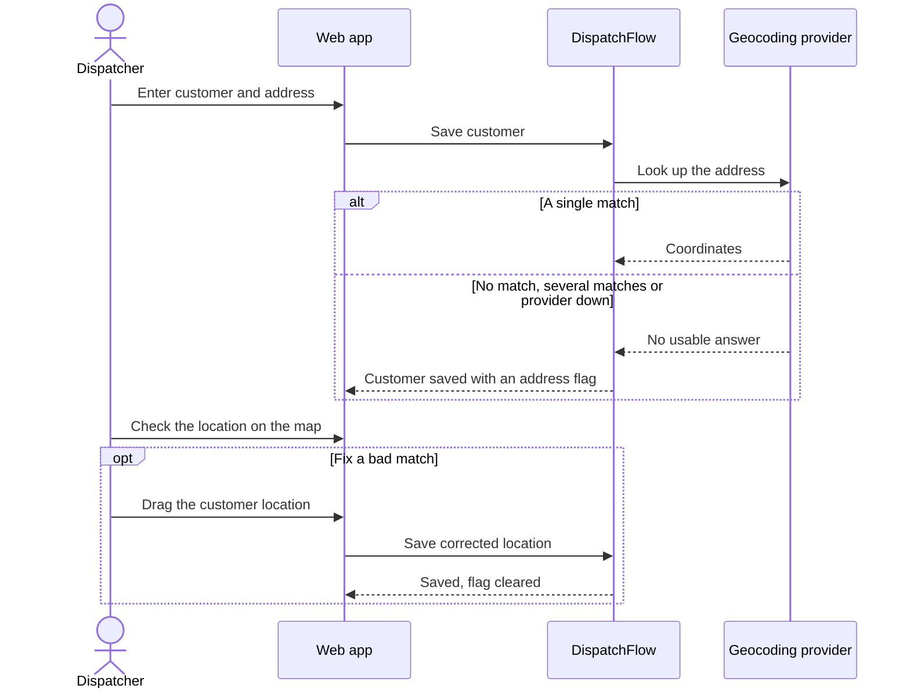

### Rows exercised

FR-08, FR-12 to FR-14, FR-56, FR-59, FR-63, FR-64, FR-83, FR-134, FR-139, FR-140, FR-215, FR-193,
FR-208, FR-216, FR-217, FR-218, FR-210, FR-212, FR-219, FR-220, FR-221, FR-305, FR-306, FR-307,
FR-320, FR-318, FR-377

## UC-05: Load the day's orders

| | |
|---|---|
| Actor | Dispatcher. An Admin may do the same. |
| Client | Web app or phone app |
| Trigger | A delivery date needs its orders. |
| Preconditions | The Dispatcher is signed in. Customers exist, or the import creates them. |
| Outcome | The delivery date holds its orders, ready to solve. |

### Main flow

1. The Dispatcher can enter an order through a form: customer, delivery date, time window, weight
   and volume demand, service duration and priority. The time window starts as the customer's. The
   order can carry a reference from an outside system and a mark that it may be left at the door. A
   phone on the order is checked and stored in international form. (FR-09, FR-85, FR-364, FR-377)
2. To load many orders, the Dispatcher downloads the template, fills it and imports it as a CSV file
   or an Excel workbook. The file has fixed, named columns. DispatchFlow reads the first sheet of a
   workbook. (FR-84, FR-309, FR-10, FR-138, FR-319)
3. DispatchFlow reads Hebrew text as UTF-8, with or without a byte order mark, and otherwise as
   Windows-1255. In that case the Dispatcher confirms a preview first. (FR-61, FR-313)
4. DispatchFlow validates every row and resolves each one to exactly one customer. A row names its
   customer by address, and DispatchFlow matches it on normalized address text. An Excel file is
   validated the same way, within the upload limits. (FR-203, FR-60, FR-205, FR-310, FR-398, FR-213)
5. A row that matches no customer creates one from the row's name and phone, marked for a location
   check. (FR-311)
6. When no row is rejected, DispatchFlow imports the orders. (FR-204)
7. As another way to load the day, the Dispatcher copies a previous delivery date's orders to a new
   date and changes them before solving. (FR-62)

### Alternatives and failures

- **3a.** The file's bytes are not valid in its encoding. DispatchFlow rejects the file with that
  reason. (FR-209)
- **3b.** The file has a UTF-16 byte order mark or NUL bytes. DispatchFlow refuses it with that
  reason. (FR-314)
- **3c.** The Dispatcher leaves the preview open too long. It expires, and its rows are deleted. A
  preview the Dispatcher discards is deleted at once. (FR-399)
- **4a.** A row is rejected. DispatchFlow lists every rejected row with its reason and imports
  nothing from the file. The same holds for an Excel file. (FR-203, FR-204, FR-213)
- **4b.** A row matches several customers. DispatchFlow rejects it and lists them. (FR-312)
- **4c.** An order's reference already exists on the same delivery date. DispatchFlow refuses it and
  reports the reason. (FR-211)
- **5a.** A row matches no customer and has no name or phone. DispatchFlow rejects it. (FR-311)

### Sequence

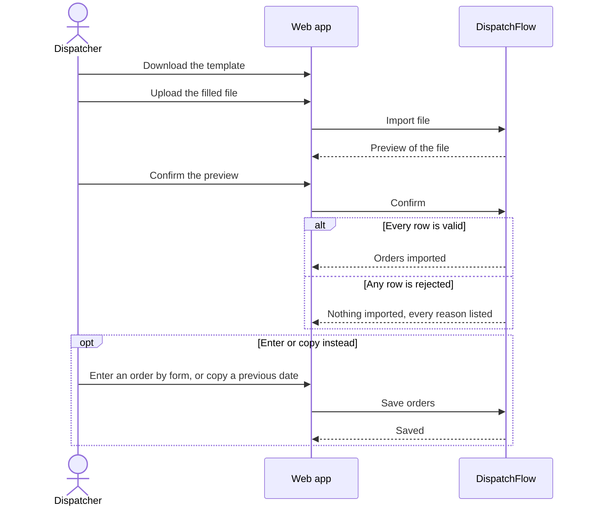

### Rows exercised

FR-09, FR-10, FR-60 to FR-62, FR-84, FR-85, FR-138, FR-203, FR-204, FR-205, FR-209, FR-211, FR-213,
FR-309, FR-319, FR-310, FR-398, FR-311, FR-312, FR-313, FR-399, FR-314, FR-364, FR-377

## UC-06: Plan the day

| | |
|---|---|
| Actor | Dispatcher. An Admin may do the same. |
| Client | Web app or phone app |
| Trigger | A delivery date has its orders and its roster. |
| Preconditions | The delivery date has orders, vehicles and driver shifts. |
| Outcome | The plan is ready: every order is on a route or listed as dropped with its reason, and the Dispatcher has reviewed it and edited it if needed. |

### Main flow

1. The Dispatcher creates a plan for a delivery date. Before solving, the Dispatcher may pin an
   order to a vehicle or a driver, and lock a route or the sequence of its stops. (FR-15, FR-91,
   FR-147)
2. The Dispatcher runs the pre-flight check. It lists the known causes of dropped orders or of a
   failed solve: orders whose customer has no coordinates, vehicles without a driver, drivers
   without a vehicle, orders heavier or larger than every vehicle, and windows outside every shift.
   It does not stop the solve, and a clean check does not promise that no order drops. (FR-141,
   FR-230, FR-231)
3. The Dispatcher requests a solve over that date's orders, vehicles and driver shifts. The solver
   is OR-Tools, the default, or the DispatchFlow solver, and choosing one changes nothing else. The
   time limit is configurable. Where the company enabled a fixed cost per vehicle and a departure
   allowance, the solve uses them. (FR-15, FR-20, FR-224, FR-19, FR-21, FR-67)
4. The solve runs in the background. The Dispatcher sees that the plan is solving, whether it is
   queued or building the travel-time matrix, how long its search has run against the limit and any
   overrun. DispatchFlow notifies the Dispatcher when the result is ready, without a reload. (FR-16,
   FR-142, FR-222)
5. The solve assigns orders to vehicles, orders the stops of every route and gives each stop a
   planned ETA, honouring every business rule. Travel times come from the road network and vary by
   time of day. ETAs include the departure allowance and a buffer. Toll roads count like any road.
   (FR-17, FR-90, FR-321, FR-226, FR-227, FR-323)
6. Behind the plan, solvers plan with the highest travel-time factor and the buffer, so a plan stays
   feasible all day. Each leg takes the travel-time factor of the part of the day it departs in.
   ETAs and the checks use the buffered times. The objective's travel cost uses per-bucket times
   without the buffer. (FR-322, FR-400, FR-401, FR-402)
7. A leave-at-door order's time window is a preference. Serving it outside the window costs the
   plan, but never drops the order for its window. The solver may plan a wait at a door stop, and
   the checks re-time the stop with no waiting. (BR-119, BR-120, BR-121, BR-126, FR-403)
8. The Dispatcher reviews the routes on a map drawn along the road network, with depots, dropped
   orders and address flags each visibly different from a routed stop. The timeline shows the stops
   per vehicle, and a table lists every route and stop, sorted and filtered as needed. Each route
   has one colour and one label, used the same way everywhere and never by colour alone. Selecting a
   stop in one view selects it in the others and shows its window, ETA, load, waiting time and any
   violation. (FR-24, FR-149, FR-25, FR-151, FR-148, FR-240, FR-150, FR-241)
9. Before publishing, each route shows its load against the vehicle's capacity, its duration against
   the driver's shift, its total waiting time and its planned distance. A leave-at-door stop served
   outside its window is marked with the minutes outside, and does not count as a violation.
   (FR-143, FR-232, FR-385)
10. While the plan is ready and not yet published, the Dispatcher edits by hand. The Dispatcher
    drags a stop to another position or another route, takes a stop off its route into the dropped
    list with the reason *removed by dispatcher*, and puts a dropped order on a route. The
    Dispatcher can undo and redo the edits made since the last solve. (FR-22, FR-146, FR-235,
    FR-145)
11. After each edit, DispatchFlow recalculates the ETAs from road travel times and runs no
    optimization. It marks every time-window, capacity and shift violation at once, and a plan with
    a violation cannot be published. Taking a stop off a route by hand is an exception to dropping
    only when not every order fits. (FR-23, FR-233, FR-234, FR-236)

### Alternatives and failures

- **4a.** The solve fails. DispatchFlow tells the Dispatcher without a reload and gives the reason:
  service unavailable, timed out or interrupted, no uncancelled orders on that date, rejected by the
  validator, search failed, no solution within the limit, or request refused. The Dispatcher can
  request the solve again. (FR-65, FR-225)
- **4b.** A lock cannot be honoured. The solve fails with that reason. (FR-238)
- **5a.** Not every order fits. The solve still returns a plan and lists every dropped order with
  its reason and, in plain language, the fact that caused it. The reasons are *capacity*, *time
  window*, *shift*, *displaced*, *missing location*, *no vehicle available*, and those that other
  rows add. (FR-18, FR-144, FR-223)
- **5b.** The road network cannot reach a customer's location. The solve still returns a plan and
  drops the order with the reason *unreachable location*. An order dropped for a missing or
  unreachable location cannot be placed until its location is fixed. (FR-66, FR-237)
- **5c.** A pin cannot be honoured. The solve drops the order with that reason. (FR-228, FR-91)
- **11a.** The Dispatcher solves again after editing. A locked route stays as it is, and the warning
  that manual edits will be discarded does not cover it. (FR-147, FR-239)
- **11b.** Midnight passes with the plan not published. A plan that is a draft, solving or ready
  becomes abandoned, which is final and read-only. Every queued or running solve job of that date
  fails with the reason "its date passed". (BR-127, BR-128)

### Sequence

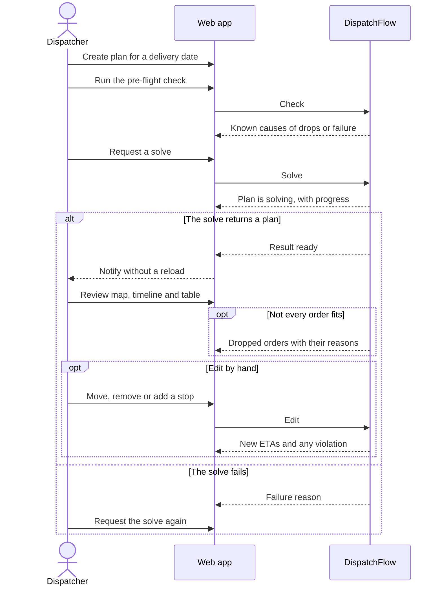

### Rows exercised

FR-15 to FR-25, FR-65 to FR-67, FR-90, FR-91, FR-141 to FR-151, FR-222, FR-223, FR-224, FR-233,
FR-234, FR-225, FR-226, FR-227, FR-228, FR-230, FR-231, FR-232, FR-235, FR-236, FR-237, FR-238,
FR-239, FR-240, FR-241, FR-321, FR-322, FR-400, FR-401, FR-402, FR-403, FR-323, BR-119, BR-120,
BR-121, BR-126, BR-127, BR-128, FR-385

## UC-07: Publish the plan

| | |
|---|---|
| Actor | Dispatcher. An Admin may do the same. |
| Client | Web app or phone app. Drivers see their route in the phone app or the web app. |
| Trigger | The Dispatcher is satisfied with a ready plan. |
| Preconditions | The plan is ready (UC-06). |
| Outcome | The plan is published, every driver with a route is alerted, and each driver sees their own route. |

### Main flow

1. The Dispatcher publishes the ready plan. (FR-26)
2. DispatchFlow checks that, for every route, the vehicle is not marked unavailable and the
   vehicle's driver holds the Driver role and is the route's driver. Refusals come in a fixed order:
   changed vehicles, an order the plan does not account for, violations, then the re-check. (BR-20,
   BR-72)
3. DispatchFlow checks that the plan serves or drops every order of the date. (BR-22)
4. DispatchFlow checks that no violation is open. (BR-17)
5. The validator re-checks every route once against the current fleet and orders of the date:
   shifts, capacities, depots and time windows. Where vehicle limits are built, the re-check covers
   them too. A plan without routes needs no re-check. (BR-21, BR-66, BR-69)
6. When the re-check finds nothing broken, DispatchFlow publishes the re-checked times. They equal
   the solved times unless the fleet changed since the solve, and then they follow it. (BR-68)
7. Each driver sees their own route. DispatchFlow alerts every driver with a route that it is ready,
   through the same channel as route-change alerts. (FR-26, FR-152)

### Alternatives and failures

- **2a.** A vehicle no longer meets the check. DispatchFlow publishes nothing, names every changed
  vehicle, and the Dispatcher solves again. (BR-63)
- **3a.** An order was placed after the solve was requested. DispatchFlow publishes nothing, names
  every such order, and the Dispatcher solves again. (BR-71)
- **3b.** The plan neither serves nor drops some order. DispatchFlow does not publish it. (BR-22)
- **4a.** The plan has a violation. DispatchFlow does not publish it. The Dispatcher fixes the
  violation or solves again. (BR-17)
- **5a.** A route breaks a rule in the re-check. DispatchFlow publishes nothing and lists every
  broken rule. The Dispatcher solves again or edits the route. (BR-67)
- **5b.** The re-check cannot run. DispatchFlow publishes nothing. (BR-70)
- **7a.** The day will not run. The Dispatcher cancels the published plan, which is allowed while no
  route has started and no stop is reported. DispatchFlow alerts its drivers, and its orders return
  to *unplanned*. A cancelled plan has no daily summary or baseline comparison and is left out of
  trends. (FR-336, FR-337, FR-338)
- **7b.** An order is placed after publishing. It enters the routes through re-optimization (UC-10).
  (BR-73)
- **7c.** The Dispatcher accepts a re-optimization. DispatchFlow applies the vehicle check to every
  vehicle the proposal keeps driving, skipping vehicles withdrawn mid-route. If a vehicle no longer
  meets it, DispatchFlow refuses the acceptance, names every changed vehicle, and the Dispatcher
  re-optimizes again. (BR-64, BR-65)

### Sequence

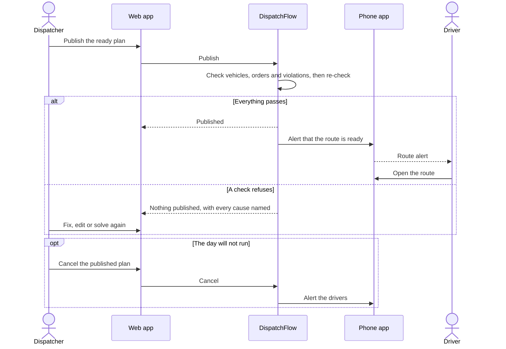

### Rows exercised

FR-26, FR-152, BR-17, BR-20 to BR-22, BR-63, BR-64, BR-65, BR-66, BR-67, BR-68, BR-69, BR-70, BR-71,
BR-72, BR-73, FR-336, FR-337, FR-338

## UC-08: Drive the route

| | |
|---|---|
| Actor | Driver |
| Client | Phone app. The web app also serves drivers, online only. |
| Trigger | The plan is published and the driver is alerted. |
| Preconditions | The driver has a published route for the date. |
| Outcome | The route is finished. Each stop has an outcome, with proof when delivered or a reason when failed, and every report has reached DispatchFlow. |

### Main flow

1. The driver opens the route. A route for a later date is listed with its date, and the alert on
   publishing opens it. (FR-324)
2. The route shows the stops in order with planned ETAs, customer details and notes. Each stop shows
   its time window and how long remains until it ends. A customer has a name and a contact phone.
   (FR-27, FR-59, FR-154)
3. Before leaving the depot, the driver reads the loading list: the route's orders in reverse stop
   order, with weight and volume, and package counts where they are built. The driver loads the
   vehicle. (FR-153)
4. The driver starts the route. A route is *not started*, *in progress* or *finished*, and the first
   stop report starts a route that was not started. (FR-68, FR-244, FR-327)
5. While the route is in progress, the phone app reports the driver's location, in the background
   too. The web app reports it only while it is open and visible on the route. (FR-31, FR-243)
6. At each stop, the driver hands the stop to navigation. The Navigate action opens Waze or Google
   Maps with the stop's stored coordinates, so a corrected location is honoured. (FR-28, FR-325)
7. The driver calls the customer's contact phone from the stop if needed. (FR-208)
8. The stop shows when its order may be left at the door. Near the stop, the app offers to mark it
   *arrived*, and neither app marks it on its own. The driver marks the stop *arrived*. (FR-365,
   FR-155, FR-252, FR-29)
9. When the stop is served, the driver marks it *delivered* with proof: a photo or a signature, with
   an optional note. DispatchFlow refuses a driver's *delivered* report that comes without proof.
   The photo is taken inside the app, framed on the package and the door and not on people, and
   never comes from the gallery. DispatchFlow re-encodes the image and strips its metadata before
   storing it. (FR-29, FR-30, FR-367, NFR-204, NFR-205)
10. When the stop fails, the driver marks it *failed*, which requires a reason. (FR-29, FR-242)
11. After each reported stop, the driver sees updated ETAs for the remaining stops. (FR-96)
12. The driver finishes the route. The app shows a summary: stops delivered and failed, and any
    reports still waiting to be sent. (FR-68, FR-156)

### Alternatives and failures

- **2a.** The dispatcher prints or exports the route: stops in order, addresses, phones, notes and
  each stop's weight and volume. (FR-72)
- **2b.** There is no connection. The phone app shows the last received route, with customer details
  and notes, the route's date and when it was received. (FR-69)
- **4a.** The driver uses the web app. It works online only. Offline work, background location,
  background alerts and encrypted storage belong to the phone app, and the web app says so. (FR-326)
- **8a.** Nobody takes a leave-at-door order. The driver may leave it at the door and mark the stop
  *delivered*, recorded as left at the door. No other order can be recorded so. A stop left at the
  door needs a photo as its proof. Without a camera, a dispatcher records it. (FR-366, FR-368)
- **9a.** There is no connection while the driver reports. The driver can start and finish the route
  and report stops, and capture proof, which is sent with its report. Offline reports keep the time
  they were made and survive closing the phone app. DispatchFlow sends queued reports soon after the
  connection returns while the app is open, otherwise when it next opens, and in the order they were
  made. A report stays queued until DispatchFlow acknowledges it, and a refused one is shown to the
  driver. (FR-70, FR-245, FR-246, FR-247, FR-248)
- **9b.** The driver signs out with reports unsent. The app warns them. Reports queued when a
  session ends stay encrypted on the phone and are sent after the same user signs in again. (FR-330,
  FR-331)
- **11a.** A route change arrives mid-route, after the Dispatcher accepts a re-optimization. The
  phone app alerts the driver, even in the background. The web app learns of the change from its
  event stream and reads the route again when the stream reconnects. Either app shows which stops
  the change added, removed or reordered. The driver confirms that they have seen it, and the
  dispatcher sees who has not. Manual edits happen only before publishing. (FR-32, FR-71, FR-347,
  FR-249, FR-97, FR-250)
- **11b.** A stop is at risk. It is marked in the driver's list as well as the dispatcher's.
  (FR-251)
- **11c.** The driver reports a problem from either app: a breakdown, running late or a full
  vehicle. DispatchFlow alerts the dispatcher. (FR-95)
- **12a.** The driver finishes the route with stops pending. The app warns them first, and
  DispatchFlow alerts the dispatcher. (FR-329)
- **12b.** Nobody finishes the route. Location collection stops after the shift has ended, within a
  set time. (FR-328)

### Sequence

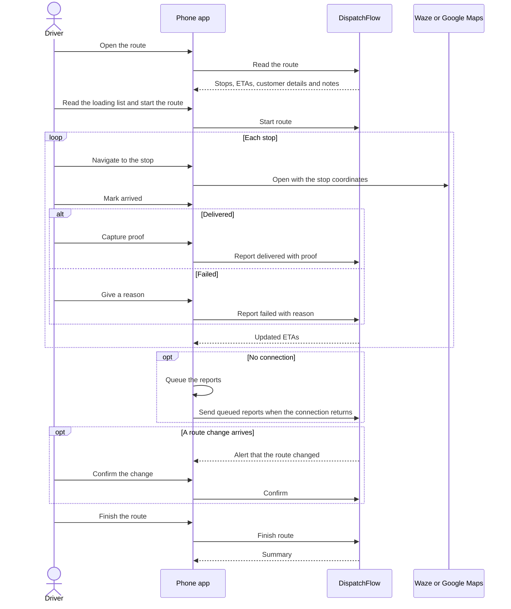

### Rows exercised

FR-27 to FR-32, FR-59, FR-68 to FR-72, FR-95 to FR-97, FR-153 to FR-156, FR-242, FR-243, FR-208,
FR-244, FR-245, FR-246, FR-247, FR-248, FR-249, FR-250, FR-251, FR-252, FR-324, FR-325, FR-326,
FR-327, FR-328, FR-329, FR-330, FR-331, FR-347, FR-365, FR-366, FR-367, FR-368, NFR-204, NFR-205

## UC-09: Watch the day

| | |
|---|---|
| Actor | Dispatcher. An Admin may do the same. |
| Client | Web app. The phone app serves Admins and Dispatchers too, and delivers their alerts. |
| Trigger | A plan is published and the day is running. |
| Preconditions | At least one route has been published. |
| Outcome | The Dispatcher knows where each route stands and has acknowledged every alert. |

### Main flow

1. The Dispatcher opens the live map. It shows each vehicle's latest position and each stop's
   status, and how old each position is. (FR-33, FR-74)
2. The Dispatcher reads each route's progress: stops done out of all stops, the current delay
   against the plan, the next stop and when the driver last reported. The delay is the actual time
   of the route's latest event minus that event's planned time, and projected arrivals carry it
   along the planned legs. (FR-158, FR-383, FR-254)
3. DispatchFlow gathers every alert in one list: stops at risk, problems drivers report, routes not
   started, failed stops, unconfirmed route changes, late and refused reports, routes finished with
   stops pending, and low ratings. (FR-157)
4. An alert raised while the web app is closed waits in the list. In the phone app, an Admin's or
   Dispatcher's alerts arrive through the open event stream while the app is open and by push while
   it is in the background, and a push carries no personal data. (FR-335, FR-405)
5. The Dispatcher acknowledges an alert, which records who did it and when. An unacknowledged alert
   stays visible until its plan completes, and one raised after that stays until it is acknowledged.
   (FR-260, FR-261)

### Alternatives and failures

- **1a.** A position is stale. The map marks it stale after a set time by the server's clock, and
  says so when no position has been received. (FR-74)
- **3a.** A stop is at risk. Its projected arrival is later than its window end minus a margin.
  DispatchFlow alerts the Dispatcher. A leave-at-door stop is never at risk, because its window does
  not bind. (FR-34, FR-253, FR-369)
- **3b.** A route has not started. DispatchFlow alerts the Dispatcher once a grace period has passed
  after shift start plus the departure allowance. (FR-101)
- **3c.** A driver marks a stop *failed*. DispatchFlow alerts the Dispatcher immediately. (FR-102)
- **3d.** A recipient gives a low rating. DispatchFlow alerts the Dispatcher as for an at-risk stop,
  and the alert appears in the list. (FR-361)
- **5a.** What the Dispatcher does about an alert continues in UC-10 or UC-11.

### Sequence

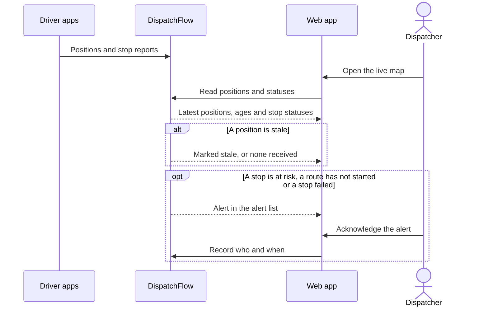

### Rows exercised

FR-33, FR-34, FR-74, FR-101, FR-102, FR-157, FR-158, FR-253, FR-254, FR-260, FR-261, FR-335, FR-405,
FR-361, FR-369, FR-383

## UC-10: Recover from a disruption

| | |
|---|---|
| Actor | Dispatcher. An Admin may do the same. |
| Client | Web app or phone app |
| Trigger | A vehicle breaks, a driver is late or falls sick, or an order is added or changes on a published day. |
| Preconditions | The plan is published. |
| Outcome | The Dispatcher accepted a re-optimization. The plan stays published, and the drivers whose routes changed receive the changes. |

### Main flow

1. The Dispatcher records the disruption. They mark a vehicle unavailable, or a driver unavailable,
   and a driver marked unavailable counts as no driver when a plan is published. Or they add orders
   to a day whose plan is published. Or they change an order's time window, leave-at-door mark,
   demand, service duration, priority or date, until its current stop is marked *arrived* or has an
   outcome. Or they put a failed or dropped order back, for today's re-optimization or another date.
   (FR-07, FR-82, FR-194, FR-11, FR-57, FR-75)
2. When the Dispatcher changes an order on a published plan, DispatchFlow says at once that the
   order is on a published route and that the driver sees the change only after a re-optimization.
   The stop is marked *changed since publishing* until a re-optimization applies the change or the
   stop has an outcome. (FR-396, FR-397)
3. On a published plan, a change to an order reaches the routes through re-optimization, except a
   date change. A date change takes the stop off at once, as cancelling does, and a route the change
   breaks is shown as broken until it is re-optimized. A put-back order gets a new current stop, and
   the earlier stop's outcome stays as recorded. (FR-206, FR-315, FR-258)
4. The Dispatcher starts a re-optimization of the remaining stops of the published plan. Only a
   person starts one. Alerts inform the Dispatcher, and nothing starts one automatically. The
   Dispatcher can limit it to chosen routes. (FR-35, FR-332, FR-159)
5. The re-optimization keeps drivers' routes as stable as it can. Route stability is part of its
   objective, and it counts the stops that leave their vehicle, dropped stops included. (FR-37,
   FR-256)
6. DispatchFlow shows a preview of what changes for each driver. The preview also shows which orders
   would drop, which time windows would break and the change in the plan's totals, and it names each
   moved stop and new order whose goods need a hand-over. (FR-36, FR-103, FR-334)
7. The Dispatcher accepts the preview. Nothing changes for drivers until then. On acceptance,
   DispatchFlow re-checks the proposal against every stop status, cancellation, order change,
   hand-over and fleet change recorded since the preview. (FR-255, BR-25)

### Alternatives and failures

- **1a.** The vehicle is repaired or the driver is back. The Dispatcher marks them available again,
  from the next solve or re-optimization. (FR-300)
- **1b.** A vehicle is out of service before the day starts. The Dispatcher leaves it out of that
  date through the date's drivers and vehicles. (FR-301)
- **3a.** The plan is ready, not published. Cancelling an order or changing its date takes its stop
  off at once. Any other change waits for the re-check at publishing. A change to an order while its
  plan is solving refuses publishing. (FR-316, FR-317)
- **7a.** The Dispatcher declines the preview, the re-optimization fails, or the validator rejects
  it. The plan stays published and every route stays as it was. DispatchFlow tells the Dispatcher
  why it failed or was rejected. (BR-26, BR-86)
- **7b.** The re-optimization runs past its limit, or a restart interrupts it or finds it queued. It
  has failed. (BR-84, BR-85)
- **7c.** Something changed since the preview. If the proposal would move or drop a stop that
  changed, or relies on an order, vehicle or driver that changed, DispatchFlow applies nothing,
  names what changed, and the Dispatcher re-optimizes. A report on a stop that the proposal leaves
  on the same vehicle and in the same order does not refuse it, and the report stands. (BR-82,
  BR-83)

### Sequence

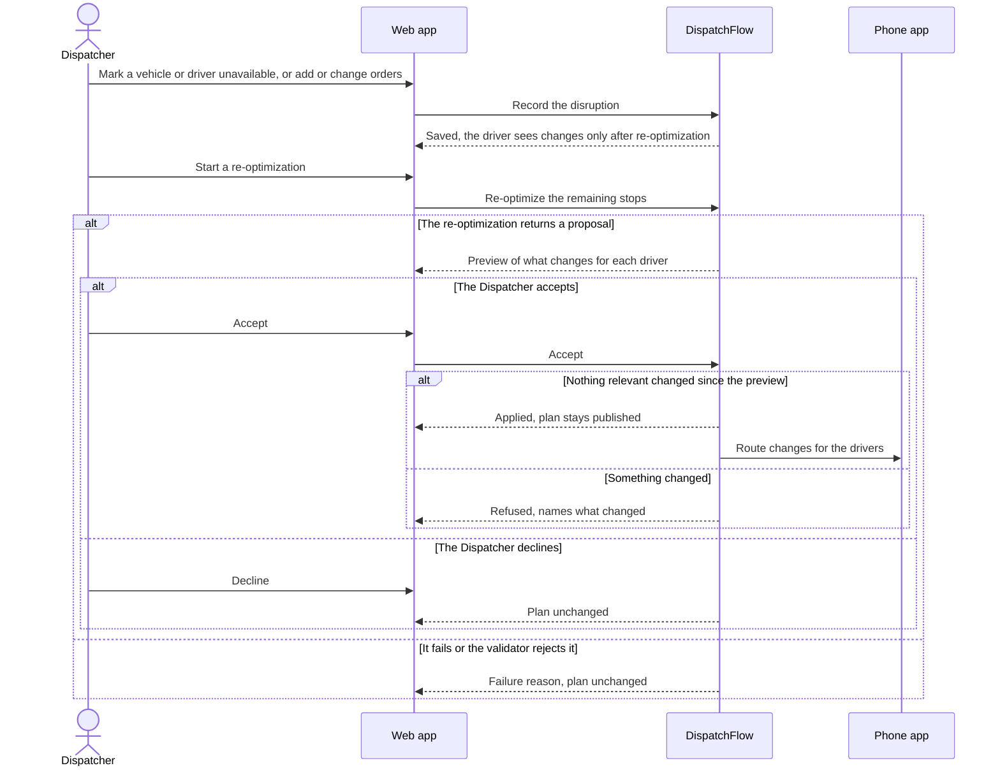

### Rows exercised

FR-07, FR-11, FR-35 to FR-37, FR-57, FR-75, FR-82, FR-103, FR-159, BR-25, BR-26, FR-255, FR-256,
FR-206, FR-396, FR-397, FR-258, FR-194, BR-82, BR-83, BR-84, BR-85, BR-86, FR-300, FR-301, FR-334,
FR-332, FR-315, FR-316, FR-317

## UC-11: Change a published route without optimizing

| | |
|---|---|
| Actor | Dispatcher. An Admin may do the same. |
| Client | Web app or phone app |
| Trigger | A route needs another driver, or an order is cancelled, and no re-optimization is wanted. |
| Preconditions | The plan is published. |
| Outcome | The route has its new driver, or the cancelled order's stop has left the route. No optimization ran, and the change is audited. |

### Main flow

1. The Dispatcher hands a route of the published plan to another driver. The new driver sees it, and
   the old driver no longer does. (FR-55)
2. The new driver must be active, available, hold the Driver role and have no route on that date.
   The route takes that date's vehicle assignment with it and keeps its stops, and no optimization
   runs. A started route can be handed over, and its reported stops stay recorded. (FR-302, FR-191,
   FR-192, FR-303)
3. Or the Dispatcher cancels an order until its current stop is marked *arrived* or has an outcome.
   The stop leaves the driver's route at once, the rest of the route stays as it is, and no
   optimization runs. A cancelled order is neither served nor dropped, so on-time figures and the
   baseline no longer count it. (FR-58, FR-207, BR-30)
4. DispatchFlow audits each change to a published route. No background process changes a published
   route silently, and a published route changes only through the named actions. (BR-77, BR-78,
   BR-47)

### Alternatives and failures

- **2a.** A hand-over breaks the new driver's shift. DispatchFlow raises a violation, and the
  Dispatcher confirms it. For a route that a confirmed hand-over put past its shift, the confirmed
  return time becomes that day's shift end, and a re-optimization cannot stretch it. (FR-304,
  FR-394)
- **2b.** The optimization service is down. The hand-over or cancellation still completes, and its
  routes show *not yet checked* until the validator checks them once the service returns. Publishing
  stays refused meanwhile. (FR-395)
- **3a.** The order's stop was already reported, or the driver has marked it *arrived*. The order
  cannot be changed or cancelled. (BR-92, FR-58)
- **3b.** The Dispatcher records the stop's outcome on the driver's behalf, with a reason when it
  failed. The record names who made it. (FR-73, FR-257)
- **3c.** The Dispatcher corrects a recorded outcome at any time, with a reason. The original stays
  in the history, and figures use the correction. (FR-333)
- **3d.** After a put-back, the Dispatcher corrects a failed stop to *delivered*. That is allowed
  while the new stop has no outcome. The new stop then leaves its route, audited. Otherwise
  DispatchFlow refuses and names the conflict. (FR-404)

### Sequence

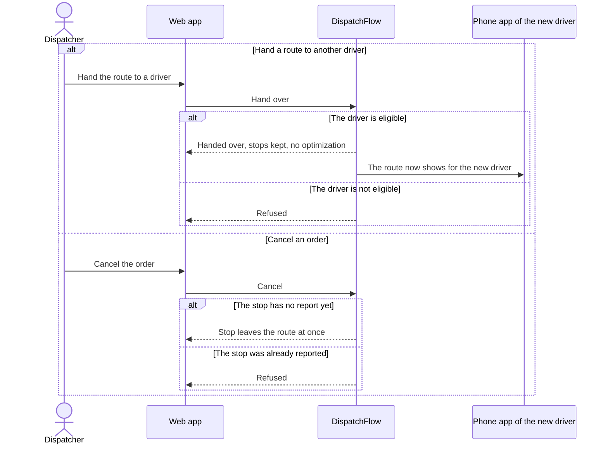

### Rows exercised

FR-55, FR-58, FR-73, BR-30, BR-47, FR-191, FR-192, FR-207, FR-257, BR-92, BR-77, BR-78, FR-302,
FR-303, FR-304, FR-394, FR-395, FR-333, FR-404

## UC-12: Review the day

| | |
|---|---|
| Actor | Dispatcher. An Admin may do the same. |
| Client | Web app or phone app |
| Trigger | The day's routes are finished or the Dispatcher wants the day's figures. |
| Preconditions | The plan was published. |
| Outcome | The Dispatcher has read the daily summary and the baseline comparison, and has exported them if needed. |

### Main flow

1. The Dispatcher reads the daily summary of the plan, per route and in total: distance, driving
   time, stops, delivered and failed stops, on-time percentage, vehicles used and dropped orders.
   The distance is the planned distance. The summary can also show planned against actual figures.
   (FR-38, FR-341, FR-106)
2. The on-time percentage is the share of delivered stops whose actual arrival, as the driver's
   device recorded it and corrected for the device's clock, was at or before the window end. A
   delivered stop with no arrival report counts its delivery time as its arrival. A leave-at-door
   stop is on time only inside its preferred window. The planned on-time percentage counts dropped
   orders as not on time. (FR-264, FR-340, FR-370, FR-266)
3. The summary shows failed stops beside the on-time percentage, so marking late stops *failed*
   stays visible. It also shows the average rating of the day's stops, or *unavailable* when there
   is none, and the share of accepted rating requests that were answered. (FR-339, FR-362)
4. The Dispatcher reads the baseline comparison. DispatchFlow compares every plan with a
   nearest-neighbour baseline on the same orders and fleet, in kilometres, driver-hours and planned
   on-time percentage. The baseline meets the windows, capacity and shifts, drops what does not fit
   and passes the validator. (FR-39, FR-342)
5. Where the company supplies historical manual routes, the Dispatcher compares the plan against
   them on the same measures. (FR-40)
6. The Dispatcher sees failed and dropped orders over a range of dates, grouped by reason, customer
   and, where the order was on a route, driver. (FR-161)
7. The Dispatcher exports summaries and order lists to a spreadsheet. (FR-107)

### Alternatives and failures

- **2a.** Nothing was delivered. DispatchFlow shows the on-time percentage as unavailable, not as
  zero. (FR-265)
- **2b.** A stop has no report when its plan completes at midnight. Its order stays *planned*, and
  the summary shows the stop as *not reported* until a late report or a dispatcher's record settles
  it. (BR-129)
- **4a.** A re-optimization left a vehicle out while it still had stops it made, which makes it a
  vehicle withdrawn mid-route. It was marked unavailable, left without a driver, or its shift ran
  out. (FR-267)
- **4b.** A withdrawn vehicle's route keeps the stops it made and never returns, so its driver-hours
  are unknown. The comparison covers kilometres and on-time only, and names the withdrawn vehicles.
  (FR-268, FR-269)
- **4c.** The baseline of such a day is solved after the re-optimization, so its figures are not
  strictly like for like. It leaves out a vehicle that was marked unavailable or left without a
  driver, and gives a vehicle whose shift ran out its whole shift. (FR-270, FR-271)

### Sequence

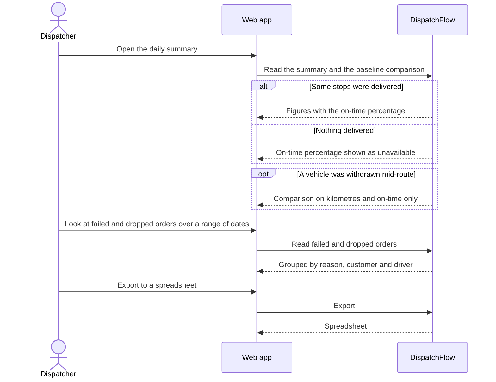

### Rows exercised

FR-38 to FR-40, FR-106, FR-107, FR-161, FR-264, FR-265, FR-266, FR-267, FR-268, FR-269, FR-270,
FR-271, FR-339, FR-340, FR-341, FR-342, FR-362, FR-370, BR-129

## UC-13: Compare the solvers

| | |
|---|---|
| Actor | Team (research). An Admin exports a pilot day. |
| Client | None. The team runs the benchmark harness and the simulation from a configuration. |
| Trigger | The team wants to know how the DispatchFlow solver compares with OR-Tools. |
| Preconditions | The configuration, the instances and the seeds are in place. |
| Outcome | The team holds the results of the static and re-optimization studies, each traceable to the run that made it. |

### Main flow

1. The team prepares its inputs: the Solomon instances, the larger Gehring-Homberger instances, a
   synthetic order generator that builds realistic days from real Israeli addresses, and the pilot's
   real days once the pilot provides them. (FR-43, FR-275, FR-45, FR-276)
2. An Admin can export a pilot day as a pseudonymized benchmark instance that both solvers and PyVRP
   read. The export is audited, and the exported instance stays outside the repository. (FR-168,
   FR-289, FR-290)
3. The team runs the benchmark harness from a configuration. It runs OR-Tools and the DispatchFlow
   solver, which sits behind the same solver interface, and PyVRP as a reference. Both solvers get
   the same time limit on the same hardware. The harness runs offline, never in CI. None of this
   reaches the product: no product capability depends on the DispatchFlow solver, only the harness
   uses PyVRP, and solver logging is off in the product. (FR-42, FR-272, FR-51, FR-278, FR-275,
   FR-274, FR-286, FR-287)
4. The scaling study reports solve time and solution quality at several stop counts, each run
   repeated. (FR-44, FR-406)
5. In the static study, the shared objective scores each result once the validator accepts it, with
   no fixed vehicle cost and no buffer. Each solver runs repeatedly, one at a time on an otherwise
   idle machine, and its result is the mean. The Gehring-Homberger and PyVRP runs keep the same
   limit and repeat count. (FR-279, NFR-110, NFR-111, NFR-242)
6. The harness reports the gap from best-known solutions where they are published, the DispatchFlow
   solver's gap from OR-Tools, and the solve time. The gap on an instance is the difference as a
   share of OR-Tools' result, and the average gap is the mean over the instances that are not left
   out. (FR-277, NFR-112, NFR-24)
7. The team runs the disruption simulation. It replays a real or synthetic day with injected delays,
   breakdowns and new orders, generated from a recorded seed. It can also inject cancellations,
   unavailable drivers, changed time windows and late driver reports. (FR-46, FR-167)
8. For each re-optimization, the simulation runs OR-Tools warm-started from the current routes and
   the DispatchFlow solver repairing them, destroying and reinserting stops around the disruption,
   at the same set of time limits. It measures each solver's objective, route stability, elapsed
   time and whether the new orders were served. (FR-273, FR-280, FR-281, NFR-25)
9. The study's insertions are new orders added to seeded synthetic plans. Each insertion's time is
   drawn from the seed, and each is made on its own, into the same solved plan. Both solvers are
   also run at other limits, and the limit covers receiving the problem to returning the validated
   solution. (NFR-182, NFR-244, NFR-245, NFR-246, NFR-120, NFR-119)
10. Only insertions for which OR-Tools, solving the whole day from scratch, serves the new order are
    counted. The study counts the others and reports their number. The DispatchFlow solver must
    return a validated solution that serves the new order, and be on average no worse than OR-Tools
    within a margin. (NFR-118, NFR-243, NFR-116, NFR-117)
11. The team analyses the results. Solver comparisons report per-instance paired results with a
    one-sided Wilcoxon signed-rank test of non-inferiority and a rank-biserial effect size, at a
    significance level fixed before the study. The team can log the DispatchFlow solver's iterations
    and run it with single operators removed or weights fixed, to measure each part's contribution.
    (FR-165, FR-288, FR-163, FR-164)
12. Every result is traceable to the commit, configuration, seeds, hardware description and solver
    versions that produced it. Results are kept beside the configuration that made them, except
    those derived from pilot data. The whole study reruns from one command. (NFR-62, NFR-115,
    NFR-122, NFR-121)

### Alternatives and failures

- **5a.** A run the validator rejects is reported. The static-quality target is met only if every
  run of the DispatchFlow solver returns a solution the validator accepts. (NFR-113)
- **5b.** An OR-Tools run fails or is rejected on an instance. The study reports it and leaves the
  instance out of the mean. (NFR-114)
- **8a.** OR-Tools did not start from the current routes in a simulation run. The study reports the
  run and does not count it as warm-started. (FR-282)
- **12a.** The study crashes. When it is run again it resumes, and the runner skips the results it
  already has. (NFR-247)

### Sequence

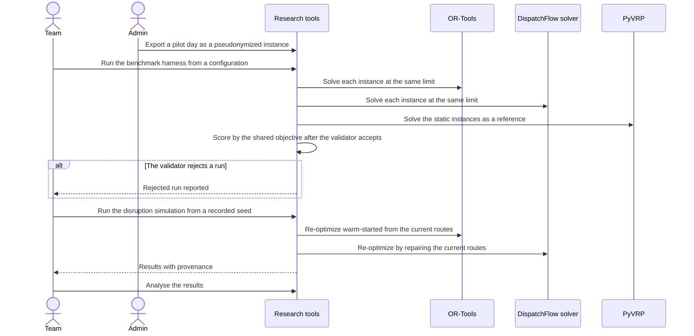

### Rows exercised

FR-42 to FR-46, FR-51, FR-163 to FR-165, FR-167, FR-168, NFR-24, NFR-25, NFR-62, FR-272, FR-273,
FR-274, FR-275, FR-276, FR-277, FR-278, FR-279, FR-280, FR-281, FR-282, FR-286, FR-287, FR-288,
FR-289, FR-290, NFR-110, NFR-111, NFR-112, NFR-113, NFR-114, NFR-115, NFR-116, NFR-117, NFR-118,
NFR-119, NFR-120, NFR-121, NFR-122, NFR-182, FR-406, NFR-242, NFR-243, NFR-244, NFR-245, NFR-246,
NFR-247

## UC-14: Know when the delivery comes, and rate it

| | |
|---|---|
| Actor | Recipient. An Admin turns the messages on, and a Dispatcher receives the alerts. |
| Client | SMS. The Admin uses the web app or the phone app. |
| Trigger | A route starts. |
| Preconditions | Messages to recipients are on, and the stop's phone is a valid Israeli mobile number. |
| Outcome | The recipient was told when the delivery comes and what became of it, and may have rated it. |

### Main flow

1. An Admin turns messages to recipients on, and the rating question on if wanted. Both start off.
   DispatchFlow checks phones when they are entered or imported and stores them in international
   form. A message goes to the order's recipient phone when it has one, otherwise to the customer's
   contact phone. (FR-350, FR-375, FR-377, FR-348)
2. When a route starts, the recipient of each of its stops gets an "out for delivery" message with
   the stop's projected arrival, rounded, as a window. A stop that joins a route in progress, such
   as a new order or a put-back, gets the message when it joins. (FR-351, FR-372)
3. Each message goes by SMS through the SMS provider from a two-way virtual number. It starts with
   the company's name, is written in the company's default interface language and has fixed wording
   for its type. With a company name and a dispatch phone within their limits, every message fits
   one SMS. (FR-49, FR-349, FR-382)
4. The projected arrival carries the route's observed delay. It is the actual time of the route's
   latest event minus that event's planned time. (FR-383)
5. When the projected arrival comes within the lead time of the "arriving in about 15 minutes"
   message, the route is in progress and the stop before it, if any, has an outcome, the recipient
   gets that message. (FR-352)
6. When a stop's first outcome is *delivered*, the recipient gets a message that confirms it, says
   whether it was left at the door and, while the rating question is on, asks for a rating from 1
   to 10. A dispatcher's record sends the same message as a driver's report. A later correction
   sends none. (FR-356, FR-374)
7. The recipient replies with a rating. A reply within the reply window of the rating request rates
   that delivery, and only the first rating counts. A rating is a whole number from 1 to 10 at the
   start of the reply. A reply answers the latest rating request sent to its phone. (FR-357, FR-376,
   FR-371)
8. The recipient gets one thank-you message. Later replies about that delivery get no answer.
   (FR-358)
9. The daily summary shows the average rating and the share of rating requests answered. Ratings
   appear in no per-route or per-driver figure until the open legal question is answered. (FR-362,
   FR-381)
10. DispatchFlow keeps messages, replies and comments as personal data under the retention rules,
    and keeps each day's average rating and share answered. (NFR-193)

### Alternatives and failures

- **1a.** Messages are off. DispatchFlow sends none, and reads replies either way. (FR-350)
- **1b.** The phone is not an Israeli mobile number. The stop gets no message, and the dispatcher
  sees why. (FR-378)
- **2a.** The stop is *arrived* or has an outcome. It gets none of the out-for-delivery, arriving,
  time-changed or order-change messages. (FR-373)
- **5a.** The time changes. Once the route has started, the recipient gets a "time changed" message
  whenever the projected arrival moves enough from the arrival last sent, with a new window. A stop
  gets a limited number of them. (FR-353, FR-384)
- **5b.** The order is dropped, moved to another date or cancelled after the route has started. The
  recipient gets a message. (FR-354)
- **6a.** The stop fails. The recipient gets a "missed you" message with the company's dispatch
  phone, and not the failure reason. (FR-355)
- **7a.** A reply is not a rating. The first such reply within the reply window gets one message
  repeating the format, and later ones get no answer. DispatchFlow keeps each reply other than a
  bare rating or an opt-out as a comment that Admins and Dispatchers can read. A comment is kept as
  plain text of limited length, shown escaped and exported with spreadsheet formula characters
  neutralized. (FR-359, FR-360, NFR-203)
- **7b.** A low rating alerts the dispatcher, as an at-risk stop does, and appears in the alert
  list. (FR-361)
- **7c.** A reply comes from a phone with no recent rating request. It gets no answer and is not
  kept, except an opt-out. (FR-379)
- **7d.** The recipient opts out. A reply whose first word is one of the opt-out words opts the
  phone out. No further messages go to it, and a phone messaged in the reply window gets one
  confirmation. A dispatcher sees the opt-out on the customer or order and, at the person's own
  request by phone, can record or remove it, noting who did it and when. DispatchFlow keeps the
  opt-out as a keyed hash of the phone. (FR-363, FR-380, NFR-202)
- **7e.** A call that claims to come from the SMS provider is not signed. DispatchFlow refuses it
  and changes nothing. A call received twice takes effect once, calls are rate limited, and
  DispatchFlow confirms a call only after storing what it carries, so the provider sends a failed
  one again. (NFR-192, NFR-199, NFR-200, NFR-201)
- **7f.** A send is repeated by a trigger that fires twice. Each message, identified by its stop,
  its type and how many "time changed" messages came before, is sent at most once. (NFR-191)
- **10a.** The SMS provider cannot be reached or does not answer. Every other function keeps working
  without waiting for it. A message the provider has not accepted within the time limit is dropped,
  and the number dropped is measured. A send whose outcome is unknown is sent again only if the
  provider drops repeats by a reference DispatchFlow gives, and otherwise counts as dropped.
  (NFR-189, NFR-190, NFR-198)
- **10b.** The company reaches the daily cap. Sending stops until midnight. The team is alerted when
  sending stops at the cap, or when too many of a day's messages are dropped. (NFR-196, NFR-197)

### Sequence

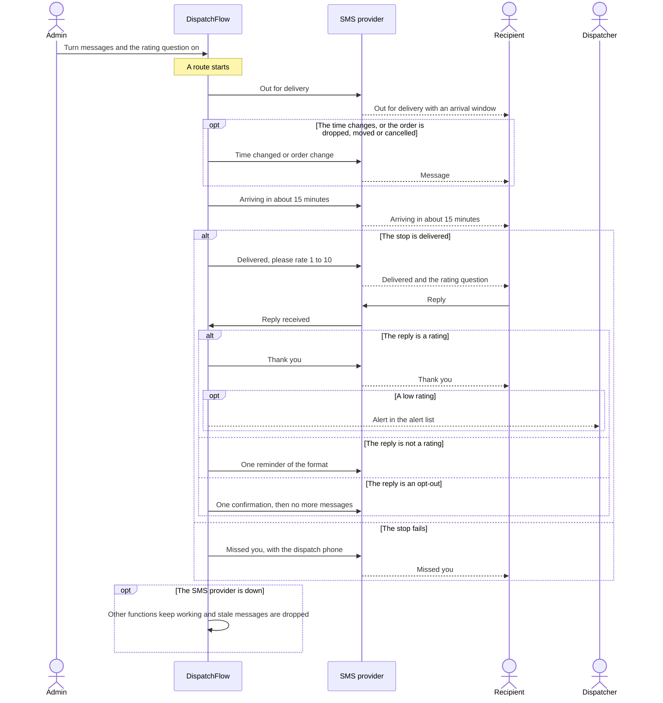

### Rows exercised

FR-49, FR-348 to FR-363, FR-371 to FR-384, NFR-189 to NFR-193, NFR-196 to NFR-203

## Gaps

Rows that no use case cites, and that describe something a person does. They may still be built and
tested, but no use case, and so no usability session or end-to-end test, is anchored on them. The
owner decides which of them, if any, need a use case. This file proposes none.

The table's last column says whether [ADR-090](../ADRs/ADR-090-scope-cuts-for-the-first-release.md)
cuts the row. No row below is cut. Three are named there as the stand-in for a cut capability, and
the column says so.

### Company, users and roles

| ID | Priority | What | Cut by ADR-090? |
|---|---|---|---|
| FR-187 | Must | End every session of a user without deactivating them | No |
| FR-387 | Must | Change a user's email | No |
| FR-388 | Must | Confirm a new email by a link sent to it | No |
| FR-77 | Should | Accept the terms and a privacy notice | No |
| FR-124 | Should | Choose the interface language | No |
| FR-176 | Should | See what each app collects about a driver | No |
| FR-181 | Should | A language choice follows the user to every device | No |
| FR-182 | Should | A new user starts with the company's language | No |
| FR-126 | Could | View the company's audit records | No |
| FR-127 | Could | See and end one's own sessions | No |
| FR-128 | Could | Require a second sign-in factor for Admins | No |

### Fleet, depots and shifts

| ID | Priority | What | Cut by ADR-090? |
|---|---|---|---|
| FR-81 | Should | Reserve time for driver breaks | No. ADR-090 names the break default (BR-105) as the stand-in for driver-hours records. |
| FR-80 | Could | A working calendar of holidays and short Fridays | No |
| FR-114 | Could | Shifts and windows that cross midnight | No |
| FR-133 | Could | Per-vehicle limits on duration, distance and stops | No |
| FR-169 | Could | Start or end a route at a driver's chosen address | No |

### Customers and orders

| ID | Priority | What | Cut by ADR-090? |
|---|---|---|---|
| FR-86 | Should | Floor, apartment and entrance code on an order | No |
| FR-87 | Should | Recipient name and phone on an order | No |
| FR-135 | Should | A delivery note on an order | No |
| FR-137 | Should | See an order's history | No |
| FR-88 | Could | Standing orders that recur on weekdays | No |
| FR-89 | Could | A default service duration per customer | No |
| FR-110 | Could | Pick-up and delivery jobs | No |
| FR-113 | Could | Several time windows on an order | No |
| FR-116 | Could | Order intake through an API | No. ADR-090 names it as the way orders come instead of orders from end customers. |
| FR-136 | Could | A package count on an order | No |

### Daily planning

| ID | Priority | What | Cut by ADR-090? |
|---|---|---|---|
| FR-92 | Should | A warning before solving over manual edits | No |
| FR-93 | Could | Compare two solves side by side | No |
| FR-94 | Could | A solve that spreads the workload evenly | No |
| FR-111 | Could | More than one trip a day for a vehicle | No |
| FR-112 | Could | An order that needs a vehicle or driver attribute | No. ADR-090 names it as the stand-in for cargo temperature. |
| FR-118 | Could | Road limits by vehicle type | No |
| FR-119 | Could | Plan across several days | No |

### Dispatcher views, and publishing and the phone app

| ID | Priority | What | Cut by ADR-090? |
|---|---|---|---|
| FR-120 | Must | Admins and Dispatchers do everything in the phone app | No |
| FR-391 | Must | The web app alerts a driver to a route change or a new route | No |
| FR-98 | Could | Scan a barcode at loading and delivery | No |
| FR-99 | Could | Record an age or ID check at delivery | No |
| FR-100 | Could | Messages between a dispatcher and a driver | No |
| FR-115 | Could | A partial delivery or a return of goods | No |
| FR-121 | Could | Arabic and Russian driver screens | No |

### Live operations and re-optimization

| ID | Priority | What | Cut by ADR-090? |
|---|---|---|---|
| FR-105 | Must | View a stop's proof of delivery | No |
| FR-76 | Should | See every order of a date with its state | No |
| FR-104 | Should | The history of accepted re-optimizations | No |
| FR-259 | Should | Find an order by customer name or phone | No |
| FR-117 | Could | A live tracking page for a customer | No |
| FR-160 | Could | Replay a past day on the map | No |

### Reporting and baseline

| ID | Priority | What | Cut by ADR-090? |
|---|---|---|---|
| FR-41 | Could | A trends dashboard across days | No |
| FR-108 | Could | Savings in money | No |
| FR-109 | Could | A report per driver | No |
| FR-162 | Could | The record of every solve and re-optimization | No |

### Research and evaluation

| ID | Priority | What | Cut by ADR-090? |
|---|---|---|---|
| FR-47 | Must | Run a pilot at the company | No |
| FR-283 | Must | Collect and write up the company's feedback | No |
| FR-407 | Must | A staged pilot when no company is confirmed | No |
| FR-48 | Should | A usability study with task-based sessions | No |
| FR-284 | Should | Driver feedback on route stability | No |
| FR-285 | Should | Usability results feed UI iterations | No |
| FR-343 | Should | Report the SUS score with no pass mark | No |
| FR-344 | Should | Sessions with stand-ins until the company's dispatcher is available | No |

### Rules that attach to a process

These uncited FR rows state a rule of a process rather than a step: FR-188, FR-392, FR-409 and
FR-411 (sessions, tokens and audit around sign-in and email change), FR-408 (bucket boundaries),
FR-229 (the objective of a spread-workload solve), FR-201 and FR-202 (vehicle-limit drops and
violations), FR-308 (visibility of a driver's home address), FR-214 (a credential for an outside
system that sends orders), FR-262 and FR-263 (the replay audit and the tracking-page link), FR-390
(benchmark demands read as weights) and FR-410 (a staged pilot's personal data). Each follows the
capability it qualifies.

### Business rules

Most uncited BR rows are cross-cutting rules that every use case lives under: access, routing
constraints, the objective, validation, the plan lifecycle, re-optimization conventions, time and
limits, and the order states. They need no use case of their own.

These look like steps of a process that no use case describes:

- Late and held driver reports, where a dispatcher confirms or refuses a report that arrives after
  the plan moved on: BR-27, BR-88, BR-89, BR-90, BR-110, BR-130, BR-132, BR-133, BR-134, BR-135 and
  BR-136.
- Driver steps and outcomes: BR-18 (outcomes are final for drivers), BR-29 (stops done out of order)
  and BR-109 (the failure reasons).
- How an order leaves *failed* or *dropped*: BR-94, BR-95 and BR-96.
- Solving again and failed solves: BR-59 and BR-60. Plans completing at midnight: BR-102.
- Two dispatchers at once: BR-38 (one re-optimization at a time) and BR-76 (no silent overwrite).
- A customer's address change, which clears a hand-corrected location after a warning: BR-104.
- Past dates: BR-116 (orders) and BR-118 (plans).
- Limit refusals: BR-36 (vehicles), BR-101 and BR-113 (orders).
- Personal-data removal and company exit: BR-98 and BR-99.

## Discrepancies

Each item is a mismatch between a UC row and a row it cites, or a gap in what the UC row cites.
requirements.md is unchanged. The owner decides which to fix there.

### Words not used

- UC-04's own row says "check geocoded pins; fix a bad pin by dragging it". The language says
  *location*, so this file writes it so. Cited rows also use "pin" for a location: FR-14, FR-64,
  FR-130, FR-215, FR-217, FR-218, FR-237, FR-311 and FR-325.
- Cited rows use "flag" for a plan's violation: FR-196, FR-233, FR-234, FR-304, FR-306, FR-315 and
  BR-17. *Address flag* is a different thing and stays.

### Rows that conflict, or do not fit

- UC-01 and UC-02: FR-346 is an explicit exception to FR-174 and BR-19, which UC-02 states as "the
  last two Admins cannot be demoted". UC-01 cites the exception and UC-02 the rule, so neither shows
  both.
- UC-03: the row's alternative "A vehicle breaks or a driver falls sick during the day" is backed by
  none of the rows it cites. FR-07, FR-82 and FR-300 are cited by UC-10, and FR-301 (a vehicle out
  of service before the day starts) is cited there too, though it fits UC-03.
- UC-05: the row says "Import a CSV" but cites the Excel rows FR-138, FR-213 and FR-319.
- UC-06: FR-239 qualifies FR-92 (warning before solving over edits), and UC-06 does not cite FR-92.
  It also cites rows that are solver internals, not user steps: FR-224, FR-322, FR-400, FR-401,
  FR-402 and BR-126. FR-408 (bucket boundaries) and FR-201 (drops for a vehicle limit), which its
  cited rows point to, are uncited.
- UC-07: BR-64 and BR-65 are about accepting a re-optimization, which is UC-10's step, but only
  UC-07 cites them.
- UC-08: FR-324 refers to FR-152 (drivers alerted on publishing), which UC-08 does not list. FR-105
  (a dispatcher views a stop's proof) and FR-391 (the web app alerts a driver) are uncited. The
  rules for driver reports that its steps exercise are uncited: BR-11, BR-18, BR-28, BR-29, BR-44,
  BR-87, BR-109 and BR-114.
- UC-09: FR-157 names late and refused reports (BR-89, BR-90), but no use case cites those rows or
  describes how those reports arise.
- UC-10: acceptance is its step, but BR-64 and BR-65 sit in UC-07. Rules its flow depends on are
  uncited: BR-10 (locked stops), BR-106 (goods stay on their vehicle, which FR-334 points to),
  BR-107 (late stops), BR-79, BR-24, BR-80 and BR-81 (start points and usable positions) and BR-38
  (one re-optimization at a time). FR-267 (a withdrawn vehicle) is a result of re-optimization but
  only UC-12 cites it.
- UC-11: the row's main flow says "Hand a route to another driver, or cancel an order", but it cites
  FR-73, FR-257, FR-333 and FR-404, which record and correct outcomes. FR-404 refers to FR-258
  (put-back), which only UC-10 cites.
- UC-12: it cites FR-362 (ratings in the summary) but not FR-381 (ratings in no per-route or
  per-driver figure), which only UC-14 cites. BR-102 (plans complete at midnight, which BR-129
  relies on) is uncited, and so is FR-41 (trends), which FR-338 refers to.
- UC-13: the actor is "Team (research)", but FR-168 says an Admin exports a pilot day. FR-390 is
  uncited, and so are BR-09, BR-15, BR-56, BR-10 and BR-106, which its cited rows rely on.
- UC-14: FR-348 sends a message to the order's recipient phone, defined by FR-87, which no use case
  cites. FR-383 (observed delay) is cited here and by UC-09 but is not about messages.

### Rows a step needs that the UC does not list

- UC-01 and UC-02: no cited row defines a failed sign-in or its attempt limit. FR-177 mentions the
  sign-in limits NFR-35 and NFR-216, and neither UC cites them.
- UC-02: FR-52 and FR-177 mention changing an email, but the rows that define it (FR-387, FR-388,
  FR-392, FR-411) are uncited, so no use case covers it.
- UC-04: BR-13 (hand-corrected locations win) and BR-104 (an address change clears a hand-corrected
  location) are uncited, though steps 8 and 9 depend on them.
- UC-05: BR-97 (invalid orders refused with their reason), BR-116 (no past dates), BR-35 (valid
  windows) and BR-101 and BR-113 (the order limit) are uncited, though the import and the form
  enforce them.
- UC-06: BR-12, BR-59 and BR-60 (the plan lifecycle, a failed solve and solving again) are uncited,
  though steps 4 and 11 follow them.
- UC-01: FR-184 and FR-185 apply only "where built", and the rows they wait on (FR-89, FR-108) are
  uncited Could rows.

### Open questions the cited rows lean on

- UC-14's rows rely on Q-95 (consent for messages), Q-96 (which SMS provider) and Q-42 (legal advice
  on personal data). The flow can change when they are answered.
- UC-04 relies on Q-02 (geocoding provider) and UC-06 on Q-20 (travel-time buckets and factors).

### TODO left in this file

- UC-01, 3a: how a person who never set a password gets a new link. The cited rows do not say.
